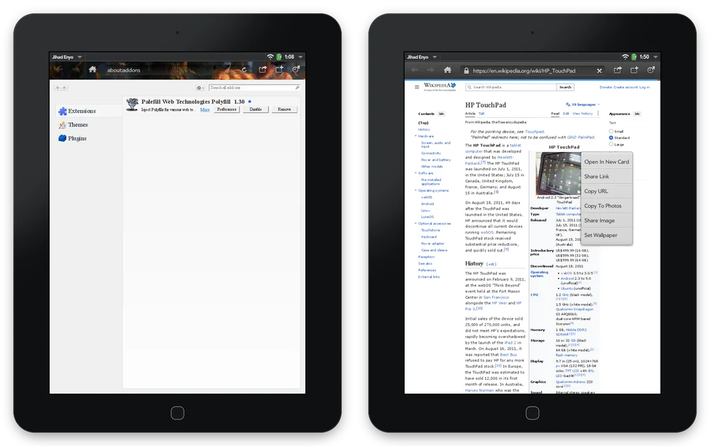

  

<h1 align="center">Jihad Browser</h1>

  <b>The whole web, back on your TouchPad.</b> 
  For HP TouchPad &nbsp;·&nbsp; webOS 3.0.5 and webOS CE 3.1.0 &nbsp;·&nbsp; Free &nbsp;·&nbsp; Open source

<em>Goanna inside, webOS alive, inshallah.</em>

  

---

## Hello again, webOS

Remember the first time you flicked a card off the top of the screen? The TouchPad shipped in July
2011 with cards, Synergy, Just Type and a browser that promised the *whole* web, Flash included.
Forty-nine days later HP announced it was discontinuing it. Since then the web has moved on and
webOS has stayed where HP left it.

webOS never really went away, though. webOS Internals, Preware, PivotCE, webOS Ports, the webOS
Archive and its App Museum, Herrie82's TLS work and the new webOS CE 3.1.0 have kept the platform
going. Jihad Browser is our part of that effort. It puts a modern web engine, **Goanna** (the UXP
engine behind Pale Moon), under the webOS browser you already know. It does a few things no webOS
browser has done before, and it installs **next to** the stock browser without changing anything
else on your TouchPad.

<table>
<tr><td><b>Version</b></td><td>1.0 (Jihad Enyo 1.0.4, Jihad Mochi 1.0.0, Jihad Mojo 1.0.0)</td></tr>
<tr><td><b>Requires</b></td><td>HP TouchPad with webOS 3.0.5 or webOS CE 3.1.0, or HP TouchPad Go with webOS 3.0.5</td></tr>
<tr><td><b>Engine</b></td><td>Goanna 6.9 (UXP), with its own NSS for TLS 1.2 and 1.3</td></tr>
<tr><td><b>Flash</b></td><td>The Adobe Flash Player 10.3 already on your TouchPad</td></tr>
<tr><td><b>Price</b></td><td>Free, under Apache-2.0 and MPL-2.0</td></tr>
</table>

---

## What's new for your TouchPad

### Personas: give your browser a look of its own

  

addons.mozilla.org still carries thousands of themes, and the old **personas** galleries are still
around. Jihad wears them.

- **Tap Add on a theme site.** Personas made for Firefox 52, Pale Moon and Basilisk install with one
  confirmation. So do the **static themes from addons.mozilla.org**, which is where most of
  the old personas live today.
- **The whole browser changes.** The theme paints the toolbar in Enyo and Mochi and the round buttons
  in Mojo. A light theme automatically gets dark icons so they stay readable.
- **Switch or remove themes** in `about:addons` → Themes, or in Settings → Appearance. Each interface
  keeps its own theme, so your three cards can each have a different look.

  

### Flash, as HP promised

HP sold the TouchPad as the tablet that showed you the *real* web, Flash and all. The stock browser
still has Flash but can no longer open most modern sites. The other modern browsers you can put on a
TouchPad today run engines that dropped plug-ins years ago. **Jihad runs both the modern web and
Flash in the same page.**

- **Your TouchPad's own Flash Player 10.3** plays animation and sound, and takes touch and keyboard
  input.
- **Built for games.** Flash runs in its own process, so a crashing movie can't take the browser with
  it. The movie keeps its own frame clock, and the CPU is boosted while it plays.
- **Classic Flash games work.** Bloxorz, from the Internet Archive's Flash collection, runs straight
  from archive.org.

 

### Real add-ons, right from a web page

Jihad installs classic **XPI add-ons** from a web page, the way desktop browsers did in 2011.
Enable, disable and remove them in `about:addons`. They stay installed across restarts, and each
interface has its own set.

**Palefill** comes pre-installed. It's a polyfill that fills in web features the engine lacks, so more
of today's sites work. It is shipped unmodified, under its own licence.

  

### Make it yours

Jihad has a full **Settings** page with more than 55 options in six panes: Browser, General, Content, Privacy,
Security and Advanced. There's also an **About** pane. You can set your home page and search engine,
the start-page links, Do Not Track, cookies, history and saved form entries, referrer rules,
smooth scrolling and the frame-rate cap.

For anything Settings doesn't cover, there's **`about:config`**. It lists every preference the
Goanna engine has, and you can search and change them all.

  

### The web of today

The stock webOS 3 browser uses a WebKit from 2011. Jihad uses Goanna, from the UXP platform that
still powers Pale Moon, so it handles today's HTML, CSS and JavaScript, and Palefill covers more on
top. Measured
on a TouchPad:

- **Acid3: 99/100**
- **html5test.co: 450 of 588 points**

  

### And the everyday things

- **Long-press menus** on links, images, text fields and the page itself. Open a link in a new card,
  share a link or an image, copy, select all, find on page, or save a picture to Photos.
- **Print to the printer you own.** webOS only ever printed to a few HP models. Jihad finds **IPP and
  AirPrint printers** on your network, or uses an address you type, and prints the page exactly as
  it appears.
- **Privacy by default.** Search and the home button go to **DuckDuckGo Lite**. You can switch to
  DuckDuckGo HTML, DuckDuckGo, Google or Wikipedia. Jihad honours `rel=noreferrer` and each page's
  referrer policy, and Do Not Track is one switch away in Settings.
- **Three interfaces.** Pick the classic **Enyo** browser, the newer **Enyo 2 / Mochi** design, or the
  lightweight **Mojo** shell from the Pre era. Each is its own app, so you can install one, two or all
  three.

  
  &nbsp;
  

---

## A word about HTTPS on webOS

If your TouchPad's browser shows "secure connection failed" on almost every site, here's why.

**Every webOS release shipped with a 2009 copy of OpenSSL.** webOS 1.4.5 has 0.9.8j. webOS 2.x and
3.0.5 have 0.9.8k. The stock browser, the apps' WebKit, Mail and the download manager all rely on it.
On 3.0.5 the browser and the apps reach it through libcurl 7.21.7. That OpenSSL speaks nothing newer
than **TLS 1.0**. It has no AES-GCM or SHA-256 cipher suites. The 3.0.5 certificate store has 212
roots, the newest from January 2010, and **ISRG Root X1**, the root behind Let's Encrypt, is not among
them. TLS 1.1 and 1.2 only reached OpenSSL in March 2012, after webOS development had stopped.

The breakage came in stages:

| When | What broke |
|---|---|
| 2014–2015 | Mail. Servers moved to SHA-256 certificates, which stock 0.9.8 doesn't load by default. |
| 2018 | GitHub turned off TLS 1.0 and 1.1 in February. The PCI DSS deadline in June made card payments drop TLS 1.0. |
| 2020 | Apple, Google, Microsoft and Mozilla dropped TLS 1.0/1.1 from their browsers, so servers had little reason to keep them. |
| 2021–2024 | Let's Encrypt's old root, DST Root CA X3, expired in September 2021. Since 2024 its sites chain only to ISRG Root X1. |

**The community kept finding ways around it:**

| Fix | Who | What it changes | Runs on |
|---|---|---|---|
| OpenSSL-Updater | tgaillar, webOS Internals (2015) | System OpenSSL to 0.9.8zg. Fixes SHA-256 certificates; still TLS 1.0. | 2.x, 3.x |
| Root Certs Update | frantid (2015); Herrie82 (2025) | Certificates only: Mozilla's current list, including ISRG Root X1. | All |
| HTTP mirrors | webOS Archive, App Museum II, Nomad84's feeds | No TLS needed: apps and feeds served over plain HTTP. | All |
| SSL-bump proxies | nizovn (Squid), webOS Archive Proxy, WebOne | Re-encrypt traffic for the device. That works, but it weakens the security TLS is there for. | 2.2.4+ |
| QupZilla / Qt WebBrowser | nizovn (2018) | A separate Qt 5 browser with its own OpenSSL 1.0.2. | TouchPad, Pre 3 |
| **TLS 1.3 Updates** | Herrie82, packaged by webOS Archive (2026) | A private OpenSSL 1.1.1w and curl 7.88.1 for the browser, app WebKit, Mail and downloads. The system's 0.9.8 is left alone. | 3.0.5 TouchPad and Go; 2.2.4 Pre 3 |
| **webOS CE 3.1.0** | codepoet80 and webOS Archive (Sept 2026) | HP's 3.0.5 with those 1.1.1w stacks and 190 current Mozilla roots built in. | TouchPad (Wi-Fi and 4G) |

**Where Jihad fits.** Jihad doesn't use the device's OpenSSL at all. Goanna brings its own **NSS 3.90**
with Mozilla's built-in root list, and every page's TLS is handled inside the browser. So HTTPS in
Jihad works the same on a stock 3.0.5 TouchPad as it does on CE 3.1.0. Tested on the device,
howsmyssl.com reports **TLS 1.3**. The padlock opens the site's certificate, and if a certificate
isn't trusted, Jihad shows it to you and lets you decide.

What Jihad *doesn't* fix: everything else. The stock browser, Mail and the download manager still
use the device's own TLS. That's TLS 1.0 on a stock TouchPad, or the 1.1.1w stacks if you've
installed the TLS 1.3 Updates or CE. Enterprise Wi-Fi, the App Catalog and other system services
stay on the 2009 OpenSSL either way. Certificate checks also need the right
date, so keep your clock set (or turn on network time). For the rest of your TouchPad, see the
[webOS Archive guide to modern TLS](https://docs.webosarchive.org/site/modern-tls/).

 

Sources

- OpenSSL versions per release: [tgaillar/OpenSSL-Updater wiki](https://github.com/tgaillar/OpenSSL-Updater/wiki); the 3.0.5
  store and libraries were also checked against HP's own 3.0.5 Doctor image.
- TLS 1.1/1.2 in OpenSSL 1.0.1, 14 March 2012: [OpenSSL 1.0.1 NEWS](https://github.com/openssl/openssl/blob/OpenSSL_1_0_1-stable/NEWS)
- [Herrie82/OpenSSL-legacyWebOS](https://github.com/Herrie82/OpenSSL-legacyWebOS) ·
  [Herrie82/webOS-rootcerts](https://github.com/Herrie82/webOS-rootcerts) ·
  [webOS Archive: modern TLS](https://docs.webosarchive.org/site/modern-tls/) ·
  [webOS Archive: browsers](https://docs.webosarchive.org/site/browsers/) ·
  [webOS Archive: getting online](https://docs.webosarchive.org/site/online/)
- [webOS CE 3.1.0 release notes](https://github.com/webOSArchive/webOS-Community-Edition/releases/tag/3.1.0-CE-Release)
- [GitHub drops TLS 1.0/1.1 (2018)](https://github.blog/news-insights/company-news/weak-cryptographic-standards-removed/) ·
  [PCI SSC, June 2018](https://blog.pcisecuritystandards.org/are-you-ready-for-30-june-2018-sayin-goodbye-to-ssl-early-tls) ·
  [Browsers retire TLS 1.0/1.1 in 2020](https://www.bleepingcomputer.com/news/security/tls-10-and-tls-11-being-retired-in-2020-by-all-major-browsers/) ·
  [RFC 8996](https://www.rfc-editor.org/rfc/rfc8996) ·
  [Let's Encrypt: DST Root CA X3 expiration](https://letsencrypt.org/docs/dst-root-ca-x3-expiration-september-2021/)
- Proxies: [squid-for-webos](https://github.com/webOSArchive/squid-for-webos) ·
  [com.nizovn.squid](https://gitlab.com/nizovn/com.nizovn.squid) · [WebOne](https://github.com/atauenis/webone)

---

## Tips & tricks

> **Tip:** Double-tap a paragraph to zoom in on it, and double-tap again to zoom back out. Pinch to zoom anywhere in between.

> **Tip:** Hold your finger on a link and choose **Open In New Card**. Your page stays where you left it.

> **Tip:** To play a Flash game with your finger, double-tap the movie. Your drags then go to the game
> instead of scrolling the page.

> **Tip:** Type `about:config` in the address bar to see every engine setting. If you don't want the
> warning page each time, turn it off in Settings → General.

> **Tip:** Want a different look in each card? Every interface keeps its own theme. Try a dark one in
> Mojo and a bright one in Enyo.

---

## Installing

Install the `.ipk` for the interface you want with **Preware** or **WebOS Quick Install**:

| Interface | Package | Looks like |
|---|---|---|
| **Jihad Enyo** | `net.riverstonerelay.jihad-browser` | The stock webOS 3 browser you know |
| **Jihad Mochi** | `net.riverstonerelay.jihad-browser-mochi` | A newer design built with Enyo 2 |
| **Jihad Mojo** | `net.riverstonerelay.jihad-browser-mojo` | Lightweight, with round buttons along the bottom |

Your TouchPad stays as it was. Each app runs entirely from its own folder and keeps its own engine
profile, add-ons, themes, history and bookmarks. Installing, updating or removing one never touches
another app or the stock browser, and nothing is written to your USB drive.

---

## Release notes and known issues

Jihad is usable every day on real TouchPads, and it is still being worked on. Here's what we know
about right now:

- **Frame rate is the TouchPad's.** The engine draws pages in software, and the card puts them on
  screen. Flash runs at its own pace, about 27 fps for a 30 fps movie, evenly spaced. That limit comes
  from Flash on this CPU, not from the browser.
- **Double-tap zoom is slower than pinch.** The engine redraws the page at the new size, which takes
  about half a second to a second, and it sometimes zooms to a larger block than the paragraph you
  tapped.
- **Text in the Mochi interface** can look a little soft at some zoom levels.
- **Bluetooth keyboards with Flash games** are wired up but haven't been tried with a real keyboard
  yet. webOS 3 can pair a keyboard but not a mouse, so your finger is Flash's mouse.

Each feature's detailed status is kept with its requirements in `context/kits/`, which is the
single source of truth. Work in progress is tracked in `docs/PICKUP.md`.

---

## Under the hood

Jihad keeps isis-browser's client–server design, and the **YAP IPC contract is byte-for-byte
unchanged**. The UI talks to a `BrowserAdapter` NPAPI plugin in the card. The plugin talks to a
headless render daemon over YAP, with a shared-memory framebuffer. Only the daemon's rendering
backend changed: QtWebKit out, Goanna in.

| Path | Contents |
|---|---|
| `app/`, `app-mochi/`, `app-mojo/` | The three UI shells (Apache-2.0) |
| `render/browserserver/` | The engine-agnostic daemon and the YAP IPC (Apache-2.0) |
| `render/goanna/` | The Goanna backend and its XPCOM components (MPL-2.0) |
| `render/adapter/` | The BrowserAdapter NPAPI plugin the cards host (Apache-2.0) |
| `packaging/prefsui/` | The settings page (`about:settings`) |
| `third_party/uxp` | The engine: a submodule pinned to the `jihad-engine-mods` commit (pristine UXP plus our changes). The desktop build applies the same changes as patches in `build/desktop/patches/`. |
| `build/desktop/`, `build/webos-oe/` | The x86_64 and webOS ARMv7 build setup |
| `context/` | Cavekit kits (requirements) and the build site (plan) |
| `docs/` | Build, toolchain and IPC reference; `PICKUP.md` is the current handoff |

Building for the device: `docs/DEVICE-BUILD.md`. Engine notes: `docs/UXP.md`. The IPC contract:
`docs/IPC-CONTRACT.md`.

---

## Thank you

Jihad Browser builds on other people's work:

- **HP's isis-project**, the open-source webOS browser and render server this project forks.
- **The UXP platform and its Goanna engine**, and **Palefill**.
- **Herrie82 and Atlas Browser**, whose BrowserAdapter fixes we ported (see `NOTICE`), and whose TLS
  work keeps the rest of webOS online.
- **The webOS Archive** (codepoet80 and friends) for the App Museum, the docs and webOS CE 3.1.0.
- **webOS Internals, Preware, PivotCE and webOS Ports/LuneOS**, who never let webOS go.
- Everyone still carrying a TouchPad around in 2026. This is for you.

## Licensing

Jihad Browser combines **Apache-2.0** code (the UI, the adapter and the IPC daemon) with **MPL-2.0**
code (the Goanna backend and the engine). The two licences are compatible. Palefill is MPL-2.0 and
shipped unmodified. All Pale Moon, Basilisk and Moonchild trademarks are removed from the engine
build. Adobe Flash Player is your TouchPad's own plugin and is not distributed with Jihad. See
`LICENSE` and `NOTICE`.

Palm, webOS, Pre, TouchPad and Synergy are trademarks of their respective owners. Jihad Browser is
an independent community project. HP, Palm and LG did not make it, endorse it or support it.
Screenshots were taken on a real HP TouchPad. The theme gallery in the personas screenshot is a local
test page; the themes themselves are from addons.mozilla.org.

Made with love for webOS, in 2026, for a tablet from 2011.

