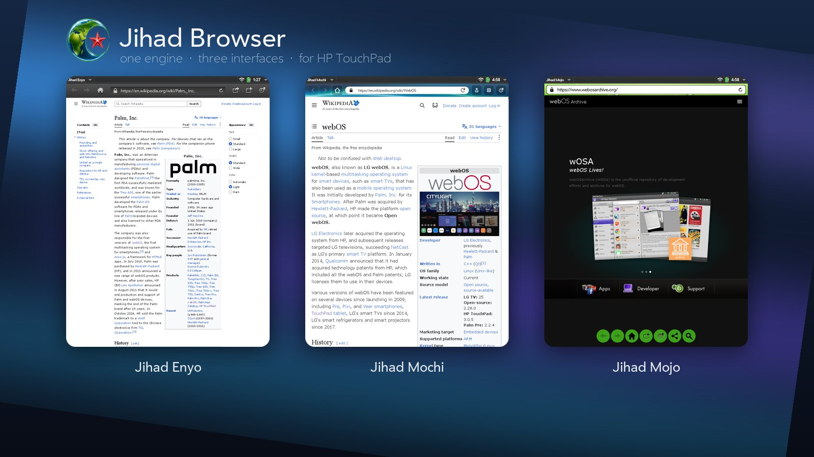
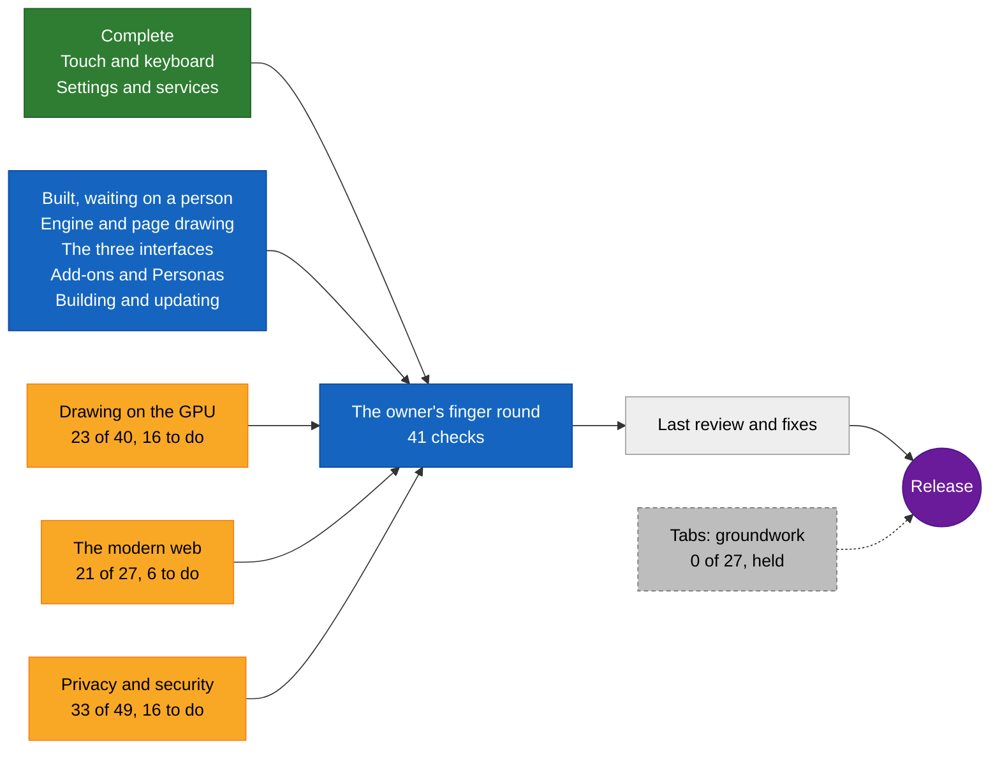
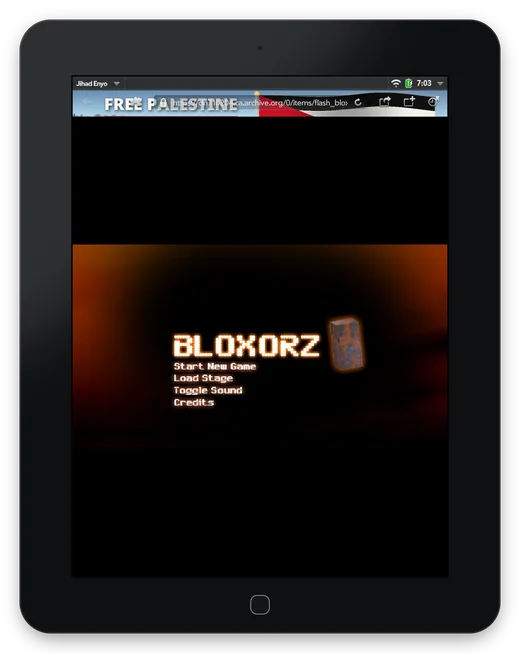
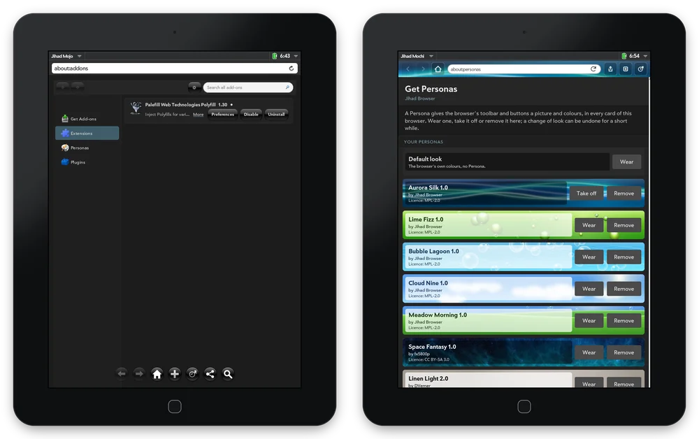
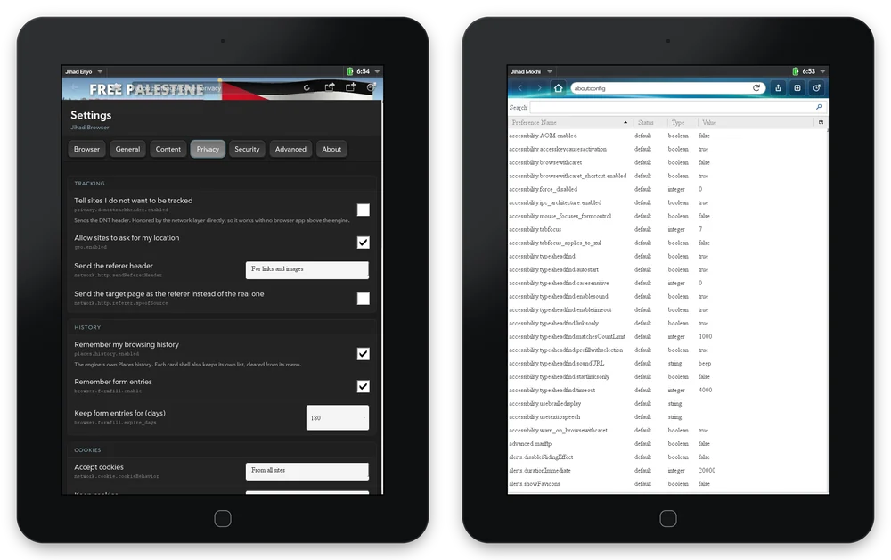
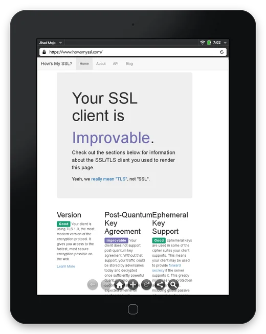

<p align="center">
  
</p>

<h1 align="center">Jihad Browser</h1>

<p align="center"><b>UXP inside, webOS alive, inshallah!</b></p>

<p align="center">
  
</p>

---

## What it is

Jihad Browser is the webOS browser with a different engine inside. The interfaces are the stock
browser's — Mojo, Enyo and the newer Mochi design — and under them runs **Goanna**, the engine of
the **UXP** platform that Pale Moon and Basilisk are built on, in place of the 2011 WebKit. So it is
one of the UXP browsers: it runs their engine, their XPI add-ons and their Personas, lays its
settings out in their panes, and has an add-on site of its own built on Phoebus, the software the
family's sites run.

It installs next to the stock browser and changes nothing else on the device. It is written for
webOS 3 as a whole, built for the TouchPad and TouchPad Go and tested on the TouchPad. It exists because people
kept webOS going long after 2011 — webOS Internals, Preware, PivotCE, webOS Ports, the webOS Archive,
Herrie82's TLS work, webOS CE 3.1.0 — and this is one more piece of that.

<table>
<tr><td><b>Version</b></td><td>1.0 (Jihad Mojo 1.0.0, Jihad Enyo 1.0.4, Jihad Mochi 1.0.0)</td></tr>
<tr><td><b>Runs on</b></td><td>webOS 3.0.5 and webOS CE 3.1.0, on the TouchPad and TouchPad Go</td></tr>
<tr><td><b>Engine</b></td><td>Goanna 6.9 (UXP), with its own NSS for TLS 1.2 and 1.3</td></tr>
<tr><td><b>Flash</b></td><td>The Flash Player 10.3 already on the device</td></tr>
<tr><td><b>Licence</b></td><td>Apache-2.0 and MPL-2.0 for Jihad's own code; the bundled libraries under their own licences (see <code>NOTICE</code>)</td></tr>
</table>

---

<!-- progress:start -->
## Where it stands

Counted from the project's own records: every part of the browser has a list of acceptance criteria, each one met only when it was shown working on a TouchPad (or, for the build, on a clean machine). What is left is either still to build or waits for a person: a finger on the device or the owner's decision. The road below runs to the first public release.

**Everything but tabs: `██████████████████░░` 685 of 730 criteria met (93 %).**

| Area | Progress | Met | Left | What it covers |
|---|---|---:|---|---|
| Engine and page drawing | `███████████████████░` 99 % | 104 / 105 | 1 for a person | Goanna inside the webOS card, frames to the card, the card's messages |
| Drawing on the GPU | `███████████░░░░░░░░░` 57 % | 23 / 40 | 16 to do, 1 for a person | the Adreno 220 composes the page; WebGL; pan and zoom speed |
| The modern web | `███████████████░░░░░` 77 % | 21 / 27 | 6 to do | today's sites: TLS, missing features filled in, video |
| The three interfaces | `███████████████████░` 98 % | 120 / 122 | 2 for a person | Enyo, Mochi and Mojo |
| Touch and keyboard | `████████████████████` 100 % | 39 / 39 | done | taps, gestures, the on-screen keyboard |
| Settings and services | `████████████████████` 100 % | 60 / 60 | done | the settings panes, downloads, history, printing |
| Add-ons and Personas | `███████████████████░` 98 % | 169 / 171 | 1 for a person, 1 with tabs | XPI add-ons, plugins, Personas, the add-on site |
| Privacy and security | `█████████████░░░░░░░` 67 % | 33 / 49 | 16 to do | the ad and tracker blocker, proxies, certificates |
| Building and updating | `███████████████████░` 99 % | 116 / 117 | 1 for a person | one repository builds every package; engine updates; licences |
| Tabs | `░░░░░░░░░░░░░░░░░░░░` 0 % | 0 / 27 | held | groundwork only, held by the owner's decision |
| The owner's finger round | `░░░░░░░░░░░░░░░░░░░░` 0 % | 0 / 41 | 41 for a person | the checks only a finger on the device can make |

### The road to release



Green is complete, amber still has work to do, blue waits for a person at the device (the finger tests are gathered into one round at the end), grey is not started or held. Whether tabs come before or after the release is the owner's call. Regenerated by `tools/readme-progress.py` from `context/kits/` and `docs/FINGER-TESTS.md`.
<!-- progress:end -->

---

## What it does

The stock browser opens little of today's web; Atlas Browser brings a current WebKit to webOS.
What follows is what Jihad adds that neither has.

### Flash next to the modern web



webOS shipped with Flash, and every browser since has dropped plug-ins. Jihad keeps the device's
own Flash Player 10.3 working on today's pages: animation, sound, touch and keys. Flash runs in its
own process with its own frame clock, so a game keeps its pace while the page does its work.
Bloxorz runs straight from the Internet Archive.

<br clear="right">

### Add-ons and Personas

<p align="center">
  
</p>

- **XPI add-ons** install from a web page and are managed in `about:addons`, as in Pale Moon and
  Basilisk. Palefill, which fills in web features the engine lacks, comes installed.
- **Personas** give the toolbar and buttons a picture and colours of their own. Two come with Jihad:
  *Free Palestine*, Battir's terraced olive hills from a CC BY 2.0 photograph by Labour Palestine,
  and *Aurora Silk*, drawn for Jihad in the glossy style of the screens webOS grew up with.
  `about:personas` is Jihad's own gallery: Wear, Take off, Remove, Undo, Install from file, and a
  search of Jihad's add-on site, addons.riverstonerelay.org, and of addons.mozilla.org, whose
  themes install with one confirmation. Persona sites made for Firefox, Pale Moon and Basilisk work
  too. Each interface keeps its own, so every card can look different.

### Settings

<p align="center">
  
</p>

A Settings page in Pale Moon's panes (General, Content, Privacy, Security, Advanced, About):
search engine, home page, start-page links, cookies, history, fonts per script, smooth scrolling,
frame rate — more than 55 options. Under it, `about:config` with every preference the engine has.

### HTTPS



Every webOS release shipped a 2009 OpenSSL that speaks TLS 1.0 at best, with a root store from 2010,
which is why the stock browser lost most HTTPS sites and other browsers on webOS need the
community's TLS packages or webOS CE. Jihad does not use the device's OpenSSL. Goanna brings its
own NSS with Mozilla's root list, so HTTPS works the same on a stock 3.0.5 device as on CE 3.1.0;
howsmyssl.com rates the protocol version Good, TLS 1.3.

<br clear="right">

### Ads and trackers

Jihad refuses loads from the hosts on EasyList and EasyPrivacy before they leave the device and
hides the frames adverts leave, in all three interfaces, with no add-on to install. The lists are
bundled and refreshed from easylist.to every four days; Settings → Privacy switches it, shows the
list versions and counts what was refused. (The lists are by The EasyList authors, used under the
GNU GPL v3 or later; see `CREDITS.md`.)

### The browser's identity

Jihad says it is Firefox 52.9, which it is at heart. When a site's bot check turns that away
(Cloudflare's "verifying you are human" page, Startpage's captcha gate), Jihad comes back once as
a current Firefox, header and script alike, and remembers the site; Settings → General lists the
sites and forgets them on request. YouTube is shown its mobile site, which is a quarter of the
desktop page's script. The few web platform pieces the engine lacks and modern pages assume
(popover, `inert`, `CSSStyleSheet.replace`, `Intl.ListFormat` and the like) are supplied to each
page before its scripts run, only where the engine has none.

### Also

- Three interfaces, one engine: Mojo with its round buttons, the classic Enyo browser, or the
  newer Mochi design. Install one or all three; each keeps its own profile, add-ons, Personas,
  history and bookmarks.
- Printing to the IPP or AirPrint printer on your network.
- DuckDuckGo Lite for search and home page; referrer rules honoured.
- Pages are drawn on the TouchPad's GPU (the Adreno 220, through the engine's own compositor), and
  frames keep coming while a page's script runs: a pinch or a pan is answered while the page is busy.
  WebGL 1 works on it. `user_pref("jihad.gpu.enabled", false);` in an interface's profile goes back
  to drawing in software.

---

## Installing

Install the `.ipk` for the interface you want with Preware or WebOS Quick Install:

| Interface | Package |
|---|---|
| Jihad Mojo (lightweight) | `net.riverstonerelay.jihad-browser-mojo` |
| Jihad Enyo (the classic browser) | `net.riverstonerelay.jihad-browser` |
| Jihad Mochi (newer design) | `net.riverstonerelay.jihad-browser-mochi` |

Developers: start at `docs/PICKUP.md` (current state), `docs/DEVICE-BUILD.md` (building) and
`docs/ENGINE.md` (how Jihad uses the engine, and how to update it).

---

## Building

Jihad builds on any x86_64 Linux from this repository alone. Everything it compiles or packages is
in the repository, in a git submodule it pins, or fetched by one of its scripts and checked by
sha256; the parts that care about the host's age run in podman containers. The host needs git,
podman, curl, binutils and xz (and gcc, make and the libusb-compat headers for novacom), about
40 GB of disk, and several hours the first time, most of it the engine.

```bash
git clone --recurse-submodules https://github.com/NotAlexNoyle/Jihad-Browser.git
cd Jihad-Browser
tools/host/build-novacom.sh          # novacom + novacomd, into tools/host/bin/
sudo -b tools/host/bin/novacomd      # keep it running while a device is plugged in
build/webos-oe/build-all-device.sh   # plug in a TouchPad the first time: eight of its libraries are copied once
```

The packages land in `build/webos-oe/out-ipk/`. Install them with Preware or WebOS Quick Install,
or with `build/webos-oe/push-variant.sh mojo` (or `enyo`, `mochi`) over novacom. The packages per
distribution, what each step fetches, and the OpenEmbedded and desktop routes are in
`docs/DEVICE-BUILD.md`.

---

## Caveats

Everything above is measured on a TouchPad; the rest of this list is what it does not do yet, or
does with a catch. Site by site, with causes and what was tried: `docs/MODERN-WEB.md`.

- **Only the TouchPad** has been tested in hand (on webOS 3.0.5, then webOS CE 3.1.0); the TouchPad Go runs the
  same binaries at the same resolution and is covered by that equivalence, not by a device test. Other webOS 3 devices should work and have
  not been tried.
- **The TLS fix covers Jihad only.** The stock browser, Mail and the system services still use the
  device's own OpenSSL; the [webOS Archive guide](https://docs.webosarchive.org/site/modern-tls/)
  covers those. Keep the clock set: certificate checks need the right date. howsmyssl.com's one
  "improvable" mark is post-quantum key agreement, which the engine does not have.
- **Frame rates are the device's.** Drawn on the GPU, a simple page pans at 30-36 frames a second
  and desktop Wikipedia at 19-21 (its two pinned side panels are drawn again for every frame); the
  first frame at a new zoom comes within a quarter of a second most of the time. Mochi's text can
  look soft at some zoom levels.
- **WebGL is version 1 on a 2011 GPU.** A 480-pixel spinning cube draws at 21-25 frames a second
  (a smaller canvas reaches the card faster); four extensions desktop browsers offer are missing
  (`ANGLE_instanced_arrays`, `WEBGL_compressed_texture_s3tc`, `EXT_blend_minmax`,
  `EXT_shader_texture_lod`).
- **Modern single-page applications are slow.** A page built as one large script (GitLab, Reddit's
  login page, DuckDuckGo's full results page) takes tens of seconds of script on this CPU, and the
  page is frozen while it runs. The desktop YouTube page is the worst of them, which is why Jihad
  asks YouTube for its mobile site.
- **Sites built as ES-module applications** load their frame but not every script-driven part
  (GitHub's commit list and README, Mastodon's timeline): the engine's module loading is behind
  them.
- **DuckDuckGo's full results page** shows its results, with its slide-out menu standing open at
  the top: the page is wider than the window and the card shows the strip past the edge where the
  page parks the menu. DuckDuckGo Lite, the default search, has no such page.
- **Some bot checks still refuse the engine.** Akamai's (eBay) and Reddit's login gate on
  old.reddit.com do, with any identity. Startpage's search works after its proof-of-work check,
  which takes about four minutes on this CPU the first time and then holds for a week.
- **What no shim covers:** CSS container queries, `backdrop-filter`, `content-visibility`,
  `Intl.Segmenter`, and H.264 in Media Source Extensions (WebM/VP9 plays).
  A page that needs one of those shows it.
- **`palm-install` skips the install scripts**, so a package installed with it does not work. Use
  Preware, WebOS Quick Install or `push-variant.sh`.
- **Flash Player is the device's own** and is not distributed with Jihad; a device without it has
  no Flash.

---

## Thanks

HP's **isis-project** (the browser this forks), the **UXP** platform, **Pale Moon**, **Basilisk**
and **Palefill**, **Herrie82** and **Atlas Browser**, the **webOS Archive**, **webOS Internals**,
**Preware**, **PivotCE** and **webOS Ports**, and everyone still carrying a webOS device in 2026.

## Licensing

**Apache-2.0** (the interfaces, the adapter, the IPC daemon) and **MPL-2.0** (the Goanna backend,
and the engine, which is modified: its source is the `jihad/uxp-RB_20261006` branch of
[UXP-Jihad](https://github.com/NotAlexNoyle/UXP-Jihad), the patches in `build/desktop/patches/`).
The packages also carry the libraries the engine runs on, each under its own licence: glibc
(LGPL-2.1), the GCC runtime (GPL-3.0 with the Runtime Library Exception), ALSA and GLib (LGPL),
Expat, fontconfig, PCRE, libpng, zlib (permissive), FreeType (FreeType License), the engine's own
`about:license` contents, FFmpeg 4.4.5's H.264/AAC/MP3 decoders (LGPL v2.1+, the two libraries
built from unmodified source by `build/webos-oe/build-ffmpeg-arm.sh`), Lato (SIL OFL, Mochi
package), and the Personas by other authors (CC BY / BY-SA, credited in `CREDITS.md`). `NOTICE` names every one, with where its text ships and where its
source is. Palefill is MPL-2.0, shipped unmodified. Pale Moon, Basilisk and Moonchild branding is
removed from the engine build; "Goanna" names the engine, Moonchild Productions' trademark, used
to say what the browser runs on. Flash Player is the device's own and is not distributed. HP's SDK,
downloaded by the build for its compiler, stays under HP's terms and nothing of it is
redistributed. See `LICENSE`, `NOTICE` and `CREDITS.md`.

<sub>Palm, webOS, Pre, TouchPad and Synergy are trademarks of their respective owners. Jihad Browser
is an independent community project, not made, endorsed or supported by HP, Palm or LG. Screenshots
were taken on a real TouchPad.</sub>
