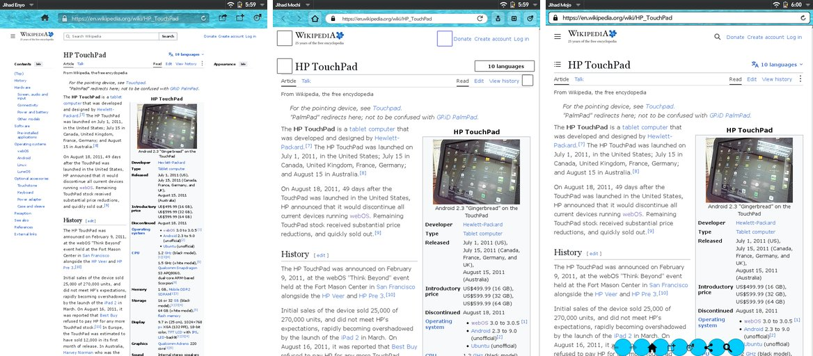
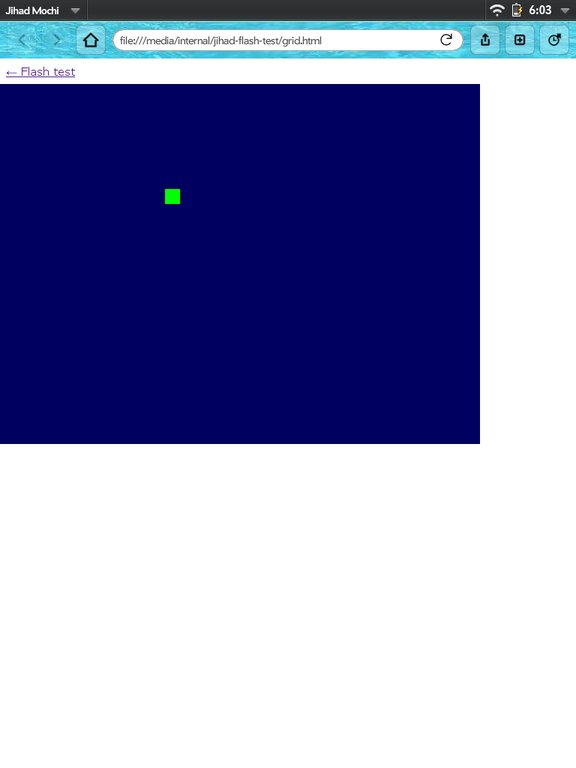
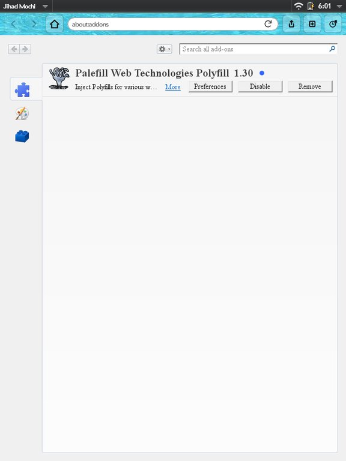
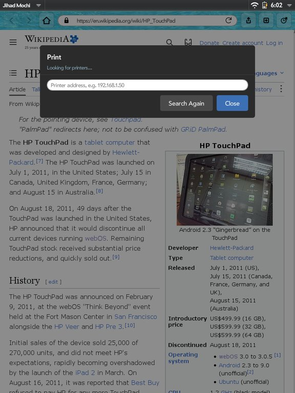
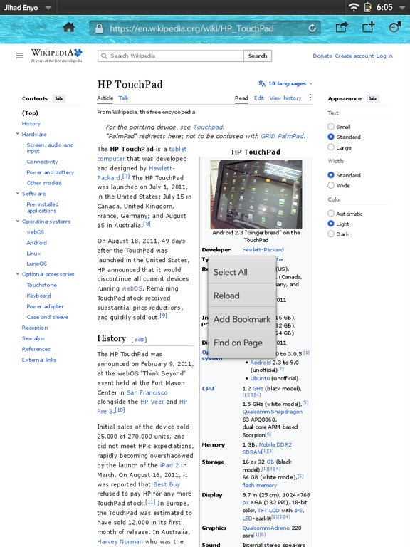
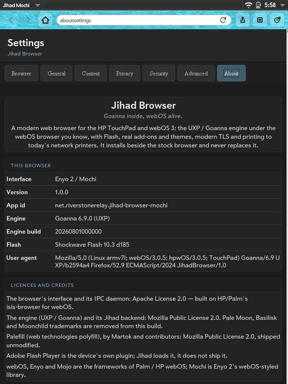
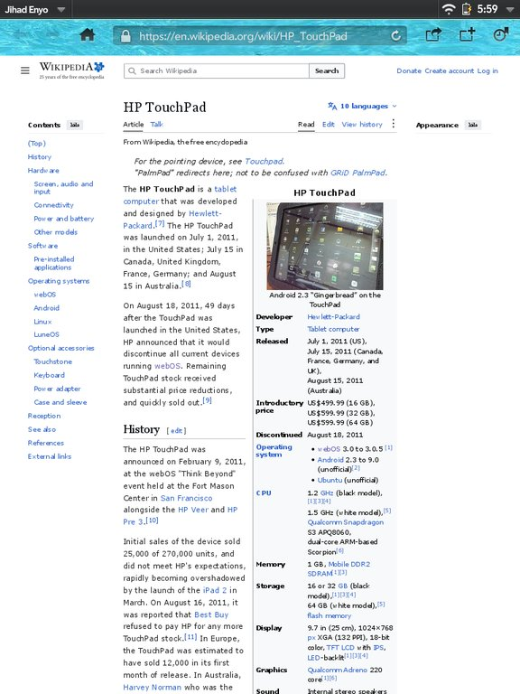

  

# Jihad Browser

<em>Goanna inside, webOS alive, inshallah.</em>

A modern web browser for the **HP TouchPad** and webOS 3 — the browser that still runs
**Adobe Flash**, **add-ons** and **themes** on 2011 hardware, and opens today's web over today's TLS.

Jihad keeps the webOS browser you already know and swaps the engine underneath it for
**UXP / Goanna**, the Pale Moon engine. It installs **alongside** the stock browser and never
replaces it, so nothing you rely on breaks.

  
   <em>One engine, three interfaces: the classic Enyo shell, the Enyo 2 / Mochi shell and the Mojo shell, all wearing the same theme.</em>

---

## What only Jihad does on webOS

None of these has ever existed in a webOS browser before.

### Flash *and* the modern web, in one engine

Goanna renders today's sites and runs the TouchPad's own Flash Player 10.3 — animation, touch,
keyboard and **sound**. The stock browser has Flash but cannot open a modern site; every
modern-engine browser dropped NPAPI and cannot run Flash at all. Jihad does both.

- Flash runs **out of process**: a crashing movie cannot take the browser down.
- Flash drives its own frame clock, so frames arrive evenly spaced instead of bunched, and the
  engine spends its time on the page rather than on redrawing unchanged frames.
- The CPU is boosted while a movie plays and handed back when it stops.

 

### Add-ons and themes

- **Real add-ons.** Install an XPI straight from a web page, manage it in `about:addons`,
  enable, disable or remove it, and it survives restarts. Each interface keeps its own add-ons.
- **Palefill ships with it** — the web-technologies polyfill that makes more of today's sites work,
  unmodified and under its own licence.
- **Personas (lightweight themes)** from Firefox 52, Pale Moon and Basilisk theme sites, and AMO's
  "static themes" (what every old persona is served as today) — installed with a confirmation,
  painted on the toolbar and buttons of every interface, with dark glyphs when the theme is light.

 

### Printing to the printer you actually own

webOS only ever printed to a handful of HP printers. Jihad finds **IPP / AirPrint printers** on your
network by itself (or at an address you type) and prints the page as the engine draws it — no
driver, no HP app.

 

### A long-press menu, a real settings page, and more

- **Long-press menus** on links, images, text fields and the page itself: open in a new card,
  share, copy, select all, find on page, save images.
- **Settings** for everyday options and **`about:config`** for the full Goanna preference system —
  on a 2011 tablet. The settings page includes an **About** pane: interface, version, engine
  build, Flash version and licences.
- **Modern TLS** with the device's own trust store, a certificate viewer behind the padlock, and
  an SSL-exception dialog for untrusted certificates.
- **Privacy defaults:** DuckDuckGo Lite is the default search and home page (DuckDuckGo HTML,
  DuckDuckGo, Google and Wikipedia are a tap away); Do Not Track and referrer rules are honoured,
  including `rel=noreferrer` and the page's referrer policy.
- **Three interfaces, your choice** — the classic **Enyo 1** shell, a modern **Enyo 2 / Mochi**
  shell, or a lightweight **Mojo** shell. Each is a separate app; install one, or all three.

 

  
  

## A good guest on your device

- Each app runs entirely from its own bundle and keeps its own engine profile, add-ons, history
  and bookmarks — installing, updating or removing one never touches another or the stock browser.
- Nothing is written to your USB storage volume, and an app removes itself cleanly.

## Install

Install the `.ipk` for the interface you want with **Preware** or **WebOS Quick Install**:

| Interface | Package |
|---|---|
| Enyo 1 (classic) | `net.riverstonerelay.jihad-browser` |
| Enyo 2 / Mochi | `net.riverstonerelay.jihad-browser-mochi` |
| Mojo (lightweight) | `net.riverstonerelay.jihad-browser-mojo` |

## Honest status

Jihad is usable day to day on real hardware, and it is still being worked on. What is known to be
imperfect right now:

- **Frame rate is the TouchPad's.** The engine paints in software and the card composites the
  result. Flash now runs at its own pace — about 27 fps for a 30 fps movie, evenly spaced — and that
  limit is Flash's own on this CPU, not the browser's.
- **Physical keyboards with Flash games** are wired up but not yet tried with a Bluetooth keyboard.
  webOS 3 pairs Bluetooth keyboards but has no Bluetooth mouse support at all; the touchscreen is
  Flash's mouse (double-tap a movie to send it your drags).
- **Finger-only checks still open:** pinch zoom in the Mojo interface and the long-press menus by
  touch are verified with scripted input and wait on a hands-on pass.
- **Slow pages can flash unstyled** for a moment while their stylesheets are still loading.

Per-feature status lives with the requirements in `context/kits/` — that is the single source of
truth. Current work in progress is in `docs/PICKUP.md`.

## For developers

Jihad keeps isis-browser's client–server split and holds the **YAP IPC contract byte-identical** —
the UI talks to a `BrowserAdapter` NPAPI plugin in the card, which talks over YAP plus a
shared-memory framebuffer to a headless render daemon. Only the daemon's rendering backend is
replaced: QtWebKit out, Goanna in.

| Path | Contents |
|---|---|
| `app/`, `app-mochi/`, `app-mojo/` | the three UI shells (Apache-2.0) |
| `render/browserserver/` | engine-agnostic daemon + YAP IPC (Apache-2.0) |
| `render/goanna/` | the Goanna backend and its XPCOM components (MPL-2.0) |
| `render/adapter/` | the BrowserAdapter NPAPI plugin the cards host (Apache-2.0) |
| `packaging/prefsui/` | the settings page (`about:settings`) |
| `third_party/uxp` | the engine, a submodule pinned to the `jihad-engine-mods` commit (pristine UXP + our delta); the desktop build applies the same delta as patches in `build/desktop/patches/` |
| `build/desktop/`, `build/webos-oe/` | x86_64 and webOS ARMv7 build wiring |
| `context/` | Cavekit kits (requirements) and the build site (plan) |
| `docs/` | build, toolchain and IPC reference; `PICKUP.md` is the current handoff |

Building for the device: `docs/DEVICE-BUILD.md`. Engine notes: `docs/UXP.md`. The IPC contract:
`docs/IPC-CONTRACT.md`.

## Licensing

Composite work: **Apache-2.0** (UI, adapter and IPC daemon) and **MPL-2.0** (Goanna backend and
engine), which are compatible. Palefill is MPL-2.0 and shipped unmodified. All Pale Moon /
Basilisk / Moonchild trademarks are removed from the engine build. Adobe Flash Player is the
device's own plugin and is not distributed with Jihad. See `LICENSE` and `NOTICE`.
