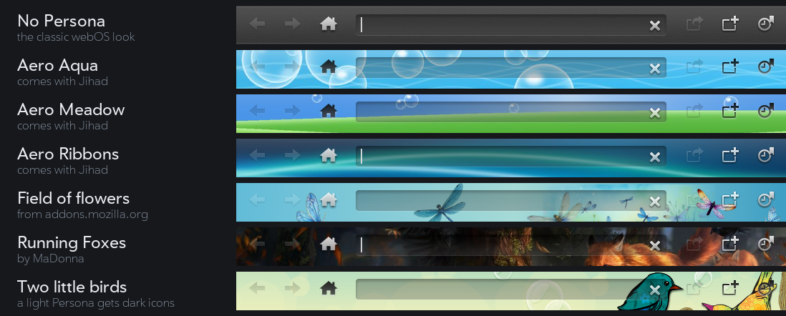
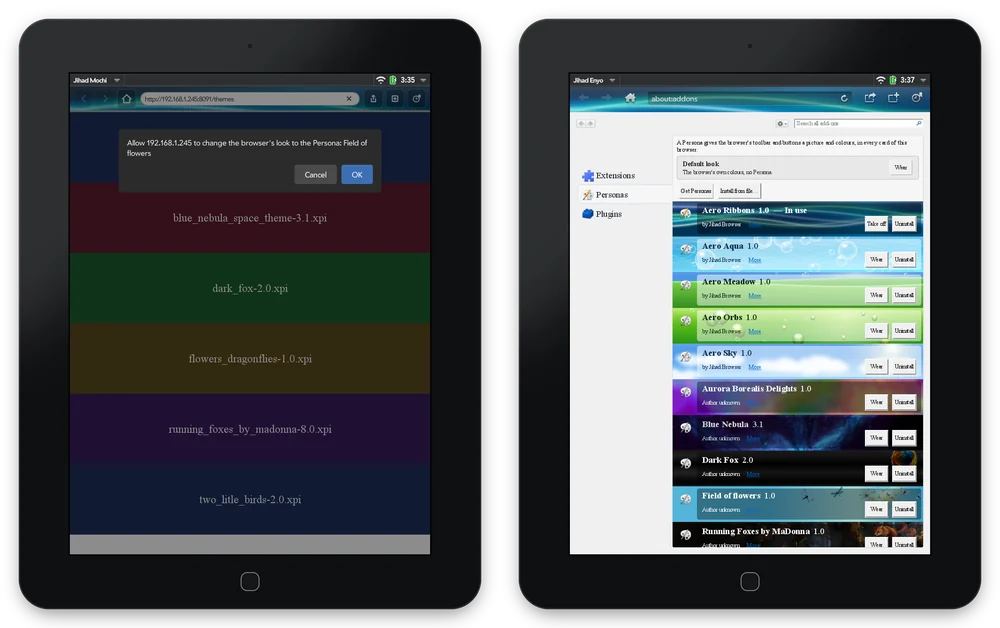
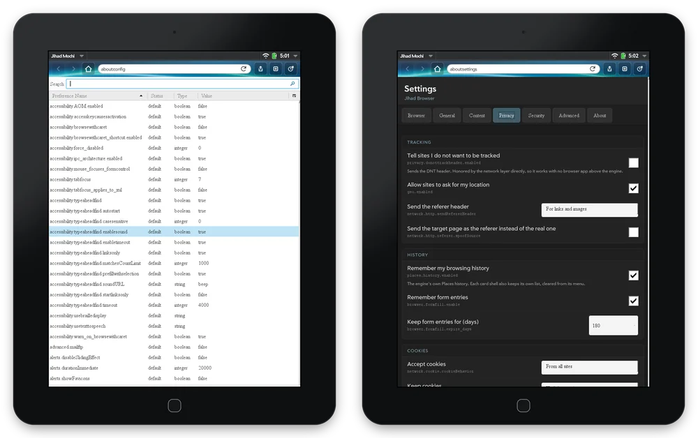
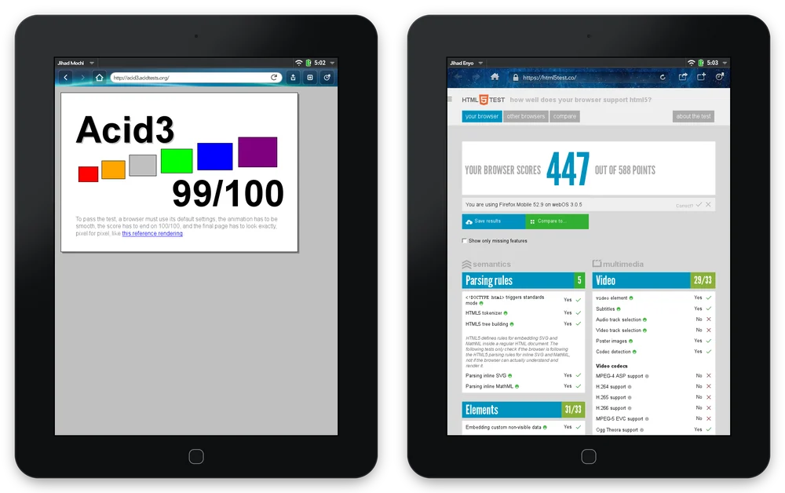

  

<h1 align="center">Jihad Browser</h1>

  <b>The whole web, back on your TouchPad.</b> 
  For HP TouchPad &nbsp;·&nbsp; webOS 3.0.5 and webOS CE 3.1.0 &nbsp;·&nbsp; Free &nbsp;·&nbsp; Open source

<em>Goanna inside, webOS alive, inshallah.</em>

  

---

## Hello again, webOS

The TouchPad shipped in 2011 promising the *whole* web, Flash included. Forty-nine days later HP
discontinued it, and the web moved on without webOS. A stubborn, wonderful community kept the
platform alive: webOS Internals, Preware, PivotCE, webOS Ports, the webOS Archive, Herrie82's TLS
work and webOS CE 3.1.0. Jihad Browser is our part of that.

It puts **Goanna**, the UXP engine behind Pale Moon, under the webOS browser you already know. It
installs **next to** the stock browser and changes nothing else on your TouchPad.

<table>
<tr><td><b>Version</b></td><td>1.0 (Jihad Enyo 1.0.4, Jihad Mochi 1.0.0, Jihad Mojo 1.0.0)</td></tr>
<tr><td><b>Requires</b></td><td>HP TouchPad with webOS 3.0.5 or webOS CE 3.1.0, or HP TouchPad Go with webOS 3.0.5</td></tr>
<tr><td><b>Engine</b></td><td>Goanna 6.9 (UXP), with its own NSS for TLS 1.2 and 1.3</td></tr>
<tr><td><b>Flash</b></td><td>The Adobe Flash Player 10.3 already on your TouchPad</td></tr>
<tr><td><b>Price</b></td><td>Free, under Apache-2.0 and MPL-2.0</td></tr>
</table>

---

## What's new for your TouchPad

### Personas

  
   Space Fantasy by fx5800p (CC BY-SA 3.0), Field of flowers by vc (CC BY 4.0), Two little birds by math3us.c (CC BY-SA 3.0). All credits: <code>CREDITS.md</code>.

A **Persona** gives the toolbar and buttons a picture and colours of their own.

- **Two come with Jihad**: **Free Palestine**, Battir's terraced olive hills from a CC BY 2.0
  photograph by Labour Palestine, and **Aurora Silk**, drawn for Jihad in the glossy style of the
  screens the TouchPad grew up with. Many more are on Jihad's add-on site,
  addons.riverstonerelay.org: the project's own, Firefox classics whose authors licensed them for
  sharing (Space Fantasy, Summerwood, Autumn Forest…) and colour-only themes from MIT-licensed
  palettes (Catppuccin, Nord, Dracula, Solarized, Gruvbox and more).
- **Jihad's own gallery**, `about:personas`: your Personas (**Wear**, **Take off**, **Remove**,
  **Undo**, **Install from file**), and a search of the add-on site and of addons.mozilla.org — whose
  themes install with one confirmation, picture themes, colour-only ones and layered ones alike,
  their colours reaching the address bar, the menus and the start page. Persona sites made for
  Firefox, Pale Moon and Basilisk work too. (Complete themes, the kind that restyle a desktop
  browser's window, have nothing to dress here; Jihad says so and points to Personas.)
- Each interface keeps its own, so every card can have a different look.

  

### Flash, as HP promised

The stock browser has Flash but can't open today's sites; every other modern browser on the
TouchPad dropped plug-ins long ago. **Jihad runs the modern web and Flash on the same page**, with
your TouchPad's own Flash Player 10.3: animation, sound, touch and keys. Flash runs in its own
process and keeps its own frame clock, so games play smoothly, and Bloxorz runs straight from the
Internet Archive.

 

### Add-ons

Jihad installs classic **XPI add-ons** from a web page and manages them in `about:addons`.
**Palefill**, which fills in web features the engine lacks, comes pre-installed.

### Make it yours

A full **Settings** page (more than 55 options: search engine, home page, start-page links,
privacy, cookies, history, security, smooth scrolling, frame rate) and **`about:config`** with every
preference the engine has.

  

### The web of today

Goanna handles today's HTML, CSS and JavaScript; the stock browser's WebKit is from 2011. Measured
on a TouchPad: **Acid3 99/100**, **html5test 447 of 588**.

  

### And

- **Printing** to the IPP / AirPrint printer on your network, not just a few HP models.
- **Privacy by default:** DuckDuckGo Lite for search and home; referrer rules honoured.
- **Three interfaces:** the classic **Enyo** browser, the newer **Mochi** design, or lightweight
  **Mojo** with round buttons. Install one, or all three.

---

## HTTPS on webOS, fixed for good

Every webOS release shipped a **2009 OpenSSL** that speaks nothing newer than **TLS 1.0**, with a
root store from 2010. As the web moved to TLS 1.2 (2018–2020) and Let's Encrypt to ISRG Root X1
(2021), the stock browser lost almost every HTTPS site. The community worked around it for years:

| Fix | Who | What it changes | Runs on |
|---|---|---|---|
| OpenSSL-Updater | tgaillar, webOS Internals (2015) | System OpenSSL to 0.9.8zg. Fixes SHA-256 certificates; still TLS 1.0. | 2.x, 3.x |
| Root Certs Update | frantid (2015); Herrie82 (2025) | Certificates only: Mozilla's current list, including ISRG Root X1. | All |
| HTTP mirrors | webOS Archive, App Museum II, Nomad84's feeds | No TLS needed: apps and feeds served over plain HTTP. | All |
| SSL-bump proxies | nizovn (Squid), webOS Archive Proxy, WebOne | Re-encrypt traffic for the device. That works, but it weakens the security TLS is there for. | 2.2.4+ |
| QupZilla / Qt WebBrowser | nizovn (2018) | A separate Qt 5 browser with its own OpenSSL 1.0.2. | TouchPad, Pre 3 |
| **TLS 1.3 Updates** | Herrie82, packaged by webOS Archive (2026) | A private OpenSSL 1.1.1w and curl 7.88.1 for the browser, app WebKit, Mail and downloads. The system's 0.9.8 is left alone. | 3.0.5 TouchPad and Go; 2.2.4 Pre 3 |
| **webOS CE 3.1.0** | codepoet80 and webOS Archive (Sept 2026) | HP's 3.0.5 with those 1.1.1w stacks and 190 current Mozilla roots built in. | TouchPad (Wi-Fi and 4G) |

**Jihad doesn't use the device's OpenSSL at all.** Goanna brings its own **NSS** with Mozilla's
root list, so HTTPS works the same on a stock 3.0.5 TouchPad as on CE 3.1.0: howsmyssl.com reports
**TLS 1.3**. It covers Jihad only; the stock browser, Mail and system services still use the
device's own TLS (see the [webOS Archive guide](https://docs.webosarchive.org/site/modern-tls/)).
Keep your clock set: certificate checks need the right date.

 

Sources

- OpenSSL versions per release: [tgaillar/OpenSSL-Updater wiki](https://github.com/tgaillar/OpenSSL-Updater/wiki); the 3.0.5
  store and libraries were also checked against HP's own 3.0.5 Doctor image.
- TLS 1.1/1.2 in OpenSSL 1.0.1, 14 March 2012: [OpenSSL 1.0.1 NEWS](https://github.com/openssl/openssl/blob/OpenSSL_1_0_1-stable/NEWS)
- [Herrie82/OpenSSL-legacyWebOS](https://github.com/Herrie82/OpenSSL-legacyWebOS) ·
  [Herrie82/webOS-rootcerts](https://github.com/Herrie82/webOS-rootcerts) ·
  [webOS Archive: modern TLS](https://docs.webosarchive.org/site/modern-tls/) ·
  [webOS Archive: browsers](https://docs.webosarchive.org/site/browsers/) ·
  [webOS Archive: getting online](https://docs.webosarchive.org/site/online/)
- [webOS CE 3.1.0 release notes](https://github.com/webOSArchive/webOS-Community-Edition/releases/tag/3.1.0-CE-Release)
- [GitHub drops TLS 1.0/1.1 (2018)](https://github.blog/news-insights/company-news/weak-cryptographic-standards-removed/) ·
  [PCI SSC, June 2018](https://blog.pcisecuritystandards.org/are-you-ready-for-30-june-2018-sayin-goodbye-to-ssl-early-tls) ·
  [Browsers retire TLS 1.0/1.1 in 2020](https://www.bleepingcomputer.com/news/security/tls-10-and-tls-11-being-retired-in-2020-by-all-major-browsers/) ·
  [RFC 8996](https://www.rfc-editor.org/rfc/rfc8996) ·
  [Let's Encrypt: DST Root CA X3 expiration](https://letsencrypt.org/docs/dst-root-ca-x3-expiration-september-2021/)
- Proxies: [squid-for-webos](https://github.com/webOSArchive/squid-for-webos) ·
  [com.nizovn.squid](https://gitlab.com/nizovn/com.nizovn.squid) · [WebOne](https://github.com/atauenis/webone)

---

## Installing

Install the `.ipk` for the interface you want with **Preware** or **WebOS Quick Install**:

| Interface | Package |
|---|---|
| **Jihad Enyo** (the classic browser) | `net.riverstonerelay.jihad-browser` |
| **Jihad Mochi** (newer design) | `net.riverstonerelay.jihad-browser-mochi` |
| **Jihad Mojo** (lightweight) | `net.riverstonerelay.jihad-browser-mojo` |

Each app keeps its own profile, add-ons, Personas, history and bookmarks, and never touches another
app or the stock browser.

**Known issues:** the engine draws in software, so frame rates are the TouchPad's; double-tap zoom
takes about a second to sharpen; Mochi's text can look soft at some zoom levels.

**Developers:** start at `docs/PICKUP.md` (current state), `docs/DEVICE-BUILD.md` (building) and
`docs/ENGINE.md` (how Jihad uses the engine, and how to update it).

---

## Thank you

HP's **isis-project** (the browser this forks), the **UXP** platform and **Palefill**,
**Herrie82** and **Atlas Browser**, the **webOS Archive**, **webOS Internals**, **Preware**,
**PivotCE** and **webOS Ports**, and everyone still carrying a TouchPad in 2026.

## Licensing

**Apache-2.0** (UI, adapter, IPC daemon) and **MPL-2.0** (Goanna backend and engine). Palefill is
MPL-2.0, shipped unmodified. Pale Moon, Basilisk and Moonchild trademarks are removed from the
engine build. Flash Player is your TouchPad's own and is not distributed. The bundled Personas
by other authors are Creative Commons BY / BY-SA, credited in `CREDITS.md`. See `LICENSE`,
`NOTICE` and `CREDITS.md`.

Palm, webOS, Pre, TouchPad and Synergy are trademarks of their respective owners. Jihad Browser
is an independent community project, not made, endorsed or supported by HP, Palm or LG. Screenshots
were taken on a real HP TouchPad.

Made with love for webOS, in 2026, for a tablet from 2011.

