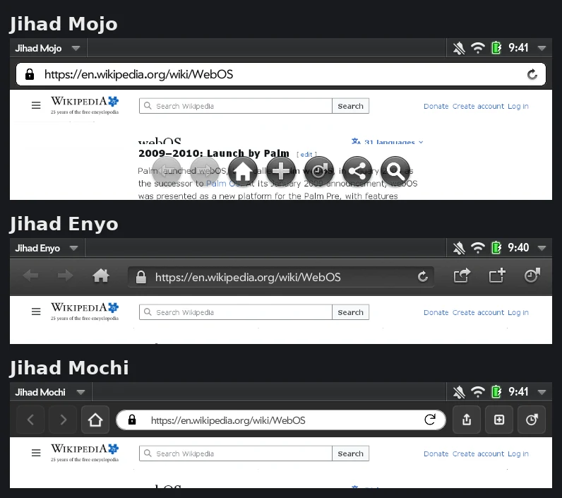
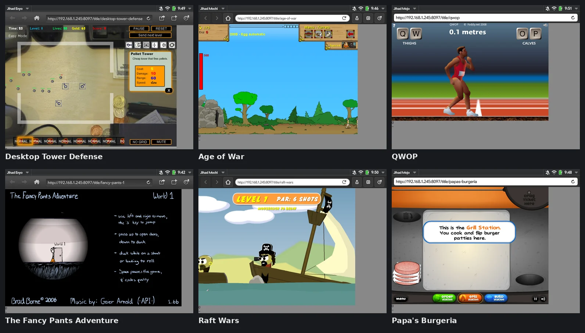
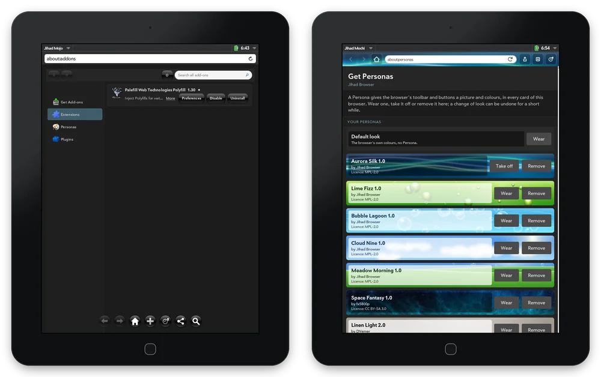

<p align="center">
  
</p>

<h1 align="center">Jihad Browser</h1>

<p align="center"><b>UXP inside, webOS alive, inshallah!</b></p>

<p align="center">
  
</p>

---

## About

Jihad Browser is the webOS 3 browser with the engine swapped out: the stock browser's interfaces
(Mojo, Enyo, or the newer Mochi design) on top of **Goanna**, the engine of the **UXP** platform
behind Pale Moon and Basilisk, in place of the 2011 WebKit. Same engine, same XPI add-ons, same
Personas, and the device's own Flash Player still working. It installs next to the stock browser
and touches nothing else.

| | |
|---|---|
| **Runs on** | webOS 3.0.5 and webOS CE 3.1.0, TouchPad and TouchPad Go |
| **Engine** | Goanna 6.9 (UXP), with its own NSS: TLS 1.2 and 1.3 |
| **Flash** | The Flash Player 10.3 already on the device |
| **Licence** | Apache-2.0 and MPL-2.0; bundled libraries under their own (`NOTICE`) |

---

<!-- progress:start -->
## Status

**`█████████████████░░░` 89 % done** (everything but tabs, which are on hold).

| Area | Progress | What it covers |
|---|---|---|
| Engine and page drawing | `██████████████████░░` 94 % | Goanna inside the webOS card, frames to the card, the card's messages |
| Drawing on the GPU | `██████████████████░░` 90 % | the Adreno 220 composes the page; WebGL; pan and zoom speed |
| The modern web | `█████████████████░░░` 87 % | today's sites: TLS, missing features filled in, video |
| Speed and memory | `███████████████░░░░░` 78 % | the engine tuned for the TouchPad; no page can starve the device; YouTube made light |
| The three interfaces | `██████████████████░░` 94 % | Enyo, Mochi and Mojo |
| Touch and keyboard | `████████████████████` 100 % | taps, gestures, the on-screen keyboard |
| Settings and services | `███████████████████░` 96 % | the settings panes, downloads, history, printing |
| Add-ons and Personas | `███████████████████░` 96 % | XPI add-ons, plugins, Personas, the add-on site |
| Flash, finished | `███████░░░░░░░░░░░░░` 37 % | the device's own Flash Player proven on real games, apps and videos in every shell |
| Privacy and security | `███████████████████░` 95 % | the ad and tracker blocker, proxies, certificates |
| Building and updating | `██████████████████░░` 94 % | one repository builds every package; engine updates; the SDK; licences |
| Tabs | `░░░░░░░░░░░░░░░░░░░░` held | groundwork only, held by the owner's decision |

<sub>Generated by `tools/readme-progress.py`; don't edit it by hand.</sub>
<!-- progress:end -->

---

## Features

### Real Flash games

<p align="center">
  
</p>

The device's Flash Player 10.3 runs on today's pages, in its own process: animation, sound, touch
and keys. The first tap engages a movie, so drags and holds go to the game and not the page; a
double tap brings up the on-screen keyboard, arrow pad included, so keyboard games play with no
keyboard attached.

### Three interfaces, one engine

Mojo with its round buttons, the classic Enyo browser, or the newer Mochi design. Install one or
all three; each keeps its own profile, add-ons, Personas, history and bookmarks.

### Add-ons, Personas, Settings

<p align="center">
  
</p>

- **XPI add-ons** install from a web page and live in `about:addons`. Palefill comes installed.
- **Personas** skin the toolbar; `about:personas` is the gallery, and it searches Jihad's add-on
  site (addons.riverstonerelay.org) and addons.mozilla.org.
- **Settings** in Pale Moon's panes, more than 55 options, with `about:config` underneath.

### And

- **HTTPS that works**: the engine's own NSS and Mozilla's root list, not the device's 2009
  OpenSSL. TLS 1.3 on a stock 3.0.5 device.
- **Ads and trackers blocked** from EasyList and EasyPrivacy, built in, refreshed every four days.
- **Bot checks**: a site that turns Firefox 52 away is retried once as a current Firefox and
  remembered.
- **A memory guard**: a page that pushes the 1 GB tablet into swapping is stopped, with a notice
  and a link back, before the tablet stops answering.
- **GPU drawing** on the Adreno 220, WebGL 1, printing to IPP and AirPrint printers.

---

## Install

Install the `.ipk` for the interface you want with Preware or WebOS Quick Install (not
`palm-install`: it skips the install scripts).

| Interface | Package |
|---|---|
| Jihad Mojo (lightweight) | `net.riverstonerelay.jihad-browser-mojo` |
| Jihad Enyo (the classic browser) | `net.riverstonerelay.jihad-browser` |
| Jihad Mochi (newer design) | `net.riverstonerelay.jihad-browser-mochi` |

## Build

Any x86_64 Linux with git, podman, curl, binutils and xz; about 40 GB and several hours the first
time. Details in `docs/DEVICE-BUILD.md`.

```bash
git clone --recurse-submodules https://git.trueog.net/NotAlexNoyle/Jihad-Browser.git
cd Jihad-Browser
tools/host/build-novacom.sh          # novacom + novacomd into tools/host/bin/
sudo -b tools/host/bin/novacomd      # keep it running while a device is plugged in
build/webos-oe/build-all-device.sh   # packages land in build/webos-oe/out-ipk/
```

Developers start at `docs/PICKUP.md` and `docs/ENGINE.md`.

## Known issues

The short list; the rest, with causes, is in `docs/KNOWN-ISSUES.md` and `docs/MODERN-WEB.md`.

- Tested on a TouchPad running webOS CE 3.1.0 only; the TouchPad Go and stock 3.0.5 are untested.
- Heavy single-page applications (GitLab, Reddit's login) take tens of seconds of script.
- YouTube plays at 144p to 360p, decoded in software, and is heavy.
- Flash movies made for Flash Player 11 and later may show nothing (Run 3, Learn to Fly 3); the
  stock browser does the same. Flash Player itself is the device's and is not distributed.
- The TLS fix covers Jihad only, not the stock browser or Mail.

## Thanks

HP's **isis-project**, the **UXP** platform, **Pale Moon**, **Basilisk** and **Palefill**,
**Herrie82** and **Atlas Browser**, the **webOS Archive**, **webOS Internals**, **Preware**,
**PivotCE** and **webOS Ports**, and everyone still carrying a webOS device in 2026.

## Licensing

**Apache-2.0** (the interfaces, the adapter, the IPC daemon) and **MPL-2.0** (the Goanna backend
and the modified engine, [UXP-Jihad](https://git.trueog.net/NotAlexNoyle/UXP-Jihad)). Bundled
libraries keep their own licences; `NOTICE` names every one, `CREDITS.md` the Personas and lists.
Flash Player and HP's SDK are not redistributed. See `LICENSE`.

<sub>Palm, webOS, Pre, TouchPad and Synergy are trademarks of their respective owners. Jihad Browser
is an independent community project, not made, endorsed or supported by HP, Palm or LG. Screenshots
were taken on a real TouchPad.</sub>
