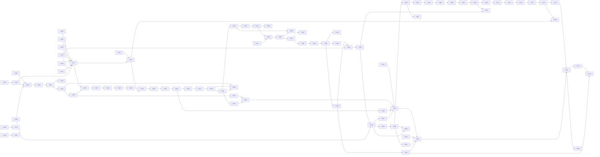

# Build Site

91 tasks across 54 tiers (Tier 0-52 plus a final BLOCKED-EXTERNAL tier), covering exactly the 53 acceptance criteria that are `[~]` (31) or `[ ]` (22) in `context/kits/` on 2026-10-01 - nothing else; the 338 `[x]` criteria are recorded as met in the kits and are not restated. Task IDs start at T-201; a row that says "continues T-1xx" inherits that task's remaining work and gating from `build-site-2026-08-10.archived.md`. **Device lane:** there is ONE TouchPad, so every agent-run task with `Device: yes` sits in a single total order (see `## Device lane`): each is `blockedBy` the previous lane task in addition to its real blockers, and the lane is why the tier count is high - the tiers below are mostly one device sitting each, with host work running in parallel beside them. Host tasks run in parallel except that engine builds (libxul) and daemon builds are one at a time; the daemon build follows the engine build because it links the same objdir. **Batch rule:** all three variants stay on one engine + daemon build. Code fixes are batched - implement, build, ONE push to all three (`build/webos-oe/push-engine-update.sh enyo mochi mojo`, or an `.ipk` upgrade of all three when the adapter or bundled files change) - then the device verifications run in lane order. Batch 1 carries every fix known today; batch 2 carries the plugin VKB adapter work plus whichever [CONDITIONAL] fixes the lane triggers. **Gates:** the 13 tasks in the last tier need a person at the device, hardware that does not exist (no keyboard), a credential, or a product-owner decision; their `Device` column reads `human` because no agent runs them and they are outside the lane. A daemon-level inject is never counted as the human test. Every device row names its observable; "Pre" means: assert the daemon log GREW and the card is CONNECTED before believing a reading, and record the libxul md5 beside the result.

## Tier 0 — No Dependencies (Start Here)

| Task | Title | Cavekit | Requirement | Device | Effort |
|------|-------|---------|-------------|--------|--------|
| T-201 | Housekeeping and baselines before any push: `df /var` first; remove enyo's leftover `MOZ_LOG=...` from `/etc/event.d/jihad` then `stop jihad; start jihad`; confirm `JIHAD_INJECT=1` in all three jobs; record each libxul md5 (enyo traced `cb514e9e...`, mochi/mojo `78c3b51a...`); check whether `org.webosinternals.ipkgservice` exists on CE. Record PRE-CHANGE figures: no-card CPU from `/proc/<pid>/stat` over 60 s, log bytes/min, `about:blank` `painted` lines per 30 s, connect-to-first-`painted` ms on a static page. Pre: daemon log GREW and card CONNECTED before any reading. | cavekit-device-build.md | device-build R8/R4 | yes | M |
| T-202 | Engine fix for the `<video>` MEDIA_ERR_DECODE race: in `third_party/uxp/gfx/layers/basic/BasicImages.cpp` `BasicPlanarYCbCrImage::CopyData`, return the base `RecyclingPlanarYCbCrImage::CopyData` result and `true` under delayed conversion (PICKUP NEW DEFECT 1); commit on `jihad-engine-mods` so the OE SRCREV can follow. Observable is T-220. | cavekit-gre-widgets.md | gre-widgets R1 | no | S |
| T-203 | Daemon idle state: with no card connected stop the 8 ms frame tick (nothing pumped, painted or paced; wake ~1/s or less), keep polling the inject channel at the idle cadence so it can still answer `no page`, wake to the full tick on connect without delaying the first frame, return to idle on disconnect. | cavekit-device-build.md cavekit-engine-embedding.md | device-build R8 engine-embedding R3 | no | M |
| T-204 | Bound the log while running: stop the periodic `tick period` line when there is nothing to report; enforce the 2 x 2 MB cap inside the daemon (rotate/reopen or stop writing, same PID, with a test knob that lowers the cap); write the three-variant worst case into the job comment (`packaging/gen-variant-scripts.sh`) and the `docs/` footprint list. | cavekit-device-build.md | device-build R8 | no | M |
| T-205 | Blank-page settle in the full paint path (`BrowserPageGoanna`): record that a zero-content frame was refused as FINAL for this document/load and stop retrying until an invalidation, navigation or resize; keep the blank-over-good suppression for a blank frame mid-load of a page that later has content; no per-paint log line while settled. | cavekit-offscreen-rendering.md cavekit-engine-embedding.md | offscreen-rendering R8/R3 engine-embedding R3 | no | M |
| T-206 | Confirm or refute the fresh-install -1027 from source: `packaging/gen-variant-scripts.sh` postinst starts the job (`start @@JOB@@`) before ls-hubd has read the new role (its own comment says the role is live only after the requested reboot); read `JihadLunaService.cpp` for any retry. If real, fix so the service registers without a hand restart (daemon-side `LSRegisterPalmService` retry with backoff so it rides the daemon build, and/or a postinst hub rescan before `start`). | cavekit-device-build.md | device-build R4 | no | M |
| T-207 | Prepare R9's two device items (continues T-104): build the `PTHREAD_PROCESS_SHARED` `__kind` probe dynamically linked with the PDK gcc 4.3.3 so it runs against the device's own glibc 2.8 libpthread, and a script that pulls `libflashplayer.so`'s DT_NEEDED closure off the device (`novacom get`) for a host `readelf --dyn-syms` scan for `sem_open`/`*attr_setpshared`. | cavekit-device-build.md | device-build R9 | no | S |
| T-208 | Clean-clone residuals (continues T-115/T-154): `git ls-files build/webos-oe/toolchain/` - `git add` the three crosstool recipe files if still untracked; `git ls-remote` the `UXP-Jihad` fork for `jihad-engine-mods` and confirm the parent gitlink is a pushed commit. If it is not pushed, the push is T-279. | cavekit-device-build.md | device-build R3 | no | S |
| T-209 | Test assets: regenerate >=10 s clips with ffmpeg (VP8, VP9, Theora, Vorbis, Opus, WAV, FLAC, MP3, AAC, H.264) per PICKUP's recipes; extend `render/goanna/test/jihad-media.html` `#state` with ended/error/currentTime/duration/decoded+dropped frames/volume/muted plus a fixed-width variant; add an input-echo page (plain `<input>`, `<textarea>`, controlled re-set-from-state input); stage via `stage-test-pages.sh`. | cavekit-gre-widgets.md cavekit-input-bridging.md | gre-widgets R1 input-bridging R2a | no | M |
| T-210 | Refresh `app-mochi/PARITY.md` against today's `app/` and `app-mochi/` (safeUrl, settings entry, toast and other post-2026-07-31 changes) so the human sign-off (T-291) is on a current checklist. Continues T-113. | cavekit-mochi-ui.md | mochi-ui R2 | no | S |
| T-211 | Adapter latch instrument (continues T-124): a `g_message` on every `mFlashGestureLock` set/clear with its call site in `render/adapter/BrowserAdapter.cpp` (DEBUG/TRACEF compile to nothing today), so the runtime value is readable via palm-log; ships in the batch-1 `.ipk`s (PDK build). | cavekit-input-bridging.md | input-bridging R7 | no | S |
| T-212 | Plugin VKB raise (continues T-144): in the adapter raise the VKB when the plugin latch engages on a plugin that wants text and lower it when the latch clears, mirroring the `msgEditorFocused` path; document what signals "wants text" and that the latch is double-tap only. Batch 2 (adapter, `.ipk`). | cavekit-input-bridging.md | input-bridging R7 | no | M |
| T-213 | Keycode follow-ups in `BrowserPageGoanna::keyDown` (continues T-127/T-109): extend the PUA swallow to the real `0xE0E2`-`0xE0E7` codes so they stop inserting invisible glyphs; add an env-gated log of the raw `(key, chr, modifiers)` triple at `asyncCmdKeyDown` (codes only, suppressed for password fields) - the instrument the human VKB session (T-282) needs. | cavekit-gre-widgets.md | gre-widgets R3 | no | S |
| T-214 | From source, explain and fix the two 2026-08-15 inject findings: `key 57346` (0xE0A2) did not move the caret in a `<textarea>` (`abcd` + 2 x Left + `X` gave `abcdX`), and the first `text` after a focus change into a `<textarea>` was dropped; state whether the inject `key` path reaches the keycode map at all. | cavekit-gre-widgets.md cavekit-input-bridging.md | gre-widgets R3 input-bridging R2a | no | M |
| T-215 | Settings-command instrument (continues T-116): one log line per frozen handler (`SetEnableJavaScript`, `SetBlockPopups`, `SetAcceptCookies`, `SetMinFontSize`, `SetUserAgent`) with the received value; a test page that opens its popup from a click handler (not during load, the 2026-08-15 confound) and a script-marker page. | cavekit-preferences-ui.md | preferences-ui R5 | no | S |

## Tier 1 — Depends on Tier 0

| Task | Title | Cavekit | Requirement | blockedBy | Device | Effort |
|------|-------|---------|-------------|-----------|--------|--------|
| T-216 | Engine build, batch 1: incremental libxul in the podman container (`build-goanna-arm.sh build`); record its md5. The only engine build in flight. | cavekit-gre-widgets.md | gre-widgets R1 | T-202 | no | S |

## Tier 2 — host work

| Task | Title | Cavekit | Requirement | blockedBy | Device | Effort |
|------|-------|---------|-------------|-----------|--------|--------|
| T-217 | Daemon build, batch 1 (`build-daemon-arm.sh`) with every batch-1 daemon change; `check-yap-contract.sh` passes (73 commands incl. 0x1600, 58 messages). Serialized after T-216 because it links against the same objdir. | cavekit-device-build.md | device-build R8/R4 | T-203, T-204, T-205, T-206, T-213, T-215, T-216 | no | S |

## Tier 3 — device sitting: Batch-1 push to all three variants

| Task | Title | Cavekit | Requirement | blockedBy | Device | Effort |
|------|-------|---------|-------------|-----------|--------|--------|
| T-218 | Batch-1 packages: `build-adapter-pdk.sh` AND `build-adapter-arm.sh` (with T-211), then `build-variant-ipk.sh` for enyo/mochi/mojo carrying T-216's libxul, T-217's daemon and T-206's postinst; verify each payload's libxul/daemon md5 equals the built ones and `libasound.so.2` is present. | cavekit-device-build.md | device-build R4/R3 | T-211, T-217 | no | S |
| T-219 | Batch-1a ENGINE push (split from the daemon push 2026-10-01 so the `<video>` verification is not confounded by — or held up behind — the daemon changes): push the T-216 libxul to all three variants with the daemon left exactly as it is; read back libxul md5 on all three (= T-216; enyo leaves the traced build) and the unchanged daemon md5; `JIHAD_INJECT=1` intact; clean restart of each job; push T-209's pages and clips to `/tmp/jm/`. Pre: daemon log GREW and card CONNECTED before any reading. | cavekit-gre-widgets.md | gre-widgets R1 | T-201, T-216, T-209 | yes | S |

## Tier 4 — device sitting: Verify: <video> plays to the end (VP8+Theora, file+http, 3 runs)

| Task | Title | Cavekit | Requirement | blockedBy | Device | Effort |
|------|-------|---------|-------------|-----------|--------|--------|
| T-220 | `<video>` plays to the end (continues T-101/T-125): VP8/WebM and Theora/Ogg >=10 s clips over `file://` and `http://`, three consecutive runs each; read `#state` via `gettext`: `ended=true`, `error=null`, `currentTime` within one frame of `duration`, decoded frames of the order of the clip's frame count (not 10-60); libxul md5 recorded for all three variants. Pre: daemon log GREW and card CONNECTED before any reading. | cavekit-gre-widgets.md | gre-widgets R1/R7 | T-219 | yes | M |

## Tier 5 — device sitting: Verify: codec reality table + undecodable-media degradation

| Task | Title | Cavekit | Requirement | blockedBy | Device | Effort |
|------|-------|---------|-------------|-----------|--------|--------|
| T-221 | Codec reality (continues T-101): per format (VP8, VP9, Theora, Vorbis, Opus, WAV, FLAC, MP3, AAC, H.264) record `canPlayType`, plays-to-end, and the reason where not (missing decoder vs defect) from `#state`; `anon video` shows the videocontrols `controlBar` attached; screenshot the error overlay for an H.264 `<video>` and an MP3 `<audio>`. Pre: daemon log GREW and card CONNECTED before any reading. | cavekit-gre-widgets.md cavekit-device-build.md | gre-widgets R1 device-build R4 | T-220 | yes | M |

## Tier 6 — device sitting: Verify: play/pause both directions by daemon click

| Task | Title | Cavekit | Requirement | blockedBy | Device | Effort |
|------|-------|---------|-------------|-----------|--------|--------|
| T-222 | Play/pause both directions by daemon-level `clickat` on the control bar (continues T-145): long clip, reveal the auto-hidden bar before each click, read `paused`/`currentTime` before and after; both directions must change state. The finger test stays human (T-285). Pre: daemon log GREW and card CONNECTED before any reading. | cavekit-gre-widgets.md | gre-widgets R1 | T-221 | yes | S |
| T-223 | Bring `packaging/prefs/jihad-platform-prefs.js` in line with T-220/T-221: the `<video>` reason is true again, and the stale "no audio output" reasoning becomes the 2026-09-27 measured state (continues T-138). | cavekit-gre-widgets.md | gre-widgets R7 | T-221 | no | S |

## Tier 7 — device sitting: Measure: does engine media need the CPU boost (R10)

| Task | Title | Cavekit | Requirement | blockedBy | Device | Effort |
|------|-------|---------|-------------|-----------|--------|--------|
| T-224 | R10 media measurement (continues T-118/T-134): stock tunables read back, `scaling_cur_freq` once a second across a >=10 s `<video>` with dropped/decoded counts; floor + drops means extend, otherwise record the numbers and close "do not extend"; tunables read back stock afterwards; `scaling_governor` READ only. Pre: daemon log GREW and card CONNECTED before any reading. | cavekit-device-build.md | device-build R10 | T-222 | yes | S |

## Tier 8 — device sitting: Verify: idle daemon CPU, wakeups, connect latency, re-idle

| Task | Title | Cavekit | Requirement | blockedBy | Device | Effort |
|------|-------|---------|-------------|-----------|--------|--------|
| T-225 | Batch-1b DAEMON push first: `push-engine-update.sh enyo mochi mojo` with the T-217 daemon (libxul unchanged from T-219), md5 read back on all three, `JIHAD_INJECT=1` intact, clean restart of each job. Then idle daemon: all cards closed, per variant `/proc/<pid>/stat` utime+stime over >=60 s (<0.5% of a core) and wakeups from the `voluntary_ctxt_switches` delta (~1/s or less); an inject `url` with no card still answers `no page`; reconnect, connect-to-first-`painted` vs T-201's baseline; close the card and see the idle figures return without a restart. Pre: daemon log GREW and card CONNECTED before any reading. | cavekit-device-build.md | device-build R8 | T-224, T-217 | yes | M |
| T-226 | [CONDITIONAL] Only if T-224 shows the clock at the floor with frames dropping: extend the boost to engine media with its own owner, release path and post-stop restore (patch `0027` model); batch 2. | cavekit-device-build.md | device-build R10 | T-224 | no | M |

## Tier 9 — device sitting: Verify: log bounded idle (10 min) and past the cap (same PID)

| Task | Title | Cavekit | Requirement | blockedBy | Device | Effort |
|------|-------|---------|-------------|-----------|--------|--------|
| T-227 | Log bound: (a) no card, a 10-minute window, `daemon.log` growth per variant of at most a few hundred bytes; (b) one variant with the cap lowered by T-204's knob and a noisy page drives the log past the cap in one lifetime: it rotates or stops with the same PID and logs again afterwards, then restore the job; (c) the worst-case number is in the job comment. Assert the log GREW during (b). Pre: daemon log GREW and card CONNECTED before any reading. | cavekit-device-build.md | device-build R8 | T-225 | yes | M |

## Tier 10 — device sitting: Verify: about:blank settles; real page still paints; no white flash

| Task | Title | Cavekit | Requirement | blockedBy | Device | Effort |
|------|-------|---------|-------------|-----------|--------|--------|
| T-228 | Blank settle: `about:blank` for 30 s, `painted` lines vs the static-content control and T-201's baseline (a handful, not hundreds); then navigate to a real page and see its first frame promptly; a page blank mid-load that then gets content must not publish the blank over the previous good frame (frame capture). Pre: daemon log GREW and card CONNECTED before any reading. | cavekit-offscreen-rendering.md | offscreen-rendering R8/R3 | T-227 | yes | M |

## Tier 11 — device sitting: Measure: idle CPU with a static page loaded

| Task | Title | Cavekit | Requirement | blockedBy | Device | Effort |
|------|-------|---------|-------------|-----------|--------|--------|
| T-229 | Engine idle: static page loaded, no input, `/proc/<pid>/stat` CPU over 60 s per variant; record the figure on engine-embedding R3. Pre: daemon log GREW and card CONNECTED before any reading. | cavekit-engine-embedding.md | engine-embedding R3 | T-228 | yes | S |

## Tier 12 — device sitting: CE baseline md5s + Atlas identity columns

| Task | Title | Cavekit | Requirement | blockedBy | Device | Effort |
|------|-------|---------|-------------|-----------|--------|--------|
| T-230 | Fresh CE baseline: md5 of the stock file set plus Atlas's files (replaces the 3.0.5 `baseline-v2`); read Atlas's identity columns off the device (NPAPI MIME, shim filename, YAP name, socket, upstart job, Luna name) and compare with all three Jihad variants - no column may be equal. | cavekit-device-build.md | device-build R4/R8 | T-229 | yes | S |

## Tier 13 — device sitting: Removal audit #1 to a role-less start

| Task | Title | Cavekit | Requirement | blockedBy | Device | Effort |
|------|-------|---------|-------------|-----------|--------|--------|
| T-231 | Removal audit #1 and role-less start: remove the three variants one at a time through the supported installer (the remaining ones keep serving after each removal; `prerm` removes exactly what postinst created, naming any failing assertion; rootfs read-only again); then show no app dir, job, shim/impl, role/service file or state dir remains and the hub has forgotten the name (rescan, or reboot with unmodified shipped jobs); re-read Atlas md5s. | cavekit-device-build.md | device-build R4/R7/R8 | T-230, T-218 | yes | M |

## Tier 14 — device sitting: Fresh install Enyo (supported path): daemon, socket, render, Luna

| Task | Title | Cavekit | Requirement | blockedBy | Device | Effort |
|------|-------|---------|-------------|-----------|--------|--------|
| T-232 | Fresh install, Enyo: install T-218's `.ipk` via the supported installer and do only what postinst asks; observe the daemon running from the app's own deviceroot (`/proc/<pid>/exe`), its YAP socket, the card launching and rendering (screenshot); grep the serving PID's log for `LSRegisterPalmService ... FAILED` / a later success; `luna-send -P` `clearCookies` or `getChromePrefs` to the variant service is answered. Pre: daemon log GREW and card CONNECTED before any reading. | cavekit-device-build.md | device-build R4 | T-231 | yes | M |

## Tier 15 — device sitting: Fresh install Mochi + Mojo; db8 kinds; Mojo framework

| Task | Title | Cavekit | Requirement | blockedBy | Device | Effort |
|------|-------|---------|-------------|-----------|--------|--------|
| T-233 | Fresh install, Mochi then Mojo: the same observables as T-232 per variant, plus Mochi's db8 kinds (bookmarks, history, downloads) registered and Mojo launching against `/usr/palm/frameworks/mojo` with no framework error. Pre: daemon log GREW and card CONNECTED before any reading. | cavekit-device-build.md | device-build R4 | T-232 | yes | M |

## Tier 16 — device sitting: Postinst reboot: Luna recovered?, sem_t across reboot, probes

| Task | Title | Cavekit | Requirement | blockedBy | Device | Effort |
|------|-------|---------|-------------|-----------|--------|--------|
| T-234 | The reboot postinst asks for (shipped, unmodified jobs only): per variant state whether the Luna service registered on first start or recovered (same-PID success, public-bus call answered); `sem_t` containment holds across the reboot (`engine up; serving YAP`, no PmLogLib hang); `plugin_mime_probe` and `alsa_probe` under both loaders. Afterwards re-add `JIHAD_INJECT=1` and restage `/tmp` assets. Pre: daemon log GREW and card CONNECTED before any reading. | cavekit-device-build.md | device-build R4 | T-233 | yes | M |

## Tier 17 — device sitting: Atlas coexistence: md5s, both serve, kill either, own connects only

| Task | Title | Cavekit | Requirement | blockedBy | Device | Effort |
|------|-------|---------|-------------|-----------|--------|--------|
| T-235 | Atlas coexistence (2)-(4): Atlas md5s after install equal T-230's; with Atlas's daemon and a Jihad daemon both running each card loads and renders a page; killing either daemon leaves the other serving; each daemon's log shows only its own card's connect. Pre: daemon log GREW and card CONNECTED before any reading. | cavekit-device-build.md | device-build R4 | T-234 | yes | M |
| T-236 | [CONDITIONAL] Only if T-232/T-233/T-234 show a variant whose service neither registered on first start nor recovered without a hand restart: revise T-206's fix (daemon retry and/or postinst); batch 2. | cavekit-device-build.md | device-build R4 | T-234 | no | S |

## Tier 18 — device sitting: Capture negotiated TLS version from a real page load

| Task | Title | Cavekit | Requirement | blockedBy | Device | Effort |
|------|-------|---------|-------------|-----------|--------|--------|
| T-237 | TLS capture: load `https://www.howsmyssl.com/a/check` in a card, `gettext body` through the card-connected daemon, record the literal `tls_version` string with date and libxul md5; an empty readout is no measurement. Pre: daemon log GREW and card CONNECTED before any reading. | cavekit-browser-services.md | browser-services R5 | T-235 | yes | S |

## Tier 19 — device sitting: Verify: controls render, scrubber tracks/rests/seeks

| Task | Title | Cavekit | Requirement | blockedBy | Device | Effort |
|------|-------|---------|-------------|-----------|--------|--------|
| T-238 | Media controls render + scrubber (continues T-137): one screenshot per element type (`<video controls>`, `<audio controls>`) with the thumb off 0 while `currentTime` > 0; two screenshots >=3 s apart show increasing thumb positions and no stray `0:00` bubble at the far left; thumb rests at the end at `ended`; a `clickat` on the track moves `currentTime` to that position. Pre: daemon log GREW and card CONNECTED before any reading. | cavekit-gre-widgets.md | gre-widgets R1 | T-237 | yes | M |

## Tier 20 — device sitting: Verify: volume widget input + pulse sink-input volume

| Task | Title | Cavekit | Requirement | blockedBy | Device | Effort |
|------|-------|---------|-------------|-----------|--------|--------|
| T-239 | In-player volume: daemon-level click on mute toggles `muted`, a click on the slider changes `volume` (read from `#state`); the daemon stream's pulse sink-input volume (`pacmd list-sink-inputs`) moves with it, composed with the mirrored system volume. Record which half fails, if any. Pre: daemon log GREW and card CONNECTED before any reading. | cavekit-gre-widgets.md | gre-widgets R1 | T-238 | yes | M |

## Tier 21 — device sitting: Investigate: volume HUD for the daemon's stream; write decision

| Task | Title | Cavekit | Requirement | blockedBy | Device | Effort |
|------|-------|---------|-------------|-----------|--------|--------|
| T-240 | Volume HUD: read the CE audio policy config on the device for which stream roles get the system HUD, and either identify a change that makes the daemon's stream HUD-eligible (route it into batch 2) or write the decision (what was tried, why the platform will not show it, cosmetic residual) on gre-widgets R1. The key press itself is human (T-286). | cavekit-gre-widgets.md | gre-widgets R1 | T-239 | yes | S |
| T-241 | [CONDITIONAL] Only if T-239 shows input reaching the widget but the sink-input volume not moving: make element `volume`/`muted` reach the cubeb pulse stream composed with the system-volume mirror; batch 2. | cavekit-gre-widgets.md | gre-widgets R1 | T-239 | no | M |

## Tier 22 — device sitting: Verify: Cookies-cleared toast in all three shells

| Task | Title | Cavekit | Requirement | blockedBy | Device | Effort |
|------|-------|---------|-------------|-----------|--------|--------|
| T-242 | Toast channel: with the Luna service confirmed registered, `luna-send -P` `clearCookies` per variant gives the daemon's `notify: ... (pushed)` line AND a visible toast in a screenshot of each of the three shells (continues T-146/T-148). Pre: daemon log GREW and card CONNECTED before any reading. | cavekit-gre-widgets.md | gre-widgets R5 | T-240 | yes | S |
| T-243 | [CONDITIONAL] Engine build, batch 2: only if T-226 or T-241 changed the engine; record md5. | cavekit-device-build.md cavekit-gre-widgets.md | device-build R10 gre-widgets R1 | T-226, T-241 | no | S |

## Tier 23 — device sitting: CE cert store + cert/dialog/download flows

| Task | Title | Cavekit | Requirement | blockedBy | Device | Effort |
|------|-------|---------|-------------|-----------|--------|--------|
| T-244 | Cert store on CE + R4 flows (continues T-135/T-152): `libPmCertificateMgr.so` md5 and nine symbols resolve; self-signed HTTPS endpoint on the host raises SSL-confirm with non-empty certFile; Trust Once via the reply FIFO gives `CertAddTrustedCert rc=0` and the page loads; an `application/octet-stream` download lands in `/media/internal/downloads` with matching md5. Pre: daemon log GREW and card CONNECTED before any reading. | cavekit-browser-services.md cavekit-device-build.md | browser-services R5 device-build R4 | T-242 | yes | M |

## Tier 24 — device sitting: Run R9 probes: __kind on glibc 2.8; Flash closure; CE closure resolves

| Task | Title | Cavekit | Requirement | blockedBy | Device | Effort |
|------|-------|---------|-------------|-----------|--------|--------|
| T-245 | R9 on the device (continues T-104): run T-207's probe and read `__kind` after a `PTHREAD_PROCESS_SHARED` init on glibc 2.8; walk `libflashplayer.so`'s closure (incl. `libPmLogLib.so`) for other `sem_open` users; confirm the closure still resolves on CE (libssl/libcrypto 0.9.8, libcurl, libWebKitLuna, libPiranha). | cavekit-device-build.md | device-build R9/R4 | T-244, T-207 | yes | S |

## Tier 25 — device sitting: Plugin/Flash sweep + R10 boost taken/released

| Task | Title | Cavekit | Requirement | blockedBy | Device | Effort |
|------|-------|---------|-------------|-----------|--------|--------|
| T-246 | Plugin sweep (addons R7, device-build R10): `about:plugins` and the NPAPI path; `jihad-anim.swf` instantiates and renders; the windowless control plugin composites at the right position/size/zoom and logs mouse/key input; plugin YAP commands; a plugin crash leaves the daemon serving; tunables read back stock at rest, boost taken on Flash and released on navigate-away and on daemon kill; `scaling_governor` read only. Pre: daemon log GREW and card CONNECTED before any reading. | cavekit-device-build.md cavekit-addons-extensions.md | device-build R4/R10 addons-extensions R7 | T-245 | yes | M |

## Tier 26 — device sitting: Re-measure Flash frame-gap histograms on CE (pull vs Flash-alone)

| Task | Title | Cavekit | Requirement | blockedBy | Device | Effort |
|------|-------|---------|-------------|-----------|--------|--------|
| T-247 | Flash pacing on CE (continues T-123/T-136): clean-restart `jihad-anim.swf` runs in the `0029` pull config and in Flash-alone (`JIHAD_PLUGIN_PULL=0 JIHAD_PLUGIN_SELF_DRIVE=0`) with the boost confirmed engaged; record the frame-gap HISTOGRAMS, not averages; leave the device in Flash-alone for the human comparison (T-287). Pre: daemon log GREW and card CONNECTED before any reading. | cavekit-addons-extensions.md | addons-extensions R7 | T-246 | yes | M |

## Tier 27 — device sitting: about:addons + extension lifecycle sweep

| Task | Title | Cavekit | Requirement | blockedBy | Device | Effort |
|------|-------|---------|-------------|-----------|--------|--------|
| T-248 | Add-ons sweep R1/R2/R4/R5: `engine up; serving YAP` with no SIGSEGV; `about:addons` renders and lists items; enable/disable/remove persist across a restart; SIGTERM flushes `prefs.js` and `extensions.json`; operable via the synthesized input path incl. the tools menu; a test extension alters a page and disable/enable removes/restores the effect; extensions live in the variant's own profile. Pre: daemon log GREW and card CONNECTED before any reading. | cavekit-device-build.md cavekit-addons-extensions.md | device-build R4 addons-extensions R1/R2/R4/R5 | T-247 | yes | M |

## Tier 28 — device sitting: XPI install flow + mismatched-XPI toast + installed toast

| Task | Title | Cavekit | Requirement | blockedBy | Device | Effort |
|------|-------|---------|-------------|-----------|--------|--------|
| T-249 | XPI sweep R3 + mismatch (continues T-103): opening an `.xpi` raises the install prompt naming the extension; accept via the dialog reply path, then it is listed and active; a mismatched-`targetApplication` XPI is refused with the incompatibility message visible on the card (now a toast; screenshot) and nothing installed; the add-on-installed toast observed once. Pre: daemon log GREW and card CONNECTED before any reading. | cavekit-addons-extensions.md cavekit-gre-widgets.md cavekit-device-build.md | addons-extensions R3 gre-widgets R5 device-build R4 | T-248 | yes | M |

## Tier 29 — device sitting: Preferences sweep + pref read-side + chrome-page typing on CE

| Task | Title | Cavekit | Requirement | blockedBy | Device | Effort |
|------|-------|---------|-------------|-----------|--------|--------|
| T-250 | Prefs sweep (continues T-117/T-131/T-143): `about:preferences` renders in each variant and `about:settings` aliases it (settle the bare-URL header/footer-only case); panes present; a change persists to that variant's `prefs.js` only; page-to-card by COORDINATE click; dropdown via card popup; no horizontal overflow; `network.cookie.cookieBehavior` set from the page survives a card relaunch as a `user_pref` and in `about:config`; text typed into a focused chrome field lands. Pre: daemon log GREW and card CONNECTED before any reading. | cavekit-device-build.md cavekit-preferences-ui.md | device-build R4 preferences-ui R2/R6 | T-249 | yes | M |

## Tier 30 — device sitting: Verify: page-written javascript.enabled=false stops script after navigation

| Task | Title | Cavekit | Requirement | blockedBy | Device | Effort |
|------|-------|---------|-------------|-----------|--------|--------|
| T-251 | JavaScript from the page (continues T-142/T-130): write `javascript.enabled=false` through `about:preferences`' own write path, NAVIGATE to the script-marker page, read `gettext #j` (`NOSCRIPT` expected); re-enable and see `SCRIPT-RAN`; state which 2026-08-05 explanation was true. Pre: daemon log GREW and card CONNECTED before any reading. | cavekit-preferences-ui.md | preferences-ui R3 | T-250 | yes | S |

## Tier 31 — device sitting: Verify: frozen YAP settings commands toggle at runtime

| Task | Title | Cavekit | Requirement | blockedBy | Device | Effort |
|------|-------|---------|-------------|-----------|--------|--------|
| T-252 | Frozen settings commands (continues T-116): drive each command through a temporary card hook (`push-card-js.sh`), read T-215's handler line and the effect (click-opened popup blocked/allowed, script marker after navigation, cookie count, computed min font size); revert the hook and prove the card JS is back to shipping. Pre: daemon log GREW and card CONNECTED before any reading. | cavekit-preferences-ui.md | preferences-ui R5 | T-251, T-215 | yes | M |
| T-253 | [CONDITIONAL] Only if T-251 shows the page's write stopping script on the next load (else first fix the page write path): restore the JavaScript row in `packaging/prefsui/content/preferences.js` (continues T-147); ships in the batch-2 `.ipk`. | cavekit-preferences-ui.md | preferences-ui R2 | T-251 | no | S |

## Tier 32 — device sitting: Verify: Mojo adopts an edit made on about:preferences

| Task | Title | Cavekit | Requirement | blockedBy | Device | Effort |
|------|-------|---------|-------------|-----------|--------|--------|
| T-254 | Mojo editable settings (continues T-112/T-156): navigate the Mojo card to its `settingsUrl()` (`about:preferences#chrome=...`), change the home URL by coordinate click + inserted text, return to the start page and read the adopted value (card log / start-page screenshot). Pre: daemon log GREW and card CONNECTED before any reading. | cavekit-mojo-ui.md | mojo-ui R7 | T-252 | yes | S |

## Tier 33 — device sitting: Verify: input-event echo, arrow/PUA keys, first-word-after-focus

| Task | Title | Cavekit | Requirement | blockedBy | Device | Effort |
|------|-------|---------|-------------|-----------|--------|--------|
| T-255 | Input-event and typing checks: on the echo page, focus by click and insert text into a plain `<input>`, a `<textarea>` and the controlled input, read the echo (event seen?); inject Left/Right, Up/Down (settles the daemon side of the 0xE0A0/A1 order), `0xE0E2`-`0xE0E7` (no glyph), single-line Up/Down degrade to Home/End, and a first word after focus into a `<textarea>`. Pre: daemon log GREW and card CONNECTED before any reading. | cavekit-input-bridging.md cavekit-gre-widgets.md | input-bridging R2a gre-widgets R3 | T-254, T-209 | yes | M |

## Tier 34 — device sitting: Input sweep R1/R2/R2a/R5 on CE

| Task | Title | Cavekit | Requirement | blockedBy | Device | Effort |
|------|-------|---------|-------------|-----------|--------|--------|
| T-256 | Input sweep R1/R2/R2a/R5: `clickAt` hits the element, click count kept, checkbox/radio toggle with one `change`, XUL chrome taps do not crash, XUL buttons activate; key events, ASCII/symbol/non-ASCII typing, `insertStringAtCursor`, visible caret (screenshot); Backspace/Delete by code point, typing over a selection, Enter/Tab, number/email accept text; a click at zoom != 1 lands on the link. Pre: daemon log GREW and card CONNECTED before any reading. | cavekit-device-build.md cavekit-input-bridging.md | device-build R4 input-bridging R1/R2/R2a/R5 | T-255 | yes | M |
| T-257 | [CONDITIONAL] Only if T-255 shows no echo: fix `FlushPendingInputEvent`/the pending-input path so a bubbling `input` event reaches page script for all three field kinds; batch 2. | cavekit-input-bridging.md | input-bridging R2a | T-255 | no | M |

## Tier 35 — device sitting: VKB on every page in a session + uncovered-pan instrument

| Task | Title | Cavekit | Requirement | blockedBy | Device | Effort |
|------|-------|---------|-------------|-----------|--------|--------|
| T-258 | VKB session (continues T-119/T-133): in one session focus an editable by `clickid` on >=3 different pages and screenshot the VKB raised each time; a top-of-page field stays visible on raise (`JIHAD_T1_LOG=1`); at a long page's bottom raise and dismiss the VKB and read the `[jihad-bs] uncovered pan ... gapTop/gapBot sinceResize dh` lines. Pre: daemon log GREW and card CONNECTED before any reading. | cavekit-input-bridging.md | input-bridging R2 | T-256 | yes | M |
| T-259 | [CONDITIONAL] Daemon build, batch 2: only if a batch-2 daemon change exists (T-236, T-257) or T-243 ran; contract check passes. | cavekit-device-build.md cavekit-input-bridging.md | device-build R4 input-bridging R2a | T-243, T-236, T-257 | no | S |

## Tier 36 — device sitting: Touch struct on CE libWebKitLuna + touchEvent sweep

| Task | Title | Cavekit | Requirement | blockedBy | Device | Effort |
|------|-------|---------|-------------|-----------|--------|--------|
| T-260 | Touch sweep R3: pull CE `libWebKitLuna.so`, re-read `NpPalmTouchEvent` size/offsets from `PluginView::handleTouchEvent` (28 bytes on 3.0.5) BEFORE enabling anything; then `touchEvent` delivers DOM touch events with the right count and coordinates on a user-scalable=no page. Pre: daemon log GREW and card CONNECTED before any reading. | cavekit-device-build.md cavekit-input-bridging.md | device-build R4 input-bridging R3 | T-258 | yes | M |
| T-261 | [CONDITIONAL] Only if T-258's lines show `sinceResize` in single-digit ms with `dh=+340`: in both `handlePaint` paths shift the source window instead of clipping the dst when the buffer has the rows (sticky edge, not white); batch 2. | cavekit-input-bridging.md | input-bridging R2 | T-258 | no | M |

## Tier 37 — device sitting: about:config/XUL sweep + date pref + richlistbox/tree

| Task | Title | Cavekit | Requirement | blockedBy | Device | Effort |
|------|-------|---------|-------------|-----------|--------|--------|
| T-262 | XUL sweep: `about:config` end to end (warning button, filter text, toggle, value in `prefs.js` after stop), `about:addons` buttons, XUL default actions, Escape closes the tools menu, no regression to HTML input; with the date/time pref off a date field is `type=text`; `richlistbox`/`tree` select, toggle and persist in `about:addons`/`about:config`. Pre: daemon log GREW and card CONNECTED before any reading. | cavekit-device-build.md cavekit-input-bridging.md cavekit-gre-widgets.md | device-build R4 input-bridging R6 gre-widgets R2/R4 | T-260 | yes | M |
| T-263 | Batch-2 packages: both adapters (with T-212 and any T-261), then all three `.ipk`s carrying the current libxul/daemon and any T-253/T-236 change; verify payload md5s. | cavekit-input-bridging.md cavekit-preferences-ui.md | input-bridging R7/R2 preferences-ui R2 | T-259, T-212, T-261, T-253 | no | S |

## Tier 38 — device sitting: Offscreen sweep R1-R6 + PG symbols on CE libWebKitLuna

| Task | Title | Cavekit | Requirement | blockedBy | Device | Effort |
|------|-------|---------|-------------|-----------|--------|--------|
| T-264 | Offscreen sweep R1-R6: windowless render and surface size tracks the window; non-blank frame, pixel format/stride, no channel swap or flip; one paint notification per frame, no buffer reuse before return, content change repaints without input; contents-size/scrolled-to/meta-viewport messages; size/scroll/zoom-and-scroll with input mapped at the new scale; `PGContext::bitblt`/`PGSurface::wrap` resolve in CE `libWebKitLuna.so`. Pre: daemon log GREW and card CONNECTED before any reading. | cavekit-device-build.md cavekit-offscreen-rendering.md | device-build R4 offscreen-rendering R1/R2/R3/R4/R5/R6 | T-262 | yes | M |

## Tier 39 — device sitting: Offscreen sweep R7/R8: select, tools menu, popups, scroll frame

| Task | Title | Cavekit | Requirement | blockedBy | Device | Effort |
|------|-------|---------|-------------|-----------|--------|--------|
| T-265 | Offscreen sweep R7/R8: a `<select>` reaches the card in each variant; the `about:addons` tools menu opens, composites, dismisses and its items ACTIVATE; an open popup is interactive (first verification ever); an engine-initiated scroll forces one full frame. Pre: daemon log GREW and card CONNECTED before any reading. | cavekit-device-build.md cavekit-offscreen-rendering.md | device-build R4 offscreen-rendering R7/R8 | T-264 | yes | M |

## Tier 40 — device sitting: Enyo shell sweep (no-finger items)

| Task | Title | Cavekit | Requirement | blockedBy | Device | Effort |
|------|-------|---------|-------------|-----------|--------|--------|
| T-266 | Enyo shell sweep: launches to start page, icon/splash (screenshot); launch with a target issues `openUrl` and paints on this variant's own socket/adapter only; stored shortcut list rendered; home control right of forward; `<select>` list anchored under the control; page `alert` reaches the card; `find` gives 1/0; usable 1024x768 layout. Pre: daemon log GREW and card CONNECTED before any reading. | cavekit-device-build.md | device-build R4 | T-265 | yes | M |

## Tier 41 — device sitting: Mochi shell sweep (no-finger items)

| Task | Title | Cavekit | Requirement | blockedBy | Device | Effort |
|------|-------|---------|-------------|-----------|--------|--------|
| T-267 | Mochi shell sweep: the same no-finger checks as T-266 on the Mochi card (db8 kinds were checked at install). Pre: daemon log GREW and card CONNECTED before any reading. | cavekit-device-build.md | device-build R4 | T-266 | yes | S |

## Tier 42 — device sitting: Mojo shell sweep incl. command-row geometry probe

| Task | Title | Cavekit | Requirement | blockedBy | Device | Effort |
|------|-------|---------|-------------|-----------|--------|--------|
| T-268 | Mojo shell sweep: the same no-finger checks as T-266, plus the command row's documented buttons and geometry (the geometry probe) and load state / title / committed URL / failed-load error shown (screenshots). Pre: daemon log GREW and card CONNECTED before any reading. | cavekit-device-build.md | device-build R4 | T-267 | yes | M |

## Tier 43 — device sitting: Daemon sweep A: cookies+cache persist, low-mem, four dialogs

| Task | Title | Cavekit | Requirement | blockedBy | Device | Effort |
|------|-------|---------|-------------|-----------|--------|--------|
| T-269 | Daemon-side sweep A (browser-services R2/R3): cookies AND the HTTP disk cache persist across a daemon restart; the low-memory guardrail fires with a raised threshold; `clearCache`/`clearCookies` on the public bus; `alert`, `confirm`, `prompt` and HTTP-auth each emit their dialog and the page stays blocked until the reply arrives over the pipe. Pre: daemon log GREW and card CONNECTED before any reading. | cavekit-device-build.md | device-build R4 | T-268 | yes | M |

## Tier 44 — device sitting: Daemon sweep B: ipc R4/R5, engine R2 shutdown, nav R4/R6

| Task | Title | Cavekit | Requirement | blockedBy | Device | Effort |
|------|-------|---------|-------------|-----------|--------|--------|
| T-270 | Daemon-side sweep B: `clearCookies` lowers the cookie count on an install-started daemon; adapter connects and completes load + paint; a pref written seconds before `stop` lands; `stop` with a card connected exits without a fault and the job file carries `stop on runlevel [06]`; an HTTP 3xx is followed in-browser with the final location reported; a coordinate tap on a link emits link-clicked with the absolute URL. Pre: daemon log GREW and card CONNECTED before any reading. | cavekit-device-build.md | device-build R4 | T-269 | yes | M |

## Tier 45 — device sitting: Device-build sweep: toolchain program, lib load, navigation

| Task | Title | Cavekit | Requirement | blockedBy | Device | Effort |
|------|-------|---------|-------------|-----------|--------|--------|
| T-271 | Device-build sweep R1/R2/R4: a C++14 program from the toolchain runs; engine libraries load with no missing-symbol/ABI error and FP/SIMD attributes (`readelf -A`) match the CPU; URL load, back/forward/reload and load-complete on each variant. Pre: daemon log GREW and card CONNECTED before any reading. | cavekit-device-build.md | device-build R4 | T-270 | yes | S |

## Tier 46 — device sitting: Device-build sweep R5: memory budget, freeze, no OOM

| Task | Title | Cavekit | Requirement | blockedBy | Device | Effort |
|------|-------|---------|-------------|-----------|--------|--------|
| T-272 | Memory sweep R5: RSS on a typical page within budget; `freeze` reclaims memory (before/after); the defined browsing scenario runs with no OOM kill (`dmesg`). Pre: daemon log GREW and card CONNECTED before any reading. | cavekit-device-build.md | device-build R4 | T-271 | yes | M |

## Tier 47 — device sitting: Removal audit #2 with extensions in two variants; reinstall

| Task | Title | Cavekit | Requirement | blockedBy | Device | Effort |
|------|-------|---------|-------------|-----------|--------|--------|
| T-273 | Removal audit #2: with the test extension installed in two variants, remove one via the supported installer; its extensions go, the other's stay; nothing outside its profile written on removal; the others keep serving; nothing in `/media/internal` beyond the download carve-out; footprint limited to the enumerated paths; runtime state removed; `prerm` exact; rootfs read-only on every exit; Atlas md5s unchanged; reinstall it. Pre: daemon log GREW and card CONNECTED before any reading. | cavekit-device-build.md cavekit-addons-extensions.md | device-build R4 addons-extensions R5/R6 | T-272 | yes | M |

## Tier 48 — device sitting: Investigate why hidd does not forward a uinput keyboard

| Task | Title | Cavekit | Requirement | blockedBy | Device | Effort |
|------|-------|---------|-------------|-----------|--------|--------|
| T-274 | hidd investigation (continues T-108): why the uinput test keyboard (`event3`, opened by hidd and LunaSysMgr) is never dispatched to the card - `/etc/hidd/HidPlugins.xml`, `libhidinputdev.so`, `/var/run/hidd/InputDevEventSocket`; observable is a daemon `palm key` line from a uinput `KEY_A`. Time-boxed; outcome feeds T-288. | cavekit-input-bridging.md cavekit-addons-extensions.md | input-bridging R7 addons-extensions R7 | T-273 | yes | M |

## Tier 49 — device sitting: Execute the novacom-get procedure for the 7 device .so files

| Task | Title | Cavekit | Requirement | blockedBy | Device | Effort |
|------|-------|---------|-------------|-----------|--------|--------|
| T-275 | Run the written `novacom get` procedure for the seven device `.so`s in `adapter-deps.manifest`, confirm their `/usr/lib/...` paths on CE and compare sha256 against the manifest (continues T-115). | cavekit-device-build.md | device-build R3 | T-274 | yes | S |

## Tier 50 — device sitting: Batch-2 upgrade install of all three variants

| Task | Title | Cavekit | Requirement | blockedBy | Device | Effort |
|------|-------|---------|-------------|-----------|--------|--------|
| T-276 | Batch-2 install: upgrade all three variants with T-263's packages through the supported installer; read back libxul, daemon and adapter md5 on each; re-add `JIHAD_INJECT=1`; clean restart. Pre: daemon log GREW and card CONNECTED before any reading. | cavekit-device-build.md | device-build R4 | T-275, T-263 | yes | S |

## Tier 51 — device sitting: [DYNAMIC] Re-verify whatever batch 2 changed

| Task | Title | Cavekit | Requirement | blockedBy | Device | Effort |
|------|-------|---------|-------------|-----------|--------|--------|
| T-277 | [DYNAMIC] Re-run the observables of whichever conditional fired: T-224's clock/drop numbers, the Luna checks of T-232, the echo page of T-255, the uncovered-pan lines of T-258, the sink-input reading of T-239. Scope is the set of conditionals that produced a change. Pre: daemon log GREW and card CONNECTED before any reading. | cavekit-device-build.md cavekit-gre-widgets.md cavekit-input-bridging.md | device-build R4/R10 gre-widgets R1 input-bridging R2/R2a | T-276 | yes | M |

## Tier 52 — device sitting: Verify: the four frozen-contract settings from about:preferences

| Task | Title | Cavekit | Requirement | blockedBy | Device | Effort |
|------|-------|---------|-------------|-----------|--------|--------|
| T-278 | Four settings from the page (continues T-147): JS enable, popup blocking, cookie acceptance and minimum font size each changed on `about:preferences` and shown on a real page (script marker, click-opened popup, cookie count, computed font size), read back in `prefs.js`. If T-253 did not fire, record JS as still blocked. Pre: daemon log GREW and card CONNECTED before any reading. | cavekit-preferences-ui.md | preferences-ui R2/R3 | T-277, T-253 | yes | M |

## Tier 53 — BLOCKED-EXTERNAL (human at the device, absent hardware, or a decision)

| Task | Title | Cavekit | Requirement | blockedBy | Device | Effort | Reason | Status |
|------|-------|---------|-------------|-----------|--------|--------|--------|--------|
| T-279 | Push `jihad-engine-mods` to the UXP-Jihad fork and bump the parent gitlink, if T-208 shows it unpushed. | cavekit-device-build.md | device-build R3 | T-208 | human | S | GitHub auth here is an interactive GUI askpass; the user does the push. | DONE 2026-11-08 (the fork branch `jihad/uxp-RB_20261027` at `14dc1e2d7a` is the parent's gitlink and is on git.trueog.net) |
| T-280 | Look at the download T-244 landed, in the Downloads app and over USB (continues T-152). | cavekit-device-build.md | device-build R4 | T-244 | human | S | A look by a person; the file's bytes are already machine-verified. | DONE 2026-11-08 by the emulated finger (`suite/download-list.test`: a data: download, the file's bytes, the MIME prompt dismissed, the Downloads tab listing it on the three shells). Found and fixed: the Enyo shell listed nothing — enyo.WebView has no download callbacks and its inner BasicWebView is the plugin's listener (`app/source/JihadWebView.js`). A look in the Downloads app by a person stays in T-566. Found: Mojo lists a run's download only at the next run (T-596) |
| T-281 | Finger session per shell: back/forward/reload/stop, address-field typing, the menu entry that opens preferences (Mojo's Settings item and the edit round trip), the card-side preferences panels, Mojo new-card/share/history, picking and dismissing a popup item, answering a card dialog (incl. XPI confirm, SSL confirm) by tap. | cavekit-device-build.md cavekit-mojo-ui.md | device-build R4 mojo-ui R7 | T-268, T-254 | human | M | Taps on card chrome go through LunaSysMgr; no inject path reaches them. | DONE 2026-11-08 by the emulated finger: the chrome walks (`suite/chrome-*`, `settings-*`, `mojo-*`), `xpi-confirm.test` (the install prompt answered by tap, the extension removed after), the SSL confirm and the dialog scripts, on the three shells |
| T-282 | On-screen-keyboard session (continues T-141): finger tap raises the VKB on every page; with T-213's instrument on, type printable/Backspace/Delete/Enter/Tab/four arrows and read the raw triples (settles 0xE0A0/A1); caret visible while typing; held-Backspace acceleration; Enter submits. Its data gates any GRE key-path handover. | cavekit-gre-widgets.md cavekit-input-bridging.md cavekit-device-build.md | gre-widgets R3 input-bridging R2/R2a device-build R4 | T-258, T-255 | human | M | VKB keys are delivered in-process by LunaSysMgr; only a finger produces them. | DONE 2026-11-08 (`suite/keyboard-keys.test`, fixture kernel-kbd: printable, Backspace, Delete, Enter, Tab, the four arrows read back as raw triples; Tab in a textarea inserts a tab, as input-bridging R2 specifies; one lost Right arrow on Enyo in one run) |
| T-283 | Real finger drag-scroll, a two-finger pinch that changes zoom (continues T-151), and physical rotation portrait/landscape with the composite and the prefs page checked in both orientations. | cavekit-input-bridging.md cavekit-device-build.md | input-bridging R3 device-build R4 | T-260 | human | S | No gesture or rotation injection into LunaSysMgr exists. | DONE 2026-11-08 by the suite (`drag-and-pinch-page`, rotation through `setWindowOrientation` in the rotate scripts, the prefs page in both orientations); a physical turn of the tablet and a real two-finger pinch stay a person's, folded into T-566 |
| T-284 | Finger taps on `about:preferences` controls (continues T-150) and a tap that focuses a text field before typing. | cavekit-preferences-ui.md | preferences-ui R6 | T-250 | human | S | The inject click enters below the card touch handler and adapter transform. | DONE 2026-11-08 by the suite (`settings-*` scripts: every control on about:preferences by finger, a field tapped before typing) |
| T-285 | Finger on the media controls: play/pause both directions, mute tap, volume slider drag, scrubber thumb drag. | cavekit-gre-widgets.md | gre-widgets R1 | T-222, T-238, T-239 | human | S | A daemon-level click is not a finger; the kit forbids counting it. | DONE 2026-11-09 by the emulated finger (`suite/media-controls.test`, the three shells, clip60av + `wide=1`): a tap on the playing video pauses it, the bar shows and stands (3 s later still there), the mute button toggles muted false/true/false by three touches. What it took: the daemon's `anon:` lookup walks native anonymous content and matches a class (videocontrols names its parts by class), `clickAt` sends the pointer's move before its press, UXP's videocontrols shows the bar on pause and keeps it while paused (third_party/uxp `91f482f803`), a clip with an audio track (a video-only clip keeps the mute button disabled), the `touch` verb (no clickAt for an interactive control). The volume and scrubber drags are T-598 (`media-scrub-drag.test` reads `known`) |
| T-286 | Engine `<audio>` heard on the speaker; Flash sound heard; hardware volume keys pressed during page media - level changes and whether the HUD appears. | cavekit-gre-widgets.md cavekit-device-build.md | gre-widgets R1 device-build R4 | T-240, T-246 | human | S | Hardware key presses and hearing need a person. | WITHDRAWN 2026-11-08 — hearing is a person's: folded into T-566 (the owner's comparison round); the audio route itself is measured by `audio-*` scripts |
| T-287 | Look at Flash-alone vs the pull config and decide whether to delete the host frame clock for self-invalidating plugins (the follow-on engine change rides a later batch). | cavekit-addons-extensions.md | addons-extensions R7 | T-247 | human | S | The eye is the only instrument that has detected this defect; deletion is a product decision. | WITHDRAWN 2026-11-08 — superseded by the Flash kit lane (Tier 93, cavekit-flash.md R2/R3: the plugin lane and the frame clock were measured and settled there) |
| T-288 | Run the 2026-08-15 keyboard-arbitration procedure (continues T-149/T-124): human double-tap sets the latch (read in T-211's log), a real key press, compare URL-field screenshots. | cavekit-input-bridging.md cavekit-addons-extensions.md | input-bridging R7 addons-extensions R7 | T-274, T-218 | human | M | No keyboard exists (gpio-keys/pwrkey/headset only); the latch needs a real double-tap. | DONE 2026-11-08 (`suite/keyboard-arbitration.test`, fixture kernel-kbd: the movie engaged by its first tap takes the key, the address bar's pixels unchanged; released, the address field takes the next key; the three shells) |
| T-289 | Double-tap a text-wanting plugin and see the VKB raised by T-212; decide whether double-tap engagement is acceptable UX. | cavekit-input-bridging.md | input-bridging R7 | T-276 | human | S | Needs a real double-tap; the single-vs-double-tap question is a design decision. | DONE 2026-11-08 — the owner: "No, single tap should engage". The first pen down in a movie sets the latch, the keyboard comes with a double tap on the engaged movie (`startLockKeyboardTimer`), the tap that engages is left unconsumed so the double click arrives, the latch's notice to the card waits for the pen up (Enyo's modal hint took the release), the Enyo hint is a toast now; `flash-input-tap/lock/keys/keyhold/kernel/cover` pass on the three shells |
| T-290 | Decide whether to drop the card panel's Block Popups / Accept Cookies rows, which become decorative once the page sets those prefs. | cavekit-preferences-ui.md | preferences-ui R2 | T-250 | human | S | Deletes a shipped card control - a product-owner decision. | DONE 2026-10-02 as T-294 (the three rows removed) |
| T-291 | Sign off the refreshed Mochi parity checklist (continues T-155). | cavekit-mochi-ui.md | mochi-ui R2 | T-210 | human | S | The criterion is marked [human-review]. | DONE 2026-11-08 — signed off on the suite's evidence (the owner's word): `app-mochi/PARITY.md` carries the sign-off, cavekit-mochi-ui.md R2 closed |

## Added during the loop (2026-10-01)

| Task | Title | Cavekit | Requirement | blockedBy | Device | Effort |
|------|-------|---------|-------------|-----------|--------|--------|
| T-292 | Quiet tick with a card connected: T-229 measured 12.3% of a core on a static page (the 8 ms frame tick doing ~1 ms of pump/bookkeeping 125 times a second). Back the tick off when ticks do no work (nothing to paint, no load, no pending input, no plugin, no recent command) and return to the frame period at once on any incoming adapter command or page activity. Batch 2 (feeds T-259). | cavekit-engine-embedding.md | engine-embedding R3 | T-229 | no | M |
| T-293 | Verify T-292 on the device after the batch-2 install: static page, card connected, no input → about 2% of a core or less over 60 s; a click, a key, a scroll and a timer-driven DOM change still reach `painted` as promptly as before; `<video>` still plays to the end with 0 dropped frames and the Flash gap histogram is unchanged. Lane position: after T-277, before T-278. Pre: daemon log GREW and card CONNECTED before any reading. | cavekit-engine-embedding.md | engine-embedding R3 | T-277, T-292 | yes | M |

## Tiers 54–61 — owner go-ahead of 2026-10-02 (added to the 2026-10-01 site, not a regeneration)

The owner answered the open decisions: remove the three card rows (T-290 → T-294), take Flash from the device's own plugin folder (T-295/T-296), and build every Mochi parity omission (T-291 → T-297…T-310). The go-ahead for the removal audit (T-231…T-234, T-273) and the engine push (T-279) was given too, but the session's permission gate refused both actions again, so those stay BLOCKED-EXTERNAL with the owner as the one who runs them.

| Task | Title | Cavekit | Requirement | blockedBy | Device | Effort | Status |
|------|-------|---------|-------------|-----------|--------|--------|--------|
| T-294 | Remove the Block Popups / Accept Cookies / Enable JavaScript rows from the Enyo and Mochi card panels (owner decision, closes T-290); stop re-applying a card-stored value for them at launch; each shell keeps its entry that opens the settings page. | cavekit-preferences-ui.md | preferences-ui R2 | — | no | S | DONE |
| T-295 | Flash from the device's own folder: the daemon also scans `/media/cryptofs/apps/usr/lib/BrowserServerPlugins/` when it exists; a copy in the profile folder must not load twice. | cavekit-addons-extensions.md | addons-extensions R7 | — | no | S | DONE |
| T-296 | Flash on/off as ONE stored value: a row on the settings page, and a way for a card to read and set the same value (private Luna method on the variant's own service). | cavekit-addons-extensions.md | addons-extensions R7 | T-295 | no | M | DONE |
| T-297 | Mochi: bookmark editing (edit affordance per row, overlay dialog, db8 merge; address stored as typed). | cavekit-mochi-ui.md | mochi-ui R2 | — | no | S | DONE |
| T-298 | Mochi: grouped history dates (Today, Yesterday, weekday, weeks, month names) without `enyo.g11n`. | cavekit-mochi-ui.md | mochi-ui R2 | — | no | S | DONE |
| T-299 | Mochi: a confirmation overlay before Clear History / Bookmarks / Cookies / Cache (its own overlay, not the engine-dialog path). | cavekit-mochi-ui.md | mochi-ui R2 | — | no | S | DONE |
| T-300 | Mochi: Clear History also clears the engine's session history (`clearHistory` on the adapter) and the back/forward controls update at once (the daemon reports history state after the purge). | cavekit-mochi-ui.md | mochi-ui R2 | — | no | S | DONE |
| T-301 | Mochi: search-engine choice in the card settings (stored with the card's own prefs; the address bar uses it). | cavekit-mochi-ui.md | mochi-ui R2 | T-294 | no | S | DONE |
| T-302 | Mochi: share sheet (email, messaging via `applicationManager/open`) and Add to Launcher (`addLaunchPoint`). | cavekit-mochi-ui.md | mochi-ui R2 | — | no | M | DONE |
| T-303 | Mochi: certificate details on the SSL warning (`certificatemanager/getcertificatedetails` while the dialog is open). | cavekit-mochi-ui.md | mochi-ui R2 | — | no | S | DONE |
| T-304 | Mochi: downloads that start from a page — handle the engine's download callbacks, show progress and result in the downloads view, retry a failed one; exactly one fetch per file. | cavekit-mochi-ui.md | mochi-ui R2 | — | no | M | DONE |
| T-305 | Daemon + adapter: implement render-to-file (PNG of the current view) and the adapter's icon/resize helpers that are compiled out today. | cavekit-mochi-ui.md cavekit-ui-shell.md | mochi-ui R2 | — | no | M | DONE |
| T-306 | Mochi: bookmark thumbnails and icons (uses T-305), stored in a directory this variant owns. | cavekit-mochi-ui.md | mochi-ui R2 | T-305, T-297 | no | S | DONE |
| T-307 | Daemon: implement save-image-at-point, image-info-at-point and inspect-url-at-point (no-op stubs today); saves land in the download carve-out only. | cavekit-mochi-ui.md cavekit-device-build.md | mochi-ui R2 device-build R8 | — | no | M | DONE |
| T-308 | Mochi: long-press menu for links and images (uses T-307 and T-302); a tap must be unaffected. | cavekit-mochi-ui.md | mochi-ui R2 | T-307, T-302 | no | M | DONE |
| T-309 | Mochi: Flash switch in the card settings (uses T-296). | cavekit-mochi-ui.md | mochi-ui R2 | T-296, T-294 | no | S | DONE |
| T-311 | Batch 3 build: daemon, both adapters, device bundle, three `.ipk`s; YAP contract check passes; payload md5s recorded. | cavekit-device-build.md | device-build R4 | T-294, T-295, T-296, T-297, T-298, T-299, T-300, T-301, T-302, T-303, T-304, T-306, T-308, T-309 | no | S | DONE |
| T-312 | Batch 3 upgrade install on all three variants through the supported installer; payload read back; quick regression (load, paint, Luna, add-on prompt after a card close). | cavekit-device-build.md | device-build R4 | T-311 | yes | M | DONE |
| T-313 | Device: card panels without the three rows (screenshots, both shells); Flash loads from the system folder with the profile copy removed; Flash switch off/on on a real Flash page. | cavekit-preferences-ui.md cavekit-addons-extensions.md | preferences-ui R2 addons-extensions R7 | T-312 | yes | M | DONE |
| T-314 | Device: each Mochi parity feature shown working on the Mochi card, one evidence line or screenshot per criterion; a finger-only step is listed for the human session rather than counted. | cavekit-mochi-ui.md | mochi-ui R2 | T-312 | yes | L | DONE |
| T-315 | Refresh `app-mochi/PARITY.md` to the built state and close the kit boxes the evidence supports. | cavekit-mochi-ui.md | mochi-ui R2 | T-314 | no | S | DONE |
| T-316 | Reboot with the shipped, unmodified jobs after batch 3: Luna service registers at boot, `engine up; serving YAP`, extensions survive, then re-add `JIHAD_INJECT=1` and restage `/tmp` assets. | cavekit-device-build.md cavekit-addons-extensions.md | device-build R4/R9 addons-extensions R5 | T-312 | yes | M | DONE |

Blocked-external additions:

| Task | Title | Cavekit | Requirement | blockedBy | Device | Effort | Reason | Status |
|------|-------|---------|-------------|-----------|--------|--------|--------|--------|
| T-310 | Print: daemon print command and a print dialog for Mochi. | cavekit-mochi-ui.md | mochi-ui R2 | — | human | L | No printer the device can reach: nothing about a print path can be verified, and a blind implementation would be a box checked on no evidence. | DONE 2026-10-05 (built; exercised against the owner's Epson, evidence `context/impl/evidence-2026-10-05/`; `suite/appmenu-print.test` reaches the printer's mDNS answer each round, no paper spent; the owner 2026-11-08: a network printer exists) |
| T-317 | Human session after the agent work: one numbered checklist covering T-280…T-289 plus the finger steps of the new Mochi features. | cavekit-device-build.md | device-build R4 | T-314 | human | M | Needs a person at the device. | WITHDRAWN 2026-11-08 — folded into T-566, the owner's comparison round (the suite covers T-280…T-289 and the Mochi features; the person's steps are listed there) |

Coverage of the new criteria: preferences-ui R2 (card rows) → T-294, T-313 · addons R7 (Flash found / Flash switch) → T-295, T-296, T-313 · mochi-ui R2: bookmark editing → T-297, T-314 · thumbnails → T-305, T-306, T-314 · downloads from a page → T-304, T-314 · long-press menu → T-307, T-308, T-314 · share / launcher → T-302, T-314 · print → T-310 · certificate details → T-303, T-314 · search engine → T-301, T-314 · Flash switch → T-309, T-313 · clear history → T-300, T-314 · confirmation → T-299, T-314 · history dates → T-298, T-314 · parity checklist → T-315.

## Tiers 62–65 — owner direction of 2026-10-05 (added to the site, not a regeneration)

The owner ran the two commands the session could not (engine push; Mochi removal through the installer), deferred the hands-on checklist, and asked for: printing in depth ("I do have a network printer, so why can't the TouchPad see it?"), Share Image and Set as Wallpaper tried on the device, the reason the root filesystem had become read-write, and a reading of the Atlas fault report. During the work the owner also asked for the Enyo toolbar's Home and Bookmarks/History icons to be redrawn, and for a way to close the USB alert a LunaSysMgr restart leaves on screen. One task was found, not planned (T-326).

| Task | Title | Cavekit | Requirement | blockedBy | Device | Effort |
|------|-------|---------|-------------|-----------|--------|--------|
| T-318 | Gitlink + OE SRCREV bumped to the pushed engine head `9dedcd5fe5` (closes T-279). | cavekit-device-build.md | device-build R3 | — | no | S |
| T-319 | Mochi fresh install after the owner's removal: audit snapshot before/after, Luna at first start, db8 kinds, first card. | cavekit-device-build.md | device-build R4 | — | yes | M |
| T-321 | Printing: what the device has, and why the owner's printer is not offered (the stock daemon discards non-HP printers). | cavekit-mochi-ui.md | mochi-ui R2 | — | yes | S |
| T-322 | Why the root filesystem was read-write at rest (the installer service leaves it so; measured from a read-only start). | cavekit-device-build.md | device-build R8 | — | yes | S |
| T-323 | Atlas fault report at the 2026-10-02 reboot: Atlas's own, at shutdown; Atlas and Jihad side by side again. | cavekit-device-build.md | device-build R4 | — | yes | S |
| T-327 | Enyo toolbar: Home and Bookmarks/History icons in the family of the stock icons (three rounds of owner feedback). | cavekit-ui-shell.md | ui-shell (toolbar) | — | yes | S |
| T-328 | `luna-restart.sh` (closes the USB alert after a LunaSysMgr restart) and `dev-sh.sh` (device script runner). | cavekit-device-build.md | tooling | — | yes | S |
| T-320 | Mochi long-press: Share Image and Set as Wallpaper driven through the sheet's own handlers; wallpaper restored. | cavekit-mochi-ui.md | mochi-ui R2 | T-319 | yes | S |
| T-324 | Print path in the daemon: find IPP printers, draw JPEG sheets, send over IPP/IPPS; own-card-only Luna methods; a test sink. (Replaces the blocked T-310.) | cavekit-mochi-ui.md | mochi-ui R2 | T-321 | yes | L |
| T-326 | [FOUND] An upgrade must run the scripts it installed: drop the engine's compiled-script cache when the bundle changed. | cavekit-device-build.md | device-build R4 | — | yes | M |
| T-325 | Print dialog in the Enyo and Mochi shells; device check against the owner's printers and the sink. | cavekit-mochi-ui.md | mochi-ui R2 | T-324, T-319 | yes | M |
| T-329 | All three variants on one build through the installer (Mochi fresh, Enyo and Mojo upgraded); payload read back. | cavekit-device-build.md | device-build R4 | T-325, T-326 | yes | M |

All twelve are done. Still open from earlier tiers and NOT closable by an agent: T-231 / T-232 / T-233 / T-273 (Enyo and Mojo removal and install from nothing — only the owner can run a removal on this device; the Mochi parts are done), T-234 / T-236 (the reboot after a from-nothing install), T-280…T-289 and T-317 (a person at the device).

## Tiers 66–69 — owner direction of 2026-10-05 (evening) and 2026-10-06 (added to the site, not a regeneration)

The owner's requests in order: "long pressing on the page doesn't do anything but it should, like on a desktop browser"; "pages only load when observed … the entire page should stay rendered at once unless its very long"; "I cant click any links on lite.duckduckgo.com. fix this, and add palefill add-on to all 3 stock browsers, while respecting its software license"; "add clicking on the lock to view certificate information"; "make sure you are using cavekit 3.1 with codex adversarial review (cavekit backup inspector if codex runs out of credits)". Found on the way: T-336, T-338, T-339.

| Task | Title | Cavekit | Requirement | blockedBy | Device | Effort |
|------|-------|---------|-------------|-----------|--------|--------|
| T-330 | Flash pages killed the daemon (a windowed plugin got a widget this build has none of) and the card looped it; engine fix, plugin child env, crash-loop guard. | cavekit-addons-extensions.md | addons R7 / device-build R4 | — | yes | M |
| T-331 | One Settings: the cards' "Browser Settings" panels merged into the settings page; Help removed; Print never greyed. | cavekit-preferences-ui.md | preferences-ui R5 | — | yes | M |
| T-332 | Long-press on page content raises a context menu in all three shells (Copy / Cut / Paste / Select All / page actions) inside the frozen contract. | cavekit-ui-shell.md | ui-shell R7 | — | yes | L |
| T-333 | Review fixes to the long-press menu (Codex round 1, inspector round 2): guarded tick, two-step Cut, per-page state, bounded reads, random clip names, chunked paste. | cavekit-ui-shell.md | ui-shell R7 | T-332 | yes | M |
| T-334 | The page stays painted: full row budget, composed frames (copy, then render only new rows), maintenance frames, wide region when zoomed, adapter guard by viewport width. | cavekit-offscreen-rendering.md | offscreen R9 | — | yes | L |
| T-335 | Padlock shows the page's certificate, connection and trust state in all three shells; daemon `pageCertificate` (own card only). | cavekit-ui-shell.md | ui-shell R8 | — | yes | M |
| T-336 | [FOUND] The adapter's `pageFocused` was an empty stub: a card's Luna requests could be answered for another card. Fixed; focus hand-over verified. | cavekit-device-build.md | device-build R4 | T-335 | yes | S |
| T-337 | Palefill 1.30 bundled unmodified under MPL-2.0 with notice; offered once per profile; engine AppCompat rule fixed so it installs enabled. | cavekit-addons-extensions.md | addons R9 | — | yes | M |
| T-338 | [FOUND] A TLS failure with no certificate raised the certificate dialog; now a failed load. | cavekit-device-build.md | device-build R4 | — | yes | S |
| T-339 | [FOUND] Cavekit 3.1's Codex review script passes a flag Codex CLI 0.160 rejects and reports success; Codex run directly with its prompt; inspector as the fallback. | cavekit-device-build.md | tooling | — | no | S |
| T-340 | All three variants reinstalled from the packages at the committed tree; device cleaned (hooks restored, scratch and dumps removed, adapter backup gone). | cavekit-device-build.md | device-build R4 | T-333, T-334, T-335, T-337 | yes | M |
| T-341 | [OWNER] Finger tests: pan and pinch smoothness, Mojo long-press menu and padlock tap, Mochi padlock after a failed load, a hold on a link in each shell. | cavekit-ui-shell.md | ui-shell R7/R8, offscreen R9 | T-340 | yes | M |

T-330–T-339 are done (T-333 after two review rounds: Codex, then the inspector when Codex's credits ran out). T-340 is the 2026-10-06 reinstall. T-341 needs a finger. Still open from earlier tiers and NOT closable by an agent: T-231 / T-232 / T-233 / T-234 / T-236 / T-273 (Enyo and Mojo removal + install from nothing), T-280–T-289, T-317.

## Tier 70 — "anything else without the device in hand?" (2026-10-06, later; added to the site, not a regeneration)

The items of T-341 that a test hook can drive, driven — and what they found.

| Task | Title | Cavekit | Requirement | blockedBy | Device | Effort |
|------|-------|---------|-------------|-----------|--------|--------|
| T-342 | Mochi padlock after a failed load, device-verified (hook `a` step answers the engine's alert). | cavekit-ui-shell.md | ui-shell R8 | T-340 | yes | S |
| T-343 | Pinch through the adapter's gesture entry points (hook `g`): zoom and scroll happen; [FOUND] the wide region was dropped at the content's right edge (one-px rounding of the content width against the band) — fixed, wide regions seen composited at 1388 and 943 columns. | cavekit-offscreen-rendering.md | offscreen R9 | T-334 | yes | S |
| T-344 | Mojo test hook (`render/goanna/test/mojo-selftest.js`, `card-selftest.sh mojo`): holds, submenu read/pick, padlock tap, alerts, clipboard, every adapter call logged with its road. | cavekit-mojo-ui.md | mojo-ui R6 | T-340 | yes | M |
| T-345 | [FOUND] Mojo Copy, Cut and `pageFocused` never reached the engine: the WebView widget's `copy(undefined)` is refused by the adapter, and it wraps no `cut`/`pageFocused`. Shell passes a callback and calls unwrapped methods on the plugin element; method set unchanged. Menu, copy, paste, select-all, cut and padlock tap device-verified. | cavekit-mojo-ui.md | mojo-ui R3/R6, ui-shell R7/R8 | T-344 | yes | M |
| T-346 | Packages rebuilt (daemon + Mojo shell) and installed on all three variants; hooks removed; inspector round 5 (Codex out of credits). | cavekit-device-build.md | device-build R4 | T-343, T-345 | yes | S |

T-341 keeps what only a finger can judge: the feel of a pan and a pinch, a hold on a link in each shell, a finger on the glyph itself.

### 2026-10-06 (later still) — the owner's go-ahead for everything that needs no hands

With "You have my go ahead for all remaining tasks that you can achieve without me physically touching the device": T-231 / T-232 / T-233 / T-273 (Enyo and Mojo removed through the installer and installed from nothing, audited; Palefill of the removed variant gone, the others' kept), T-234 (reboot: all three daemons up from the shipped jobs, Luna registered on first start, cards render, root read-only, no crash reports; T-236's condition did not arise), one real print (Mochi dialog → Epson ET-2800 over IPPS, job accepted; the sink first), T-279's SRCREV bump (`db070f0003`, the gitlink's commit). The pushes themselves were refused by the session's permission gate and are the owner's. Also this session: Codex round 6 on the inspector-only range (`impl-review-findings-6.md`) with four fixes (padlock only for a committed address; Cut bound to the field the copy came from; copied text let go after 15 s; host test sinks compile; push script refuses a stale bundle), packaged and installed as an upgrade; the community SDK updated to 0.4 (owner ran the root step); tabbed-browsing groundwork (Tier 71 above, pending by the owner's word).

## Tier 72 — 2026-10-06 (night): Codex r7, menu parity, Flash for games, DuckDuckGo Lite, Mojo pinch (added to the site, not a regeneration)

Owner: "continue implementing everything you can using cavekit 3.1 with codex adversarial review … Make sure the upper right menu has the same options on all 3 variants (see atlas for reference). optimize flash player for gaming performance, and add lite/html duckduckgo as a default search engine option and make it the default", then the three Mojo directions (no toolbar icons by the url; refresh inside the url bar; pinch broken).

| Task | Title | Cavekit | Requirement | blockedBy | Device | Effort |
|------|-------|---------|-------------|-----------|--------|--------|
| T-355 | Codex round 7 fixes: referrer/policy on re-drives, theme origin at the event, preview gating/reset, persist installed theme only, title bound+coalesce, static-theme limits/pending/hash id, bounded card JSON, Enyo lazy views, settings migration, overload-proof confirm text | cavekit-addons-extensions.md | addons R10; engine-embedding | T-340 | yes | M |
| T-356 | Mochi menu parity with Atlas/Enyo: Share ▾ / New Card / Bookmarks ▾, app menu Find · Settings · Print, sysmgr open-app-menu relaunch | cavekit-mochi-ui.md | mochi R2 | T-355 | yes | S |
| T-357 | Mojo menu parity on the bottom circles (Share ▸, Bookmarks ▸ submenus), Bookmarks/Downloads/Print scenes and models, app menu Find · Settings · Print | cavekit-mojo-ui.md | mojo R6 | T-355 | yes | M |
| T-358 | Mojo reload/stop embedded at the right of the address field (owner) | cavekit-mojo-ui.md | mojo R6 | T-357 | yes | S |
| T-359 | [FOUND] Flash: strip-generation regression made every frame a full paint (16 fps) — fixed; miss-reason counters | cavekit-addons-extensions.md | addons R7 | T-355 | yes | S |
| T-360 | Flash gaming: host frame drivers off by default (child timer off, pull only after plugin silence); content-rate measurement (grid SWF) shows no game-speed loss | cavekit-addons-extensions.md | addons R7 | T-359 | yes | M |
| T-361 | [FOUND] Mojo pinch: hold fired mid-pinch and adapter zoom fought the widget's (grey page) — adapter fixed, hook Z step with control | cavekit-mojo-ui.md | mojo R6 | T-357 | yes | M |
| T-362 | DuckDuckGo Lite default + HTML option in every shell and the settings page, one-time migration | cavekit-preferences-ui.md | prefs R2 | T-340 | yes | S |
| T-363 | Review round 8 (inspector; Codex out of credits until Oct 7 1:53 AM) and fixes; re-run Codex on the range when credits return | cavekit-addons-extensions.md | addons R7/R10; mojo R6 | T-355,T-356,T-357,T-358,T-359,T-360,T-361,T-362 | no | M |
| T-364 | [OWNER] Finger: Mojo pinch, the circles' menus, the in-field reload; Flash game feel | cavekit-mojo-ui.md | mojo R6; addons R7 | T-363 | yes | S |

## Tier 96 — Taken from the references (2026-11-09; added to the site, not a regeneration)

The owner's standing rule of 2026-11-09: a dependency pulled to a newer state (Atlas, UXP, the SDK) is read for things
Jihad can use (`docs/REFERENCES.md`, cavekit-atlas-references.md R3). The adopt items land here; the owner's-call items
become rows when the owner says yes.

| ID | Task | Kit | Reqs | Depends | Parallel | Size | Status |
|----|------|-----|------|---------|----------|------|--------|
| T-599 | The screen stays on while a page's media plays (Atlas `6aa556d`, PR #13): the display timeout dims and blanks the TouchPad under a film with the sound going on. The daemon already knows when media plays (the audio-route poll of `BrowserPageGoanna.cpp`, `jihadStartAudioPoll`) and has a door to the card (the notification subscription the `print-*` categories ride): it tells the card when a page's media starts and stops; each shell sets the card's window property `blockScreenTimeout` (webOS 3, no privilege) while media plays and the card is in front, and clears it on stop, pause, the card's deactivation or close — a pause of a few seconds is not a stop (Atlas's 3 s). By finger: a 60 s clip with the display timeout at 30 s, the screen still lit at 50 s (a frame checked by eye), and off within the timeout after the clip ends; the three shells | cavekit-gre-widgets.md | R1 | T-285 | yes | M | DONE 2026-11-09 (by `tools/device/finger/screen-hold-test.sh` on the three shells, the display timeout at 30 s and its on-while-connected off: the 60 s clip held the display on to its end (Enyo, Mochi, Mojo: on at 10-50 s and 80 s), the hold let go 3 s after the daemon heard the clip stop (Mojo's log: video and media 0 at 17:12:47, hold off at 17:12:50) and the display then went off within the timeout (off at 130 s). Two faults found on the way: the window property passed as a JSON string (ignored; an object, as Enyo hands it) and Mojo dropping a link handed to the running app (`app-assistant.js`). Earlier: BUILT — the daemon's audio poll notes playback (`gJihadMediaPlaying`) and the main thread tells the card once per change on the notification channel (`media-playing` 1/0, BrowserPageGoanna.cpp); each shell sets the card's `blockScreenTimeout` while media plays and the card is in front and lets go 3 s after a stop or on deactivation (Enyo BrowserApp.js `mediaPlaying`/`setScreenHold`, Mochi JihadBrowser.js, Mojo main-assistant.js). The test `tools/device/finger/screen-hold-test.sh <shell>` sets the display timeout to 30 s, plays the 60 s clip and reads the display's state at 10 s steps. The daemon `8e046e8a` waits for the device; Mochi has no activation hook yet (the notice alone sets and clears its hold)) |
| T-600 | An in-card page for a failed load (Atlas `e148635`, PR #16; the owner's "yes, all three shells"): in place of isis's modal "Unable to Load Page" / "Unable to resolve host." dialog over whatever was on screen, each shell shows its own error panel where the page view is — the failed address, what went wrong in plain words (no network, the name did not resolve, the connection was refused or reset, the certificate case stays the certificate kit's dialog), Try Again (the daemon's retry arm: `GetLoadError`, the failed URL) and, where webOS has one, the settings app for the cause (Wi-Fi); the panel leaves when a load commits. By finger on the three shells: an unresolvable host, a refused port, airplane mode if the finger can reach it (else the host's server stopped); Retry after the cause is fixed loads the page | cavekit-ui-shell.md, cavekit-mochi-ui.md, cavekit-mojo-ui.md, cavekit-navigation-events.md | R9 (ui-shell), R2 (mochi, mojo) | T-565 | yes | M | DONE 2026-11-09 (by finger on the three shells, `tools/device/finger/load-error-test.sh`, shots `docs/rounds/refs-2026-11-09/le-*`: an unresolvable host and a refused port each show the shell's panel with the failed address and the cause in words; Try Again with the server up loads the page; Wi-Fi Settings opens com.palm.app.wifi (Enyo, by tap). Fixed on the way: the engine raised a failed load as an alert (error pages on, `browser.xul.error_pages.enabled`; the engine's page kept as the failure, not re-driven); Enyo 1's failedLoad is a no-op, so the daemon also sends setMainDocumentError (on a synchronous refusal too); the bar showed the address before the failure (the daemon reports the failed one once); a repeat failure of the same host reported success (the www. retry's failure only on the window's STOP, now counted); Enyo named about:blank on a fresh card (the address now from the error event) and blinked the panel off during the www. retry; Mochi's Try Again was a no-op (an unchanged published url: the view's load()); Mochi and Mojo relaunched with a link left the card behind (activate / the main stage controller); the panels sized to the page area. The test closes the other cards first, gives the refused case a never-cached address, and stops its server by name) |
| T-601 | Bluetooth media keys drive the page's media (the webOS 3 counterpart of Atlas `b929448`'s media session; the owner's "yes"): the card subscribes to `palm://com.palm.keys/media` (play, pause, playpause, next, previous, stop) while a page has media and relays each to the daemon, which acts on the page's playing or last-played element (`play()`, `pause()`, the next/previous as a seek by 10 s where no playlist exists); proven by a synthetic key event on the bench (`luna-send` to the keys service or the input layer) on the three shells, and by a headset if one is at the device | cavekit-gre-widgets.md | R1 | T-599 | yes | M | DONE 2026-11-09 but for a headset (none at the bench): the self-test hooks' `mediakey:pause-play` on the three shells handed a key "down" to each shell's own handler, which sent it through its daemon's `mediaKey` (own card only) onto the page — "media key pause -> ok (the playing one)", then "play -> ok", Enyo, Mochi and Mojo. The subscription to `palm://com.palm.keys/media` itself is the part only a Bluetooth headset proves. Built: each shell subscribes to `palm://com.palm.keys/media` status and sends a key's down, after pageFocused, to its own daemon's new `mediaKey` method (JihadLunaService.cpp, own card only); the daemon acts on the page's `<video>`/`<audio>` through the external `nsIDOMHTMLMediaElement` (GoannaRenderPage.cpp `MediaKey`: the playing one, else the one that played last, else the first; play, pause, playpause, stop, next/prev as ±10 s). The keys service takes no injected key on the bench (no inject method; com.palm.keys is the Bluetooth stack's), and the daemon answers its own card only, so the bench drives each shell's own handler with the self-test hooks' `mediakey` scenario (`card-selftest.sh <shell> run mediakey:pause-play`); a headset if one is at the device) |
| T-602 | A screen lock over a playing video (Atlas `6aa556d`; the owner's "yes"): a small lock button at the video's top right while fullscreen or large video plays; a tap on it turns every page tap off — a tap then only shows "Screen locked", tapping that asks "Unlock controls?", a second tap unlocks; a pause of a few seconds keeps the lock, the clip's end or the card leaving the front drops it. In the card (not injected into the page); the three shells; by finger with frames by eye | cavekit-gre-widgets.md | R1 | T-599 | yes | M | DONE 2026-11-09 (`suite/screen-lock.test` passes on the three shells: the lock button stands while the clip plays, locked a tap on the video leaves it playing, the notice's taps (shown, "Unlock controls? Tap again", unlocked) give the page back and a tap pauses it; frames by eye, `docs/rounds/finger-2026-11-09/kept/*-screen-lock-*`. Built: the daemon checks once a second on its main thread whether a `<video>` plays (`GoannaRenderPage::VideoPlaying`) and tells the card `video-playing` 1/0 on change; each shell shows a lock button at the view's top right while one plays, a shield over the view when locked (every tap caught; "Screen locked", a tap on it "Unlock controls? Tap again", a second tap unlocks), gone 3 s after the video stops or when the card leaves the front (Mochi gained stage hooks for it, `jihadStageActivated`/`Deactivated` from its Mojo bridge). The screen hold (T-599) follows a playing video too, silent or not) |
| T-603 | An "Autoplay media with sound" preference (BrowserServer `7c5e2c4`'s `SetAutoplayWithSound` 0x1131 behind Atlas's Preferences switch; the owner's "yes"): a Settings row on the three shells, default off (today's behaviour: the engine's gate passes an element a tap has played once, `jihad.youtube.stopAutoplay` stays its own row); on, pages may start media with sound by themselves. Carried to the engine the way Jihad's other switches travel (the daemon's own service and prefs, not a YAP addition unless the IPC kit's guard allows one); effect-verified by finger on a page that autoplays with sound, both states, the three shells | cavekit-preferences-ui.md, cavekit-gre-widgets.md | R1 | T-565 | yes | M | DONE 2026-11-09; **the default is OFF by the owner's choice of 2026-11-10** (`packaging/prefs/jihad-platform-prefs.js`): the finger tests whose page starts its clip by itself (media-controls, media-scrub-drag, video-controls, screen-lock) and decoder-ab.sh turn it on for their runs | — earlier: DONE 2026-11-09 but for its default, the owner's (`suite/autoplay-sound.test` and `autoplay-unmute.test` pass with the pref off: a page's play() of a clip with its sound is refused with NotAllowedError — the clip waits at 0:00 with its play button — and a tap starts it; a muted clip plays by itself and the page unmuting it with no tap gets it paused at 29.8 s. Found on the way: UXP answers a blocked play() with a promise that never settles, so pages waited forever instead of falling back to a muted start; Jihad's gate rejects it. Built: the engine's `jihad.media.autoplayWithSound` (HTMLMediaElement.cpp, live by a var cache): false lets a page start media by itself only muted or at volume 0 until a gesture reaches the element (a tap that plays, loads, seeks, unmutes or sets the volume), refuses the autoplay attribute for an audible element, and pauses a playing element a script makes audible without a gesture; true is upstream's. The Settings row "Autoplay media with sound" in the shared settings page (packaging/prefsui, all three shells). Built with the default true (today's behaviour) — the default is the owner's, in the next dialog batch (Atlas ships it off). Note: a media key from a headset (T-601) is not a gesture to the engine) |

## Tier 95 — What the Tier 53 pass of 2026-11-08 found (added to the site, not a regeneration)

The owner's order of 2026-11-08: the open rows in chronological order, every base covered, the questions through the
dialog. The Tier 53 rows (the human-at-the-device residue of 2026-10-01) were taken by the emulated finger; what the
pass found that is not a row yet is here.

| ID | Task | Kit | Reqs | Depends | Parallel | Size | Status |
|----|------|-----|------|---------|----------|------|--------|
| T-596 | Mojo lists a run's download only at the next run: `suite/download-list.test` on Mojo showed the previous round's file and not its own, twice (frames `explore7`, `explore9` of 2026-11-08), where Enyo and Mochi list it at once. Find where the Mojo widget's `webViewDownloadFinished` (the only download event it fires) reaches `JihadDownloads.update` late, or where the panel reads a stale list; the record stands in the panel before the dialog's OK is answered | cavekit-mojo-ui.md | R2 | - | yes | S | IN PROGRESS 2026-11-09 (passes on the current build: `suite/download-list.test` on Mojo, 9 waits ok, the panel's top row is this run's file (jihad-download-23, `docs/rounds/finger-2026-11-09/kept/mojo-download-list-downloads_.jpg`); the card's log has "[Jihad] download start" and "finished" 0.36 s apart. The misses of 2026-11-08 did not come back; two more runs decide it, the log lines kept to catch it) |
| T-597 | The engine's startup cache holds a compiled XBL binding and the running engine writes its table back at exit: a chrome file pushed under a running daemon (videocontrols.xml, 2026-11-08) was undone by the old daemon's write-back after the cache was cleared. `DropStaleStartupCache` fingerprints `components/` and the bundle id only; have it take the bundle's chrome tree (or a stamp `make-device-bundle.sh` writes for it) so a changed binding drops the cache by itself, and write the dev-loop rule in PICKUP (stop the jobs, clear, start; `push-engine-update.sh --daemon-only` re-lays the bundle's loose chrome bindings, so the bundle must be rebuilt first) | cavekit-device-build.md | R3 | - | yes | S | DONE 2026-11-09 (`make-device-bundle.sh` writes `jihad-watch.list`, the engine's loose files the branch changes and this project's chrome, 20 files; `DropStaleStartupCache` adds their size and time to the fingerprint; `push-engine-update.sh` carries the list. Device, Enyo: videocontrols.xml touched under the running job, the restart dropped the cache, the next unchanged restart kept it; 35 ms a start. cavekit-device-build.md R3) |
| T-598 | The video controls by finger beyond the bar and the mute button: a drag on the volume slider and on the scrubber's thumb (XUL `scale` inside the native anonymous content: whether the daemon reports it as an interactive rect so the pen pair reaches it, or the adapter pans the page instead); `suite/media-scrub-drag.test` carries the steps and reads `known` until then (2026-11-09: with `wide=1` the volume slider stands at 708,637 32x28 and the scrubber at 26,637 642x28, both found; the drags changed neither the volume nor the position on any shell) | cavekit-gre-widgets.md | R1 | T-285 | yes | S | IN PROGRESS 2026-11-09 (the daemon reports each `video[controls]`' bottom 40 CSS px as an interactive rect (type 0, `CollectVideoControlRects`), so the pen pair reaches the controls: **the volume drag works on the three shells** (volume=0.16 after the drag, was unchanged). The scrubber's drag read no seek: it started 20 px into the scale's box, left of the visible track (the gap after the play button); the test now starts 80 px in and ends past the track's end (seek 60) — re-run in progress) |

## Tier 94 — The device kept reachable, and YouTube made light (2026-11-07; cavekit-device-headroom.md)

The owner's "make the browser more efficient, especially youtube, so this doesnt happen in the future" and "see if atlas does
any youtube tricks that might be applicable. you can also look for extensions, plugins, or user scripts" (2026-11-07), after a
game's ad sent a finger round's card to a YouTube watch page and the TouchPad dropped off USB until the cable was replugged.
Tier 93 (T-576) waits on this tier's guard: its rounds play the heaviest movies there are.

| ID | Task | Kit | Reqs | Depends | Parallel | Size | Status |
|----|------|-----|------|---------|----------|------|--------|
| T-590 | The probe and the baselines: a page in a shell for a set time, main-thread and total CPU, memory, swap, load, the loads it asks for (`jihad.blocking.trace`), the card closed by the probe; Enyo's home feed, idle watch page and 60 s play; Atlas beside it | cavekit-device-headroom.md | R2 | - | yes | S | DONE 2026-11-08 (tools/device/finger/page-probe.sh, atlas-probe.sh, the load trace, the activity count and the stall profile; the watch page alone, playing, and the home feed in Enyo with Atlas beside each: docs/rounds/headroom-2026-11-07/README.md and headroom-2026-11-08/notes.txt) |
| T-591 | The guard: the browser's processes below the system's in CPU priority and first for the OOM killer; the shedding order under a memory floor or continuous swap; a player gone within 15 s of its card; the 10-minute stress | cavekit-device-headroom.md | R1 | T-590 | yes | M | DONE 2026-11-08 (nice 5 and oom_adj 5 at the daemon's start, inherited by the players; the players' step and the player's exit measured; the thresholds prefs; the stress's stall WITNESSED by stallwatch.c as the eMMC's queue (swap-out, the cache's writes, syslog, the journal: every process in D state, the link gone 80-156 s) — not CPU priority; the guard sees the browser as a whole and counts swap-outs: the third stress held 10 minutes, 73 of 73 USB probes, load under 5.2, the player then the watch page shed at the swap's onset. The device's own fault found on the way: the dead light sensor's I2C error storm, 20 % CPU and syslog rotating every 2-5 minutes (the owner's). Lever still to measure: jihad.cache.noDiskPaths (video segments off the disk cache, default on). docs/rounds/headroom-2026-11-08/notes.txt) |
| T-592 | YouTube's pages lighter: fonts, the animation library, telemetry, the JS heap budget, off-thread parsing, each alone against the baseline; the kept ones finger-tested on feed, search, watch, play, comments | cavekit-device-headroom.md | R3 | T-590 | yes | M | PENDING |
| T-593 | YouTube video cheap: H.264 only, at most 30 fps and 480 rows, by default with a setting; no previews or next video by themselves; a 60 s play's drops, CPU and memory | cavekit-device-headroom.md | R4 | T-590 | yes | M | DONE 2026-11-08 but for the drop bar (`jihad.youtube.lite` with its row cap `jihad.youtube.maxRows`; `jihad.youtube.stopAutoplay`, default on, a settings row: on youtube.com a play() is refused unless a trusted mousedown/click/keydown came within 30 s — suite `youtube-no-next` passes on the three shells (the tap's play allowed in 1.7-2.0 s, nothing plays for 70 s after the end, the URL unchanged; with the gate off YouTube navigates to a mix by itself), `youtube-feed-no-preview` (the mobile feed has no video elements). The 60 s play at 360p drops 22.7 % of its frames; the row cap binds at the API but YouTube's mobile player picks its H.264 ladder by bandwidth regardless (360p under a 240 cap): R4's 5 % bar is NOT met and waits on T-594 or the owner. The compat component's on-demand probe, the runner's `probe`/`probe-has`/`wait quiet`. docs/rounds/finger-2026-11-08/, docs/rounds/headroom-2026-11-08/notes.txt) |
| T-594 | Hardware H.264 through the device's OMX decoder: a probe decoding a clip from the daemon's process, its cost; build it or put it to the owner | cavekit-device-headroom.md | R4 | T-593 | yes | L | IN PROGRESS 2026-11-10 (the probe BUILT, `tools/device/omx-probe/` (`build.sh`; OpenMAX IL 1.1.2 headers from UXP's `media/openmax_il/il112`): it loads the device's OMX core, lists the components, opens the AVC decoder (`OMX.qcom.video.decoder.avc`, Atlas's gst-omx element), feeds an Annex-B stream one access unit a buffer and counts the pictures back, with the wall time, the rate and this process's CPU over the decode; the clips by `make-media-assets.sh` (`clip30h264-{360,480}.h264`, constrained baseline as YouTube's formats 133/134). UXP's own OMX platform layer is a stub (Gonk's, removed): a decoder module would be ours. Next, on the device: where the core lives, whether the daemon's user may open it (Atlas's BrowserServer opens `/dev/msm_vidc_dec` and the pmem devices to its group), the two clips' numbers against FFmpeg's software decode) |
| T-595 | Atlas's settings beside Jihad's, and YouTube add-ons and user scripts for UXP, read and recorded with sources | cavekit-device-headroom.md | R5 | - | yes | S | DONE 2026-11-07 (docs/rounds/headroom-2026-11-07/README.md: Atlas has no YouTube code; its general levers set beside Jihad's; h264ify's technique adopted as our own) |

## Tier 93 — Flash, finished (2026-11-05; cavekit-flash.md)

The owner's "add a kit for comprehensive testing and completion of flash support, with autonomous finger tests, on a variety of
flash games, apps, and videos" (2026-11-05). Flash runs, on evidence from movies this project generated and one real game; this
tier proves it on a declared corpus in all three shells against the stock browser on the same files, fixes what that finds, and
closes the Flash criteria still open across four kits. It stands on Tier 92's check library, runner and suite (T-565).

| ID | Task | Kit | Reqs | Depends | Parallel | Size | Status |
|----|------|-----|------|---------|----------|------|--------|
| T-570 | The corpus: the manifest, the fetch and verify tool, the SWF header reader, the cache outside the repository, at least 24 games, 8 apps and 8 videos chosen and sourced, the check that no third-party movie is tracked | cavekit-flash.md | R1 | T-565 | yes | M | DONE 2026-11-06 (`tools/host/flash-corpus.py`, `flash-corpus.json`: 37 games, 10 apps, 10 videos, 4 assets; the spread met; the cache ~/.cache/jihad-flash) |
| T-571 | The instrumented movies, AVM1 and AVM2 (mouse, keys, frames, timer, stage, version, video time and codec and drops), reporting to page text; generated in the tree and parsed back | cavekit-flash.md | R2 | T-565 | yes | M | DONE 2026-11-06 (`render/goanna/test/make-instrument-swf.py`, `jihad-instr-avm1.swf`, `jihad-instr-avm2.swf`, `jihad-flash-instr.html`) |
| T-572 | The library's plugin checks: stage coordinates, the content rate, the reacted check with its no-input control, drawn by colours, reference signatures, the wedged verdict, process and audio-stream oracles; each proven against planted faults | cavekit-flash.md | R2 | T-571 | yes | L | DONE 2026-11-06 (`fingerlib.sh`, `fbstream -C` and `-S`, the verbs in `finger-run.py`, `jihad-plant-*.swf`, `suite/self/flash-*.test`. They found: the player silent since 2026-08-15, the bundled libasound; a dotted focus ring on a tapped movie; a pinch's zoom left on the next page, in every shell) |
| T-573 | The stock browser round: every title's content rate, spacing and reaction time on the same tools; the bars of R3, R5 and R6 revised from what it measures | cavekit-flash.md | R3 | T-570, T-572 | yes | M | DONE 2026-11-06 (`flash/title-round.py`, `flash/stock-bench.sh`, `tools/host/flash-serve.py`; the numbers in `flash-corpus.json`. The first comparison, Enyo as shipped against stock: Bloxorz 13.4 / 28.6, Motherload 10.8 / 29.5, Robot Unicorn 11.6 / 26.4, Bubble Tanks 16.2 / 32.4, Fancy Pants 2.2 / 19: below the bar, T-576's first work) |
| T-574 | The embedding matrix: wmodes, tags, detection, FlashVars, ExternalInterface, shared objects, scale modes, several movies, frames, full screen, real sites by host | cavekit-flash.md | R4 | T-572 | yes | M | DONE 2026-11-06 but for one question (suite/flash-wmode, -tags, -api, -layout, -fullscreen.test on the three shells; flash/site-round.py, docs/rounds/finger-2026-11-06/t574/flash-sites.md. An object with only a movie param now plays. Open: whether a changed identity alters a site that turns this browser away: refused by this session's permission system, the owner's to decide; the player's full-screen hint: T-581) |
| T-575 | Input: tap, hold, drag, the gesture lock, the reaction time, the keyboard raised over a movie, its codes and its cover, the kernel keyboard's arbitration against the card; defects fixed | cavekit-flash.md | R5 | T-572 | yes | L | DONE 2026-11-06 (suite/flash-input-*.test, flash/reaction.py, the fixture kernel-kbd. Found and fixed: the gesture lock could never engage (the adapter dropped every rect); keys went to the page (a double tap now focuses the movie); the character was missing from a key event; **the arrow keys, by a guarded patch of the player in memory**; the keyboard's touch race; a covered movie did not move. Faster than the stock browser on reaction) |
| T-576 | Games: a script per game per shell, the 60 s rounds, the keyboard games on the system keyboard, the 15 minute soaks; defects fixed | cavekit-flash.md | R6 | T-570, T-573, T-575 | yes | L | IN PROGRESS: Enyo's first full round done (37 games; docs/rounds/finger-2026-11-06/t576/), scripts fixed for games that end and for ads that take the card away; next the stock and software-path rounds for the bar, then Mochi, Mojo and the soaks. Paused 2026-11-07 for Tier 94 after a game's ad sent the card to YouTube and the device off USB |
| T-577 | Apps: a task per app per shell, text landing exact, clipboard and FileReference; defects fixed | cavekit-flash.md | R7 | T-570, T-575 | yes | M | PENDING |
| T-578 | Videos: each clip to its end, the codec and size table, pause, resume and seek, the throttled and stalled download, real pages; defects fixed | cavekit-flash.md | R8 | T-570, T-573 | yes | L | PENDING |
| T-579 | Sound with the movie's life: the stream closing on leaving, the background card against stock, the 10 minute player | cavekit-flash.md | R9 | T-572 | yes | M | PENDING |
| T-580 | The movie's life: twenty cycles, teardown without the abort, a hostile library in the plugin folder, crashes bounded, background cards, two cards, the largest title, the Flash switch; defects fixed | cavekit-flash.md | R10 | T-570, T-572 | yes | L | PENDING: found in T-573's round: tap website-viewer's movie (a confirm dialog), close the card under it, and the daemon opens no plugin any more until it restarts (the page loads, the second InstantiatePluginInstance never comes); the stock browser does the same |
| T-581 | The movie on its page: pan, flick, pinch, double tap, zooms, rotation, the verify mode beside a movie, stacking order; defects fixed | cavekit-flash.md | R11 | T-572 | yes | M | PENDING |
| T-582 | The corpus in the suite: one command, the smoke subset, the baseline comparison, the device left as found | cavekit-flash.md | R13 | T-576, T-577, T-578 | yes | M | PENDING |
| T-583 | Finished: the controls recorded, the generated table in the docs, no title failing, every moved criterion closed in its own kit citing a script id | cavekit-flash.md | R12 | T-574, T-579, T-580, T-581, T-582 | yes | S | PENDING |
| T-584 | The owner's comparison on real titles: at least 5 games, 2 apps and 2 videos beside the suite's verdicts, every disagreement dispositioned; game feel, sync and dropouts in the owner's word (answers T-364 and addons R7's smoothness) | cavekit-flash.md | R14 | T-583 | yes | S | BLOCKED-EXTERNAL (the owner at the device) |

## Tier 92 — Autonomous finger testing (2026-11-03; cavekit-finger-testing.md)

The owner's "devise a system for accurate autonomous finger testing" (2026-11-03). The emulated finger drives; what judges is
still an eye on a still. This tier gives the round its own instruments and verdicts: a framebuffer sampler for what the card
showed while the finger moved, a stream tool that measures it, oracle checks in place of a glance, geometry derived from the
page, waits on marks, one runner, and a comparison with the owner's own round. The owner's order of 2026-11-03 evening ("2"): this tier before T-505 item 4; item 4's scale
choice stays the owner's when it starts.

| ID | Task | Kit | Reqs | Depends | Parallel | Size | Status |
|----|------|-----|------|---------|----------|------|--------|
| T-561 | The frame sampler on the device: the shown page of `/dev/fb1` (the pan offset honoured) at ≥ 10 samples/s for a gesture's length, each sample's time, the finger's position and the rows' signatures (the raw page on request), C from the repository's toolchain beside `finger.c`; its cost measured (the daemon's Wikipedia frame rate with and without it, under 5 % apart) | cavekit-finger-testing.md | R2 | — | yes | M | DONE 2026-11-03 (`tools/device/finger/fbstream.c`: 15 samples/s, every 8th framebuffer row folded into 1024 portrait-row signatures — an exact hash, a profile, the first pixel, one-colour — in 2-5 ms a read, 6 % of a core; every pan flip recorded (the frame shown, to the ms); the finger's trace (`FINGER_TRACE` in finger.c) joined by time; the content columns `-c`, the event shot `-U`; the daemon's rate with and without it: Wikipedia 10.65 / 10.75, the long page 18.4 / 18.5 (1 % and 0.5 %); `docs/rounds/finger-2026-11-03/notes.txt`) |
| T-562 | The stream tool on the host: the shown scroll per sample, the shown-frame spacing, the tracking error against the finger, stale or repeated bands, uniform bands inside the page, the fixed parts' rows held still; tested against planted faults (a duplicated band, a moved header, a grey band) and against the daemon's verify mode on a clean pan | cavekit-finger-testing.md | R2 | T-561 | yes | M | DONE 2026-11-03 (`tools/host/finger-stream.py`: the shift by the exact signatures' vote or the profiles' correlation, the flips' spacing, the tracking error per gesture, backwards scrolls, stale and uniform bands, the still rows, the outside columns, the publish-to-flip delay from the daemon's log; `test-finger-stream.py`: the three planted faults reported where planted on both pages; the long page agrees with the verify mode (131 and 112 verified, 0 wrong; 0 stale), Wikipedia's verify "wrong" frames are its tile-arrival class. Its first two catches, T-567 and T-568, leave no known-good round yet: R2's "0 stale, 0 uniform" reading stays open until one is) |
| T-563 | The check library and the geometry: the oracle checks (scroll, zoom, the element at a point, a field's text, the URL, dialogs, the keyboard, content present by colours and text, regions equal or changed), the page-top calibration tap per shell, `rect`-derived positions, the chrome table per shell, Mojo's header rule; the existing walks moved onto it with their hand-worked numbers gone | cavekit-finger-testing.md | R1, R3 | T-562 | yes | L | DONE 2026-11-04 (`tools/device/finger/fingerlib.sh` + `daemon-start.sh`/`daemon-stop.sh` + `fbstream -Q` + `fingerlib-check.sh`; the library's round on the three shells (Enyo 15 of 16, Mochi 14 of 16, Mojo 16 of 17; the one failure each the deliberate one that keeps its frame; Mochi's second a shell finding, T-569), the plant stopped the round with "off by 20 px", Mojo's header rule measured (the bar goes with the first move, back with a load or a pull-down), the settings walk on the library one pane a session: Enyo 62 of 62, Mochi 62 of 62, Mojo 62 of 62 (the five tabs and the 57 rows each, every pref changed and put back by the finger on its own control, no pref left changed; 13-15 minutes a shell); `docs/rounds/finger-2026-11-04/notes.txt` "T-563") |
| T-564 | The script form and the runner: launch / wait-for / gesture / expect / shoot-on-fail, one device session per script, the device lock the owner touches, the restore after every script, the report under `docs/rounds/finger-<date>/`, the end-of-suite device check; the lint that no bare sleep guards a check | cavekit-finger-testing.md | R4, R5 | T-563 | yes | L | DONE 2026-11-05 (`tools/device/finger/finger-run.py` + `suite/*.test` + `device-check.sh`; the lock refused with its reason (exit 3), the lint's four rules on its fixture, one session a script, prefs.js put back whole after every script, the kept frames as JPEGs, the report with every run's lines and the device check; the suite of three scripts plus the self scripts on the three shells: 13 runs in 11 minutes — 9 passes (pan-long-drag, keyboard-address and settings-tabs on each of Enyo, Mochi and Mojo), 3 a person's (the accelerometer), 1 failure (the deliberate one of suite/self, its frame kept as kept/enyo-deliberate-fail-7-text_.jpg) — and the device check 26 of 26 ok at the end; `docs/rounds/finger-2026-11-05/notes.txt`) |
| T-565 | The suite: every reachable item of `docs/FINGER-TESTS.md` as a script with an id, in each shell it names; the slow-human variants (the dialog answered at 8 s, the job stopped before a persistence check); the pan at three speeds, the jittered and the paused drag; the list regenerated from the report; the kits' finger citations by script id | cavekit-finger-testing.md | R4, R6 | T-564 | yes | L | DONE 2026-11-06 (69 scripts, 197 runs on the three shells, no failure standing: 165 pass, 7 known (T-567), 10 a person's, 3 by a tool, 12 not run with the reason, `docs/rounds/finger-2026-11-05/t565/finger-report.md`; `docs/FINGER-TESTS.md` generated, the hand-run record kept as `docs/FINGER-TESTS-2026-10.md`; nineteen kit criteria cite scripts, gpu-rendering R12 the stream's numbers. What the runs found: T-585, T-569) |
| T-566 | The owner's comparison round: the suite's report beside the owner's verdicts on the same build, every disagreement dispositioned; R12's smoothness answered by the stream's numbers and the owner's word | cavekit-finger-testing.md | R7 | T-565 | yes | S | BLOCKED-EXTERNAL (the owner at the device) |
| T-567 | The stream's first catch (2026-11-03, `docs/rounds/finger-2026-11-03/wiki-v-sample25-grey-band-at-the-bottom.jpg`): under a drag on desktop Wikipedia the bottom of the screen shows a solid grey band (`d8d8d8`, 48-186 rows) for one to a few samples where the article continues. DIAGNOSED 2026-11-03 night (notes.txt): the card drawn past the frame's end — the frame has 141 rows of slack below the view, the card's blit leaves rows past the frame undrawn (its Onyx background `#d8d8d8` shows), and on the first three drags after a load the express frames take 150-480 ms (the compositor jobs 110-135 ms median with the main thread's paints and pumps of 104-1594 ms beside them), so the card runs 180-330 rows ahead. The fix is the owner's: (a) more slack below the view (the view lower in the frame) (b) the card fills past the frame with the page's background colour (c) the card clamps its shift to the frame's end (a stall, not a band) (d) faster express frames while the main thread paints (T-505's ceiling: the real cause, the biggest work). Measured by the stream: 0 uniform bands at the bottom over 16 drags. 2026-11-03 late night: unchanged by T-568's fix (wiki-b2: 27 bottom bands in 11 of 518 samples, in the first drags after the load as diagnosed). The owner chose (d), faster express frames; INVESTIGATED the same night (notes.txt "T-567 INVESTIGATED", the thread sampler `tools/device/t502/threadstat.c` + `tools/host/threadstat-read.py`, `wiki-rounds-table.py`): both cores 94-95 % busy over the drags (the daemon's main thread 40 % of a core, half of it JavaScript; LunaSysMgr's card paints 25-45 %; sensord 15 %); the slow express frames are the first drags' whole reads (the page's own changes: 18 whole-frame jobs in 8 s) at glReadPixels' 90 us a row (35 MB/s: 7.7 s of a 35 s round, the compositor's biggest cost; the driver offers no BGRA read — engine `928649199e` adds the switch and the log line — and the GPU swizzle pass costs more than it saves). Tried and measured, none a fix: half the displayport (worse), the main thread at nice +5 (worse), a 20 Hz refresh (no change), the GPU swizzle pass (worse); JavaScript off halves the main thread and is the one mover. Kept: the fling lead's speed over 40..250 ms of positions (daemon; the lead flapped two or three times a drag on burst-delivered positions). The next step is the owner's: a finer diff for a changed tree (a JIHAD_GPU_REQLOG=1 round first), a CPU-readable render target in place of glReadPixels (research), or T-505 item 4 with the layers painted at the zoom's resolution (the agent's recommendation) | cavekit-gpu-rendering.md | R3, R12 | T-562 | yes | L | DONE 2026-11-09 (the scaler's measurement) — **2026-11-10: the owner chose (b), the fill, BUILT**: the daemon writes the page's canvas background (`GoannaRenderPage::CanvasBackgroundARGB`, the presShell's colour, read on the main thread every tick) into the frame trailer's reserved words (`kJihadBgMagic`, JihadFrameWindow.h), and the card fills its rows past the frame's end with it instead of its own grey (BrowserAdapter.cpp, after the source clamp); old cards and daemons ignore the words. On the device and measured by the stream's bottom-band count with the next push | — earlier: DONE 2026-11-09, closed on the scaler's measurement as the row said: the eighth build's rounds count the bottom band in 26 samples over three scaler rounds against 29 for the controls (tallest 61-122 rows against 74-89; `docs/rounds/t505-2026-11-09/eighth-build-results.txt`): the scale choice (a) does not remove it. Of the first night's options, (b) the card filling past the frame with the page's background colour and (c) the card clamping its shift to the frame's end are put to the owner in the dialog batch — earlier: PENDING (investigated; the owner's choice of the structural fix — 2026-11-09, by the dialog: the scale choice (a), the scaler, built under T-505; this row closes on its measurement) 2026-11-04: the owner chose 3 (T-505 item 4 with the layers painted at the zoom's resolution): built and measured (the T-505 row) — the CPU bands take the GPU read out of the band frames (27.8-31.0 -> 20.5 ms on Wikipedia) but the resolution's dearer paints make the stalls behind the main thread worse (the bottom band in 35 samples against 14): the symptom stays; the next lever is the scale choice (a), the tiles scaled on the CPU with the paints at 1. |
| T-569 | [FOUND by T-563's round, Mochi] After the keyboard is raised by the address field's tap and dropped by a page tap, the next page loaded lays out in the keyboard-sized window (768x655) and ends at zoom 1.0000 where Enyo and Mojo show the desktop viewport at 0.6882 (`docs/rounds/finger-2026-11-04/fl-check-mochi.txt` zoom-fit, the Mochi hand log's metaViewport / emitGeometry / setZoomAndScroll lines in notes.txt): the Mochi card's window height after the keyboard's dismissal, or the daemon's followed width on a new load in a keyboard-sized window (T-538 covered the page that was there) | cavekit-mochi-ui.md | mochi R6 | — | yes | S | DONE 2026-11-06 (not the keyboard's as first read: the card's size sent again forced a reflow at the card's size, and a page's declared viewport went with it; Mochi's card sends it on every layout pass. `GoannaRenderPage::Resize`: the same size moves nothing, a real change lays a declaring page out at what it declares. All three shells 0.6882 on desktop Wikipedia, the keyboard coming and going: `wikipedia-keyboard-zoom`) |
| T-585 | [FOUND by T-565's whole runs, fixed with it] about:addons: a tap again on the search field dropped the keyboard at once (the focus event read retargeted to the XUL `<textbox>`); all shells: the tap after a long press's popup lost (`m_didHold` waiting for a click the system never sends); Mochi: a page tap left the address field's keyboard up; find as you type lost the word at the next letter (from after the match, no wrap); Mojo: no coast and a dead first flick (the framework's flick event too late for the scroller), 60 px at the foot of the page dead to taps (the circles' strip); an emptied number field wrote 0, `browser.sessionhistory.max_entries` at 0 on the three profiles (Back off), and the device check blind to it | cavekit-finger-testing.md | R6 | T-565 | yes | M | DONE 2026-11-06 (scripts `addons-search-hide-key`, `long-press-text-field`, `keyboard-address`, `appmenu-find`, `pan-long-flick`, `personas-flick`, `persona-wear`, `settings-int-emptied`, `chrome-buttons`; `docs/rounds/finger-2026-11-05/notes.txt`) |
| T-568 | The stream's second catch (2026-11-03, long-p sample 70; the picture `docs/rounds/finger-2026-11-03/long-pic-sample24-band-under-the-header.jpg`): on the long page under a drag a band one shift tall (17-45 rows) directly under the fixed header, one colour where line 10's text belongs, in 156 of 524 samples. DIAGNOSED 2026-11-03 night (notes.txt): the card's hold fill (T-544, `jihadHoldStuck`) paints the rows a held rect's moved copy covers outside its place in ONE colour — the frame's pixel just past the rect — and the frame LEADS the card's displayed scroll by 17-45 rows (the adapter's own `[hold] moved 0,22..0,45` lines) because T-527's express prediction composes it velocity x 80 ms ahead while the frame's real age at the card's flip is 14-18 ms today (the stream's publish-to-flip). The same fill runs beside Wikipedia's held sidebars. The fix is the owner's: (a) the card draws the rows under a held rect from the previous frame it holds (exact content, the prediction kept) (b) the card paints a leading frame unshifted (c) PREDICT_MS retuned to the stream's ~20 (the band shrinks to jitter) (d) no prediction when the frame has held parts (e) the daemon ships what lay beneath each held rect for the card. Sized by the stream the same night (16 drags each): the prediction at 20 ms leaves 30 of 524 samples with a band of 8 rows (from 156 of 14.5) with the best worst-case tracking (58 rows); off, 0 bands but the worst case 143; the hold off, the header slides in 298 samples and the band stays — the hold is right, its fill is the fault. Done when the stream reads 0 stale and 0 uniform bands under the header over 16 drags | cavekit-gpu-rendering.md | R3, R12 | T-562 | yes | M | DONE 2026-11-03 late night (the owner's "proceed" to the recommendation: fix (e), exact and the prediction kept at 80 ms. The daemon writes what lay beneath each held rect — the CPU dress's record, T-505 — into a 512 KB area before the stuck block, whose spare words describe it (`JihadFrameWindow.h`: beneathMagic, beneathBase, beneathRows; `kJihadReservedBytes` keeps the frames' rows out), and the card's hold blits those rows where its fill went (`BrowserOffscreen::stuckBeneath`, `jihadHoldStuck`); `JIHAD_GPU_NO_BENEATH=1` turns it off. Trap: the hold rect and the part's rect differ by a pixel of rounding, so the part that contains the hold rect is the match. The stream on the long page, 16 drags: 0 stale, 0 uniform, the header still (long-b2; 245 bands in 156 samples on the shipped build, 132 again with the switch off); the adapter's log "beneath drawn for 1" on every hold, the hold 0.59 -> 1.17 ms a repaint; the rate within the rounds' 1 fps spread. Wikipedia unchanged: T-567's bottom bands remain) |

## Tier 91 — Four kits of 2026-10-26: low-power levers, the engine's next release, the webOS SDK, the Atlas references

The owner's requests of 2026-10-26 (evening) and their choices the same day: **T-505 first, then these**; the engine
**waits for the next `RB_` tag** (the newest is still our base RB_20261006; RC_20261026 is on the release branch);
the SDK to Redux 0.4.1 **and** `/opt/PalmSDK` refreshed. Research: `docs/research/lowpower-uxp.md` and the kits' scopes.

| ID | Task | Kit | Reqs | Depends | Parallel | Size | Status |
|----|------|-----|------|---------|----------|------|--------|
| T-545 | The Atlas checkouts on their real upstreams: the app's origin to `webOS-ports/org.webosports.app.atlas`, the fork parents as a read-only `ancestor` remote, all branches and tags fetched, default branches fast-forwarded only; a dirty or diverged checkout reported, not reset | cavekit-atlas-references.md | R1 | T-505 | yes | S | DONE 2026-11-09 (the app's origin set to `webOS-ports/org.webosports.app.atlas` and fast-forwarded `e6cc687` -> `e665566` (tag 0.9.6, 24 commits); `ancestor` remotes on BrowserAdapter (`woce`, `84a330a` = the merge base) and BrowserServer (`isis-project`, `e2506f5`), push URL DISABLED; all four fetched with every branch and tag, all clean, none diverged) |
| T-546 | `tools/host/update-references.sh`: R1 for the four Atlas checkouts and any reference checkout named (webos-docs, lunace), what arrived per checkout, refuses on uncommitted changes | cavekit-atlas-references.md | R2 | T-545 | yes | S | DONE 2026-11-09 (`tools/host/update-references.sh`: refuses on uncommitted changes before any fetch, puts the Atlas remotes right (R1), fetches all with tags and prunes, fast-forwards the default branch only, prints the commits that arrived newest first, new and pruned branches/tags, the head; a diverged or detached checkout is reported and left. Run over the four and `webos-docs ref-forks/lunace-webos-ports`: webos-docs 3 commits, luna-sysmgr 18 tags) |
| T-547 | `docs/REFERENCES.md`: the last-read heads, and the commits since weighed for Jihad (adopt / not applicable / owner's call; the owner's calls asked as multiple choice) | cavekit-atlas-references.md | R3 | T-546 | yes | S | DONE 2026-11-09 (`docs/REFERENCES.md`: the six last-read heads; the app's `e6cc687..e665566` weighed row by row — adopt: the screen stays on while a page's media plays (T-599); owner's call: an in-card load-error panel, BT media keys to page media, the screen lock during video, and BrowserServer's `SetAutoplayWithSound` toggle (the 2026-11-09 dialog batch); the rest n/a with the reason. The owner's standing rule of 2026-11-09, every dependency pulled is read for Jihad gains, is memory `feedback-weigh-new-dependency-code`) |
| T-548 | The SDK submodule to Redux 0.4.1 (`5349208` or newer): the gitlink, `Current` checked, the PDK pin unchanged, DEVICE-BUILD.md and device-build R11 updated | cavekit-webos-sdk-update.md | R1 | T-505 | yes | S | DONE 2026-11-09 but for the gitlink, which is the owner's (memory `feedback-no-submodule-pointer-commits`): the submodule checked out at `5349208` (0.4.1-Release + the Windows uninstall fix, the kit's named commit; upstream main `755de99` carries three later Lunacy Enyo patches outside the release), `Current -> ./0.4.1` with the 17 palm-* tools; the PDK pin untouched (`fetch-pdk.sh` unchanged, the adapter built with it on 2026-11-08); DEVICE-BUILD.md and device-build R11 name 0.4.1 |
| T-549 | novacom/novacomd rebuilt from 0.4.1 (`-std=gnu17` passed); on the bench: `novacom -l`, run, a 40 MB put/get, a full push-variant.sh, palm-package/install/launch of the three packages | cavekit-webos-sdk-update.md | R2 | T-548 | no | S | DONE 2026-11-09 (`build-novacom.sh` passes `-std=gnu17` through CC; novacom and novacomd built from `5349208` into `tools/host/bin/` on gcc 14.2.1. The bench, CE 3.1.0, the 0.4.1 client against the host's running novacomd (its Linux code is 0.4's — the 0.4.1 range's libusb-1.0 backend is compiled for Windows only, `WINDOWS-PORT-LINUX-REGRESSION.md`; the daemon swap is a root step, handed to the owner with T-550): `novacom -l` lists topaz-linux, `novacom run` answers, a 40 MB put and get round-trip byte-identical (5.5 / 6.3 s); 0.4.1's `palm-package` built the three .ipks in the container (`build-variant-ipk.sh`, Enyo 1.0.4), `palm-install` installed each (161 / 168 / 184 s, rc 0, `palm-install -l` lists them), `palm-launch` launched and `-c` closed each (the Enyo card seen running with 336 painted frames, screenshot by eye); a full `push-variant.sh enyo` (postinst on the device, 114 s); `default-check.sh` ×3 after it: faults 0, GPU path, express lane on all three. Stock 3.0.5: the owner's device, when it is on novacom) |
| T-550 | `/opt/PalmSDK` refreshed with 0.4.1's installer: the exact root command handed to the owner (pause for sudo), `/usr/local/bin/palm-package` checked after | cavekit-webos-sdk-update.md | R3 | T-548 | yes | S | DONE 2026-11-10 (the owner ran both root commands: the 0.4.1 installer, `/opt/PalmSDK/Current -> 0.4.1` and `/usr/local/bin/palm-package` into it; and the novacomd swap, `/opt/nova/bin/novacomd` now the 0.4.1 build, the device back online at 21:27) | — earlier: READY 2026-11-09 — the owner's root step, handed over in the day's dialog: `sudo third_party/webos-sdk-redux/Current/install-sdk-linux.sh` (answer 1 for /opt/PalmSDK; it installs 0.4.1 beside 0.4 and moves `Current`), then `ls -l /usr/local/bin/palm-package` resolves through `/opt/PalmSDK/Current` to 0.4.1; beside it the host's novacomd (`/opt/nova/bin/novacomd`, the 0.4 build of 2026-10-06): `sudo install -m755 tools/host/bin/novacomd /opt/nova/bin/novacomd && sudo pkill -x novacomd && sudo -b /opt/nova/bin/novacomd` |
| T-607 | The host's novacomd to NotAlexNoyle/novacomd 1.2.1: `build-novacom.sh` builds it from the fork's tag (checked against `b8c48ef`) and refuses the original libusb 0.1.12; the system daemon 1.2.1 on libusb-compat and the old copies removed (the owner's root steps, with nothing running on the TouchPad); on the bench `novacom -l`, run, a 40 MB put/get, a full push-variant.sh | cavekit-webos-sdk-update.md | R4 | T-550 | no | S | DONE 2026-11-11 (the script builds 1.2.1 from the fork's tag and refuses libusb 0.1.12; the release binary hung after a USB timeout (its libusb 0.1.12), so `/opt/nova/bin/novacomd` is the libusb-compat build, the owner's install at 05:27; the bench: list, run, 40 MB both ways, push-variant, default-check ×3) |
| T-608 | GCC tuning for Scorpion: default (Cortex-A8) against `-mtune=cortex-a9`, an engine of its own (`mozconfig.goanna-arm-a9`), interleaved rows from copied directories | cavekit-lowpower-uxp.md | R2 | T-556 | yes | M | IN PROGRESS 2026-11-11 (the owner: "measure the question in 1"; the A9 build running) |
| T-609 | No `LD_LIBRARY_PATH` in the daemons' environment (the jobs' exec line; `gen-variant-scripts.sh`), then Flash, audio, video and default-check on the device without it | cavekit-device-headroom.md | R1 | — | yes | S | IN PROGRESS 2026-11-11 (the jobs regenerated; the device check after the PGO session) |
| T-610 | GPU readback through `EGL_KHR_lock_surface` into an area-sized pbuffer, BGRA with no swizzle (Atlas), measured against today's read | cavekit-gpu-rendering.md | R3 | — | yes | M | DONE 2026-11-11, NOT ADOPTED (measured, gpu-bench section 19, `docs/rounds/gpu-bench-2026-11-11/section-19.txt`: a 1024x768 lock_surface costs lock 13.3 + copy 8.2 + unlock 6.9 = 28.4 ms against today's read 16.6 + swizzle 18.0, and its bitmap is ABGR (red offset 24), so the swizzle stays; bands no better) |
| T-611 | Atlas's hardware H.264 recipe (gst-omx patch, MDP4 rotator de-tile, V4L2 overlay, `pmem_smipool` hand-off) weighed and tried for T-594 | cavekit-device-headroom.md | R4 | T-594 | no | L | PENDING (the owner: "5") |
| T-612 | The FFmpeg audio decoder in the S16 build: queue 0096 (float to int16, S16 copied, S32 shifted; after roytam1 28f55eb5c, 27c36d1ea), the engine rebuilt, an MP4, an MP3 and a FLAC heard by the owner | cavekit-modern-web.md | R1 | — | no | S | IN PROGRESS 2026-11-11 (0096 committed on the engine branch, `UXP_PIN=82b0e17b35`, the gitlink the owner's; the build after the A9 one) |
| T-613 | Each shell's daemon starts at that shell's first launch, not at boot | cavekit-device-headroom.md | R1 | — | no | M | PENDING (the owner, 2026-11-11) |
| T-614 | Flash games silent (the owner, 2026-11-11): the cause found on the device and fixed | cavekit-flash.md | R9 | — | no | M | PENDING (the device after the PGO session) |
| T-615 | The bundle strips the read-only toolchain libraries (glibc, libstdc++, libgcc_s, the loader): strip failed on them with "Permission denied" and the error was silenced, 42 MB of debug info per variant | cavekit-device-build.md | R11 | — | yes | S | IN PROGRESS 2026-11-11 (`make-device-bundle.sh` makes each file writable for the strip, restores its mode, stops on a failed strip; the next bundle checks it) |
| T-616 | GPU readback through Palm's shared-pixmap EGLImage (`NRemoteTexture`, `libnrwindow.so`; codepoet's webos-webkit-update-research): render into it, read `Vaddr()`, against `glReadPixels` in gpu-bench; adopted only if faster | cavekit-gpu-rendering.md | R3 | — | yes | M | MEASURED 2026-11-11 (gpu-bench section 20, `docs/rounds/gpu-bench-2026-11-11/section-20.txt`; Palm's libnapp NPixmap kinds private, wrapped-SysV and shared): NOT a readback: an FBO on the pixmap's EGLImage is complete, but red and blue clears never reach its memory after glFinish. It IS a live texture SOURCE: CPU writes (BGRA) are sampled at once, no upload. Next: CPU-painted tiles written straight into pixmap-backed textures in place of glTexImage2D/glTexSubImage2D (17-26 ms per 256x256 today), measured (T-636) |
| T-617 | Express frames read back as native RGB565 (codepoet's secondscreen: 10 to 27 fps on this GPU): timed in gpu-bench, then the banding judged by eye | cavekit-gpu-rendering.md | R3 | — | yes | M | MEASURED 2026-11-11 (gpu-bench section 19: a 565 renderbuffer draws in 7.6 ms against 14.5 and reads natively (`GL_RGB/UNSIGNED_SHORT_5_6_5`, the driver's own read format) in 6.8 ms against 16.6 + an 18.0 ms swizzle; 5x cheaper, but 16-bit colour bands gradients, a correctness cost: the owner's call whether express frames DURING a drag may be 565, full colour at rest) |
| T-618 | Mochi built with Enyo 2's minifying deploy step (codepoet's bootplate `deploy.sh -w`) instead of ~200 modules through the debug loader: the cold launch measured | cavekit-mochi-ui.md | R1 | — | yes | M | PENDING (the owner, 2026-11-11: "pursue all codepoet and macos / powerpc fixes that actually result in performance improvements", each measured before it is kept) |
| T-619 | A warm-up page after the daemon starts (after Lunacy's FontWarmer): the first page's time to first frame measured with and without | cavekit-lowpower-uxp.md | R5 | — | yes | M | PENDING (the owner, 2026-11-11: "pursue all codepoet and macos / powerpc fixes that actually result in performance improvements", each measured before it is kept) |
| T-620 | JS source compression: the main thread's wait in `SourceCompressionTask::complete()` timed, then the wait dropped when the task has not started, or compression off (TenFourFox 6a91f966), each against the shipped build | cavekit-lowpower-uxp.md | R2 | — | yes | M | PENDING (the owner, 2026-11-11: "pursue all codepoet and macos / powerpc fixes that actually result in performance improvements", each measured before it is kept) |
| T-621 | Bidi resolution skipped for left-to-right blocks (Mozilla 1358275 and its follow-ups, TenFourFox 0c70c7c8), after checking the bench's Wikipedia turns bidi on | cavekit-lowpower-uxp.md | R2 | — | yes | M | PENDING (the owner, 2026-11-11: "pursue all codepoet and macos / powerpc fixes that actually result in performance improvements", each measured before it is kept) |
| T-622 | JIT warm-up thresholds by environment (`JIT_OPTION_baselineWarmUpThreshold` 2/5, `JIT_OPTION_forcedDefaultIonWarmUpThreshold` 500/2000; TenFourFox), interleaved | cavekit-lowpower-uxp.md | R2 | — | yes | M | PENDING (the owner, 2026-11-11: "pursue all codepoet and macos / powerpc fixes that actually result in performance improvements", each measured before it is kept) |
| T-623 | GC and cycle-collector timers lengthened (TenFourFox #483: first GC 30 s, full GC 100 s, forget-skippable 2500 ms): the main thread at rest measured | cavekit-lowpower-uxp.md | R2 | — | yes | M | PENDING (the owner, 2026-11-11: "pursue all codepoet and macos / powerpc fixes that actually result in performance improvements", each measured before it is kept) |
| T-624 | Text-frame property flags (Mozilla 1385395, TenFourFox b8ebae83): no hash lookup on every text frame's creation and teardown | cavekit-lowpower-uxp.md | R2 | — | yes | M | PENDING (the owner, 2026-11-11: "pursue all codepoet and macos / powerpc fixes that actually result in performance improvements", each measured before it is kept) |
| T-625 | Short Latin-1 DOM strings copied inline to script (Mozilla 1352323, TenFourFox eb6f6264) | cavekit-lowpower-uxp.md | R2 | — | yes | M | PENDING (the owner, 2026-11-11: "pursue all codepoet and macos / powerpc fixes that actually result in performance improvements", each measured before it is kept) |
| T-626 | A deeper decoded-video queue (`media.video-queue.default-size` 30/60, `send-to-compositor-size` 10) against the 480p VP9 drops | cavekit-device-headroom.md | R4 | — | yes | M | PENDING (the owner, 2026-11-11: "pursue all codepoet and macos / powerpc fixes that actually result in performance improvements", each measured before it is kept) |
| T-627 | The ARM assembler's fast paths (Mozilla 1333447, Arctic Fox 6eb43fafff) | cavekit-lowpower-uxp.md | R2 | — | yes | M | PENDING (the owner, 2026-11-11: "pursue all codepoet and macos / powerpc fixes that actually result in performance improvements", each measured before it is kept) |
| T-628 | The smaller Mac/PPC items, each measured: the JS backports, the CPU count the engine sees at start, longer GC slices on page load, constant-time `Array.prototype.shift`, NEON text scans, `image.mem.decode_bytes_at_a_time=200000` | cavekit-lowpower-uxp.md | R2 | — | yes | M | PENDING (the owner, 2026-11-11: "pursue all codepoet and macos / powerpc fixes that actually result in performance improvements", each measured before it is kept) |
| T-629 | The scoreboard (the owner's goal, 2026-11-11: "beat both webkit and chromium ... users will pick jihad browser and global jihad over atlas and webkit + chromium"): the same pages through Jihad, Atlas and the stock browser on the TouchPad, each measured for speed (load, main thread, pan fps, memory) and rendering correctness (frames read and compared), repeated after each kept change | cavekit-modern-web.md | R1 | — | no | L | PENDING (Atlas and the stock browser on the device; the bench and the frame reads extended to them) |
| T-630 | The clock hold through Palm's governor device `/dev/ondemandtcl0` (`TICKLE_IOCT_FLOOR_HOLD`/`UNHOLD`, a floor per open file) instead of writing `scaling_min_freq` from the YAP threads (Herrie fea6d480c4b; HP's cpufreq_ondemand_tickle): the node checked on CE, then the hold's latency and the crash-left floor compared | cavekit-lowpower-uxp.md | R2 | — | yes | M | PENDING (the owner, 2026-11-11: "pursue all 6 of herrie's paths, but again, only if they actually result in improved behavior") |
| T-631 | A page created in advance while the daemon is idle (Atlas `BPWPE_PRESPAWN`): the 5.4-7.0 s from card connect to first frame split first, then measured with and without, its memory counted | cavekit-lowpower-uxp.md | R5 | — | yes | M | PENDING (the owner, 2026-11-11: "pursue all 6 of herrie's paths, but again, only if they actually result in improved behavior") |
| T-632 | No composing while the display is off, and GL work that is never read back flushed (meta-webos-ports 4cde93675: unswapped frames kept 64 KB command buffers on this Adreno): KGSL allocations checked with WebGL backgrounded and the screen off | cavekit-gpu-rendering.md | R10 | — | yes | M | PENDING (the owner, 2026-11-11: "pursue all 6 of herrie's paths, but again, only if they actually result in improved behavior") |
| T-633 | GCC 12 with glibc 2.23 for the engine and daemon (Atlas's crosstool config), after PGO lands: the engine builds, then measured against GCC 9.4 | cavekit-lowpower-uxp.md | R5 | — | yes | M | PENDING (the owner, 2026-11-11: "pursue all 6 of herrie's paths, but again, only if they actually result in improved behavior") |
| T-634 | The memory guard's available memory computed with the kernel's MemAvailable formula (low watermarks, reclaimable slab; Herrie 93b783c6f32, Atlas 6dc2cca) instead of today's sum: the guard's decisions compared on the heavy pages | cavekit-device-headroom.md | R1 | — | yes | M | PENDING (the owner, 2026-11-11: "pursue all 6 of herrie's paths, but again, only if they actually result in improved behavior") |
| T-635 | A memory purge when a navigation commits (Atlas's 512 MB branch); and, system-wide, Herrie's chatthreader for webOS 3 and the write-back defaults (the device's vm values read first): each measured, the system ones the owner's to keep | cavekit-device-headroom.md | R1 | — | yes | M | PENDING (the owner, 2026-11-11: "pursue all 6 of herrie's paths, but again, only if they actually result in improved behavior") |
| T-636 | Zero-copy tile uploads: CPU-painted tiles written into Palm NPixmap-backed EGLImage textures (live, BGRA) instead of glTexImage2D/SubImage2D, from T-616's finding; measured against today's uploads, frames verified | cavekit-gpu-rendering.md | R3 | — | yes | M | PENDING (the owner, 2026-11-11) |
| T-637 | Express frames during a drag read as RGB565 (5x cheaper read, faster draw), full colour the moment the finger lifts (the owner: "During drags only"); measured and judged by eye | cavekit-gpu-rendering.md | R3 | — | yes | M | PENDING (the owner, 2026-11-11) |
| T-638 | Flash's window attributes passed on only when they change (Pale Moon d078ed24; UXP's PluginInstanceChild.cpp calls UpdateWindowAttributes(true) every time) | cavekit-flash.md | R11 | — | yes | S | BUILT 2026-11-11 (engine 0103, JIHAD_PLUGIN_SETWINDOW_DEDUP=1, off by default); the Flash A/B pending |
| T-639 | The initial paint delay A/B: Jihad's 100 ms against Pale Moon's 300 ms (nglayout.initialpaint.delay), Wikipedia and the heavy pages | cavekit-lowpower-uxp.md | R4 | — | yes | S | PENDING (the owner, 2026-11-11: "Pursue all 4" of Pale Moon for Android's speed items, the same rule) |
| T-640 | Media preload prefs (media.preload.default=1, media.preload.auto=2) measured on the video pages | cavekit-device-headroom.md | R4 | — | yes | S | PENDING (the owner, 2026-11-11: "Pursue all 4" of Pale Moon for Android's speed items, the same rule) |
| T-641 | One disk-cache entry capped at 2 MB (today 50 MB = the whole cache, so one download evicts everything) | cavekit-lowpower-uxp.md | R3 | — | yes | S | PENDING (the owner, 2026-11-11: "Pursue all 4" of Pale Moon for Android's speed items, the same rule) |
| T-642 | Reader mode in the three UIs: a button and about:reader?url= (UXP's reader ships), also a speed feature (no page script) | cavekit-ui-shell.md | R1 | — | yes | M | BUILT 2026-11-11 (0fd0779b: about:reader component, the menus in the three UIs; host-verified, the cards untested) |
| T-643 | Tablet zoom and tap rules: no zoom onto a focused field; double-tap targets by computed display, the tapped line kept in view (Pale Moon 4498d9b2) | cavekit-input-bridging.md | R5 | — | yes | M | BUILT 2026-11-11 (62c84ff7: adapter + daemon compile; untested on the device) |
| T-644 | A user override for pages with user-scalable=no (today BrowserAdapter.cpp refuses the double tap) | cavekit-input-bridging.md | R5 | — | yes | S | BUILT 2026-11-11 (62c84ff7: jihad.zoom.allowEveryPage default true; untested on the device; two calls for the owner: declared ranges kept, pinch on fit-the-card locked pages zooms) |
| T-645 | A per-tab desktop/mobile site toggle in the three UIs | cavekit-ui-shell.md | R1 | — | yes | M | BUILT 2026-11-11 (0fd0779b: about:desktopsite per tab; host-verified, the cards untested) |
| T-551 | Watch for UXP's next `RB_` tag (`git ls-remote --tags` of the UXP repository at each session start); when it appears, read its range against the queue and start T-552 | cavekit-engine-release-2026-10.md | R1 | T-505 | yes | S | DONE 2026-11-03 (T-552 started the same day; earlier: READY 2026-11-02 (`RB_20261027` on upstream: 12 commits over RB_20261006, 11 files; the two NSS certificate commits already on the device via the certificate-trust kit's roots (037cc5f614); the memory-safety fixes (the JS OOB copy, the `jar:` flag, feTile, the layout frame table, the animation observer, SQLite 3.54.1) not; the owner's 2026-11-02 word: the certificate/HTTPS changes get special attention at the update (kit R1); T-552 is the owner's go) |
| T-552 | The queue rebased by `update-engine.sh <tag>` / `--finish`: 0060 DROPPED (the owner's word, 2026-11-02), pins, `patch-queue.sh --check`, `check-engine-pins.sh`, `check-engine-api.py`, the build id, ENGINE-SOURCE.md | cavekit-engine-release-2026-10.md | R1, R2 | T-551 | no | M | DONE 2026-11-03 (the 73 patches on the tag in a worktree, 0060 fell away as already applied; `--finish`: the branch jihad/uxp-RB_20261027 at 52ad9ab66e, 72 patches renumbered from 0060, every pin (UXP/6b18be9), `patch-queue.sh --check` ok, `check-engine-api.py` 0 FAIL 0 WARN and its baseline rewritten, `check-engine-pins.sh` all agree with the commit; JIHAD_APP_BUILD_ID 20261103000000; ENGINE-SOURCE.md: the base, the drop, the renumbering, the range's table with each commit's disposition — the certificate ones first) |
| T-553 | The roots after the update: `audit-roots.py` 0 findings, the roots' pin on the new base | cavekit-engine-release-2026-10.md | R3 | T-552 | yes | S | DONE 2026-11-03 (audit against the fetched release certdata and the CCADB report: identical set and trust, 169/118, none removed, RESULT OK; `docs/rounds/certs-2026-11-03/audit.txt`; `ROOTS_SOURCE` 037cc5f614 is in the base now) |
| T-554 | The new engine on the device: desktop tests, ARM engine + daemon + three packages by full pushes, default-check ×3, the touched areas (jar:/resource: pages, cookies and history across the SQLite update, selection, an SVG filter page); the push is the owner's | cavekit-engine-release-2026-10.md | R4 | T-553 | no | M | DONE 2026-11-03 (desktop: the full build clean, 14 of 18 tests pass after the harness caught up, the four left the desktop GTK path's known read-back limit; ARM: libxul (-j4 after earlyoom), the daemon, the bundle, the three .ipks, full pushes to all three variants, default-check ×3 faults 0, 28 of 29 exports as before; the touched areas by tools/device/engine-checks.sh: the jar: pages, cookies through SQLite 3.54.1, feTile and its overflow case, a long press's selection, faults 0; the certificate kit's checks by tools/device/cert-checks.sh unchanged against 2026-10-25 (the TLS floor, the badssl cases, OCSP revocation); `docs/rounds/engine-rb27-2026-11-03/notes.txt`. The push is the owner's) |
| T-555 | The low-power baseline: one device benchmark script (Wikipedia load to idle and its pumps, jsbench, a long article's RSS/PSS now and after 30 s, daemon start cold and warm, the scripted pan on two pages), five runs each, medians and spread; the shipped build's baseline recorded | cavekit-lowpower-uxp.md | R1 | T-505 | no | M | DONE 2026-11-09 (`tools/device/lowpower-bench.sh`, five runs on the Enyo variant, the shipped switches; the rows in `docs/rounds/lowpower-2026-11-09/lowpower-bench.tsv`, the medians with spread in `docs/research/lowpower-uxp.md` §4. The daemon stamps the timeline with `daemon main`, `engine up`, `card connected` and `first painted frame` so the start figures read off one clock. Found: Wikipedia at rest keeps the main thread 82 % busy (T-604); a trivial page's first frame 5.4-7 s after the card connects; jsbench's loop swings 2x run to run under the governor) |
| T-556 | The CPU levers: JS helper threads for two cores (an engine patch), -O2 vs -Os, PGO tried or declined by the owner | cavekit-lowpower-uxp.md | R2 | T-555 | no | L | IN PROGRESS 2026-11-11 (the capped helper pool KEPT, chain 4. **The owner, 2026-11-11: "-O2 + PGO, redone"** (settles -O2). The -Os try made a profile of start-up only, and with GCC 9, -Os + PGO cannot speed anything (`docs/research/pgo-review-2026-11-11.md`). Redone: `mozconfig.goanna-arm-pgo` (-O2, `-fprofile-update=single -fno-profile-values`), UXP's `MOZ_PROFILE_GENERATE`/`MOZ_PROFILE_USE` through `build-goanna-arm.sh`'s 4th argument, the daemon's `pgo-dump` inject command, the spike scripts and the bench made for a slow engine (`WAIT_SCALE`), `tools/device/pgo-profile.sh` for the session; lowpower-uxp.md §7 rewritten. Gen build running; then the session, the use build, the measure) | — earlier: IN PROGRESS 2026-11-10 (**PGO: the owner's "try it"** — the procedure in `docs/research/lowpower-uxp.md` §7, the generate phase building (`mozconfig.goanna-arm-pgo-gen`). **2026-11-10: the first fix raced** (the stop stripped before the exiting daemon saved its prefs back): from 22:40 to 08:15 the Enyo profile had script off (and Skia from 00:38), so the night's re-measurement is void too; the stop now waits for the daemon to be gone, and chain 4 checks the profile after every lever. Chain 4 re-measures) | — earlier: IN PROGRESS 2026-11-09 (the lever chain, every lever interleaved with a control of its hour, `docs/research/lowpower-uxp.md` §5: **-O2** measured — jsbench strings -55 %, dom -21 %, loop -13 %, the longest Wikipedia call -16 %, the card's first frame -9/-10 %, RSS +2 %, libxul's text +42 % (39.9 against 28.1 MB), the cold daemon start +60 % but confounded by the alternate directory (omni.ja's same-size libxul pays the same); the **capped pool** reversed against its own hour (the load's main thread -10 %, the pan within the spread): a third round decides; the **helpers' nice 5** dropped (no effect). Next: chain 2 (the alternate-directory control, the pool's third round), then -O2 and PGO to the owner) | — earlier: IN PROGRESS 2026-11-09 (the helper-thread switches built into the engine, unset = upstream: `JIHAD_JS_HELPER_THREADS`, `JIHAD_JS_ION_THREADS`, `JIHAD_JS_PARSE_THREADS`, `JIHAD_JS_HELPER_NICE` (js/src/vm/HelperThreads.cpp); the first, non-interleaved round of the capped pool read a 2.5 s slower load, the hour's) |
| T-557 | The memory levers: jemalloc arenas and dirty cap for the daemon plus a purge after load idle; the memory prefs one by one; three daemons inside device-build R5's budget | cavekit-lowpower-uxp.md | R3 | T-555 | no | M | IN PROGRESS 2026-11-10 (chain 4, clean: nnff's second round — PSS -11.6 % after the load and -9 % 30 s after, the load -16 %, the long page's pan the same, but Wikipedia's pipeline 9.2 against 12.7 fps (the first round 11.6 / 12.9): two losses, so ff (the dirty cap) and nn (the arenas) are measured apart (chain 5). The six prefs one by one: the predictor off, GC chunks 4, the surface expiry 30 s dropped (nothing beyond the spread); the image cache 8 MB (PSS 30 s after -4.4 %), the decode chunk 64 KB (the load -6 %, outside the spread) and the parser's flush timer 250 ms (the load -16.5 %) to a second round (chain 5)) | — earlier: IN PROGRESS 2026-11-10 (**2026-11-10: the first fix raced** (the stop stripped before the exiting daemon saved its prefs back): from 22:40 to 08:15 the Enyo profile had script off (and Skia from 00:38), so the night's re-measurement is void too; the stop now waits for the daemon to be gone, and chain 4 checks the profile after every lever. Chain 4 re-measures) | — earlier: IN PROGRESS 2026-11-09 (the lever chain, `docs/research/lowpower-uxp.md` §5: `MALLOC_OPTIONS=nnff` **-21 MB PSS** 30 s after Wikipedia's load (-8.3 %), nothing else beyond the spread — likely kept after chain 2's second round with the long page; `JIHAD_PURGE_AFTER_LOAD_MS=5000` dropped (no memory gain, paint +38 %). Next: chain 2 — nnff's second round, the six prefs of research row 4 one by one; then the three daemons inside device-build R5's budget) | — earlier: the daemon's `JIHAD_PURGE_AFTER_LOAD_MS=<ms>` built: the heap purged that long after a load completes, unset = no purge but the watcher's and the last card's |
| T-558 | The page-content levers: reduced motion and lazy images measured and put to the owner; `image/jxl` in the Accept headers; the VP9/WebM decoder A/B | cavekit-lowpower-uxp.md | R4 | T-555 | no | M | IN PROGRESS 2026-11-10 (chain 4, clean: **the VP9 A/B** — at 480p ffvpx dropped 883 / 891 / 855 of 900 frames (painted 2-27), libvpx 87 / 56 / 45; at 360p 57 / 37 / 78 against 0 / 18 / 23; with ffvpx off FLAC fails (error 4), MP3 plays. **Chosen: libvpx for VP8/VP9, ffvpx for FLAC** — engine patch 0093 (`media.ffvpx.vpx.enabled`: false makes the ffvpx module decline VP8/VP9), false in `jihad-platform-prefs.js`; the A/B again on the device with FLAC and MP3 on the shipped prefs (chain 5, `decoder-ab.sh` reworked for the pref). **Reduced motion**: Wikipedia at rest -65 %, apple.com's paint -95 % and PSS -15 %, animate.style nothing — **the owner, 2026-11-10: on by default with a setting** (`ui.prefersReducedMotion=1` in `jihad-platform-prefs.js`, the Settings page's "Page animations" row; deployed by chain 5). **Lazy images**: nothing on Wikipedia, the long page's load +17 % and PSS +7 % — the void night's gain was the no-script profile's; **the owner: not carried**) | — earlier: IN PROGRESS 2026-11-10 (**2026-11-10: the first fix raced** (the stop stripped before the exiting daemon saved its prefs back): from 22:40 to 08:15 the Enyo profile had script off (and Skia from 00:38), so the night's re-measurement is void too; the stop now waits for the daemon to be gone, and chain 4 checks the profile after every lever. Chain 4 re-measures) | — earlier: IN PROGRESS 2026-11-09 (**2026-11-09 22:30: the PREF levers' rows are VOID** — `gpu-spike-stop.sh` stripped no `PREF=` word, so each control after a lever's first run carried the lever and the prefs stayed for later rounds (ffvpx off, reduced motion, Skia, script off); the scripts fixed, the Enyo profile cleaned, the rows re-measured. Stands: `image/jxl` KEPT; libvpx alone fails FLAC; MSE WebM stays on (YouTube already plays H.264 here, refused VP8/VP9/AV1 by `jihadWebCompat.js`). Void: the decoder A/B's dropped frames, reduced motion, lazy images) | — earlier: IN PROGRESS 2026-11-09 (`image/jxl` KEPT (JPEG XL 204 ms a 1600x1200 picture against WebP 304, JPEG 226). The lever chain (§5): the **VP9 decoder** — ffvpx KEPT (480p dropped 31 median against libvpx's 65, 360p the same, libvpx alone fails FLAC); **reduced motion** no gain on animate.style or apple.com; **lazy images** -15 MB PSS, paint -42 %, load -10 %, every picture there after the pan. MSE WebM stays on (YouTube already plays H.264 here and is refused VP8/VP9/AV1 by `jihadWebCompat.js`). Next: reduced motion and lazy images to the owner as choices (the dialog batch)) |
| T-559 | The build and startup levers: omni.ja, the content backend A/B, accessibility/devtools server off if nothing needs them | cavekit-lowpower-uxp.md | R5 | T-555 | no | M | IN PROGRESS 2026-11-10 (chain 4, clean: **Skia was never measured** — `gfx.content.azure.backends` set in the profile's prefs.js comes after the gfx prefs are read, and the eye frames under each "backend" are pixel-identical but for the status bar; the A/B runs again through the default pref (`GPREF=`, which now quotes a string value) with eye frames (chain 5). **omni.ja dropped**: back to back against the loose GRE in place the engine starts cold +60 %, +51 % of it any copied directory's (the control: a copy of the shipped libxul 8 190 against 5 411 ms); the card's first frame -8 % cold. **The lean engine not taken**: both from copied directories, cold -8 % within the spread, warm the same, 419 KB smaller stripped; the add-ons kit names neither accessibility nor the devtools server) | — earlier: IN PROGRESS 2026-11-10 (**2026-11-10: the first fix raced** (the stop stripped before the exiting daemon saved its prefs back): from 22:40 to 08:15 the Enyo profile had script off (and Skia from 00:38), so the night's re-measurement is void too; the stop now waits for the daemon to be gone, and chain 4 checks the profile after every lever. Chain 4 re-measures) | — earlier: IN PROGRESS 2026-11-09 (**2026-11-09 22:30: the PREF levers' rows are VOID** — `gpu-spike-stop.sh` stripped no `PREF=` word, so each control after a lever's first run carried the lever and the prefs stayed for later rounds (ffvpx off, reduced motion, Skia, script off); the scripts fixed, the Enyo profile cleaned, the rows re-measured. Void: Skia's numbers; omni.ja's pair stands (no pref, the Skia backend on both sides). The lean engine built (`mozconfig.goanna-arm-lean`: no accessibility, no devtools server, nothing shipped needs them): libxul 419 KB smaller stripped (-1.4 %); its start measured next) | — earlier: IN PROGRESS 2026-11-09 (the lever chain, §5: **Skia** paint sum -24 %, the pipeline 11.9 against 9.9 fps (+20 %), RSS +3 % — a second round and the same Wikipedia frame under each backend for the eye in chain 2; **omni.ja** (179 files against 2 126) the load -14 % within overlapping spreads, the card's first frame -6 % cold, the daemon's start +59 % cold — confounded twice (the copied directory, the startup cache dropped at every flip of the layout): chain 2 runs it back to back. Accessibility/devtools off: after those) |
| T-560 | Every lever's numbers and decision in `docs/research/lowpower-uxp.md`; kept levers commented in the build/prefs, engine changes in the queue; levers that may differ on stock 3.0.5 named for the owner | cavekit-lowpower-uxp.md | R6 | T-556, T-557, T-558, T-559 | yes | S | PENDING |
| T-604 | The main thread at rest (found by the baseline, 2026-11-09): desktop Wikipedia sitting still keeps the engine's main thread busy 82 % of the time — a pump of 58-95 ms in every 100 ms tick, no paints (`docs/research/lowpower-uxp.md` §4; the rounds of T-567 saw 40 % under drags, half of it script). Find what runs: the page's timers and script (the JS profiler or `javascript.enabled=false` as the control, as T-567 did), the refresh driver's 30 Hz ticks with nothing to paint, the engine's own periodic work (the memory watcher, the audio poll, the clock hold), the daemon's tick itself; then the lever — the refresh driver throttled or idle when nothing changed, timers clamped in a background or still page, the daemon's tick slower at rest — measured by the baseline script's `rest_sum_ms` against 24 613 and kept only if the page stays live (a counter page, a video, the finger's next tap) | cavekit-lowpower-uxp.md | R2 | T-555 | yes | M | IN PROGRESS 2026-11-10 (chain 4 G: the page's timers clamped to 100 ms (`dom.min_timeout_value`) leave the rest time as it was (24 212 against 24 439 ms): dropped. The rest work is animation and reduced motion is its lever — Wikipedia at rest -65 %, apple.com's paint -95 %: **the owner, 2026-11-10: on by default with a setting** (built; T-558). Left: the rest time read on the shipped default after the deploy) | — earlier: IN PROGRESS 2026-11-10 (**found on the clean profile** (chain 4, `docs/rounds/lowpower-2026-11-10/`): desktop Wikipedia at rest keeps the main thread busy 24.8 s of 30 [24.2..25.1] with script, 0.4 s without; with `ui.prefersReducedMotion=1` **8.7 s [5.2..12.4], -65 %**, paint -67 %, the load -9.5 %, the pan the same — the rest-time work is an animation that honours reduced motion (a third of the samples painting and building display lists). The lever is reduced motion, the owner's choice (R4); a quieter engine-side lever (the refresh driver throttled while nothing scrolls) would change every page, measured next if the owner keeps motion on) | — earlier: IN PROGRESS 2026-11-10 (**2026-11-10: the first fix raced** (the stop stripped before the exiting daemon saved its prefs back): from 22:40 to 08:15 the Enyo profile had script off (and Skia from 00:38), so the night's re-measurement is void too; the stop now waits for the daemon to be gone, and chain 4 checks the profile after every lever. Valid: the clean rest profile of 22:38 — the main thread 80 % busy at rest with script (30 % of the samples painting and building display lists: something animates; 9 % style), 1 % without (`docs/rounds/t505-2026-11-09/rest-clean-*`). The rows of 20:34-21:19 (rest 4-6 s) ran with script and with reduced motion, lazy images, Skia and ffvpx off stuck: one of them takes the rest from 24 s to 5 s — chain 4 measures each alone on Wikipedia) | — earlier: IN PROGRESS 2026-11-09 (**2026-11-09 22:30: the PREF levers' rows are VOID** — `gpu-spike-stop.sh` stripped no `PREF=` word, so each control after a lever's first run carried the lever and the prefs stayed for later rounds (ffvpx off, reduced motion, Skia, script off); the scripts fixed, the Enyo profile cleaned, the rows re-measured. The "page of the hour" reading is withdrawn: the rest time fell from 24 s to 5 s between 19:42 and 20:34, exactly where reduced motion and lazy images stuck in the profile, and the rest profiles of 21:51 ran with Skia, reduced motion and ffvpx off (with script 5.2 s, without 0.6 s). Next: the rest time on the clean profile, then each stuck pref alone (reduced motion first) to find which one took 19 s off) | — earlier: IN PROGRESS 2026-11-09 (found: **the 82 % was the page's own script of those hours**, not the engine — the day's wiki rows read the rest 24.0-25.8 s through 19:42 and 4.1-5.9 s from 20:34 on, nothing pushed between (`lowpower-bench.tsv`); the rest profiles of 21:51 (`docs/rounds/rest-2026-11-09/`): with script 5 167 ms of 30 s (17 %), a quarter of the samples style matching (SelectorMatches, RuleHash: the page's class changes restyling); with `javascript.enabled=false` 567 ms (2 %) — the engine's own periodic work at rest. Next: the timers clamped to 100 ms (`dom.min_timeout_value`) measured in chain 2 and kept only if the page stays live) |
| T-605 | The verify's first frames at the top of desktop Wikipedia are wrong in the CONTROL too (found by T-505's scaler rounds, 2026-11-09): a `JIHAD_GPU_VERIFY=1` finger round without the scaler read 122 frames, 19 with wrong rows, 12 structurally wrong — the frames at y −141 (the page's top) with ~790 wrong rows where the header (the logo, the search box, Donate / Log in) stands in the reference and the slot is blank; the frames after the first drags are clean. The header there is Vector 2022's sticky header in flow at the top: hidden as a part for the frame without its parts and dressed by the daemon from the parts' pictures — on the first frames the dress or its picture is not there yet. Find which (the dress's record, the parts' signatures, the overview), fix, and the verify round reads 0 structurally wrong at the top (`docs/rounds/t505-2026-11-09/fp-wiki-cv-daemon-gpu.log`) | cavekit-gpu-rendering.md | R2 | T-505 | yes | M | IN PROGRESS 2026-11-10 (**the children log (kids1/kids2, 14:11) refutes "the subtree reaches outside the part"**: the contents sidebar's 9 children lie inside its rect (local 32,135 208x787). **Found instead**: the faulty frame (`kids1-vs-slot.raw` against its reference) has the article only where x < 208 and in the frame's rows 437-1223 — in GL's bottom-up coordinates (0,0) 208x787, the hidden container's own extent. A part hidden at opacity 0 with more than one child is composed through an intermediate surface (`ContainerLayer::DefaultComputeEffectiveTransforms`), and the layers drawn after it came out only inside that extent (the GL mechanism not traced); with one child the opacity folds into it and the frames were right, which is why only the load's frames (9 children) failed. **Fixed, built**: the hide sets a part's leaves to opacity 0, never the part (no surface, and no offscreen pass for a hidden part; `JIHAD_GPU_HIDE_PART=1` restores the old hide). Next (chain 5): two verify rounds on it and one on the old hide; `jihad-opacity-group.html` (an ordinary opacity group with content after it, plain and sticky) for whether any intermediate surface does the same outside a hidden part) | — earlier: IN PROGRESS 2026-11-10 (**reproduced on the clean profile**: the control rounds of 22:31 and 22:34 (`fp-wiki-clean-{old,exact}-daemon-gpu.log`) read 3 and 11 frames at y -141 during the load with 144-160 rows structurally wrong (173..189, 221..237, 269..285, 365..397); the five rounds of the evening that read none ran on the polluted profile (T-558's correction), so one of its prefs hides the fault. The hide list at the faulty frames: the contents sidebar's sticky layer with **9 children** (1 after the load) — likely the article's layers under it during the load, so a frame without its parts hides the article and the dress repaints only the part's rect (the eighth build's blank-article frame). Next: the hide log with each hidden part's children (bounds on the frame), then the fix: a part whose subtree reaches outside its rect is not a part for that frame) | — earlier: IN PROGRESS 2026-11-09 (reopened: its five rounds ran on a profile carrying Skia, reduced motion and ffvpx off (T-558's correction); a control round on the clean profile decides it) | — earlier: DONE 2026-11-09 (five control verify rounds on the engine with the hide-part log (`JIHAD_GPU_DIFFLOG`): `fp-wiki-cvd`, `-cvd2`, `-cvd3` with the log, `-cvp1` plain as the eighth build's, `-cvpL` with lazy images: **0 frames structurally wrong at the top** in every one, "not comparable" 0; the frames the eighth build's control showed (the article column blank under the dressed sidebar) did not come back. The hide list at the top names the two sticky containers only (the contents sidebar 22,233 144x543 and the appearance panel 602,233 136x56, neither stuck). What the rounds found instead is T-606) | — earlier: IN PROGRESS 2026-11-09 (the stamp disproved the stale-reference theory: in the eighth build's rounds both verify rounds read "not comparable: 0", the control 13 frames structurally wrong of 171. The dumped pair (`docs/rounds/t505-2026-11-09/eighth-verify-frame-vs-reference.jpg`): at y -141 during the load the frame shows the sidebar part and the tab labels but not the article column, while the reference composed right behind it on the same tree shows the whole page; after the load every frame differs only in the same 84 rows (anti-aliasing class). Next: whether the first composite of a new tree draws the content's newly received tiles (the reference composed BEFORE the job as the control experiment), and whether such a frame is published (a blank article for a moment while the page loads)) | — earlier: IN PROGRESS 2026-11-09 (found: a verify artifact, not a picture fault — the reference composite ran ~190 ms behind its frame with the page's layer transactions between (the load's paints), so it showed content the frame could not have; the slot was the page as it stood when composed (later frames carry the header). Fixed in the tools: the engine stamps each frame job with the count of content transactions applied (`sJihadTreeSeq`, the poll's 55th int, CompositorBridgeParent.cpp/PuppetWidget.cpp) and the daemon logs such a pair as "not comparable" and does not compare it (`verifyNotComparable`). Next: a control verify round reading 0 structurally wrong at the top) |
| T-606 | The CPU parts turned off by a cover on desktop Wikipedia (found by T-605's rounds, 2026-11-09): on the current build a painted layer of the article (component alpha, one visible rect over the whole frame, `0,-1 766x1230`) is drawn above the two sticky containers from the load on, so `JihadPartsSig` reports a cover ("drawn above a part at 22,234 716x542"), the daemon refuses the frame three times and turns the CPU parts off for the document (4 of 5 rounds; not with `jihad.images.lazy=true`, and in none of the eighth build's). With them off, the verify reads runs of express frames 600-750 rows wrong, each run opened by a band frame (shift 26) after a whole "scroll only" frame; the dumped pair (`docs/rounds/t505-2026-11-09/cvd-verify-frame-vs-reference.jpg`, the frame left) shows the stuck contents sidebar moved up by the shift. Done so far: the daemon's cover count now starts again with each document (`mPartsCovers` was never reset; built, on the device with T-598's daemon). The likely mechanism (to prove): Vector 2022's article body is positioned after the sidebars in the same stacking context, so its layer is above them by design and its rects never met them; the page's 12 `loading="lazy"` pictures, eager under the gate's off state (deferred by upstream's poll in the eighth build), give that layer enough rects that FrameLayerBuilder simplifies its visible region to the bounds (`layout/base/FrameLayerBuilder.cpp:3574`, `mVisibleRegion.SimplifyOutward(4)`), which cover the sidebars. Next: whether the cover is real (the layer's pixels over the sidebars: transparent, its region a simplified bound) and the cover test made exact or the strike rule eased; why today's build layers the article above the parts (the lazy gate's eager path against the eighth build's deferred one); the engine-parts path's band frame keeping a stuck layer ("0 columns, 0 kept") checked by eye without the verify | cavekit-gpu-rendering.md | R2 | T-605 | yes | M | IN PROGRESS 2026-11-10 (**the covers came from the polluted profile**: on the clean profile the bound test saw no cover in 149 frames (no parts off, no express frame over 100 rows wrong), so the parts-off runs of the evening were the stuck prefs' (Skia or reduced motion). Kept: the daemon's per-document cover count; `JihadLeafDrawsIn` (on the device since 22:30) — its clean round flagged one cover with drawn pixels at the load's top, a real one. Left: whether the exact test costs anything (a round against `JIHAD_GPU_EXACT_COVERS=0`), and the engine-parts band path seen by eye without the verify (`JIHAD_GPU_CPU_PARTS=0`)) | — earlier: IN PROGRESS 2026-11-09 (the rounds that found it ran on Skia with reduced motion (T-558's correction): whether the cover comes on the clean profile (Cairo) is the first question. Built meanwhile: `JihadLeafDrawsIn` — a leaf above a part covers it only where its tiles hold drawn pixels (read from their shared memory as the CPU band path reads them, kept per tile and update count; `JIHAD_GPU_EXACT_COVERS=0` turns it off), and a rejected cover is logged; on the host, not on the device) |

## Tier 90 — Certificate trust (2026-10-25; cavekit-certificate-trust.md)

The owner's direction of 2026-10-25: the roots audited for exploited or abandoned CAs, the removed ones gone, parity
with what Pale Moon and Basilisk ship, the missing ones pulled in. Baseline: UXP RB_20261006's certdata (June 2025)
ships 24 roots Mozilla has removed and lacks 19 current ones; UXP release = Mozilla central byte for byte.

| ID | Task | Kit | Reqs | Depends | Parallel | Size | Status |
|----|------|-----|------|---------|----------|------|--------|
| T-528 | The audit script `tools/host/audit-roots.py` (the engine's roots vs UXP release and the CCADB removed report, by SHA-256; the platform import's list checked too) and the 2026-10-25 record | cavekit-certificate-trust.md | R1 | — | yes | M | DONE 2026-10-25 |
| T-529 | The roll: UXP release's certdata.txt on the engine fork as patch 0060, the pins (roots' commit/date/sha), libnssckbi.so rebuilt and bundled, installed on the bench; the audit passes | cavekit-certificate-trust.md | R2 | T-528 | yes | M | DONE 2026-10-25 |
| T-530 | The device checks: badssl's cases, a site under a new root with the platform setting off, a removed root refused, the padlock's issuer; HP's roots and Trust Always re-verified against the refreshed removed list | cavekit-certificate-trust.md | R3, R4 | T-529 | yes | M | DONE 2026-10-25 |
| T-531 | The maintenance: `docs/CERTIFICATE-TRUST.md`, make-cert-lists.py on the current CCADB address with the bundle's list rebuilt, update-engine.sh's certdata warning | cavekit-certificate-trust.md | R3, R5 | T-529 | yes | S | DONE 2026-10-25 |
| T-532 | The TLS floor: `security.tls.version.min` 3 in the platform prefs (the Settings row keeps the user's override); tls-v1-0/1-1 refused, tls-v1-2 loads | cavekit-certificate-trust.md | R6 | T-529 | yes | S | DONE 2026-10-25 |
| T-533 | The Trust dialog only for the engine's overridable errors: `GoannaRenderPage.cpp` reads `nsITransportSecurityInfo.errorCode` and the set of `DetermineCertOverrideErrors`; a revoked certificate is a failed load with the engine's alert | cavekit-certificate-trust.md | R7 | T-529 | yes | M | DONE 2026-10-25 |
| T-534 | NSS over TLS 1.3 reported a revoked certificate's refusal as `SSL_ERROR_RX_MALFORMED_SERVER_HELLO`: PSM's retryDueToTLSIntolerance remembered the certificate error as version intolerance, retried at TLS 1.2 and tripped the server's downgrade sentinel (the retried socket carried no verdict, errorCode 0). Engine patch 0061: a SEC_ERROR_* / pkix / bad-cert-domain failure never retries lower | cavekit-certificate-trust.md | R4 | T-533 | yes | M | DONE 2026-10-25 |

## Tier 89 — The finger round driven by an emulated finger; the GPU floor's levers (2026-10-24; added to the site, not a regeneration)

The owner, 2026-10-24: "proceed with everything blocked by the finger tests, not by assuming it works, but by driving
your own tests by emulating a finger and addressing any issues that crop up. if youre not sure how best to emulate a
finger on the touchpad consult codex"; and (3b) the GPU floor levers: the bench without `sensord`/`atlas-sensord`,
compositor-thread work in the engine. Kit: `cavekit-finger-emulation.md` R1–R4. The path and the tool: the kit's head.
Codex was out of usage (468k tokens of grepping, no report); the path was read from the binaries in-house.

| Task | Title | Cavekit | Requirement | blockedBy | Device | Effort | Status |
|------|-------|---------|-------------|-----------|--------|--------|--------|
| T-523 | The emulated finger: `tools/device/finger/finger.c` (the panel's datagrams to LunaSysMgr's socket, portrait coordinates), every gesture with a visible reaction, the README | cavekit-finger-emulation.md | R1, R2, R4 | — | yes | M | DONE 2026-10-24 (ffaa022b and the day's follow-up: `tools/device/finger/` — tap, double tap, hold, drag, two-finger drag, flick, pinch, sleep; the path, the frame, every gesture of R2 proven on the bench) |
| T-524 | The finger round, part 1: the GPU path on real pages in the three interfaces under the timeline and the dumps; cavekit-gpu-rendering R6 and R12 closed; T-514's items | cavekit-finger-emulation.md | R3 | T-523 | yes | L | DONE 2026-10-24 (the scrolling and gesture items of `docs/FINGER-TESTS.md` run in all three with the emulated finger, `docs/rounds/finger-2026-10-24/zoom-grey.txt`: the owner's grey found and fixed — the smart zoom's block rule and the viewport's default maximum (daemon), the root's displayport base and clip divided by the resolution (engine c79d16f8, patch 0059), the GPU-path hit test's mapping, the resolution set before the displayport, the displayport re-set at a zoom; a GPU maximum-scale of 4000 / the declared viewport's larger side. Dispositioned to T-527: the flick's coast gap (blank lower card and header for ~0.5 s), the first frame at a new zoom (1.6-2.9 s on desktop Wikipedia), the clip above ~2.9 on a wide page and the untagged page's maximum. Dev copies on the device: libxul 4d753b8f, daemon 7c29035a on all three, originals as .orig) |
| T-525 | The finger round, part 2: chrome and shells (settings and personas flicks, addons lists, the long-press menus, the padlock, Mojo pinch; rotation a person's) | cavekit-finger-emulation.md | R3 | T-523 | yes | L | DONE 2026-10-24 (the chrome buttons of all three, the long-press menus of all three, the drop-down and the certificate dialog, the preferences tabs and controls, Mojo's settings values and address search, a Persona worn and taken off, the add-ons panes and plugin menu, the add-on site's nav and search — each on its item in `docs/FINGER-TESTS.md`. Open from it: Mojo's link hold offers the text commands only (mojo-ui R6), the extension row's buttons take no tap at the fit zoom (chrome-look R2), the about:addons search filter not judged. Rotation stays a person's.) |
| T-526 | The finger round, part 3: keyboard and text, plugins and media; what stays a person's said so | cavekit-finger-emulation.md | R3 | T-523 | yes | L | DONE 2026-10-24 (every keyboard, text, plugin and media item a finger reaches run — see `docs/FINGER-TESTS.md`; Mochi's Paste found and fixed (the sheet blurred the field; a click first), Mojo's link hold fixed with it (T-525); a person's: hearing (Flash and HTML audio), a physical keyboard, a framed field (no test page), another app's link; open: the about:addons extension row's buttons at the fit zoom) |
| T-527 | The GPU floor with the owner's levers: the bench without `sensord`/`atlas-sensord`, then the compositor-thread floor in the engine (T-505/T-511/T-517 re-opened under it) | cavekit-gpu-rendering.md | R3, R8 | T-524 | yes | XL | DONE 2026-10-26 (the owner's levers worked: the sensor bench (desktop Wikipedia 24.6/24.2 fps with sensord and atlas-sensord stopped, R3's 24 met on it; 22.7-23.6 with them), the compositor-thread engine work (engine 0062-0066), R8 met (the 480 px cube 25-28 fps), the zoom's sharp frame 3-4x sooner and a double tap out's frame at once, two inspector reviews' findings fixed; what is left is in T-504 (a double tap out after a pan), T-505 (the gaps' floor: the compositor job itself) and T-516 (the GPU's ramp after a pause). Earlier: the sensor bench done: desktop Wikipedia 21-22 fps with sensord/atlas-sensord, 25-27.5 without; the long page 30-35 / 33-37; sensors restored. 2026-10-25 night, the zoom's sharp frame (R6): the first frame painted at a new zoom's resolution 513-669 ms on desktop Wikipedia by finger, was 746-2212 — the critical displayport, the express lane publishing the main lane's frame, the hold ended at the express post, no minified frame for a big zoom out, engine 0062 (the root's displayport base kept by the paint); pans unchanged or better, verify 0 structurally wrong (`docs/rounds/t527-2026-10-25/notes.txt`). 2026-10-25 later: R8 met — the 480 px WebGL cube 25.3-28.0 fps on the card (was 16.6-22.0): the daemon writes the rect changed since the frame before into the frame trailer and the adapter redraws only that, and a change too tall for the band surface takes a 512-row one (engine 0063); the PDK adapter builds again (YapProxy's member initializer, T-540); the pan's 56 ms+ gaps traced (`tools/host/gap-trace.py`, the express lane's idle notes). 2026-10-26: the inspector's fifteen findings over the night's changes fixed but one (notes.txt: XUL layout height per document, pan frames under a zoom of 0.5, the rootless offset per document, the fling lead bounded, the adoption's bookkeeping, the lock, the dirty key, the displayport at a new size; engine 0064 the paint skip and the moved base's paint, 0065 a failed band surface not retried); the double tap out's first frame at once (the frame kept at the zoom in, published again: 0 ms; R6 [~]); two compositor-job levers measured and not kept (a region read of the change; the own slot with stuck layers). Device: pans 33.1 / 23.6 fps, verify 0 wrong. Next: desktop Wikipedia ≥ 24 fps with the sensors and the gaps' floor (the copy from the base 10-14 ms, the read 7-12, the compose ~8 on the one compositor thread), the double tap out after a pan while zoomed in, the add-on detail view's length (review #13)) |

## Tier 88 — Closing the kits' open criteria on the current build (2026-10-24; added to the site, not a regeneration)

The owner, 2026-10-24: "Continue the implementation of Jihad Browser using Cavekit version 3.1."
The registry had no unblocked task: the finger rounds (T-514 and the older ones), the tabs tier
(set aside by the owner on 2026-10-06) and T-504/505/511/517 (the circuit breaker, judged by the
owner's finger round) are the owner's. What was left to an agent were acceptance criteria no task
covered any more: criteria met by earlier tasks and never ticked, criteria whose device run was
still owed (the blocker's R3/R4/R6/R7, the GPU path's R2/R4 sweep on the build after the review
fixes), two template placeholders never filled, and the engine's review fixes (patch 0058) staged
in `third_party/uxp` but not committed, so the patch queue no longer reproduced the bench's engine.
Commits are SSH-signed since 2026-10-21 and wait on the owner's passphrase (memory
`commits-are-ssh-signed`): T-521 prepares them as one chain.

| Task | Title | Cavekit | Requirement | blockedBy | Device | Effort | Status |
|------|-------|---------|-------------|-----------|--------|--------|--------|
| T-518 | Closing the records: criteria met by earlier tasks ticked with their evidence (gpu R11's review, content-blocking R7, modern-web R1 and T-500/T-501), the placeholders in cavekit-modern-web.md, docs/MODERN-WEB.md and PICKUP filled, the README's progress regenerated | cavekit-gpu-rendering.md, cavekit-content-blocking.md, cavekit-modern-web.md | R11; R7; R1, R6 | — | no | S | DONE 2026-10-24 (gpu R11's review criterion ticked on T-513 and Codex's 2026-10-24 pass; content-blocking R7's three on the bundle's sha check, the README paragraph with `cardview.jpg`, and round 26; modern-web R1's two on T-484/run 2c and the README's Caveats link; T-500's two criteria ticked, T-501's kept `[~]` until T-520 re-probes MSE; `T500_KIT`, `T501_KIT`, `T501_DEVICE_RESULT`, `DEVICE_STATE_EVENING` and `TRACE_PICKUP` filled; `.cavekit/config` restored to the owner's one line; README "Where it stands" regenerated) |
| T-519 | GPU R2/R4 verify sweep and R3's per-page table on the current build (engine 0058): `JIHAD_GPU_VERIFY=1` over the scripted pan on the six pages (`jihad-fixed-both.html` added: an opaque header and footer, nothing else), the mid-pan dumps looked at, the wide page's right side and bottom, the kept/column/two-band evidence from the compositor's lines, the GPU path against `NOGPU=1` on every page in `docs/RENDERING-OPTIONS.md` | cavekit-gpu-rendering.md | R2, R3, R4 | T-518 | yes | M | DONE 2026-10-24 (two device chains, `docs/rounds/t519-2026-10-24/`: under verify 0 rows structurally wrong on all six pages, 0 differing at all on five, Wikipedia 3 of 70 frames resampling-class; the animation page differs only inside its animated block (the reference's own compose time: R2's first criterion `[~]`, the engine fix named); dumps looked at; Hacker News at 0.955 shows its right side and bottom; R4's four ticked on the compositor's band/kept/column lines (`jihad-fixed-both.html` added); the per-page table GPU against `NOGPU=1`, the GPU path ahead on every page; `pan-run.sh` takes `ROUND_DIR`) |
| T-520 | Content blocking's open device criteria: R3 (a listed host opened top-level, a `$third-party` host first- against third-party through the device's /etc/hosts and `jihad-tp-first.html`/`jihad-tp-third.html`, an `@@` exception), R4 (hiding off live, the sheet's cost on MDN cached, three runs each), R6 (the switches live through the inject channel's `setpref`, the line and its counter, the update button; the Enyo and Mojo rows shot), R7 (`shouldLoad`'s latency on 200 refused images) | cavekit-content-blocking.md | R3, R4, R6, R7 | T-518 | yes | L | DONE 2026-10-24 (four device runs, `docs/rounds/t520-2026-10-24/`: R3's four, R4's hiding-off and R6's three ticked with the inject channel's `setpref`/`gettext`/`click`; R7's latency within 10 %; T-501's MSE criterion closed; R4's cost criterion measured and NOT met — +4 s a load, 8-12 s a daemon's first — handed to T-522 with the cause found by four sheet variants) |
| T-522 | The generic hiding sheet's cost (R4, measured by T-520: +4 s a load on the MDN page's copy, 8-11 s on a daemon's first; the sheet's 268 per-selector `@-moz-document regexp` groups, each carrying the 160 generic-hide hosts' 2.4 KB regexp, evaluated per document — the same selectors under `url-prefix` scopes cost nothing): the site-excepted generic selectors out of the global sheet and into the per-document sheet for every host but the excepting one (`excSel`, compiler 11), the global sheet left with one regexp group; the cost re-measured within 15 %; `jihad-hiding.html` still hidden, a `$generichide` host not, a site-excepted selector hidden elsewhere | cavekit-content-blocking.md | R4 | T-520 | yes | M | DONE 2026-10-24 (compiler 11: the 268 site-excepted generic selectors out of the global sheet into the per-document sheet, `_genericHidden` for the `$generichide` hosts and prefixes; the sheet has one `@-moz-document` group; MDN copy on 2868-3104 against off 2578-2846 ms, +8.7 %, first load 3.7 s; `jihad-excsel.html`; the three variants run the dev copy) |
| T-535 | One tap, one click: the adapter sent a clickAt from the gesture single-tap on top of the pen path's hit-test click (every tap two clicks: checkboxes dead, about:addons' row buttons dead) — the gesture's clickAt removed, the three adapters rebuilt and shipped | cavekit-input-bridging.md, cavekit-finger-emulation.md | R1, R3 | T-526 | yes | S | DONE 2026-10-25 |
| T-536 | about:addons by finger: a closed popup's pixels stayed on the card (the GPU frame rebuilt on the slot that still had the menu) — the popup-close transition voids every slot (`gpuSlotsReset`); the row after Undo relabelled Uninstall (a mutation observer); the tools menu styled readable (`#utils-menu`); Uninstall → Undo and the update check verified | cavekit-offscreen-rendering.md, cavekit-chrome-look.md | R7, R2 | T-535 | yes | M | DONE 2026-10-25 |
| T-537 | Enter in a `<textarea>` reaches the page first (a real keydown + keypress; a page that cancels has handled it — duckduckgo.com's search box; otherwise the editor's line break) | cavekit-input-bridging.md | R2a | T-535 | yes | S | DONE 2026-10-25 |
| T-538 | A field inside a frame by finger: the daemon follows a tapped frame into its document for the edit target (jihadIsInsideFrameOf) and re-raises the keyboard on a tap on the frame of the current target; the followed layout width (T-499) survives the keyboard's height-only resize, so a fit-zoomed page neither re-flows nor re-zooms around the keyboard | cavekit-chrome-look.md, cavekit-input-bridging.md | R4, R2 | T-535 | yes | M | DONE 2026-10-25 |
| T-539 | The slow-script dialog by finger: the card's confirm names the engine's buttons in its text (OK = Continue, Cancel = Stop script); Cancel stops the script and the card stays usable | cavekit-modern-web.md | R2 | T-535 | yes | S | DONE 2026-10-25 |
| T-540 | A dialog whose card closes meanwhile holds the daemon's main thread for the whole 60 s reply wait (the YAP send fails with EPIPE but connected() stays true): make the wait end when the send failed or the client is gone | cavekit-ui-shell.md | R3 | T-539 | yes | S | DONE 2026-10-25 |
| T-541 | A fast flick beyond the displayport showed the uncovered rows grey/white for up to a second on an image-heavy page (about:personas by finger, 2026-10-25). Fixed: the displayport at rest is a height each way (JIHAD_GPU_DP_Y 0.25 → 0.75; the A/B on desktop Wikipedia cost nothing — 80 vs 74 express frames over the same five flicks, the main lane 5-8 fps either way) and a fling adds a lead of up to one height in its direction from the card's scroll speed; the same flicks on about:personas land on painted rows | cavekit-gpu-rendering.md | R6, R12 | T-527 | yes | M | DONE 2026-10-25 |
| T-543 | about:addons' long lists by finger (twelve sideloaded test extensions): the list did not pan — the card was told the window's height (a XUL root's min-height never reached the reported size) and on the GPU path a page with no root scroll frame could not be moved by the card's scroll. The list's length on the root (`jihad-content-height`), the window made that tall, a XUL page moved by the compositor's world offset in both lanes, the card's scroll clamped when the page gets shorter; by finger in Enyo the list pans to its end and a tap opens the right add-on's details | cavekit-chrome-look.md | R2 | T-527 | yes | M | DONE 2026-10-25 (Enyo by finger; Mochi and Mojo by finger 2026-10-26 with the packages) |
| T-542 | A Persona installed from a .xpi file showed "Author unknown" and seemed to lack its card picture (Carbon Light from render/goanna/test/personas, by finger 2026-10-25) — NO DEFECT: the fixture's manifest has no author, and its header.png is a flat light grey (3000×200, grey 180), which IS what the card shows; the header file landed in the profile and the card uses it directly (a small header needs no thumb) | cavekit-personas-ui.md | R6, R8 | T-535 | yes | S | DONE 2026-10-25 (no defect) |
| T-544 | Stuck and fixed parts held still on the card between frames of a pan: under a finger desktop Wikipedia's sticky sidebars moved with the page and jumped back at each frame (the owner, 2026-10-26: "the center column is scrolling/panning smoothly but the sidebars are not" — they jitter and lag). The engine returns each frame's fixed and stuck rects with its poll (engine 0068), the daemon writes them and the card's view row into the segment (`JihadStuckBlock`), the adapter draws them where the frame drew them and covers their moved copy in the page's colour beside them | cavekit-gpu-rendering.md | R4 | T-527 | yes | M | DONE 2026-10-26 (four mid-drag screenshots each way on desktop Wikipedia: with the hold both sidebars at the same place in all four while the column moved 47-150 px; without it (`JIHAD_GPU_NO_HOLD=1`) displaced 11-12 px in two of four; no ghost or seam by eye; frame rate unchanged (7.1 / 6.3 fps with, 6.5 without, eight finger drags); `docs/rounds/t527-2026-10-25/notes.txt`) |
| T-521 | The engine's review fixes folded: the signed engine commit (patch 0058), `patch-queue.sh --add`, `update-engine.sh --pins`, ENGINE-SOURCE's row, `check-engine-pins.sh` and `patch-queue.sh --check` agree; the Jihad-Browser commits prepared as one chain for the owner's passphrase | cavekit-gpu-rendering.md | R11 | T-518, T-519, T-520, T-522 | no | S | DONE 2026-10-24 13:49 (engine `7a872e8f`, Jihad-Browser `506c4114`, `3f4e1a27`, `318869f2`; unsigned by the owner's rule — the Gitea key is Gitea's only, `commit.gpgsign false` per repo; the pins check all agree, 58 patches reproduce the pin; the push is the owner's: `git -C third_party/uxp push fork jihad/uxp-RB_20261006`, `git push origin main`. The first chain run's story: the chain `.cavekit/handoff-2026-10-24/t521-chain.sh` — the engine commit, `patch-queue.sh --add`, `update-engine.sh --pins`, the checks, then commits A/B/C with the shared files split by hunk — stopped at its first prompt with "incorrect passphrase supplied", nothing staged or committed; run it again, four prompts, or with the key in an agent, then push both repos) |

## Tier 87 — GPU rendering: the pick 2 + 4 (2026-10-17/18; added to the site, not a regeneration)

The owner, 2026-10-17: the pick **2 + 4** (the engine's OpenGL compositor in the daemon with a
readback into the YAP buffer, then WebGL through EGL), a one-week spike first; *"dont treat the
chart speed predictions as the theoretical maximum, but the bare minimum goal"*. 2026-10-18, after a
finger test: *"areas turn grey and zoom rendering of page content lags behind actual page zoom
state"*, then *"continue using cavekit 3.1 to finish the implementation"*. Kit:
cavekit-gpu-rendering.md R1–R12. Test every change on a real page against `NOGPU=1` on the same
pan (`tools/device/t502/pan-run.sh`, `PAN_DELAY=12`), frames checked by `JIHAD_GPU_VERIFY=1` and
the mid-pan dumps, never by a screenshot. No device run while the owner is at the TouchPad.

| Task | Title | Cavekit | Requirement | blockedBy | Device | Effort | Status |
|------|-------|---------|-------------|-----------|--------|--------|--------|
| T-502 | The spike and the compositor-side scroll (rounds 1-137): patches 0040/0041/0042, the daemon's job pipeline, band reads on the band surface, the displayport, fixed/sticky rows, the composition fix for wide pages | cavekit-gpu-rendering.md | R2, R3 (part) | — | yes | L | DONE (commits through `bc4a8eaf`/`b30b9989`: test pan 27-34 fps, animation 26-31, HN 36-37, desktop Wikipedia 13-14 vs software 9-12.4) |
| T-503 | Fixed and sticky at minimum cost: opaque stuck layers kept (per opaque rect, the visible region's gaps), others read as columns, fixed header + footer as two bands; the draw-culling fix kept; verify and dumps on the long-static page, a header+footer page and desktop Wikipedia | cavekit-gpu-rendering.md | R4, R2 | T-502 | yes | M | DONE 2026-10-18 (rounds 138-150): opaque fixed/stuck layers kept per covered rect, the rest read as column chunks packed on the band surface, header + footer as two bands; the draw culling fixed; a sticky layer the engine laid out stuck counted (probed sticky ranges); the root composition covers what the card shows (Hacker News' blank bottom strip); verify made side-effect free with a structural test: 0 structurally wrong rows on the test page, `jihad-sticky-mix.html`, desktop Wikipedia and Hacker News. Pans: test page 27-34 fps, sticky-mix 15-17.5 (software 0.9-3.1), Wikipedia 16.4-18.5 (was 13-14; software 9-12.4), Hacker News 34-37.5, animation 24-32 |
| T-504 | Zoom keeps up: a scripted pinch and double-tap on Wikipedia and the test page with the frame timeline; first frame at the new zoom ≤ 250 ms; no grey at rest; tile uploads off the GPU's queue | cavekit-gpu-rendering.md | R6 | T-502 | yes | L | DONE 2026-10-26 (the owner's bounded overview: right after a zoom in the daemon composes a half-resolution picture of the page around the zoom-in point — the kept frame's rows and a frame's above and below, the scrolled content alone, rows no tile covered left out (engine 0069) — while the old tiles are still in the tree, and at a double tap out after a pan draws the card's view from it at twice its size with the fixed and stuck parts where they sit at the new position. The fixed and stuck parts are composed alone with their alpha and drawn over it where they sit at the new position. By finger on desktop Wikipedia (to 2.33, one or seven drags, back): the first frame 40-56 ms where the paint's came at 294-614 ms; frames looked at against the painted one, also on a page with a see-through fixed header and sticky sidebar; a pan past the picture still waits (the owner's bound, no black frame). An inspector review's six findings fixed (the readback's forced alpha, the parts' stale background, the probe, the scratch). Memory 1.8-2.8 MB and ~0.5 MB of parts beside the kept frame's 3.7; 7.5-9.4 MB of scratch for ~0.5 s. Cost: the zoom in's sharp frame later (682-779 ms against 519-545). `docs/rounds/t504-2026-10-26/notes.txt`) — earlier: IN PROGRESS 2026-10-26 (the owner: a bounded overview — a half-resolution picture of a few screens around the zoom-in point, ~4-8 MB per card) — earlier: PARTIAL 2026-10-18 (rounds 162-186: the zoom hold; the grey strip of a zoomed-in settle fixed; engine 0044 (tile textures converted at 1x1 and pooled: the Adreno's first write after a draw) and 0045 (no DEAA for axis-aligned scales: shader compiles in a zoom's first frame); the layers painted at the zoom's resolution above 1.1; double taps scripted (`t`), `JIHAD_GPU_ZOOM_DUMP`. Met: the scripted pinches and double taps with the timeline, the card covered at rest (dumps), uploads that do not wait, sharp zoomed text. Open: the first frame within 250 ms while the page's script holds the main thread (0.8-1.7 s on Wikipedia after its load) and one double tap in ten at ~400 ms: frames made off the main thread, with T-505); 2026-10-19, T-515: the zoom under script met (Wikipedia after load 10/10 within 225 ms); the double taps' slow ones are GPU draws: T-516; 2026-10-19 (rounds 334-341, `docs/rounds/t502-2026-10-17/dtap-r334-341.txt`): scripted double taps 2 of 18 over 250 ms (286, 367), the second core unplugged after an idle pause; the scripted tap skips the touch path's governor ramp, so a finger's tap is for T-514; a zoom's express frame now gives up uncomposed main-lane frames at the old zoom. Task token budget spent (the plugin's 45k): left PARTIAL for the owner) |
| T-505 | Real-page pans to the chart: desktop Wikipedia ≥ 24 fps; the 56 ms+ gaps traced (the main loop uncapped) and the avoidable ones removed; the per-page table against `NOGPU=1` | cavekit-gpu-rendering.md | R3 | T-503 | yes | L | PARTIAL 2026-11-10 (**the scaler ON by default, the owner's choice of 2026-11-10**: `JIHAD_GPU_CPU_SCALE=1` in the three generated jobs (`packaging/gen-variant-scripts.sh`), on the device with the next variant push; 24 fps stays out of this lever's reach) | — earlier: PARTIAL 2026-11-09 at its bound, the scaler measured: the eighth build (two-pass NEON, rounding fixed) composes 306-367 of the band frames on the CPU; desktop Wikipedia's pan 11.3 fps against the control's 10.5 (+7 %, every scaler round at or above every control round), verify 4 structurally wrong of 131 against the control's 13 of 171 (`docs/rounds/t505-2026-11-09/eighth-build-results.txt`). Behind `JIHAD_GPU_CPU_SCALE=1`, off; whether it becomes the default is the owner's (the dialog batch). 24 fps is not within this lever's reach — earlier: IN PROGRESS 2026-11-09 evening (the scaler BUILT as `JIHAD_GPU_CPU_SCALE=1`, engine CompositorBridgeParent.cpp `JihadCpuDrawScaled`: a tiled leaf under a uniform downscale 0.25..1 composed on the CPU by bilinear samples of the tiles, the band row composed in a cached buffer, each source row copied once. Four builds measured by finger on Wikipedia, interleaved with the control (`docs/rounds/t505-2026-11-09/`): the first drew at 152 ms a frame (a tile lookup per sample), the second and third at 32-59 (reads straight from the tiles' shared buffers, 260-520 us a band row) and the rate 9.6-9.7 against the control's 10.1-10.8; the verify found the title block missing — a layer small enough for one tile has that tile at the layer's region, not on the grid at 0,0 (`GetTileOffset`'s origin), so the first three builds drew nothing for it. The fourth build (the origin, the rows copied once) draws the content right (verify 115 frames, 13 with ONE wrong row each, 0 structurally wrong: the row at every rect seam, where the GPU's filter reads the texel past the rect inside a tile and the build clamped at the rect) at 10.2 / 9.6 / 9.7 fps against the control's 10.2 / 8.6 / 10.4 — on par, because its "draw" still took 43-49 ms a frame: not the scaler but the page's white colour layer under the band, filled with byte stores straight into the frame's write-through memory (~40 of the 43 ms; the exact path had the same fill and the same alpha-tile reads). The fifth build fills and blends through a cached row and clamps the samples at the tiles' edges. The fifth: the fill fixed, the scaler's own cost now visible (60 ms for Wikipedia's 300k band pixels, 200 ns a pixel scalar); the sixth sampled each pixel in NEON (211 us a band row, no better: a lane transfer per pixel); the seventh blends the two source rows DOWN in NEON 16 bytes at a time, then lerps ACROSS on packed words: 143-164 us a row, the band frame 36-44 ms all in, the rate 10.8 / 11.2 / 10.8 against the control's 9.3 / 10.3 / 10.7 and the first drags' express frames 57-60 ms median against 91-104 — but its NEON blend divided by 255 where the weights sum to 256 and white wrapped to black in whole bands (63 of 98 verify frames away from the page top structurally wrong); the eighth divides by a rounding shift of 8. The census: 77-89 % of Wikipedia's band frames go to the scaler, the rest masked or scaled outside its range. Three USB drops in a day of Wikipedia finger rounds (the rounds script waits for the device and closes the Connected alert) — earlier the same day: IN PROGRESS (the owner, by the dialog: **build the scaler (a)** — the tiles painted at resolution 1 and scaled down on the CPU into the band frames (NEON bilinear), gated, measured on interleaved Wikipedia rounds (fps, express p90, bottom-band count, RSS), kept only if it moves the rate; the oldest open row, so it comes right after T-555's baseline run) — earlier the same day: PARTIAL (R3's desktop Wikipedia ≥ 24 fps under a finger stays open at ~10 fps; the scripted pan met 24 fps on 2026-10-26 (T-517). The Deciding Vote of 2026-11-04 — the owner's delegation — declined the scaler and moved on, so the one lever left, the scale choice (a) (the tiles at resolution 1 scaled down on the CPU into the bands; T-567 names the same), is the owner's word, asked in the 2026-11-09 dialog batch; every other part of the row is done: the gaps traced to their sources (T-567's investigation), the avoidable ones removed, the per-page table against `NOGPU=1`) — earlier: IN PROGRESS 2026-11-04 midday (the Deciding Vote — Codex, `docs/rounds/finger-2026-11-04/codex-deciding-vote.md` — picked the engine's switch ON by default, the daemon's OFF, no scaler: the CPU bands are the GPU path's default (engine 6d621405dd, patch 0077; `JIHAD_GPU_CPU_BANDS=0` off), the kept tile locks' price measured (the daemon's RSS after 16 drags +19 MB on the long page, +27-34 MB on Wikipedia, the rate unchanged), pushed to the three variants, default-check clean, the verify with no switch word 0 wrong of 132; Wikipedia's 24 fps stays open, the scaler an option on the owner's word) — earlier: IN PROGRESS 2026-11-04 (item 4 BUILT, measured, reviewed; the defaults the owner's: the engine's `JIHAD_GPU_CPU_BANDS=1` — a band frame whose rows are covered by tiled painted and colour layers alone at a scale of 1 composed on the CPU from the tiles' buffers, no GL composite, no read (engine 88a1b3eaaf, patch 0076; TextureHost keeps a tile's read lock under the switch) — and the daemon's `JIHAD_GPU_RES_ZOOM=1` (the layers painted at the zoom's resolution below 1.1 too: the owner's scale choice (b)). By finger, 16 drags (`docs/rounds/finger-2026-11-04/notes.txt`): the long page 18.2 -> 19.5 fps flowing, the band frame's compositor time 22.0 -> 4.7 ms (the 13.6 ms read gone), the express frames made in 14 ms median against 31, the verify 0 wrong of 121, the stream 0 stale and the worst lag 294 -> 131 ms; desktop Wikipedia with both switches 105 of 160 band frames on the CPU (27.8-31.0 -> 20.5 ms) but the main thread's paints at 0.6882 sum 5.1-5.3 s against 3.2-3.9 s (round 183's finding stands: the fit zoom's paint resamples every glyph and image), the express lane waits for slots behind main-lane jobs (the bottom band in 35 samples against 14, p90 285 against 177 ms), the rate 9.8 against 9.6-10.4: choice (b) loses there; the verify 1 wrong of 66, outside the bands. The review (Codex, `context/impl/impl-review-findings-t505-cpubands.md`): ten findings, seven fixed (the tiles' read lock kept after the immediate upload — the content side was painting the buffer the compositor copied —, intermediate surfaces refused, the clear white, the animations' clock, the tolerances, MayResample, the band clip before the tiles), one a guard, two open in the daemon's switch (a pinch repaints at each step, T-527's zoom-back gates below 1); the first build's verify had caught the diff baseline left stale (22 wrong frames) before. Next, the owner's: the defaults (the engine's on: a pure gain where it applies; the daemon's off), and whether to build the scale choice (a) — the tiles at resolution 1 scaled down on the CPU into the bands — for Wikipedia's gain without the paints' price) — earlier: IN PROGRESS 2026-11-03 (item 3 done: the parts' pictures by part — engine 0073: each rect of the parts list signed on its own (its parts' subtree, the paints under its outermost layer, its size), `compose_post3`/`start3` with the signatures the daemon holds, the pass reads only the rects it lacks, the poll's 54 ints; the daemon keeps eight pictures by part — and the express lane's second frame on the first in flight back (review C1) under a double restore (the first's beneath and its base's, by slot record serial); the parts by part ON by default (the owner, 2026-11-03, by performance; `JIHAD_GPU_PARTS_PER=0` off), the express second frame OFF (`JIHAD_GPU_EXPRESS_SECOND_PARTS=1` on; no gain); the owner's next: item 4 over the damaged-rows read; `JIHAD_GPU_VERIFY=1` verifies the express lane's frames too. By finger (the build with the review's fixes) desktop Wikipedia 10.8 → 11.4 / 11.4 fps (the contents panel, 310 of 340 KB, is the part that changes: the lever is bounded by it), the long page 19.2 / 19.4 / 18.1; verify after the pan mark 0 wrong rows in both lanes, 142 two-deep frames among them, 55-80 with the first frame's dress held so the copy catches it (`docs/rounds/t505-2026-11-03/notes.txt`); the review gate one inspector (Codex out until Nov 4th): REVISE, seven findings, all fixed (`impl-review-findings-t505-cpuparts.md` review 3); a latent main-lane fault from review 2's F4 (a second job's wrong previous-composite flag, the frame recorded 316 rows off) found by the verify and fixed. Next: item 4, the scroll-only bands composed on the CPU from the tiles — PICKUP's "Item 4, where to start" (2026-11-03 evening): the tiles' CPU pixels reachable on the compositor side (BufferTextureHost::GetBuffer), the band condition is "tiled painted or colour layers only" rather than "scroll only" (6-7 of ~90 frames), and the scale at Wikipedia's fit zoom (0.69 with tiles at resolution 1) is the owner's decision before the build) — earlier: IN PROGRESS 2026-11-02 (the review gate on 81f56bef + engine 446b22790a done by the inspector (Codex out of credits until Nov 4th): REVISE, six findings, all fixed (engine 0073; the daemon); PICKUP's item 2, the long page's one wrong verify frame, reproduced with the verify dumps and traced to the engine: a content-only frame's narrow tree change was composed as a partial composite of those columns but read whole rows, the other columns the window target's last composite (the verify reference with the parts), so the header passed for the page beneath it (F1; the fix composes the rows whole: `LayerManagerComposite::JihadWholeRows`); after it the long page's verify 85 frames, 78 shifted, 0 wrong (`docs/rounds/t505-2026-11-02/notes.txt`); CPU parts stay on by default (the owner's word, the review clean). Open, after the engine update to RB_20261027 (the owner's order of 2026-11-02): cheaper part pictures (a per-part signature, only the changed part read), then the CPU-composed bands) — earlier: IN PROGRESS 2026-10-26 (late: two inspector reviews (REVISE) -> E2, engine 0072: the parts' picture read in the frame's own job when their signature moves, exact (verify: 0 wrong rows in a Wikipedia pan, where the engine's parts showed 2 wrong frames); scripted Wikipedia 12.8 fps (9.4 without), the long page 23.6 (18.8); by finger Wikipedia 12.3 (9.5), the long page 18.3 (15.7) — the stale switch gone (as fast, exact); on by default once the re-review is clean (the owner's word); findings in `context/impl/impl-review-findings-t505-cpuparts.md`) — evening, the owner's "both, parts first": the parts on the CPU built behind `JIHAD_GPU_CPU_PARTS=1` (engine 0070, daemon 2bd3e6f1) and four faults on the way fixed (the picture never matching, the lanes' two kinds, engine 0071: own-slot frames diffed without the scroll, T-511's rule taking a slot stale whole); scripted pan with the card moving: desktop Wikipedia 9.4 -> 11.2 fps, 14.2 with `JIHAD_GPU_CPU_PARTS_STALE=1` (the owner's trade: the previous picture while a changed part's is made), the long page 18.8 -> 24.7; by finger Wikipedia 11-13 against ~10; frames looked at; whether to ship it on, and the stale trade, are the owner's; the CPU-composed bands next; `docs/rounds/t505-2026-10-26/notes.txt`) — earlier the same day: the cause proven and the card measured, the owner's "prove the cause first" and "measure first": the same daemon work makes desktop Wikipedia 32 fps and the long page 53 with LunaSysMgr drawing nothing, 8.6 / 13.6 with the card moving — the card's redraw on the shared GPU and memory makes every daemon stage ~3x slower (`JIHAD_GPU_NO_PUBLISH=1`, a diagnostic). The card's paint is Piranha's SOFTWARE blit (~10 ms, ~20 a second, most of them repaints); a surface kept per frame changed nothing; the frame wrapped without alpha halves the blit and cuts LunaSysMgr's CPU 15 % (shipped, `<state>/alphawrap` reverts) but not the pan rate. Codex's adversarial review: `context/impl/impl-review-findings-t505-codex.md`. The owner's plan, after "consider sharing tasks across the CPU and GPU": (1) pan frames composed on the GPU as the scrolled content alone and the fixed/sticky parts blended on the CPU, then (2) scroll-only bands composed on the CPU from the tiles, each behind a switch, measured by finger; `docs/rounds/t505-2026-10-26/notes.txt`) — earlier the same day, measured read-only, the owner's "measure first": under eight finger drags desktop Wikipedia 9.5 fps and the long page 16.6 while frames flow; a frame is bound by the readback path on the GPU shared with LunaSysMgr's redraw of the card — Wikipedia's band frames 64 ms median: the read's GPU wait 36, the copy from the base 16, the compose 14, its sticky sidebars read as columns doubling the read; the long page's 30 ms with 11 / 13 / 3; the long gaps are the job's GPU waits, none the main thread's; `docs/rounds/t505-2026-10-26/notes.txt`. The proposal is the owner's to choose) — earlier: IN PROGRESS 2026-10-26 (R3 re-opened against the corrected test, the owner's choice: the scripted pan never moved the card, so its 24 fps left out the card's own redraw; with the card moving desktop Wikipedia pans at ~7 fps under a finger and by the corrected scripted pan, the long page ~19 — the readback waits behind LunaSysMgr's redraw of the card on the same Adreno. Measured and not kept: the express thread's copy from the base (no gain), the card's scroll redraw coalesced to one in 33 or 50 ms (no gain, WebAppMgr's CPU unchanged). Earlier the same day: the owner: prototype the card shifting the frame it holds, the daemon sending only the new rows and the shift, behind a switch until measured; meanwhile desktop Wikipedia's pan is 24.0 fps with the sensors running since the second core comes up for a pan, T-516) — earlier: PARTIAL 2026-10-18 (rounds 187-201: the per-page table against `NOGPU=1` (the GPU path ahead on every page: the test page 30-35 against 2.7-3.2 fps, sticky-mix 17-19 against 2.4-3.1, desktop Wikipedia 19-26 against 2.7-2.9, Hacker News 31-37 against 6.4-10.4; the software path pans inside its painted region and publishes few frames); the 56 ms+ gaps traced to the page's restyle, the displayport moves' paints and misc events (stall sampler); overscan, 0.15 of the height above and below the view (engine 0046): grey-free pans, verify clean on four pages, at 10% of the rate (Wikipedia 16.5-24, the test page 25-32). Open: Wikipedia ≥ 24 fps, which needs the frames made off the main thread (T-515)); 2026-10-19, T-515: the main thread's stalls covered (19-21 fps, median gap 45 ms); the rest is the compositor thread's ~45 ms a Wikipedia frame: T-517; 2026-10-19 evening (rounds 349-357): the 10 s pan 23.2-24.1 fps; the page's tile uploads, partial uploads, deferred uploads, a topped-up pool and the express lane on its own slot measured and not kept; the band frame is GPU-bound (r357). BLOCKED by the circuit breaker: the owner's finger round (T-514) and the bench's sensord load (the owner's call) decide) |
| T-506 | Animation, new content and self-scroll measured against the chart (DOM edit and typing ≤ 106 ms) | cavekit-gpu-rendering.md | R5 | T-502 | yes | S | DONE 2026-10-18 (rounds 202-203: the animation page 26-31 fps reading only its changed rows; typing 22-62 ms and DOM edits 26-70 ms from the input to the first published frame with changed rows (an input-latency probe on the inject channel); the self-scrolling page followed at 10.7-13.9 fps) |
| T-507 | Every other card event on the GPU path: rotation, resize, select popups, caret, link and find highlights, thumbnails, navigation without stale frames | cavekit-gpu-rendering.md | R9 | T-502 | yes | M | DONE 2026-10-18 (rounds 204-212 on `jihad-card-events.html`: rotation to landscape and back, the keyboard's resize, the select list and pick, the caret, find-in-page, link navigation with back, forward and reload, the thumbnail; the thumbnail's view row and the popups' origin corrected for overscan; the test hook gains `<`, `>`, `R`, `O<orientation>`; the inject channel `thumb <path>`) |
| T-508 | Video and Flash on the GPU path: `<video>` (VP8, Theora, H.264) to the end, styled video (rounded, fade, under a modal), Flash draw/animate/input | cavekit-gpu-rendering.md | R7 | T-502 | yes | L | DONE 2026-10-19 (rounds 213-228: VP8, Theora, VP9 and H.264 to the end on the GPU path, at the clips' rates; styled video (rounded, fade, modal); Flash draws, animates and takes keys; `push-engine-update.sh` now carries FFmpeg's libavcodec/libavutil, which a device updated by it lacked (H.264, AAC and MP3 were refused on both paths); new pages `jihad-video-styled.html`, `jihad-anim-opacity.html`, `jihad-canplay.html`) |
| T-509 | Safety and fit: bounded GPU waits with a fallback to the software path, a simulated EGL failure, memory and GPU memory against the software path, three daemons at once, idle CPU | cavekit-gpu-rendering.md | R1, R10 | T-502 | yes | M | DONE 2026-10-19 (rounds 229-232: the daemon gives the GPU path up for its life after three failed or refused frames or a frame not composed in 3 s, and renders in software (`gpuFallBack`); engine 0047 (a forgotten frame writes nothing; `JIHAD_GPU_TEST_NO_EGL`, `JIHAD_GPU_TEST_STALL`); memory and idle CPU measured against the software path, three GPU daemons at once) |
| T-510 | The default: the GPU path on in all three event.d jobs with `JIHAD_GPU_COMPOSITOR=0` and a pref to force software; Mochi and Mojo load, pan, zoom and close on it; the startup report | cavekit-gpu-rendering.md | R1 | T-503, T-507, T-509, T-515 | yes | M | DONE 2026-10-19 (blocked by T-504 until then so the owner's zoom complaint would not ship; the express lane (T-515) closed it. The generated upstart jobs start the GPU path with the express lane; `JIHAD_GPU_COMPOSITOR=0` or the pref `jihad.gpu.enabled=false` (read before the engine starts) give the software path, and the log names the path taken; all three interfaces load, pan, zoom and close Wikipedia on their default daemons (`default-check.sh`), the pref and the env override checked on the bench) |
| T-511 | WebGL through EGL: contexts on the device's GPU on the GPU path, a spinning-cube test page ≥ 24 fps, context loss, spot conformance | cavekit-gpu-rendering.md | R8 | T-510 | yes | L | DONE 2026-10-25 (T-527: the 480 px cube 25.3-28.0 fps on the card, 360 px 28.9-29.9, 240 px 29.4-30; the partial redraw through the frame trailer and the tall band surface, engine 0063; earlier: PARTIAL 2026-10-19 (rounds 281-313, `docs/rounds/t502-2026-10-17/webgl-r281-313.txt`; engine 0051 (WebGL on EGL on the GPU path, the stencil back mask, one share group so the canvas's texture is composited with no copy, a context released before its destruction), 0052 (the column read); the daemon's own-slot base judged by the recent changes. Met: contexts on the GPU path and none on the software path; the cube renders correctly; 8 open/close cycles and a lose/restore without a fault; the spot checks and the missing extensions listed. Open: the 480 px cube 18-20.5 fps on the card (240 px 26.5-26.9, 360 px 21.5-22.8): the compositor job's ~45 ms, carried by T-517; 2026-10-19 evening (round 358): the 480 px cube 19.5-20.9 fps on the card, the page's own rate 23.8-25.1; the card cannot pass the page's rate. BLOCKED with T-517's floor)) |
| T-512 | Fit to keep: diagnostics pruned and bounded, the knobs listed, the engine work folded into the patch queue, the docs and README | cavekit-gpu-rendering.md | R11 | T-503…T-511, T-517 | no | M | DONE 2026-10-19 (`e8b0e425`: the `[jihad-gpu]` diagnostics behind one gate each in the engine (0057, `mozilla/gfx/JihadGpuLog.h`) and the daemon (`render/goanna/JihadGpuLog.h`), three startup lines in a shipped daemon, the default checks of all three interfaces pass; every switch in `tools/device/t502/README.md`; the 57 patches reproduce the pin and each has its ENGINE-SOURCE row; RENDERING-OPTIONS, the README and PICKUP carry the evening's numbers. The review (R11's third) is T-513) |
| T-513 | Review of Tier 87 (Codex by direct invocation, the inspector as backup) and fixes | cavekit-gpu-rendering.md | R11 | T-512 | no | M | DONE 2026-10-19 (Codex out of credits: two inspectors, 12 findings, all fixed, `context/impl/impl-review-findings-gpu-2.md`; twenty card cycles flat (R10); a fast flick and two cards in turn pass the verify mode once its reference is composed behind the job (R2); the three default checks on the bench) |
| T-514 | [OWNER] Finger round on the GPU path in all three interfaces: pan, flick, pinch, double-tap | cavekit-gpu-rendering.md | R12 | T-513 | yes | S | DONE 2026-10-24 by the emulated finger (T-524; R12 at [~]: "finds it smooth" stays the owner's word) |
| T-515 | Frames made off the main thread: the card's scroll and zoom read on an IPC thread, the compositor composing and the frame published while the main thread runs the page's script or a paint (the open criteria of T-504, the first frame at a new zoom within 250 ms under script, and T-505, desktop Wikipedia ≥ 24 fps) | cavekit-gpu-rendering.md | R3, R6 | T-505 | yes | L | DONE 2026-10-26 (its two open criteria met: the first frame at a new zoom within 250 ms while the page's script holds the main thread — desktop Wikipedia right after load, pumps of 1-1.3 s, 12 of 12 double taps by finger (in 67-104 ms, out 0-1 ms: the kept frame), `docs/rounds/t527-2026-10-25/dtap6-busy-daemon-gpu.log`; desktop Wikipedia ≥ 24 fps on the owner's bench (T-527)) — PARTIAL 2026-10-19 (rounds 240-267, the express lane: each card's YAP commands read on a thread of the proxy's own, the daemon's frame lock (`render/goanna/JihadFrameLock.h`; the main thread lets go of it in the pump and the layer paint), an express thread that composes the layer tree as it stands and publishes, engine 0048 (the paint and the compose post apart, jobs from any thread). Met: the zoom under script (Wikipedia after load 10/10 within 160-225 ms, held off median 681 and three never framed; a page holding the main thread 600 ms in 700 within 45-91 ms, held off median 450); pans on that page 26-32 fps (2.4-3.8); Wikipedia's 2.2 s restyle under frames every ~45 ms. Open, and no longer the main thread's: desktop Wikipedia 19-21 fps, the compositor thread's ~45 ms a frame (T-517); double taps 40-449 ms, GPU draws of the other resolution's tiles (T-516). `docs/rounds/t502-2026-10-17/express-r240-267.txt`) |
| T-516 | The zoom's first frame on every gesture: a zoom out after a zoom in's repaint draws the new resolution's tiles at ~0.55, 20-35 ms a draw on the Adreno (a 179 ms composite, round 263); found and removed, card double taps both ways within 250 ms in runs of ten | cavekit-gpu-rendering.md | R6 | T-515 | yes | M | DONE 2026-10-26 (the owner chose both levers after each was measured alone: the first frame at a new zoom reads the card's view alone (engine 0067) and the daemon brings the second core online on the card's zoom or pan; double taps by finger 20 of 20 within 250 ms (in 49-93 ms, out 0-152 ms), each lever alone 40 of 40; the readback's slowness was one contended core with the second unplugged after a pause, not the GPU's clock (measured read-only first)) — earlier: PARTIAL 2026-10-19 (rounds 270-280: the slow frames were not draws: the first readback after a pause ran 100-390 ms (30-40 usual) with the CPU swizzle 20-122 ms (7 usual): the clocks after two idle seconds (the CPU floor released, the second core unplugged, the GPU idled down) and the engine's other threads. Kept: the YAP reader raises the clock hold on a scroll, zoom or smart-zoom request (`JIHAD_CLOCK_HOLD_MS`), the compositor and express threads at nice -6 (`JIHAD_GPU_FRAME_NICE`), the clocks on the timeline. Double taps (12 a run): before 4-8 over 250 ms (max 479), after 0-2 (261-323; median 158). Tried and dropped: an 8 s hold (no change: the GPU still idles), a warm-up frame on the smart-zoom request (its own slow frame queued ahead of the zoom's: worse). Open: the GPU's ramp after a pause) |
| T-517 | Desktop Wikipedia's pan frame under 41 ms: the compositor thread's ~45 ms a frame (3-7 ms of CPU a composite, the column passes, the readback's wait for the GPU) broken down and cut, whichever lane asks; ≥ 24 fps in the scripted pan; the same floor under a large animated area: the 480 px WebGL cube ≥ 24 fps on the card (T-511's open part; measured option: the adapter invalidating only the changed strip, +12 %, round 304) | cavekit-gpu-rendering.md | R3, R8 | T-515 | yes | L | DONE 2026-10-26 (desktop Wikipedia's scripted pan 24.6 and 24.2 fps on the owner's bench, a mean frame of 40.7 and 41.3 ms; the 480 px WebGL cube 25.3-28.0 fps on the card (T-527: the dirty rect through the trailer, engine 0063)) — PARTIAL 2026-10-19 (rounds 314-332, `docs/rounds/t502-2026-10-17/floor-r314-320.txt`. Kept: no cache clean of the frame rows on write-through segments; frame windows (a frame moves within its segment instead of 3.7 MB of rows being moved: `render/browserserver/Src/JihadFrameWindow.h`, the adapter's `BrowserOffscreen`, engine 0053), with both lanes keeping every slot's stale rows and the express lane building on its own slot when that measures faster. The long test page 30.5-36.4 fps (median gap 26 ms, was 29). Open: Wikipedia 19-21 fps: its two see-through sticky panels are composed again every frame in 3-4 chunks of the band surface, ~5 ms of CPU a pass; a rule keeping see-through sticky columns once proven still did not apply there (round 333: the contents panel changes as the page scrolls) and was reverted; next: one tree traversal for all of a frame's regions; rounds 342-348: engine 0055 (a band frame's regions in one composite) and 0056 (tiles outside the clip skipped before their lock): chunked frames compose 10.6 ms where they took 22.5; Wikipedia's 10 s pan 23.4-23.9 fps (was 20.0-21.7), typical frame 35-38 ms; the gaps left are the page's own work in the compositor's queue and on the other core; 2026-10-19 evening (rounds 349-357, `floor-r314-320.txt`): the page's layer transactions on the compositor thread timed (tile uploads), every cut after 0055/0056 measured and recorded in `dead-ends.md`; BLOCKED with T-505) |

## Tier 86 — Content blocking: ads and trackers (2026-10-15; added to the site, not a regeneration)

The owner: "build in an ad and tracker blocker if possible (following license terms)". Kit:
cavekit-content-blocking.md R1–R7. The lists: EasyList + EasyPrivacy, taken under GPLv3+ (the
kit's table says what was rejected and why).

| Task | Title | Cavekit | Requirement | blockedBy | Device | Effort | Status |
|------|-------|---------|-------------|-----------|--------|--------|--------|
| T-485 | The lists in the tree: `third_party/easylist/{easylist.txt,easyprivacy.txt,README.md}` pinned (upstream `! Version:` kept, sha256 in `make-device-bundle.sh`, bundled raw under `blocklists/`); NOTICE, CREDITS.md, about:jihad, `licenses/` name them under GPLv3+ | cavekit-content-blocking.md | R2, R7 | — | no | S | DONE (`third_party/easylist/` snapshots 202610151429 with README, sha256-pinned and bundled raw under `blocklists/` by `make-device-bundle.sh`; NOTICE, CREDITS.md, about:jihad and the About pane name them under GPLv3+) |
| T-486 | `render/goanna/components/jihadContentBlocker.js`: the compiler (host set, third-party set, exceptions, generic cosmetic selectors, skip counts), the profile cache, `nsIContentPolicy` in the `content-policy` category (top-level and same-host never blocked, eTLD for third-party), the user sheet, prefs `jihad.blocking.*`, the counter, the log lines; registered by `make-device-bundle.sh`, created at daemon start; test pages `jihad-blocking.html`, `jihad-blocking-many.html` | cavekit-content-blocking.md | R1, R2, R3 | T-485 | yes | L | DONE on all three (v5.1 packages: Enyo 14:20, Mochi 14:36, Mojo 14:53 on the fifth try; the http test page right on Mochi; MDN clean); memory +40 MB idle open (R6: the memory reporter figures being read; jemalloc is off in this build) |
| T-487 | The updater: every 4 days from easylist.to over HTTPS, newer `! Version:` only, compile and swap in place, keep-what-you-have on failure, `jihad.blocking.lastUpdate`; `tools/host/count-blocklist.py` for the independent count | cavekit-content-blocking.md | R5, R2 | T-486 | yes | M | DONE 2026-10-19 (forced update, network off, no repeat within 4 days or a day after a failure, on the Enyo card; two bugs found and fixed: EasyPrivacy refused as truncated on every update, the early look skipped and the next six hours away) |
| T-488 | Settings → Privacy → "Content blocking": two switches, the read-only versions/counter line, the first button row ("Update the lists now") in `preferences.js`; effect-verified live in the three variants | cavekit-content-blocking.md | R4 | T-486, T-487 | yes | M | DONE on all three (v5.1 packages; Mochi's rows shot, Enyo and Mojo to shoot in the second run) |
| T-489 | Device verification and numbers: MDN without adverts (before/after screenshots, the README's image), VmRSS delta, `load done` with the sheet on/off and with 200 blocked images, the exception and third-party cases, network-off update; the README's feature sentence with the credit | cavekit-content-blocking.md | R1, R3, R6, R7 | T-488 | yes | M | DONE as far as the device allows (MDN without adverts in the README; the http test page; memory: idle 34.8 MB with the lists on demand, +22 MB with a card (the 12 MB goal not met, accepted for this version); the GC criterion met (1,073 vs 1,101 ms); the 200-image timing not measured (the stalls are the pages' own scripts); the updater's forced update and network-off tests still pending) |
| T-490 | Review of Tier 86 (the inspector; Codex when its credits return) and fixes; the licensing audit extended to the lists | cavekit-content-blocking.md | R7 | T-485…T-489 | no | M | DONE 2026-10-19 (round 26 in impl-review-findings-6.md, every finding dispositioned; F-6 fixed with the recomposed card view; F-21 fixed: `count-blocklist.py` has a character-level tokenizer sharing nothing with the compiler, and `--cross` finds no rule the two classify differently in the bundled lists or today's 202610191813; the component's fixes run on the bench in all three interfaces) |

## Tier 85 — The modern web: ledger and fixes (2026-10-15; added to the site, not a regeneration)

The owner: "showcase the modern web", then "dont just breeze past that. document and fix issues
loading the modern web." Kit: cavekit-modern-web.md R1–R5.

| Task | Title | Cavekit | Requirement | blockedBy | Device | Effort | Status |
|------|-------|---------|-------------|-----------|--------|--------|--------|
| T-480 | `docs/MODERN-WEB.md`: the ledger with every site of 2026-10-15 (the README round and the six-site survey), each row complete; how to get content-page console output on the device (`JIHAD_JS_CONSOLE=all`); linked from the README's Known issues | cavekit-modern-web.md | R1, R4 | — | no | S | DONE (`docs/MODERN-WEB.md`: 19 rows, every one dispositioned; the console method with the log-rotation caveat; linked from the README's Known issues) |
| T-481 | `dom.max_script_run_time` sized from the device (DuckDuckGo results as the reference; 60 s expected) in `packaging/prefs/`, the guard kept; `render/goanna/test/jihad-busy.html` still brings the dialog | cavekit-modern-web.md | R2 | — | yes | S | DONE (device 2026-10-15: `dom.max_script_run_time` 60; The Verge renders in full, DuckDuckGo Lite renders, the endless script still brings the dialog — shots `t481-verge`, `t481-lite`, `t481-busy`; the pref in `jihad-platform-prefs.js`, set in the Mojo and Mochi profiles for the test) |
| T-482 | Cloudflare: the `challenges.cloudflare.com` rule in the daemon's UA table (a Firefox ESR token, the Pale Moon finding cited), daemon rebuilt and pushed, w3.org tested; the row *fixed* or *open* with the console output | cavekit-modern-web.md | R3 | — | yes | M | DONE as far as it goes (the `challenges.cloudflare.com` rule in `EngineHost.cpp`, daemon rebuilt and on the device; w3.org still stops — the console shows Turnstile running and failing on its own verdict; the ledger row is open with the next experiment, a current Firefox token for the site's own requests = moving the base UA, the owner's decision) |
| T-483 | GitHub's deferred parts: the console with `JIHAD_JS_CONSOLE=all` on the device, the errors or the missing feature named, a UA-token or pref fix tried if one is indicated, the row dispositioned | cavekit-modern-web.md | R4 | T-480 | yes | M | DONE (console with `JIHAD_JS_CONSOLE=all` 12:16: `ReferenceError: Turbo is not defined`; ES-module loading, as Mastodon's `import.meta` error shows; upstream UXP, no configuration applies; the method and the log-rotation caveat in `docs/MODERN-WEB.md`) |
| T-491 | Round 2: a pretend user's half hour on the device — the site list and the script in `tools/device/` (`browse-round.sh`, `browse-round-sites.txt`), run in Mochi with the console bridge on all sources, every visit logged and shot; the "Round 2" section of `docs/MODERN-WEB.md` with every row dispositioned | cavekit-modern-web.md | R6 | T-481, T-486 | yes | L | DONE for the first run (2026-10-15 11:40–12:20 device time, Mochi, blocker v3: 30 visits, `docs/rounds/round2-2026-10-15*`; the 30 rows with cause and disposition in `docs/MODERN-WEB.md`; the scripts in `tools/device/` and `tools/host/run-browse-round.sh`; the second run after the fixes is T-492's) |
| T-492 | Round 2's fixes: every issue configuration or Jihad's own code can fix, fixed, packaged, pushed and re-run; the comparison in the ledger | cavekit-modern-web.md | R6 | T-491 | yes | L | DONE for this round (2026-10-16: the UA rows for Google/Bing/Etsy/YouTube kept, the rest removed; the GC threshold 64 + the v6–v9 blocker fixes (benchmark 5–6× faster, a full GC 1,073 ms with the lists); the daemon purges and collects when the last card leaves (428 → 170 MB); closed pages are released — the rest is the allocator, T-493 proposed; the NS_ERROR_NOT_INITIALIZED thrower unnamed (jQuery loads clean); Cloudflare/Startpage/eBay/old-Reddit and the four module apps open/upstream with causes) |
| T-493 | The engine rebuilt with jemalloc (`--enable-jemalloc` in `mozconfig.goanna-arm`; hours) — the one lever left for resident memory after pages close (the allocator returns nothing and reports nothing without it); measured by the memory report and the round's RSS column | cavekit-content-blocking.md, cavekit-engine-update.md | R6 | — | yes | L | DONE (2026-10-16: `--enable-jemalloc`; the allocator linked INTO the daemon with -rdynamic — on Linux UXP puts it in the program, the trap in docs/MODERN-WEB.md; daemon 11 `4c318d49` on all three variants; after three heavy pages and the last close 149 MB resident, was 170; `heap-allocated` reports; `memory.free_dirty_pages` on) |
| T-494 | The challenges (the owner 2026-10-16: "Try to fix the challenges blocking sites from loading including cloudflare and RECAPTCHA"; the base UA stays 52.9): Cloudflare's interstitial (Medium, Britannica, AP, npm, w3.org), Startpage's JS check, eBay; reCAPTCHA already past via google.com's row. Lead: the security error in Cloudflare's frame ("may not load data from https://example.org/"); a probe page and a console-on capture of every line in the challenge frames; then the fix | cavekit-modern-web.md | R3, R6 | — | yes | L | DONE as a diagnosis (2026-10-16: the engine's load policy cleared; the challenge frames emit nothing; header/script consistency alone changed nothing; a whole-page current identity passes Cloudflare on w3.org, Britannica, npm, not Medium — the fix is T-495; reCAPTCHA already past via google.com's row; Startpage and eBay to retest under T-495) |
| T-495 | The learned identity (the owner 2026-10-16: "52.9 by default but adjust based on the needs of the page"): `components/jihadUserAgent.js` — `cf-mitigated: challenge` on a top-level response learns the site, pins the docShell, reloads once; the header for the site's requests; prefs `jihad.ua.*`; Settings → General → Browser identity; registered by the bundle and created by the daemon; the `challenges.cloudflare.com` row out of the daemon's table | cavekit-modern-web.md | R3 | T-494 | yes | M | DONE (2026-10-16: w3.org and Medium learned, reloaded and rendered on the device; the list persists; Settings → General shows it; shipped in the 03:21 packages with daemon 11) |
| T-496 | The identity read on the wire and the second signature: `render/goanna/test/jihad-identity-server.py` (a host-side site that fakes `cf-mitigated: challenge` and Startpage's `/sp/captcha-block` redirect, logs every request's header, and has pages that report `navigator.userAgent`); the component's `_challengeOf` with the redirect signature; the no-loop branch, the frames' header and the third-party frame measured; eBay and old Reddit shown not to be the identity's (curl from the host, both tokens); daemon 12's console line carries the column (`source:line:column`) for the `NS_ERROR_NOT_INITIALIZED` bundles | cavekit-modern-web.md | R3, R1 | T-495 | yes | M | DONE (2026-10-16 12:13–12:25 on Enyo: every box of R3 ticked but Startpage's search, which meets Anubis's proof of work; `docs/MODERN-WEB.md` T-496) |
| T-497 | YouTube sped up (the owner 2026-10-16: "speed up youtube"): the desktop watch page measured against the mobile site on the host (13.7 MB vs 3.0 MB of script) and on the device (worst stall 24.4 s vs 5.3 s, RSS 274 vs 162 MB, the home feed in 18 s); `jihad.ua.sites` rules in `components/jihadUserAgent.js` (header + docShell pin), youtube.com → a mobile Firefox identity; the daemon's youtube.com row out; Settings → General "Sites with a set identity" | cavekit-modern-web.md | R3, R6 | T-495 | yes | M | DONE (2026-10-16; the ledger T-497; the tap on the mobile player is a finger test) |
| T-498 | The web compatibility shims (the owner 2026-10-16: "fix the regular duckduckgo"): `components/jihadWebCompat.js` — a sandbox per document defines what the engine lacks (CSSStyleSheet.replace, popover, inert, Intl.ListFormat, reportError, checkVisibility, AbortSignal.any, URLSearchParams.size, Array.fromAsync) plus one agent sheet; `jihad.compat.trace` names the engine call that throws an XPCOM result to a page; the API probe page's second list; registered by the bundle, created by the daemon (daemon 13) | cavekit-modern-web.md | R1, R6 | T-496 | yes | M | DONE (2026-10-16: 16/16 on the shims' test page on the device; Etsy's 47 errors gone and its search styled; DuckDuckGo's results render — its open menu panel is T-499; all three variants carry the component) |
| T-499 | The layout viewport follows a page's overflow (found 2026-10-16: DuckDuckGo's slide-out menu, parked at innerWidth + 4 = 772, is on screen because the page is 1000 wide and the card fit-zooms the whole width): an offscreen engine window as wide as the content once per load, the card's size kept apart from the engine's in the pan/floor arithmetic (`BrowserPageGoanna.cpp` emitGeometry/setScrollPosition, `GoannaRenderPage.cpp`), pref-gated, measured on DuckDuckGo, Wikipedia, BBC, YouTube mobile, with rotation | cavekit-modern-web.md | R6 | T-498 | yes | L | DONE 2026-10-19 (the card's own size resent keeps the layout viewport; the layout viewport is the document's, back to the card's size for the next one, decided once the document is parsed and never on about:blank; probe page with rotation, BBC, YouTube mobile, Wikipedia, DuckDuckGo on the Enyo card) |
| T-500 | The stall (the owner 2026-10-16: "fix the stall"): a leaf-PC stall sampler in the daemon (`$JIHAD_STALL_SAMPLER`, `tools/host/stall-resolve.py` against the unstripped libxul) names what holds the thread — the pages' own JavaScript, compile, the collections; the clock found at 192–384 MHz under load (Palm's ondemandtcl ramps on a touch, up_threshold 95); the clock hold in `JihadBrowserServer.cpp` (the frequency floor at the top while the engine has work, released after 2 s idle; pref `jihad.cpu.hold`); never the governor (it wedged the kernel's cpufreq lock: a reboot) | cavekit-modern-web.md | R6 | T-498 | yes | L | DONE 2026-10-16 (commit `4ded8d72`: the stall sampler and `tools/host/stall-resolve.py`; the clock hold in `JihadBrowserServer.cpp`, pref `jihad.cpu.hold`, never the governor; both in use in the GPU rounds of 2026-10-18) |
| T-501 | H.264 and AAC: FFmpeg 4.4.5's decoders cross-built for the device (`build/webos-oe/fetch-ffmpeg.sh`, `build-ffmpeg-arm.sh`: libavcodec.so.58 + libavutil.so.56, LGPL v2.1+, decoders and parsers only), shipped by the bundle when built, NOTICE and `licenses/runtime/`; the engine's FFmpegRuntimeLinker loads them for `<video>`, `<audio>` and Media Source Extensions | cavekit-gre-widgets.md | R1 | — | yes | M | DONE 2026-10-16, re-verified 2026-10-19 (commit `4ded8d72` built and played them; a device later updated only by `push-engine-update.sh` had lost the libraries and refused every MP4, MP3 and AAC; the push now carries them, and H.264, AAC and MP3 play to the end again on the device) |
| T-484 | Wikipedia's layout decided and recorded; every fix of T-481…T-483 re-tested and its ledger row updated with a screenshot; the README hero retaken on sites that work | cavekit-modern-web.md | R1, R5 | T-481, T-482, T-483 | yes | S | DONE (Wikipedia: desktop kept; the README hero recomposed 14:52 — Internet Archive, BBC News, MDN without adverts, unthemed, Aero backdrop — in `docs/screenshots/cardview.jpg`) |

## Tier 84 — One repository builds Jihad on any Linux (2026-10-14; added to the site, not a regeneration)

The owner: "is everything for jihad browser now centralized to …/Jihad-Browser or is there still
code out of tree for the build etc?", then "yes. and try to integrate some of the host tools into
the readme instructions for building jihad. it should be as self contained to its own repo as
possible while running on a wide variety of linux distros", and "use git submodules for build
dependencies for automation". Kit: cavekit-device-build.md R11.

| Task | Title | Cavekit | Requirement | blockedBy | Device | Effort | Status |
|------|-------|---------|-------------|-----------|--------|--------|--------|
| T-471 | Build scripts read only the repository: drop the sibling fallbacks (`../toolchains`, `../mochi-sampler`, `../../webos-stacks`) and the `…/Jihad-Browser/…` paths; `build-webos` inside the repository | cavekit-device-build.md | R11 | — | no | S | DONE (adapter rebuilt byte-identical; Enyo and Mojo packages identical in content; Mochi differs only in BUNDLED-VERSIONS, which now names repository-relative paths instead of the builder's home) |
| T-472 | Build dependencies as submodules: crosstool-NG, libpbnjson, yajl, npapi-headers, webos-sdk-redux, build-webos (the heavy and optional ones not checked out by default); Jihad's own files for them moved into the repository; scripts and manifests pointed at them; the adapter rebuilt byte-identical | cavekit-device-build.md | R11 | T-471 | no | L | DONE (`61fe5974`, `f94af9c9`, `9ff7d71a`; both adapters, gcc 4.3.3 and gcc 9, rebuild byte-identical from the submodules; the Qt4 headers re-fetched to the pinned digest; the seven device libraries byte-identical over novacom; the sysroot assembled by `arm-sysroot.recipe` digest-identical to the one every build used; the toolchain rebuilt from the crosstool-NG submodule: same version, identical compiler output, byte-identical `libc-2.23.so`, `ld-2.23.so` and `libstdc++`, 24 of 5,652 files differ and all are build-time noise. The clean clone found 32 of the 187 Debian packages answering cached 404s from archive.debian.org's CDN; the fetchers now retry with a cache-buster, and all 187 came) |
| T-473 | `fetch-pdk.sh` downloads the Palm SDK `.deb` from the Internet Archive by itself and checks its sha256 | cavekit-device-build.md | R11, R3 | — | no | S | DONE (`e1ae67c0`; the `.deb` downloaded from the Internet Archive, sha256 matched, the extracted tree identical to the one in use) |
| T-474 | The adapter (32-bit PDK gcc) and the three packages (palm-package, Java) build inside the container; `build-all-device.sh` needs only git and podman on the host; the output equals the host-run build | cavekit-device-build.md | R11 | T-472, T-473 | no | M | DONE (`00a82f35`; through `in-container.sh` the adapter, the three packages and the daemon `06e75a68` are byte-identical to the host-run build and to the device; `build-all-device.sh` ran end to end through the containers. The run from a clean clone at another path (`Jihad/.jihad-cleanclone-test`, 2026-10-14): every input without the host's copies, the engine built, the daemon `06e75a68`, the shims, the three impls and the three packages' contents byte-identical to this checkout's, once `QT_NO_DEBUG` (round 25) had taken the checkout path out of the impl) |
| T-475 | novacom and novacomd from the `webos-sdk-redux` submodule with one script (`tools/host/`) | cavekit-device-build.md | R11 | T-472 | no | S | DONE (`e3a5f4fc`; the repository-built novacom lists the TouchPad, and `dev-sh.sh` resolves it first) |
| T-476 | The scratchpad's device helpers and the Codex review runner into `tools/`, with no session paths | cavekit-device-build.md | R11 | — | no | S | DONE (`e0f38f07`; the read-only device tools run on the TouchPad; `set-prefs.sh` run once with a pattern that matches nothing) |
| T-477 | The README's "Building" section: host packages per distribution family, clean clone to three `.ipk`s to the TouchPad; DEVICE-BUILD.md and TOOLCHAIN.md brought in line | cavekit-device-build.md | R11 | T-474, T-475, T-476 | no | M | DONE (`5cace42e`) |
| T-478 | Outside the repository: the two reference clones (OpenSSL-legacyWebOS, squid-for-webos) from the scratchpad into `ref-forks/`; the Relay's two Squid scripts asked of the server agent, to keep in `deploy/relay/` | cavekit-device-build.md | R11 | — | no | S | DONE (the two clones in `ref-forks/`, current; the Relay's two scripts received 2026-10-14 after the request was resent twice past the reboot, sha256 as on the server, in `deploy/relay/` with a README; the admin's login name stays in their paths, the owner's call) |
| T-479 | Review of Tier 84 (the inspector; Codex is out until Oct 18th) and fixes | cavekit-device-build.md | R11 | T-471…T-478 | no | M | DONE (the inspector: REQUEST CHANGES, 2 P1, 7 P2, 16 P3, round 25 in impl-review-findings-6.md; all fixed in `59040faf` but the engine pin, which is the owner's push; the three packages rebuilt without the home path and pushed to all three variants, example.com loaded and painted in each; the clean clone at another path gives byte-identical shims, impls, daemon and package contents) |

## Tier 83 — Proxies and webOS's certificates (2026-10-13; added to the site, not a regeneration)

The owner: "add support for riverstone relay proxy, and webone, and self hosted proxies in jihad. also add support for system certificates including community patches if installed." Kit: cavekit-proxies-certs.md (decisions recorded there).

| Task | Title | Cavekit | Requirement | blockedBy | Device | Effort | Status |
|------|-------|---------|-------------|-----------|--------|--------|--------|
| T-457 | webOS's certificates: a component that reads webOS's stores at NSS start and trusts, in memory, the CA certificates not HP's, not removed by Mozilla, not Jihad's, not expired, not the Relay's; lists from HP's 3.0.5 doctor and CCADB with a rebuild script; the Settings switch and list | cavekit-proxies-certs.md | R4 | — | yes | L | DONE (`e223591f`, `9394c08b`; device, all three) |
| T-458 | The Proxy section: No proxy (default) / webOS's setting / Riverstone Relay (its CA an option, off) / WebOne / My own proxy / PAC, read from and written to `network.proxy.*`, validated, the old row gone; the daemon reads webOS's setting over its Luna connection | cavekit-proxies-certs.md | R1, R2, R3 | — | yes | L | DONE (typing a proxy by hand: the finger round) |
| T-464 | Opening a CA certificate asks (a JS `nsICertificateDialogs` through the card's confirm), refusing the Relay's and non-CAs; the added CAs listed with Remove | cavekit-proxies-certs.md | R6 | — | yes | M | DONE (device, Enyo; WebOne's attachment opened too) |
| T-459 | A proxy's 407 names the proxy | cavekit-proxies-certs.md | R5 | — | yes | S | DONE (Enyo, Mochi; Mojo's sheet names it) |
| T-460 | The Relay's splice rule for the server agent (Squid `browser` acl on Jihad's UA, before the bump rules), sent over wormhole-rs | cavekit-proxies-certs.md | R2 | — | no | S | DONE (applied by the server agent 17:07 UTC, `squid.conf` 31–33; Jihad's UA gets the site's issuer, others `squid-proxy`) |
| T-461 | Device: each proxy mode through a logging PC proxy (three shells), webOS's setting, a login proxy, WebOne on the PC, the Relay (CA option off and on; after the rule); the stores' import (five newer roots, a Certificate Manager CA, the switch); a CA link | cavekit-proxies-certs.md | R1–R6 | T-457, T-458, T-459, T-460, T-464 | yes | M | DONE (the Relay's pass-through too: example.com's own Cloudflare certificate through it, Enyo, CA option off) |
| T-462 | Review of Tier 83 (Codex when it has credits, the inspector before) and fixes | cavekit-proxies-certs.md | R1–R6 | T-461 | no | M | DONE (inspector round 23, `9394c08b`; Codex after Oct 18th: T-466) |
| T-463 | The server's round-22 reply: install.sh replaces an unedited site block in place (`.new` only for an edited one); DEPLOY.md says to check `default_server` on :443 | cavekit-addons-site.md | R10 | — | no | S | DONE (Riverstone-Addons `c322904`, `68caed1`; scratch harness; sent with the Relay note) |
| T-465 | [FOUND] After a pick in a card's drop-down that grows the page (Settings → Proxy → Riverstone Relay), the card keeps its old picture, its own list included, until the next touch; the daemon did paint (Enyo, Mochi). A page that grows by itself redraws fine (`/media/internal/jihad-grow.html`) | cavekit-offscreen-rendering.md | R8 | — | yes | M | WITHDRAWN: not a redraw bug. Both sightings were screenshots taken before the pick ran (the shot at 30 s, the pick at about 30 s); replayed exactly, the 30 s shot shows the old state and a 40 s one the new, and 15 of 15 picks with time redrew within a second (Enyo, Mochi). `card-selftest.sh run` now stamps the shot's time and marks the hook's lines logged after it |
| T-466 | Codex on Tier 83 (Jihad `5db7860c..`, the site `057dbad..d9359ea`) when its credits return (Oct 18th, 2026 11:59 AM), with round 22's | — | — | T-462 | no | M | DONE by the inspector instead (the owner, 2026-10-13): round 24 |
| T-467 | [FOUND] JS components are read as Latin-1: non-ASCII in their strings came out garbled (the print status's ellipsis, the Persona importer's BOM strip); escaped. The install scripts leave a byte-identical adapter alone (a replaced one LunaSysMgr had mapped kept / read-write) | cavekit-device-build.md | R8 | — | yes | S | DONE (`e223591f`) |
| T-468 | The Relay hides users' addresses (the owner): Squid's `forwarded_for delete`, sent to the server agent with checks before and after; then http://httpbin.org/ip through the Relay on the device shows only the server | cavekit-proxies-certs.md | R2 | T-461 | no | S | DONE (applied 18:12 UTC, `squid.conf` line 103; the device's http through the Relay shows only the server; `d9359ea` live, smoke 43/43) |
| T-469 | Review round 24's fixes (the inspector, for Codex): R4 roots only and never a certificate the SSL dialog installed; R6 only for a page (offer), site certificates refused; the [proxy] marker; webOS's last proxy kept; the gallery offers the bundled set; finger-sized link buttons; the kits brought up to date | cavekit-proxies-certs.md, cavekit-personas-ui.md, cavekit-chrome-look.md | R1, R4, R5, R6; R7, R9; R2 | T-456, T-466 | yes | M | DONE (`cfbfbcf2`; device, all three on daemon 06e75a68) |
| T-470 | The site's round-24 fixes (`71dd173`, `f9bcb79`) to the server agent: install.sh's site-block rules, DEPLOY.md step 11, the MPL Personas' links, the panel redirect, 503 on a database outage, the feed's order and per_page, login timing | cavekit-addons-site.md | R5, R10 | T-469 | no | S | DONE (live 2026-10-14 10:26 UTC; install.sh kept the block as the repository's; the five MPL Personas updated at 1.0, pictures as they were; smoke 43/43 on the server and through Cloudflare; the feed 39 of 39 with Aurora Silk's MPL and credits links) |

## Tier 82 — Review round 22 and what the device checks found (2026-10-13; added to the site, not a regeneration)

Codex ran out at 22:32 on all four ranges (retry Oct 18th, 2026 11:59 AM); the inspector reviewed the three ranges no one had (impl-review-findings-6.md, round 22).

| Task | Title | Cavekit | Requirement | blockedBy | Device | Effort | Status |
|------|-------|---------|-------------|-----------|--------|--------|--------|
| T-449 | Round 22, Jihad: change before blur on keyboard-down; the focus flag drained first; only known setting types laid out; Unicode font names; odd sizes sorted in; card pictures swapped not redrawn, the queue self-restarting, small/failed headers remembered; Mojo's keyboard-away mark tied to its page | cavekit-chrome-look.md; cavekit-preferences-ui.md; cavekit-personas-ui.md | chrome-look R2, R4; prefs R9; personas R9 | T-448 | yes | M | DONE (device: Enyo, Mojo) |
| T-450 | Round 22, engine tooling: update-engine.sh's guards and safe --finish/--abort, atomic pins, .gitmodules' branch a pin, the checker's ICU/loadURI/C++ checks, patch-queue --add's format, ENGINE.md §4.5/§6 | cavekit-engine-update.md | R2, R3, R4, R7 | T-448 | no | M | DONE |
| T-451 | R8's missing device checks: Mochi and Mojo (https, Palefill, a Persona, about:addons/config/settings), Enyo (about:addons, about:settings) | cavekit-engine-update.md | R8 | T-448 | yes | S | DONE |
| T-452 | [FOUND] Daemon: the page's size before a page-made scroll (anchors and deep links at load stayed at the top) | cavekit-preferences-ui.md | R9 | T-449 | yes | S | DONE (Enyo, Mochi) |
| T-453 | [FOUND] Mojo: a card opened on a page comes up without the keyboard | cavekit-chrome-look.md | R4 | T-449 | yes | S | DONE |
| T-454 | [FOUND] Install scripts: the read-only restore tried for ~10 s (one push left `/` rw) | cavekit-device-build.md | R8 | — | yes | S | DONE (BusyBox; three pushes from a read-only `/`) |
| T-455 | Round 22, site: migration 002 retried and reported; the smoke test on the server itself and stricter on the feed; :443 answers only its name; the importer updates a Persona whose id is taken | cavekit-addons-site.md | R3, R4, R6, R10 | — | no | M | DONE (Riverstone-Addons `057dbad`, local copy; follow-up sent to the server agent) |
| T-456 | Codex on round 22's four ranges when its credits return (Oct 18th, 2026 11:59 AM) | — | — | T-449, T-450, T-455 | no | M | DONE by the inspector instead (the owner, 2026-10-13): round 24, impl-review-findings-6.md |

## Tier 81 — The engine on UXP RB_20261006; updates made easy (2026-10-12; added to the site, not a regeneration)

Owner: "Proceed with the UXP update, with a focus on making future updates easier, and optimizing the code where possible, while supporting modern web standards. target the latest release". Kit: cavekit-engine-update.md R2, R3, R4, R7, R8.

| Task | Title | Cavekit | Requirement | blockedBy | Device | Effort | Status |
|------|-------|---------|-------------|-----------|--------|--------|--------|
| T-442 | Split the squash into one commit per patch; carry the 39 onto RB_20261006 (three-way); read the six overlapping files | cavekit-engine-update.md | R7, R8 | — | no | M | DONE (no conflict; the NPAPI-GTK2 option dropped) |
| T-443 | `build/engine/update-engine.sh` (start / --finish / --abort / --pins); `UXP_TAG` in the pins; the queue as git mails; the bundler reads the ICU name | cavekit-engine-update.md | R2, R7 | T-442 | no | M | DONE |
| T-444 | `render/goanna/EngineCalls.h`: the 15 positional engine calls behind named wrappers | cavekit-engine-update.md | R3 | — | no | S | DONE (builds with the daemon) |
| T-445 | Release build in Thumb-2 (`--enable-release --enable-gold --with-thumb=yes`) | cavekit-engine-update.md | R8 | T-442 | no | S | DONE (libxul -35%, code -43%) |
| T-446 | Settings: a switch for CSS `:has()` (off, as upstream releases ship it) | cavekit-preferences-ui.md | — | — | yes | S | DONE (code) |
| T-447 | Device: full variant push of the new engine to all three; the §7 checklist; the modern-web page before (old engine: no adoptedStyleSheets, URL.parse, revert-layer, :has) and after | cavekit-engine-update.md | R8 | T-445 | yes | M | DONE (all three; postinst's read-write test fixed on the way) |
| T-448 | Review (Codex 22:31, or the inspector) of the update and the tooling | — | — | T-447 | no | M | DONE (Codex out at 22:32; the inspector — round 22, Tier 82) |

## Tier 80 — Fonts, as Pale Moon and Basilisk offer them; no Persona by default (2026-10-12; added to the site, not a regeneration)

Owner: "Add a setting for adjusting font like pale moon / basilisk have. ensure software and font licensing / redistribution terms are respected"; "no theme should be applied to any variant by default"; "you can apply themes if you need to for testing purposes just make sure you put the variants back to default afterwards". Kits: cavekit-preferences-ui.md R9, cavekit-personas-ui.md R9.

| Task | Title | Cavekit | Requirement | blockedBy | Device | Effort | Status |
|------|-------|---------|-------------|-----------|--------|--------|--------|
| T-438 | Settings → Content → Fonts & Colors: fonts per script (proportional, serif, sans-serif, monospace, sizes, minimum), the engine's own list of installed fonts, samples, Restore defaults, a pane link | cavekit-preferences-ui.md | R9 | — | yes | M | DONE (device: Enyo effect; all three drawn) |
| T-439 | Licensing: no font shipped; the device's fonts used in place; own MPL-2.0 code | cavekit-preferences-ui.md | R9 | T-438 | no | S | DONE |
| T-440 | No Persona worn by default; the test Personas taken off in all three | cavekit-personas-ui.md | R9 | — | yes | S | DONE (device, all three) |
| T-441 | Card pictures made in the background, one at a time (device: the per-request budget never finished them; decodes failed under cache pressure) | cavekit-personas-ui.md | R9 | — | yes | S | DONE (device, Mojo: all 16) |

## Tier 79 — The owner's evening list and review round 20 (2026-10-12; added to the site, not a regeneration)

Owner: "add a select all to the navbar" (then: "it wasnt showing in the cut/copy menu upon selecting text in the urlbar"); "the scrolling on about:settings and about:personas lacks momentum and snappiness"; "some personas are still flashing like carbon light 2.0"; "when about:settings or about:personas is open the keyboard should be dismissed at first so the whole page is visible"; "extension settings dont appear correctly (cut off)"; "when the keyboard is closed in about:addons the cursor in the search panel is still there". Kits: cavekit-chrome-look.md R2–R4, cavekit-personas-ui.md R9.

| Task | Title | Cavekit | Requirement | blockedBy | Device | Effort | Status |
|------|-------|---------|-------------|-----------|--------|--------|--------|
| T-431 | The address field gives up the focus when a Jihad page is opened (all three shells) | cavekit-chrome-look.md | R4 | — | yes | S | DONE (device, all three) |
| T-432 | The page's field gives up the focus when the keyboard goes down (daemon) | cavekit-chrome-look.md | R4 | — | yes (finger: owner) | S | BUILT |
| T-433 | Small card pictures for installed Personas | cavekit-personas-ui.md | R9 | — | yes | M | DONE (device, Enyo) |
| T-434 | An add-on's preferences fit the card | cavekit-chrome-look.md | R2 | — | yes | S | DONE (device, Mochi) |
| T-435 | Mochi: LunaSysMgr's gestures (Mojo.handleGesture) reach the adapter; flick velocities whole | cavekit-chrome-look.md | R3 | — | yes (finger: owner) | S | BUILT |
| T-436 | Select All in the URL bar's Cut/Copy bubble: not satisfiable (the system draws it); the owner chose select-on-tap in all three | cavekit-chrome-look.md | R4 | — | yes | S | DONE (device, all three) |
| T-437 | Inspector round 20: Jihad's 3 P2 + 8 P3 and the site's 2 P2 + 11 P3 | — | — | — | no | M | DONE |

## Tier 78 — The server agent's work order, the gallery's flicker, each shell's buttons, Free Palestine (2026-10-12; added to the site, not a regeneration)

Owner: "The active persona seems to flicker in about:personas. Fix that. Then there is a prompt from a claude agent on the riverstone relay server that you need to consider" (`~/Documents/PROMPT-PC.md`); "buttons in mochi should be mochi style, buttons in enyo should be enyo style, buttons in mojo should be mojo style"; "draw a 'Free Palestine' persona for distribution with jihad browser". Answers: the flicker is while the page loads; bundle Free Palestine + Aurora Silk; every Jihad page takes the shell's buttons; MIT colour palettes allowed, credited. Kits: cavekit-personas-ui.md R8/R9, cavekit-persona-formats.md R4, cavekit-chrome-look.md (new), cavekit-addons-site.md. Site code in `../Riverstone-Addons` (branch `jihad`).

| Task | Title | Cavekit | Requirement | blockedBy | Device | Effort | Status |
|------|-------|---------|-------------|-----------|--------|--------|--------|
| T-418 | about:personas: nothing moves or is redrawn while it loads | cavekit-personas-ui.md | R8 | — | yes | S | |
| T-419 | Gallery: opens at once with the bundled two; the site searched in place (its full list stays on its page), no duplicates (owner: "bundled + site search only") | cavekit-personas-ui.md | R8 | T-418 | yes | M | |
| T-430 | Gallery: addons.mozilla.org searched through its public API (its pages show this engine a bot check); Install fetched from AMO only, asks first naming it | cavekit-personas-ui.md | R8 | T-419 | yes | M | |
| T-420 | Bundle Free Palestine (owner: "an artistic depiction of palestinian land", then "photo realistic": the CC BY 2.0 photograph "Village of Battir" by Labour Palestine with the flag and the words) + Aurora Silk; the rest to the site's catalogue, credits split | cavekit-personas-ui.md | R9 | — | yes | M | |
| T-421 | Index colours as a JSON string; the site page's Wear keeps colours too | cavekit-persona-formats.md | R4 | — | yes | S | |
| T-422 | Momentum on Jihad's pages: no scroll echo while the card streams positions (daemon); Mochi hands flicks to the adapter | cavekit-chrome-look.md | R3 | — | yes (finger: owner) | M | |
| T-423 | Each shell's buttons on Settings, about:personas, about:addons | cavekit-chrome-look.md | R1 | — | yes | M | |
| T-424 | about:addons in the webOS style, every function kept | cavekit-chrome-look.md | R2 | T-423 | yes | L | |
| T-425 | Site: kinds and colours (migration 001, importer, feed, page, update service), the catalogue's palettes | cavekit-addons-site.md | R5, R6 | T-420 | no | L | |
| T-426 | Site: discover pane in the Jihad skin; panel text; fail2ban include; DEPLOY.md | cavekit-addons-site.md | R7, R10 | — | no | M | |
| T-427 | Device, against the local copy: every kind from the gallery and the page — previews, Wear asks first, listed in about:addons, colours applied; the refusal of a theme with neither picture nor colour | cavekit-persona-formats.md | R1, R4 | T-419, T-421, T-425 | yes | M | |
| T-428 | Pack the site and the catalogue, write the reply to the server agent, one wormhole code | cavekit-addons-site.md | R10 | T-425, T-426, T-429 | no | S | |
| T-429 | Review: Codex (credits back 5:29 PM) or the inspector, and fixes | — | — | T-418..T-427 | no | M | |

## Tier 77 — Settings: a clear way to Personas, extensions and plugins (2026-10-12; added to the site, not a regeneration)

Owner: "add a clear route to about:personas and extensions in browser settings on all 3 variants"; then no extension named as the row's subheading, a Plugins row with the Flash Player's details, and one button per row. Kit: cavekit-preferences-ui.md R8. One page (about:settings) serves all three shells, so one change covers them; each is checked on the device.

| Task | Title | Cavekit | Requirement | blockedBy | Device | Effort | Status |
|------|-------|---------|-------------|-----------|--------|--------|--------|
| T-415 | Browser pane opens with "Personas, Extensions and Plugins", one button each: Browse Personas (about:personas), Manage Extensions and Manage Plugins (about:addons lists); what is worn, how many extensions, the Flash Player's version and state | cavekit-preferences-ui.md | R8 | — | no | S | done |
| T-416 | Device: the group and each button, from each shell's own Settings entry, in all three variants | cavekit-preferences-ui.md | R8 | T-415 | yes | S | done |
| T-417 | Review (Codex; the inspector when it is out of credits) and fixes | cavekit-preferences-ui.md | R8 | T-416 | no | S | done (inspector round 19; Codex owed) |

## Tier 76 — Jihad's add-on site, addons.riverstonerelay.org (2026-10-11; added to the site, not a regeneration)

Owner, choosing among the Persona-index options: a Phoebus site on the owner's domain, the owner's Devuan/nginx/OpenRC server, the full feature set with Personas first, owner-only content, originals + vetted CC, a native feed in about:personas plus the site's own buttons, updates on demand, a Palm-era skin, built locally first. Kit: cavekit-addons-site.md. Site code: `../Riverstone-Addons` (Phoebus fork). Nothing is deployed, pushed or put in DNS without the owner.

| Task | Title | Cavekit | Requirement | blockedBy | Device | Effort | Status |
|------|-------|---------|-------------|-----------|--------|--------|--------|
| T-400 | Fork hygiene: README/NOTICE, licences, Moonchild skins/apps/mail/bans out of the tree | cavekit-addons-site.md | R1 | — | no | M | done |
| T-401 | PHP 8.2/8.4: error handler, E_STRICT, Smarty 4.5.8, SafeMySQL, librdf, mysqli, Persona preview fixes | cavekit-addons-site.md | R2 | T-400 | no | M | done |
| T-402 | Local stack: rootless containers (nginx, PHP-FPM 8.2 and 8.4, MariaDB), schema, owner account, up/down | cavekit-addons-site.md | R9 | T-401 | no | M | done |
| T-403 | Hardening: config out of the root, registration and `special` gone, panel path-only, CSRF, escaping, SQLi, downloads, headers, rate limit | cavekit-addons-site.md | R3, R8 | T-402 | no | L | done |
| T-404 | The Jihad application: id, UA token, features, https URLs | cavekit-addons-site.md | R4 | T-402 | no | S | done |
| T-405 | Personas: version/licence/source columns, importer from personas.json (sha256), safe page, AUS with version, previews at import | cavekit-addons-site.md | R5 | T-403, T-404 | no | M | done |
| T-406 | Feed component `?component=personas` (paged, UTF-8 search, escaped JSON, cache headers) | cavekit-addons-site.md | R6 | T-405 | no | M | done |
| T-407 | Palm-era skin `base/skin/jihad/`, front page, error pages; TouchPad/desktop/phone layouts | cavekit-addons-site.md | R7 | T-404 | yes | L | done (on-device landscape: the owner's) |
| T-408 | Test CA for the device, in a test copy of a profile, removed after; site reachable from the TouchPad | cavekit-addons-site.md | R9 | T-402 | yes | S | done |
| T-409 | Browser prefs: getAddons/discover/update URLs, getMoreURL, galleryURL, the site's install permission, offline behaviour | cavekit-addons-site.md | R11 | T-404 | yes | S | done (getMoreURL unset by design) |
| T-410 | about:personas: the site's Personas paged, search, More on the web | cavekit-addons-site.md | R12 | T-406, T-409 | yes | M | done (typed search: owner's finger test) |
| T-411 | Updates on demand: Personas (Check for updates) and add-ons (about:addons) against the site | cavekit-addons-site.md | R13 | T-405, T-409 | yes | M | done |
| T-412 | Codex review of the site and the browser half; fixes | cavekit-addons-site.md | R3 | T-403..T-411 | no | M | done by the inspector (Codex owed when credits return) |
| T-413 | Deploy checklist and scripts for Devuan/nginx/OpenRC/PHP-FPM/MariaDB/certbot, backups | cavekit-addons-site.md | R10 | T-412 | no | M | done |
| T-414 | [OWNER] Server go-ahead, DNS for addons.riverstonerelay.org, root steps, smoke test | cavekit-addons-site.md | R10 | T-413 | human | S | DONE 2026-11-08 — the owner: "I did it, close T-414" (the Persona worn from the live site on a desktop) |

## Tier 75 — More Persona formats (2026-10-11; added to the site, not a regeneration)

Owner's choice after the format survey: colour-only themes, layered pictures, more colour slots. Kit: cavekit-persona-formats.md.

| Task | Title | Cavekit | Requirement | blockedBy | Device | Effort | Status |
|------|-------|---------|-------------|-----------|--------|--------|--------|
| T-390 | Extras beside a Persona (profile file, cleaned, deleted with it); colour-only packages get a drawn picture | cavekit-persona-formats.md | R1, R4 | — | yes | M | done |
| T-391 | Layered pictures: every picture kept (bounded), placed and tiled; the shells and the pane draw them | cavekit-persona-formats.md | R2 | T-390 | yes | M | done |
| T-392 | Colour slots in the shells: address field, menus, second bar, glyphs, start page; put back for classic Personas | cavekit-persona-formats.md | R3 | T-390 | yes | L | done |
| T-393 | Travel: getTheme, channel limit order, Undo/Default/uninstall/editions, index colour slots | cavekit-persona-formats.md | R4 | T-390..T-392 | yes | S | done (Undo/Default/editions: code only) |
| T-394 | Device verification in all three shells; screenshots; review | cavekit-persona-formats.md | R1–R4 | T-390..T-393 | yes | M | done |

## Tier 74 — Engine update readiness (2026-10-08; groundwork only)

Owner: "lay the groundwork for a uxp/goanna update by making our interaction with it more modular and maintainable by humans." Kit: cavekit-engine-update.md.

| Task | Title | Cavekit | Requirement | blockedBy | Device | Effort | Status |
|------|-------|---------|-------------|-----------|--------|--------|--------|
| T-380 | Branch is the source of truth; patch-queue.sh --check/--add; repair the drift | cavekit-engine-update.md | R1 | — | no | M | done |
| T-381 | engine-version.env + check-engine-pins.sh | cavekit-engine-update.md | R2 | — | no | S | done (generation open) |
| T-382 | EngineCompat.h: every jihad_* export, startup report | cavekit-engine-update.md | R3 | — | yes | S | done |
| T-383 | check-engine-api.py + baseline | cavekit-engine-update.md | R4 | T-382 | no | M | done |
| T-384 | docs/ENGINE.md; ENGINE-SOURCE.md brought up to date | cavekit-engine-update.md | R5 | T-380..T-383 | no | M | done |
| T-385 | Wrappers for the positional engine calls | cavekit-engine-update.md | R3 | T-382 | yes | M | DONE 2026-10-18 (the wrappers landed with Tier 81 as `render/goanna/EngineCalls.h`; `build/engine/check-engine-calls.sh` now guards them: the wrapped methods are read from the header and any direct call in `render/` fails it; it found one, `test/embed_load.cpp`'s `LoadURI`, now `engine_calls::LoadURIPlain`, compiled in the desktop container; 19 call sites) |
| T-386 | JS shim for engine modules and about:addons markup | cavekit-engine-update.md | R4b | — | yes | M | DONE 2026-10-18 (`render/goanna/modules/JihadEngine.jsm`, installed as `resource://gre/modules/JihadEngine.jsm` by the bundle, the desktop build and the engine-update push: LightweightThemeManager, AddonManager, PermissionsUtils and about:addons' ids, row anonids/classes, view controller and URLs; `jihadPersonas.js` and `jihadBundledAddons.js` go through it; `check-engine-api.py` reads its SURFACE block (one list) and fails a component importing an engine module around it; `test/jihad-engine-shim-test.js` passes; device (Enyo): about:addons shows "Personas" and "Uninstall", the Personas view lists "the 14 you have" and Default look in use, no errors) |
| T-387 | Shared component install; derived push list; desktop tests for the uncovered paths | cavekit-engine-update.md | R6 | T-380 | no | L | DONE 2026-10-18 (`build/install-components.sh` for the bundle and the desktop dist (the bundle identical); `engine-loose-files.py` derives the push list (four engine files now go that did not); the desktop engine on RB_20261006 (clobbered; patch 0043 guards the Palm NPEvent code; `build-goanna.sh` stops on a failed mach step); `personas` 7/7 and `media` 18/18 desktop tests with negative controls; `prefsui` brought up to date, 38/38; the daemon builds for desktop again (the stall sampler's PC per architecture, jemalloc's purge weak, the clock-hold flag in EngineHost)) |

## Tier 73 — Personas UI on about:addons (2026-10-08; added to the site, not a regeneration)

Owner: "make it user friendly to manage and install personas, using about:addons as a base." Kit: cavekit-personas-ui.md.

| Task | Title | Cavekit | Requirement | blockedBy | Device | Effort | Status |
|------|-------|---------|-------------|-----------|--------|--------|--------|
| T-365 | Rows show the Persona's art, author, version (1.0 default), In use first | cavekit-personas-ui.md | R1 | — | yes | M | done 2026-10-08 |
| T-366 | Wear / Default look / Uninstall (picture deleted), finger-sized controls | cavekit-personas-ui.md | R2 | T-365 | yes | M | done (Default look's Wear untapped) |
| T-367 | Undo bar for 30 s after any change (Try dropped: owner "duplicative") | cavekit-personas-ui.md | R3 | T-366 | yes | S | done |
| T-368 | Install from file; Get Personas; additional_backgrounds; wallpaper fit | cavekit-personas-ui.md | R4 | T-366 | yes | M | done |
| T-369 | Intro / empty state; Settings → Appearance summary + Manage Personas | cavekit-personas-ui.md | R5 | T-365 | yes | S | done (empty state code-only) |
| T-370 | Device verification in all three shells; screenshots | cavekit-personas-ui.md | R6 | T-365..T-369 | yes | M | done but the owner's finger pass |
| T-371 | Bundled Frutiger Aero set: drawn, shipped, offered once, editions replace | cavekit-personas-ui.md | R7 | T-365 | yes | M | done |

## Tier 71 — Tabbed browsing (GROUNDWORK ONLY, 2026-10-06; every task PENDING by the owner's word: "lay the groundwork … but don't implement it yet")

Kit: `context/kits/cavekit-tabbed-browsing.md`. Design: `docs/TABS-GROUNDWORK.md` (plan B: pages in the daemon, one connection per card, tab commands over the variant's own Luna service; the YAP contract untouched).

| Task | Title | Cavekit | Requirement | blockedBy | Device | Effort |
|------|-------|---------|-------------|-----------|--------|--------|
| T-347 | Preferences `jihad.tabs.{enabled,openLinksIn}` (openLinksIn default `tab`) as real engine prefs with rows on the settings page; read by the daemon. | cavekit-tabbed-browsing.md | tabs R5 | — | yes | S |
| T-348 | Daemon tab set per connection: `TabSet`/`Tab` in `JihadBrowserServer`, sink by pointer and `attachBuffers`/`detachBuffers` in `BrowserPageGoanna`, `maybePaint` no-op when unbound, `docShell->SetIsActive` on bind/unbind; `tabs/new`, `tabs/switch`, `tabs/close`, `tabs/list` on the own Luna service answered for the focused card only; the `tabs` notification; the switch sequence (sentinel, geometry, title/url, history, load state, frame); reap on disconnect. | cavekit-tabbed-browsing.md | tabs R2 | T-347 | yes | L |
| T-349 | Recording sink for background tabs: title/url/load/history recorded and replayed on switch; engine dialogs from a background tab held in the daemon (the prompter waits on its pipe) and shown on switch; downloads/createPage attributed by docshell key. | cavekit-tabbed-browsing.md | tabs R3 | T-348 | yes | M |
| T-350 | Tab strips in the three shells (Enyo from Atlas's `AtlasTabStrip`, Mochi inline strip, Mojo row above the command row), responsive and horizontally scrolling, no cap: taps → `pageFocused(true)` then the Luna call; "Open in New Tab" on the link long-press; `window.open` → new tab; strip invisible with one tab; "New Card" untouched. | cavekit-tabbed-browsing.md | tabs R1, R4 | T-348 | yes | L |
| T-351 | Memory on the device: the pressure point with typical pages; the LRU unload step for background tabs (url/title/scroll/history kept, dimmed in the strip, reload on switch); twenty tabs without the daemon dying; idle rules with twenty idle tabs. | cavekit-tabbed-browsing.md | tabs R3 | T-349, T-350 | yes | M |
| T-352 | Test hooks (`T`, `tN`, `xN`, `?`) in the three hooks and `card-selftest.sh`; device verification of the kit's R6 list by hook, with frame dumps against colour-coded pages after each switch. | cavekit-tabbed-browsing.md | tabs R6 | T-350 | yes | M |
| T-353 | Review (Codex adversarial, inspector as backup) of T-348–T-350; fixes. | cavekit-tabbed-browsing.md | tabs R2/R3 | T-352 | no | M |
| T-354 | [OWNER] Finger: tab taps, close controls, "Open in New Tab", the feel of a switch. | cavekit-tabbed-browsing.md | tabs R6 | T-353 | yes | S |

## Summary

| Tier | Tasks | Effort |
|------|-------|--------|
| Tier 0 | 15 | 7S / 8M |
| Tier 1 | 1 | 1S |
| Tier 2 | 1 | 1S |
| Tier 3 | 2 | 2S |
| Tier 4 | 1 | 1M |
| Tier 5 | 1 | 1M |
| Tier 6 | 2 | 2S |
| Tier 7 | 1 | 1S |
| Tier 8 | 2 | 2M |
| Tier 9 | 1 | 1M |
| Tier 10 | 1 | 1M |
| Tier 11 | 1 | 1S |
| Tier 12 | 1 | 1S |
| Tier 13 | 1 | 1M |
| Tier 14 | 1 | 1M |
| Tier 15 | 1 | 1M |
| Tier 16 | 1 | 1M |
| Tier 17 | 2 | 1S / 1M |
| Tier 18 | 1 | 1S |
| Tier 19 | 1 | 1M |
| Tier 20 | 1 | 1M |
| Tier 21 | 2 | 1S / 1M |
| Tier 22 | 2 | 2S |
| Tier 23 | 1 | 1M |
| Tier 24 | 1 | 1S |
| Tier 25 | 1 | 1M |
| Tier 26 | 1 | 1M |
| Tier 27 | 1 | 1M |
| Tier 28 | 1 | 1M |
| Tier 29 | 1 | 1M |
| Tier 30 | 1 | 1S |
| Tier 31 | 2 | 1S / 1M |
| Tier 32 | 1 | 1S |
| Tier 33 | 1 | 1M |
| Tier 34 | 2 | 2M |
| Tier 35 | 2 | 1S / 1M |
| Tier 36 | 2 | 2M |
| Tier 37 | 2 | 1S / 1M |
| Tier 38 | 1 | 1M |
| Tier 39 | 1 | 1M |
| Tier 40 | 1 | 1M |
| Tier 41 | 1 | 1S |
| Tier 42 | 1 | 1M |
| Tier 43 | 1 | 1M |
| Tier 44 | 1 | 1M |
| Tier 45 | 1 | 1S |
| Tier 46 | 1 | 1M |
| Tier 47 | 1 | 1M |
| Tier 48 | 1 | 1M |
| Tier 49 | 1 | 1S |
| Tier 50 | 1 | 1S |
| Tier 51 | 1 | 1M |
| Tier 52 | 1 | 1M |
| Tier 53 (BLOCKED-EXTERNAL) | 13 | 10S / 3M |

**Total: 91 tasks, 54 tiers** (41S / 50M / 0L); 51 device-lane tasks, 13 BLOCKED-EXTERNAL.

## Device lane

The single order in which agent-run device tasks execute (each is blockedBy its predecessor). Priority order: housekeeping and the batch-1 push, `<video>`, the idle daemon, the blank-page storm, fresh install / Luna registration / Atlas, TLS, media controls, then the remaining partials and the CE 3.1.0 sweep, then batch 2.

T-201 -> T-219 -> T-220 -> T-221 -> T-222 -> T-224 -> T-225 -> T-227 -> T-228 -> T-229 -> T-230 -> T-231 -> T-232 -> T-233 -> T-234 -> T-235 -> T-237 -> T-238 -> T-239 -> T-240 -> T-242 -> T-244 -> T-245 -> T-246 -> T-247 -> T-248 -> T-249 -> T-250 -> T-251 -> T-252 -> T-254 -> T-255 -> T-256 -> T-258 -> T-260 -> T-262 -> T-264 -> T-265 -> T-266 -> T-267 -> T-268 -> T-269 -> T-270 -> T-271 -> T-272 -> T-273 -> T-274 -> T-275 -> T-276 -> T-277 -> T-293 -> T-278

## Coverage Matrix

| Cavekit | Req | Criterion (abbreviated) | Task(s) | Status |
|---------|-----|-------------------------|---------|--------|
| cavekit-engine-embedding.md | R3 | No busy-wait/spin; CPU idle when no work is pending | T-203, T-205, T-225, T-228, T-229 | COVERED |
| cavekit-device-build.md | R3 | Every declared input obtainable from a clean clone | T-208, T-275, T-279 | COVERED |
| cavekit-device-build.md | R4 | Cert/dialog/download flows function with the device services | T-244, T-280 | COVERED |
| cavekit-device-build.md | R4 | Fresh install on CE 3.1.0 via the supported path, all three variants | T-201, T-231, T-232, T-233, T-234 | COVERED |
| cavekit-device-build.md | R4 | Luna service registered after a fresh install without a hand restart | T-206, T-232, T-233, T-234, T-236, T-277 | COVERED |
| cavekit-device-build.md | R4 | Coexistence with Atlas (identity, md5s, both serve, own connects) | T-230, T-231, T-235, T-273 | COVERED |
| cavekit-device-build.md | R4 | Sweep - this kit (R1-R5, R7-R10 on CE) | T-271, T-231, T-232, T-233, T-234, T-244, T-272, T-246, T-273 | COVERED |
| cavekit-device-build.md | R4 | Sweep - cavekit-offscreen-rendering.md | T-264, T-265 | COVERED |
| cavekit-device-build.md | R4 | Sweep - cavekit-gre-widgets.md (binding, degradation, date, richlistbox/tree) | T-221, T-262 | COVERED |
| cavekit-device-build.md | R4 | Sweep - cavekit-addons-extensions.md | T-248, T-249, T-245, T-246, T-273 | COVERED |
| cavekit-device-build.md | R4 | Sweep - cavekit-preferences-ui.md | T-250 | COVERED |
| cavekit-device-build.md | R4 | Sweep - cavekit-input-bridging.md | T-256, T-260, T-262 | COVERED |
| cavekit-device-build.md | R4 | Sweep - card front-ends (ui-shell, mochi-ui, mojo-ui) | T-233, T-266, T-267, T-268 | COVERED |
| cavekit-device-build.md | R4 | Sweep - daemon-side kits (services, ipc, engine, navigation) | T-269, T-270 | COVERED |
| cavekit-device-build.md | R4 | Sweep - human-only residue | T-280, T-281, T-282, T-283, T-284, T-285, T-286 | COVERED |
| cavekit-device-build.md | R8 | Daemon log bounded WHILE the daemon runs | T-204, T-227 | COVERED |
| cavekit-device-build.md | R8 | An idle daemon is idle | T-201, T-203, T-225 | COVERED |
| cavekit-device-build.md | R9 | Remaining cross-ABI surfaces enumerated (two device items) | T-207, T-245 | COVERED |
| cavekit-device-build.md | R10 | Whether the boost should extend beyond plugins (media) | T-224, T-226, T-277 | COVERED |
| cavekit-input-bridging.md | R2 | Tapping an editable raises the VKB on EVERY page; no scroll-off | T-258, T-261, T-282 | COVERED |
| cavekit-input-bridging.md | R2a | Left/Right by code point; Home/End; Up/Down by line | T-214, T-255, T-282 | COVERED |
| cavekit-input-bridging.md | R2a | Programmatic edit dispatches a bubbling DOM input event | T-209, T-255, T-257, T-277 | COVERED |
| cavekit-input-bridging.md | R3 | A pinch changes page zoom; a tap maps to a click | T-283 | COVERED |
| cavekit-input-bridging.md | R7 | Keys swallowed for content when a PLUGIN has focus | T-211, T-288 | COVERED |
| cavekit-input-bridging.md | R7 | Verified on device with an interactive plugin (no leak; chrome regains keys) | T-274, T-288 | COVERED |
| cavekit-input-bridging.md | R7 | VKB can be raised deliberately for a text-wanting plugin | T-212, T-263, T-289 | COVERED |
| cavekit-gre-widgets.md | R1 | Controls render into the offscreen surface (thumb off 0) | T-238 | COVERED |
| cavekit-gre-widgets.md | R1 | Play/pause operable by tap; state changes | T-222, T-285 | COVERED |
| cavekit-gre-widgets.md | R1 | Codec reality measured and written down | T-221 | COVERED |
| cavekit-gre-widgets.md | R1 | A <video> clip plays TO THE END with no error | T-202, T-216, T-219, T-220 | COVERED |
| cavekit-gre-widgets.md | R1 | The in-player volume control works (input + output) | T-239, T-241, T-285 | COVERED |
| cavekit-gre-widgets.md | R1 | The scrubber tracks playback and seeks, on a clean install | T-238, T-285 | COVERED |
| cavekit-gre-widgets.md | R1 | Hardware volume keys: level changes AND HUD shown, or a named limit | T-240, T-286 | COVERED |
| cavekit-gre-widgets.md | R3 | platformHTMLBindings are REACHED for a focused text field | T-213, T-282 | COVERED |
| cavekit-gre-widgets.md | R3 | Hand-rolled keycode map reduced to the VKB's own codes | T-213, T-255, T-282 | COVERED |
| cavekit-gre-widgets.md | R3 | No regression to typing on device | T-214, T-255, T-282 | COVERED |
| cavekit-gre-widgets.md | R5 | Non-modal messages use the toast (three shells, add-on toast) | T-242, T-249 | COVERED |
| cavekit-gre-widgets.md | R7 | Every content-facing capability working or off with the reason | T-220, T-221, T-223 | COVERED |
| cavekit-browser-services.md | R5 | Negotiated TLS version CAPTURED from a real page load | T-237 | COVERED |
| cavekit-browser-services.md | R5 | Platform cert store path still works on CE 3.1.0 | T-244 | COVERED |
| cavekit-mochi-ui.md | R2 | Parity checklist vs ../app [human-review] | T-210, T-291 | COVERED |
| cavekit-mojo-ui.md | R7 | Mojo chrome-owned settings are editable | T-254, T-281 | COVERED |
| cavekit-addons-extensions.md | R3 | Mismatched targetApplication rejected with a clear reason | T-249 | COVERED |
| cavekit-addons-extensions.md | R7 | Flash holds a SMOOTH sustained composite frame rate | T-247, T-287 | COVERED |
| cavekit-addons-extensions.md | R7 | Keyboard reaches a focused plugin and not the card chrome | T-274, T-288 | COVERED |
| cavekit-offscreen-rendering.md | R3 | Invalidations coalesced; no redundant full repaints | T-205, T-228 | COVERED |
| cavekit-offscreen-rendering.md | R8 | A genuinely blank page SETTLES | T-205, T-228 | COVERED |
| cavekit-preferences-ui.md | R2 | Every control maps to a real engine pref - no decorative toggles | T-250, T-290 | COVERED |
| cavekit-preferences-ui.md | R2 | The four frozen-contract settings present and correct | T-251, T-253, T-278 | COVERED |
| cavekit-preferences-ui.md | R3 | A change takes effect without a daemon restart, on a real page | T-251, T-278 | COVERED |
| cavekit-preferences-ui.md | R5 | Frozen YAP settings commands keep working | T-215, T-252 | COVERED |
| cavekit-preferences-ui.md | R6 | Controls hit-testable by touch at 1024x768 | T-284 | COVERED |
| cavekit-preferences-ui.md | R6 | Keyboard entry works in any text field the page offers | T-250, T-284 | COVERED |
| cavekit-ui-shell.md | R7 | Hold on text selects the word; menu offers Copy / Select All / page actions | T-332, T-333 | COVERED |
| cavekit-ui-shell.md | R7 | Hold on a field: focus + caret; Paste / Select All, Copy / Cut once selected | T-332, T-333, T-345 | COVERED |
| cavekit-ui-shell.md | R7 | A press inside the selection keeps it (Select All → Copy copies the page) | T-333 | COVERED |
| cavekit-ui-shell.md | R7 | A page handling its own contextmenu gets no second menu | T-332 | COVERED |
| cavekit-ui-shell.md | R7 | Cut deletes only once the card has the text, whole; the card is told | T-333, T-345 | COVERED |
| cavekit-ui-shell.md | R7 | Inside the frozen contract (adapter's selectAll/copy/cut/insertStringAtCursor) | T-332 | COVERED |
| cavekit-ui-shell.md | R7 | A real finger on text / field / link in all three shells | T-341 | COVERED (owner) |
| cavekit-ui-shell.md | R7 | Fields inside iframes get the page menu (known gap, owner's call) | T-341 | COVERED (owner) |
| cavekit-ui-shell.md | R8 | `pageCertificate` answered to the own card only, in the reply | T-335 | COVERED |
| cavekit-ui-shell.md | R8 | Padlock opens the certificate view with fingerprint / connection / trust rows | T-335 | COVERED |
| cavekit-ui-shell.md | R8 | No padlock over a failed load | T-335, T-338, T-342 | COVERED |
| cavekit-ui-shell.md | R8 | Several cards: the answer is for the card that asked (`pageFocused`) | T-336 | COVERED |
| cavekit-ui-shell.md | R8 | Mojo padlock tap; Mochi padlock after a failed load | T-342, T-345 | COVERED |
| cavekit-offscreen-rendering.md | R9 | Region uses the whole segment; a page that fits is painted whole | T-334 | COVERED |
| cavekit-offscreen-rendering.md | R9 | Frames are composed; ≤ 768 new rows a frame; maintenance frames | T-334 | COVERED |
| cavekit-offscreen-rendering.md | R9 | Off-screen rows swept once loaded and still, with pauses | T-334 | COVERED |
| cavekit-offscreen-rendering.md | R9 | Every row of a composed frame is row-exact after jumps | T-334 | COVERED |
| cavekit-offscreen-rendering.md | R9 | Zoomed in, the region is as wide as the content up to two viewports | T-334, T-343 | COVERED |
| cavekit-offscreen-rendering.md | R9 | A real pan and pinch judged by eye | T-341 | COVERED (owner) |
| cavekit-offscreen-rendering.md | R9 | Wide regions seen on the device | T-343 | COVERED |
| cavekit-addons-extensions.md | R9 | Palefill 1.30 vendored byte for byte, licence and hash | T-337 | COVERED |
| cavekit-addons-extensions.md | R9 | Offered once per profile through the add-on manager | T-337 | COVERED |
| cavekit-addons-extensions.md | R9 | Installs enabled (AppCompat rule) | T-337 | COVERED |
| cavekit-addons-extensions.md | R9 | It does something (debug output on a fixed site) | T-337 | COVERED |
| cavekit-addons-extensions.md | R9 | Known and accepted: the settings window it cannot open; whole-response buffering | T-337 | COVERED |
| cavekit-mojo-ui.md | R6 | Long-press menu and padlock in the Mojo shell | T-344, T-345, T-341 | COVERED |
| cavekit-addons-extensions.md | R10 | Personas: site install with confirm, painted on all shells with ink glyphs, AMO static themes, preview gating, Appearance section; tabs themed | T-355 (tabs: T-350) | COVERED |
| cavekit-mojo-ui.md | R6 | Upper-right menu options on the circles; reload in the url field; app menu; pinch | T-357, T-358, T-361, T-364 | COVERED |
| cavekit-mochi-ui.md | R2 | Upper-right and app menus = Atlas/Enyo | T-356 | COVERED |
| cavekit-preferences-ui.md | R2 | DuckDuckGo Lite default, HTML option | T-362 | COVERED |
| cavekit-addons-extensions.md | R7 | Flash pacing for games: one producer, content rate measured | T-359, T-360, T-364 | COVERED (eye test pending) |
| cavekit-tabbed-browsing.md | R1 | Tab strip in every shell: switch / new / close / long-press "Open in New Tab" / hidden with one tab | T-350 | COVERED (pending) |
| cavekit-tabbed-browsing.md | R2 | Tabs are daemon pages; YAP and the adapter untouched; Luna commands for the own card; switch sequence; state kept; set dies with the card | T-348 | COVERED (pending) |
| cavekit-tabbed-browsing.md | R3 | Background tabs quiet and bounded: held dialogs, attribution, cap, memory, idle | T-349, T-351 | COVERED (pending) |
| cavekit-tabbed-browsing.md | R4 | Tabs and cards coexist: New Card unchanged, two cards two sets, thumbnail, move to card | T-350, T-352 | COVERED (pending) |
| cavekit-tabbed-browsing.md | R5 | Preferences as real engine prefs on the settings page | T-347 | COVERED (pending) |
| cavekit-tabbed-browsing.md | R6 | Hooks and device evidence; the finger | T-352, T-354 | COVERED (pending) |

**Coverage: 86/86 criteria (100%)** *(6 rows added 2026-10-06 for cavekit-tabbed-browsing.md, groundwork only: every task pending.)* *(27 rows added 2026-10-06 for ui-shell R7/R8, offscreen R9, addons R9 and mojo-ui R6; "(owner)" marks a criterion only a finger can close.)*

## Dependency Graph

