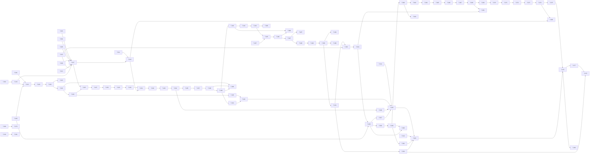

# Build Site

91 tasks across 54 tiers (Tier 0-52 plus a final BLOCKED-EXTERNAL tier), covering exactly the 53 acceptance criteria that are `[~]` (31) or `[ ]` (22) in `context/kits/` on 2026-10-01 - nothing else; the 338 `[x]` criteria are recorded as met in the kits and are not restated. Task IDs start at T-201; a row that says "continues T-1xx" inherits that task's remaining work and gating from `build-site-2026-08-10.archived.md`. **Device lane:** there is ONE TouchPad, so every agent-run task with `Device: yes` sits in a single total order (see `## Device lane`): each is `blockedBy` the previous lane task in addition to its real blockers, and the lane is why the tier count is high - the tiers below are mostly one device sitting each, with host work running in parallel beside them. Host tasks run in parallel except that engine builds (libxul) and daemon builds are one at a time; the daemon build follows the engine build because it links the same objdir. **Batch rule:** all three variants stay on one engine + daemon build. Code fixes are batched - implement, build, ONE push to all three (`build/webos-oe/push-engine-update.sh enyo mochi mojo`, or an `.ipk` upgrade of all three when the adapter or bundled files change) - then the device verifications run in lane order. Batch 1 carries every fix known today; batch 2 carries the plugin VKB adapter work plus whichever [CONDITIONAL] fixes the lane triggers. **Gates:** the 13 tasks in the last tier need a person at the device, hardware that does not exist (no keyboard), a credential, or a product-owner decision; their `Device` column reads `human` because no agent runs them and they are outside the lane. A daemon-level inject is never counted as the human test. Every device row names its observable; "Pre" means: assert the daemon log GREW and the card is CONNECTED before believing a reading, and record the libxul md5 beside the result.

## Tier 0 — No Dependencies (Start Here)

| Task | Title | Cavekit | Requirement | Device | Effort |
|------|-------|---------|-------------|--------|--------|
| T-201 | Housekeeping and baselines before any push: `df /var` first; remove enyo's leftover `MOZ_LOG=...` from `/etc/event.d/jihad` then `stop jihad; start jihad`; confirm `JIHAD_INJECT=1` in all three jobs; record each libxul md5 (enyo traced `cb514e9e...`, mochi/mojo `78c3b51a...`); check whether `org.webosinternals.ipkgservice` exists on CE. Record PRE-CHANGE figures: no-card CPU from `/proc/<pid>/stat` over 60 s, log bytes/min, `about:blank` `painted` lines per 30 s, connect-to-first-`painted` ms on a static page. Pre: daemon log GREW and card CONNECTED before any reading. | cavekit-device-build.md | device-build R8/R4 | yes | M |
| T-202 | Engine fix for the `<video>` MEDIA_ERR_DECODE race: in `third_party/uxp/gfx/layers/basic/BasicImages.cpp` `BasicPlanarYCbCrImage::CopyData`, return the base `RecyclingPlanarYCbCrImage::CopyData` result and `true` under delayed conversion (PICKUP NEW DEFECT 1); commit on `jihad-engine-mods` so the OE SRCREV can follow. Observable is T-220. | cavekit-gre-widgets.md | gre-widgets R1 | no | S |
| T-203 | Daemon idle state: with no card connected stop the 8 ms frame tick (nothing pumped, painted or paced; wake ~1/s or less), keep polling the inject channel at the idle cadence so it can still answer `no page`, wake to the full tick on connect without delaying the first frame, return to idle on disconnect. | cavekit-device-build.md cavekit-engine-embedding.md | device-build R8 engine-embedding R3 | no | M |
| T-204 | Bound the log while running: stop the periodic `tick period` line when there is nothing to report; enforce the 2 x 2 MB cap inside the daemon (rotate/reopen or stop writing, same PID, with a test knob that lowers the cap); write the three-variant worst case into the job comment (`packaging/gen-variant-scripts.sh`) and the `docs/` footprint list. | cavekit-device-build.md | device-build R8 | no | M |
| T-205 | Blank-page settle in the full paint path (`BrowserPageGoanna`): record that a zero-content frame was refused as FINAL for this document/load and stop retrying until an invalidation, navigation or resize; keep the blank-over-good suppression for a blank frame mid-load of a page that later has content; no per-paint log line while settled. | cavekit-offscreen-rendering.md cavekit-engine-embedding.md | offscreen-rendering R8/R3 engine-embedding R3 | no | M |
| T-206 | Confirm or refute the fresh-install -1027 from source: `packaging/gen-variant-scripts.sh` postinst starts the job (`start @@JOB@@`) before ls-hubd has read the new role (its own comment says the role is live only after the requested reboot); read `JihadLunaService.cpp` for any retry. If real, fix so the service registers without a hand restart (daemon-side `LSRegisterPalmService` retry with backoff so it rides the daemon build, and/or a postinst hub rescan before `start`). | cavekit-device-build.md | device-build R4 | no | M |
| T-207 | Prepare R9's two device items (continues T-104): build the `PTHREAD_PROCESS_SHARED` `__kind` probe dynamically linked with the PDK gcc 4.3.3 so it runs against the device's own glibc 2.8 libpthread, and a script that pulls `libflashplayer.so`'s DT_NEEDED closure off the device (`novacom get`) for a host `readelf --dyn-syms` scan for `sem_open`/`*attr_setpshared`. | cavekit-device-build.md | device-build R9 | no | S |
| T-208 | Clean-clone residuals (continues T-115/T-154): `git ls-files build/webos-oe/toolchain/` - `git add` the three crosstool recipe files if still untracked; `git ls-remote` the `UXP-Jihad` fork for `jihad-engine-mods` and confirm the parent gitlink is a pushed commit. If it is not pushed, the push is T-279. | cavekit-device-build.md | device-build R3 | no | S |
| T-209 | Test assets: regenerate >=10 s clips with ffmpeg (VP8, VP9, Theora, Vorbis, Opus, WAV, FLAC, MP3, AAC, H.264) per PICKUP's recipes; extend `render/goanna/test/jihad-media.html` `#state` with ended/error/currentTime/duration/decoded+dropped frames/volume/muted plus a fixed-width variant; add an input-echo page (plain `<input>`, `<textarea>`, controlled re-set-from-state input); stage via `stage-test-pages.sh`. | cavekit-gre-widgets.md cavekit-input-bridging.md | gre-widgets R1 input-bridging R2a | no | M |
| T-210 | Refresh `app-mochi/PARITY.md` against today's `app/` and `app-mochi/` (safeUrl, settings entry, toast and other post-2026-07-31 changes) so the human sign-off (T-291) is on a current checklist. Continues T-113. | cavekit-mochi-ui.md | mochi-ui R2 | no | S |
| T-211 | Adapter latch instrument (continues T-124): a `g_message` on every `mFlashGestureLock` set/clear with its call site in `render/adapter/BrowserAdapter.cpp` (DEBUG/TRACEF compile to nothing today), so the runtime value is readable via palm-log; ships in the batch-1 `.ipk`s (PDK build). | cavekit-input-bridging.md | input-bridging R7 | no | S |
| T-212 | Plugin VKB raise (continues T-144): in the adapter raise the VKB when the plugin latch engages on a plugin that wants text and lower it when the latch clears, mirroring the `msgEditorFocused` path; document what signals "wants text" and that the latch is double-tap only. Batch 2 (adapter, `.ipk`). | cavekit-input-bridging.md | input-bridging R7 | no | M |
| T-213 | Keycode follow-ups in `BrowserPageGoanna::keyDown` (continues T-127/T-109): extend the PUA swallow to the real `0xE0E2`-`0xE0E7` codes so they stop inserting invisible glyphs; add an env-gated log of the raw `(key, chr, modifiers)` triple at `asyncCmdKeyDown` (codes only, suppressed for password fields) - the instrument the human VKB session (T-282) needs. | cavekit-gre-widgets.md | gre-widgets R3 | no | S |
| T-214 | From source, explain and fix the two 2026-08-15 inject findings: `key 57346` (0xE0A2) did not move the caret in a `<textarea>` (`abcd` + 2 x Left + `X` gave `abcdX`), and the first `text` after a focus change into a `<textarea>` was dropped; state whether the inject `key` path reaches the keycode map at all. | cavekit-gre-widgets.md cavekit-input-bridging.md | gre-widgets R3 input-bridging R2a | no | M |
| T-215 | Settings-command instrument (continues T-116): one log line per frozen handler (`SetEnableJavaScript`, `SetBlockPopups`, `SetAcceptCookies`, `SetMinFontSize`, `SetUserAgent`) with the received value; a test page that opens its popup from a click handler (not during load, the 2026-08-15 confound) and a script-marker page. | cavekit-preferences-ui.md | preferences-ui R5 | no | S |

## Tier 1 — Depends on Tier 0

| Task | Title | Cavekit | Requirement | blockedBy | Device | Effort |
|------|-------|---------|-------------|-----------|--------|--------|
| T-216 | Engine build, batch 1: incremental libxul in the podman container (`build-goanna-arm.sh build`); record its md5. The only engine build in flight. | cavekit-gre-widgets.md | gre-widgets R1 | T-202 | no | S |

## Tier 2 — host work

| Task | Title | Cavekit | Requirement | blockedBy | Device | Effort |
|------|-------|---------|-------------|-----------|--------|--------|
| T-217 | Daemon build, batch 1 (`build-daemon-arm.sh`) with every batch-1 daemon change; `check-yap-contract.sh` passes (73 commands incl. 0x1600, 58 messages). Serialized after T-216 because it links against the same objdir. | cavekit-device-build.md | device-build R8/R4 | T-203, T-204, T-205, T-206, T-213, T-215, T-216 | no | S |

## Tier 3 — device sitting: Batch-1 push to all three variants

| Task | Title | Cavekit | Requirement | blockedBy | Device | Effort |
|------|-------|---------|-------------|-----------|--------|--------|
| T-218 | Batch-1 packages: `build-adapter-pdk.sh` AND `build-adapter-arm.sh` (with T-211), then `build-variant-ipk.sh` for enyo/mochi/mojo carrying T-216's libxul, T-217's daemon and T-206's postinst; verify each payload's libxul/daemon md5 equals the built ones and `libasound.so.2` is present. | cavekit-device-build.md | device-build R4/R3 | T-211, T-217 | no | S |
| T-219 | Batch-1a ENGINE push (split from the daemon push 2026-10-01 so the `<video>` verification is not confounded by — or held up behind — the daemon changes): push the T-216 libxul to all three variants with the daemon left exactly as it is; read back libxul md5 on all three (= T-216; enyo leaves the traced build) and the unchanged daemon md5; `JIHAD_INJECT=1` intact; clean restart of each job; push T-209's pages and clips to `/tmp/jm/`. Pre: daemon log GREW and card CONNECTED before any reading. | cavekit-gre-widgets.md | gre-widgets R1 | T-201, T-216, T-209 | yes | S |

## Tier 4 — device sitting: Verify: <video> plays to the end (VP8+Theora, file+http, 3 runs)

| Task | Title | Cavekit | Requirement | blockedBy | Device | Effort |
|------|-------|---------|-------------|-----------|--------|--------|
| T-220 | `<video>` plays to the end (continues T-101/T-125): VP8/WebM and Theora/Ogg >=10 s clips over `file://` and `http://`, three consecutive runs each; read `#state` via `gettext`: `ended=true`, `error=null`, `currentTime` within one frame of `duration`, decoded frames of the order of the clip's frame count (not 10-60); libxul md5 recorded for all three variants. Pre: daemon log GREW and card CONNECTED before any reading. | cavekit-gre-widgets.md | gre-widgets R1/R7 | T-219 | yes | M |

## Tier 5 — device sitting: Verify: codec reality table + undecodable-media degradation

| Task | Title | Cavekit | Requirement | blockedBy | Device | Effort |
|------|-------|---------|-------------|-----------|--------|--------|
| T-221 | Codec reality (continues T-101): per format (VP8, VP9, Theora, Vorbis, Opus, WAV, FLAC, MP3, AAC, H.264) record `canPlayType`, plays-to-end, and the reason where not (missing decoder vs defect) from `#state`; `anon video` shows the videocontrols `controlBar` attached; screenshot the error overlay for an H.264 `<video>` and an MP3 `<audio>`. Pre: daemon log GREW and card CONNECTED before any reading. | cavekit-gre-widgets.md cavekit-device-build.md | gre-widgets R1 device-build R4 | T-220 | yes | M |

## Tier 6 — device sitting: Verify: play/pause both directions by daemon click

| Task | Title | Cavekit | Requirement | blockedBy | Device | Effort |
|------|-------|---------|-------------|-----------|--------|--------|
| T-222 | Play/pause both directions by daemon-level `clickat` on the control bar (continues T-145): long clip, reveal the auto-hidden bar before each click, read `paused`/`currentTime` before and after; both directions must change state. The finger test stays human (T-285). Pre: daemon log GREW and card CONNECTED before any reading. | cavekit-gre-widgets.md | gre-widgets R1 | T-221 | yes | S |
| T-223 | Bring `packaging/prefs/jihad-platform-prefs.js` in line with T-220/T-221: the `<video>` reason is true again, and the stale "no audio output" reasoning becomes the 2026-09-27 measured state (continues T-138). | cavekit-gre-widgets.md | gre-widgets R7 | T-221 | no | S |

## Tier 7 — device sitting: Measure: does engine media need the CPU boost (R10)

| Task | Title | Cavekit | Requirement | blockedBy | Device | Effort |
|------|-------|---------|-------------|-----------|--------|--------|
| T-224 | R10 media measurement (continues T-118/T-134): stock tunables read back, `scaling_cur_freq` once a second across a >=10 s `<video>` with dropped/decoded counts; floor + drops means extend, otherwise record the numbers and close "do not extend"; tunables read back stock afterwards; `scaling_governor` READ only. Pre: daemon log GREW and card CONNECTED before any reading. | cavekit-device-build.md | device-build R10 | T-222 | yes | S |

## Tier 8 — device sitting: Verify: idle daemon CPU, wakeups, connect latency, re-idle

| Task | Title | Cavekit | Requirement | blockedBy | Device | Effort |
|------|-------|---------|-------------|-----------|--------|--------|
| T-225 | Batch-1b DAEMON push first: `push-engine-update.sh enyo mochi mojo` with the T-217 daemon (libxul unchanged from T-219), md5 read back on all three, `JIHAD_INJECT=1` intact, clean restart of each job. Then idle daemon: all cards closed, per variant `/proc/<pid>/stat` utime+stime over >=60 s (<0.5% of a core) and wakeups from the `voluntary_ctxt_switches` delta (~1/s or less); an inject `url` with no card still answers `no page`; reconnect, connect-to-first-`painted` vs T-201's baseline; close the card and see the idle figures return without a restart. Pre: daemon log GREW and card CONNECTED before any reading. | cavekit-device-build.md | device-build R8 | T-224, T-217 | yes | M |
| T-226 | [CONDITIONAL] Only if T-224 shows the clock at the floor with frames dropping: extend the boost to engine media with its own owner, release path and post-stop restore (patch `0027` model); batch 2. | cavekit-device-build.md | device-build R10 | T-224 | no | M |

## Tier 9 — device sitting: Verify: log bounded idle (10 min) and past the cap (same PID)

| Task | Title | Cavekit | Requirement | blockedBy | Device | Effort |
|------|-------|---------|-------------|-----------|--------|--------|
| T-227 | Log bound: (a) no card, a 10-minute window, `daemon.log` growth per variant of at most a few hundred bytes; (b) one variant with the cap lowered by T-204's knob and a noisy page drives the log past the cap in one lifetime: it rotates or stops with the same PID and logs again afterwards, then restore the job; (c) the worst-case number is in the job comment. Assert the log GREW during (b). Pre: daemon log GREW and card CONNECTED before any reading. | cavekit-device-build.md | device-build R8 | T-225 | yes | M |

## Tier 10 — device sitting: Verify: about:blank settles; real page still paints; no white flash

| Task | Title | Cavekit | Requirement | blockedBy | Device | Effort |
|------|-------|---------|-------------|-----------|--------|--------|
| T-228 | Blank settle: `about:blank` for 30 s, `painted` lines vs the static-content control and T-201's baseline (a handful, not hundreds); then navigate to a real page and see its first frame promptly; a page blank mid-load that then gets content must not publish the blank over the previous good frame (frame capture). Pre: daemon log GREW and card CONNECTED before any reading. | cavekit-offscreen-rendering.md | offscreen-rendering R8/R3 | T-227 | yes | M |

## Tier 11 — device sitting: Measure: idle CPU with a static page loaded

| Task | Title | Cavekit | Requirement | blockedBy | Device | Effort |
|------|-------|---------|-------------|-----------|--------|--------|
| T-229 | Engine idle: static page loaded, no input, `/proc/<pid>/stat` CPU over 60 s per variant; record the figure on engine-embedding R3. Pre: daemon log GREW and card CONNECTED before any reading. | cavekit-engine-embedding.md | engine-embedding R3 | T-228 | yes | S |

## Tier 12 — device sitting: CE baseline md5s + Atlas identity columns

| Task | Title | Cavekit | Requirement | blockedBy | Device | Effort |
|------|-------|---------|-------------|-----------|--------|--------|
| T-230 | Fresh CE baseline: md5 of the stock file set plus Atlas's files (replaces the 3.0.5 `baseline-v2`); read Atlas's identity columns off the device (NPAPI MIME, shim filename, YAP name, socket, upstart job, Luna name) and compare with all three Jihad variants - no column may be equal. | cavekit-device-build.md | device-build R4/R8 | T-229 | yes | S |

## Tier 13 — device sitting: Removal audit #1 to a role-less start

| Task | Title | Cavekit | Requirement | blockedBy | Device | Effort |
|------|-------|---------|-------------|-----------|--------|--------|
| T-231 | Removal audit #1 and role-less start: remove the three variants one at a time through the supported installer (the remaining ones keep serving after each removal; `prerm` removes exactly what postinst created, naming any failing assertion; rootfs read-only again); then show no app dir, job, shim/impl, role/service file or state dir remains and the hub has forgotten the name (rescan, or reboot with unmodified shipped jobs); re-read Atlas md5s. | cavekit-device-build.md | device-build R4/R7/R8 | T-230, T-218 | yes | M |

## Tier 14 — device sitting: Fresh install Enyo (supported path): daemon, socket, render, Luna

| Task | Title | Cavekit | Requirement | blockedBy | Device | Effort |
|------|-------|---------|-------------|-----------|--------|--------|
| T-232 | Fresh install, Enyo: install T-218's `.ipk` via the supported installer and do only what postinst asks; observe the daemon running from the app's own deviceroot (`/proc/<pid>/exe`), its YAP socket, the card launching and rendering (screenshot); grep the serving PID's log for `LSRegisterPalmService ... FAILED` / a later success; `luna-send -P` `clearCookies` or `getChromePrefs` to the variant service is answered. Pre: daemon log GREW and card CONNECTED before any reading. | cavekit-device-build.md | device-build R4 | T-231 | yes | M |

## Tier 15 — device sitting: Fresh install Mochi + Mojo; db8 kinds; Mojo framework

| Task | Title | Cavekit | Requirement | blockedBy | Device | Effort |
|------|-------|---------|-------------|-----------|--------|--------|
| T-233 | Fresh install, Mochi then Mojo: the same observables as T-232 per variant, plus Mochi's db8 kinds (bookmarks, history, downloads) registered and Mojo launching against `/usr/palm/frameworks/mojo` with no framework error. Pre: daemon log GREW and card CONNECTED before any reading. | cavekit-device-build.md | device-build R4 | T-232 | yes | M |

## Tier 16 — device sitting: Postinst reboot: Luna recovered?, sem_t across reboot, probes

| Task | Title | Cavekit | Requirement | blockedBy | Device | Effort |
|------|-------|---------|-------------|-----------|--------|--------|
| T-234 | The reboot postinst asks for (shipped, unmodified jobs only): per variant state whether the Luna service registered on first start or recovered (same-PID success, public-bus call answered); `sem_t` containment holds across the reboot (`engine up; serving YAP`, no PmLogLib hang); `plugin_mime_probe` and `alsa_probe` under both loaders. Afterwards re-add `JIHAD_INJECT=1` and restage `/tmp` assets. Pre: daemon log GREW and card CONNECTED before any reading. | cavekit-device-build.md | device-build R4 | T-233 | yes | M |

## Tier 17 — device sitting: Atlas coexistence: md5s, both serve, kill either, own connects only

| Task | Title | Cavekit | Requirement | blockedBy | Device | Effort |
|------|-------|---------|-------------|-----------|--------|--------|
| T-235 | Atlas coexistence (2)-(4): Atlas md5s after install equal T-230's; with Atlas's daemon and a Jihad daemon both running each card loads and renders a page; killing either daemon leaves the other serving; each daemon's log shows only its own card's connect. Pre: daemon log GREW and card CONNECTED before any reading. | cavekit-device-build.md | device-build R4 | T-234 | yes | M |
| T-236 | [CONDITIONAL] Only if T-232/T-233/T-234 show a variant whose service neither registered on first start nor recovered without a hand restart: revise T-206's fix (daemon retry and/or postinst); batch 2. | cavekit-device-build.md | device-build R4 | T-234 | no | S |

## Tier 18 — device sitting: Capture negotiated TLS version from a real page load

| Task | Title | Cavekit | Requirement | blockedBy | Device | Effort |
|------|-------|---------|-------------|-----------|--------|--------|
| T-237 | TLS capture: load `https://www.howsmyssl.com/a/check` in a card, `gettext body` through the card-connected daemon, record the literal `tls_version` string with date and libxul md5; an empty readout is no measurement. Pre: daemon log GREW and card CONNECTED before any reading. | cavekit-browser-services.md | browser-services R5 | T-235 | yes | S |

## Tier 19 — device sitting: Verify: controls render, scrubber tracks/rests/seeks

| Task | Title | Cavekit | Requirement | blockedBy | Device | Effort |
|------|-------|---------|-------------|-----------|--------|--------|
| T-238 | Media controls render + scrubber (continues T-137): one screenshot per element type (`<video controls>`, `<audio controls>`) with the thumb off 0 while `currentTime` > 0; two screenshots >=3 s apart show increasing thumb positions and no stray `0:00` bubble at the far left; thumb rests at the end at `ended`; a `clickat` on the track moves `currentTime` to that position. Pre: daemon log GREW and card CONNECTED before any reading. | cavekit-gre-widgets.md | gre-widgets R1 | T-237 | yes | M |

## Tier 20 — device sitting: Verify: volume widget input + pulse sink-input volume

| Task | Title | Cavekit | Requirement | blockedBy | Device | Effort |
|------|-------|---------|-------------|-----------|--------|--------|
| T-239 | In-player volume: daemon-level click on mute toggles `muted`, a click on the slider changes `volume` (read from `#state`); the daemon stream's pulse sink-input volume (`pacmd list-sink-inputs`) moves with it, composed with the mirrored system volume. Record which half fails, if any. Pre: daemon log GREW and card CONNECTED before any reading. | cavekit-gre-widgets.md | gre-widgets R1 | T-238 | yes | M |

## Tier 21 — device sitting: Investigate: volume HUD for the daemon's stream; write decision

| Task | Title | Cavekit | Requirement | blockedBy | Device | Effort |
|------|-------|---------|-------------|-----------|--------|--------|
| T-240 | Volume HUD: read the CE audio policy config on the device for which stream roles get the system HUD, and either identify a change that makes the daemon's stream HUD-eligible (route it into batch 2) or write the decision (what was tried, why the platform will not show it, cosmetic residual) on gre-widgets R1. The key press itself is human (T-286). | cavekit-gre-widgets.md | gre-widgets R1 | T-239 | yes | S |
| T-241 | [CONDITIONAL] Only if T-239 shows input reaching the widget but the sink-input volume not moving: make element `volume`/`muted` reach the cubeb pulse stream composed with the system-volume mirror; batch 2. | cavekit-gre-widgets.md | gre-widgets R1 | T-239 | no | M |

## Tier 22 — device sitting: Verify: Cookies-cleared toast in all three shells

| Task | Title | Cavekit | Requirement | blockedBy | Device | Effort |
|------|-------|---------|-------------|-----------|--------|--------|
| T-242 | Toast channel: with the Luna service confirmed registered, `luna-send -P` `clearCookies` per variant gives the daemon's `notify: ... (pushed)` line AND a visible toast in a screenshot of each of the three shells (continues T-146/T-148). Pre: daemon log GREW and card CONNECTED before any reading. | cavekit-gre-widgets.md | gre-widgets R5 | T-240 | yes | S |
| T-243 | [CONDITIONAL] Engine build, batch 2: only if T-226 or T-241 changed the engine; record md5. | cavekit-device-build.md cavekit-gre-widgets.md | device-build R10 gre-widgets R1 | T-226, T-241 | no | S |

## Tier 23 — device sitting: CE cert store + cert/dialog/download flows

| Task | Title | Cavekit | Requirement | blockedBy | Device | Effort |
|------|-------|---------|-------------|-----------|--------|--------|
| T-244 | Cert store on CE + R4 flows (continues T-135/T-152): `libPmCertificateMgr.so` md5 and nine symbols resolve; self-signed HTTPS endpoint on the host raises SSL-confirm with non-empty certFile; Trust Once via the reply FIFO gives `CertAddTrustedCert rc=0` and the page loads; an `application/octet-stream` download lands in `/media/internal/downloads` with matching md5. Pre: daemon log GREW and card CONNECTED before any reading. | cavekit-browser-services.md cavekit-device-build.md | browser-services R5 device-build R4 | T-242 | yes | M |

## Tier 24 — device sitting: Run R9 probes: __kind on glibc 2.8; Flash closure; CE closure resolves

| Task | Title | Cavekit | Requirement | blockedBy | Device | Effort |
|------|-------|---------|-------------|-----------|--------|--------|
| T-245 | R9 on the device (continues T-104): run T-207's probe and read `__kind` after a `PTHREAD_PROCESS_SHARED` init on glibc 2.8; walk `libflashplayer.so`'s closure (incl. `libPmLogLib.so`) for other `sem_open` users; confirm the closure still resolves on CE (libssl/libcrypto 0.9.8, libcurl, libWebKitLuna, libPiranha). | cavekit-device-build.md | device-build R9/R4 | T-244, T-207 | yes | S |

## Tier 25 — device sitting: Plugin/Flash sweep + R10 boost taken/released

| Task | Title | Cavekit | Requirement | blockedBy | Device | Effort |
|------|-------|---------|-------------|-----------|--------|--------|
| T-246 | Plugin sweep (addons R7, device-build R10): `about:plugins` and the NPAPI path; `jihad-anim.swf` instantiates and renders; the windowless control plugin composites at the right position/size/zoom and logs mouse/key input; plugin YAP commands; a plugin crash leaves the daemon serving; tunables read back stock at rest, boost taken on Flash and released on navigate-away and on daemon kill; `scaling_governor` read only. Pre: daemon log GREW and card CONNECTED before any reading. | cavekit-device-build.md cavekit-addons-extensions.md | device-build R4/R10 addons-extensions R7 | T-245 | yes | M |

## Tier 26 — device sitting: Re-measure Flash frame-gap histograms on CE (pull vs Flash-alone)

| Task | Title | Cavekit | Requirement | blockedBy | Device | Effort |
|------|-------|---------|-------------|-----------|--------|--------|
| T-247 | Flash pacing on CE (continues T-123/T-136): clean-restart `jihad-anim.swf` runs in the `0029` pull config and in Flash-alone (`JIHAD_PLUGIN_PULL=0 JIHAD_PLUGIN_SELF_DRIVE=0`) with the boost confirmed engaged; record the frame-gap HISTOGRAMS, not averages; leave the device in Flash-alone for the human comparison (T-287). Pre: daemon log GREW and card CONNECTED before any reading. | cavekit-addons-extensions.md | addons-extensions R7 | T-246 | yes | M |

## Tier 27 — device sitting: about:addons + extension lifecycle sweep

| Task | Title | Cavekit | Requirement | blockedBy | Device | Effort |
|------|-------|---------|-------------|-----------|--------|--------|
| T-248 | Add-ons sweep R1/R2/R4/R5: `engine up; serving YAP` with no SIGSEGV; `about:addons` renders and lists items; enable/disable/remove persist across a restart; SIGTERM flushes `prefs.js` and `extensions.json`; operable via the synthesized input path incl. the tools menu; a test extension alters a page and disable/enable removes/restores the effect; extensions live in the variant's own profile. Pre: daemon log GREW and card CONNECTED before any reading. | cavekit-device-build.md cavekit-addons-extensions.md | device-build R4 addons-extensions R1/R2/R4/R5 | T-247 | yes | M |

## Tier 28 — device sitting: XPI install flow + mismatched-XPI toast + installed toast

| Task | Title | Cavekit | Requirement | blockedBy | Device | Effort |
|------|-------|---------|-------------|-----------|--------|--------|
| T-249 | XPI sweep R3 + mismatch (continues T-103): opening an `.xpi` raises the install prompt naming the extension; accept via the dialog reply path, then it is listed and active; a mismatched-`targetApplication` XPI is refused with the incompatibility message visible on the card (now a toast; screenshot) and nothing installed; the add-on-installed toast observed once. Pre: daemon log GREW and card CONNECTED before any reading. | cavekit-addons-extensions.md cavekit-gre-widgets.md cavekit-device-build.md | addons-extensions R3 gre-widgets R5 device-build R4 | T-248 | yes | M |

## Tier 29 — device sitting: Preferences sweep + pref read-side + chrome-page typing on CE

| Task | Title | Cavekit | Requirement | blockedBy | Device | Effort |
|------|-------|---------|-------------|-----------|--------|--------|
| T-250 | Prefs sweep (continues T-117/T-131/T-143): `about:preferences` renders in each variant and `about:settings` aliases it (settle the bare-URL header/footer-only case); panes present; a change persists to that variant's `prefs.js` only; page-to-card by COORDINATE click; dropdown via card popup; no horizontal overflow; `network.cookie.cookieBehavior` set from the page survives a card relaunch as a `user_pref` and in `about:config`; text typed into a focused chrome field lands. Pre: daemon log GREW and card CONNECTED before any reading. | cavekit-device-build.md cavekit-preferences-ui.md | device-build R4 preferences-ui R2/R6 | T-249 | yes | M |

## Tier 30 — device sitting: Verify: page-written javascript.enabled=false stops script after navigation

| Task | Title | Cavekit | Requirement | blockedBy | Device | Effort |
|------|-------|---------|-------------|-----------|--------|--------|
| T-251 | JavaScript from the page (continues T-142/T-130): write `javascript.enabled=false` through `about:preferences`' own write path, NAVIGATE to the script-marker page, read `gettext #j` (`NOSCRIPT` expected); re-enable and see `SCRIPT-RAN`; state which 2026-08-05 explanation was true. Pre: daemon log GREW and card CONNECTED before any reading. | cavekit-preferences-ui.md | preferences-ui R3 | T-250 | yes | S |

## Tier 31 — device sitting: Verify: frozen YAP settings commands toggle at runtime

| Task | Title | Cavekit | Requirement | blockedBy | Device | Effort |
|------|-------|---------|-------------|-----------|--------|--------|
| T-252 | Frozen settings commands (continues T-116): drive each command through a temporary card hook (`push-card-js.sh`), read T-215's handler line and the effect (click-opened popup blocked/allowed, script marker after navigation, cookie count, computed min font size); revert the hook and prove the card JS is back to shipping. Pre: daemon log GREW and card CONNECTED before any reading. | cavekit-preferences-ui.md | preferences-ui R5 | T-251, T-215 | yes | M |
| T-253 | [CONDITIONAL] Only if T-251 shows the page's write stopping script on the next load (else first fix the page write path): restore the JavaScript row in `packaging/prefsui/content/preferences.js` (continues T-147); ships in the batch-2 `.ipk`. | cavekit-preferences-ui.md | preferences-ui R2 | T-251 | no | S |

## Tier 32 — device sitting: Verify: Mojo adopts an edit made on about:preferences

| Task | Title | Cavekit | Requirement | blockedBy | Device | Effort |
|------|-------|---------|-------------|-----------|--------|--------|
| T-254 | Mojo editable settings (continues T-112/T-156): navigate the Mojo card to its `settingsUrl()` (`about:preferences#chrome=...`), change the home URL by coordinate click + inserted text, return to the start page and read the adopted value (card log / start-page screenshot). Pre: daemon log GREW and card CONNECTED before any reading. | cavekit-mojo-ui.md | mojo-ui R7 | T-252 | yes | S |

## Tier 33 — device sitting: Verify: input-event echo, arrow/PUA keys, first-word-after-focus

| Task | Title | Cavekit | Requirement | blockedBy | Device | Effort |
|------|-------|---------|-------------|-----------|--------|--------|
| T-255 | Input-event and typing checks: on the echo page, focus by click and insert text into a plain `<input>`, a `<textarea>` and the controlled input, read the echo (event seen?); inject Left/Right, Up/Down (settles the daemon side of the 0xE0A0/A1 order), `0xE0E2`-`0xE0E7` (no glyph), single-line Up/Down degrade to Home/End, and a first word after focus into a `<textarea>`. Pre: daemon log GREW and card CONNECTED before any reading. | cavekit-input-bridging.md cavekit-gre-widgets.md | input-bridging R2a gre-widgets R3 | T-254, T-209 | yes | M |

## Tier 34 — device sitting: Input sweep R1/R2/R2a/R5 on CE

| Task | Title | Cavekit | Requirement | blockedBy | Device | Effort |
|------|-------|---------|-------------|-----------|--------|--------|
| T-256 | Input sweep R1/R2/R2a/R5: `clickAt` hits the element, click count kept, checkbox/radio toggle with one `change`, XUL chrome taps do not crash, XUL buttons activate; key events, ASCII/symbol/non-ASCII typing, `insertStringAtCursor`, visible caret (screenshot); Backspace/Delete by code point, typing over a selection, Enter/Tab, number/email accept text; a click at zoom != 1 lands on the link. Pre: daemon log GREW and card CONNECTED before any reading. | cavekit-device-build.md cavekit-input-bridging.md | device-build R4 input-bridging R1/R2/R2a/R5 | T-255 | yes | M |
| T-257 | [CONDITIONAL] Only if T-255 shows no echo: fix `FlushPendingInputEvent`/the pending-input path so a bubbling `input` event reaches page script for all three field kinds; batch 2. | cavekit-input-bridging.md | input-bridging R2a | T-255 | no | M |

## Tier 35 — device sitting: VKB on every page in a session + uncovered-pan instrument

| Task | Title | Cavekit | Requirement | blockedBy | Device | Effort |
|------|-------|---------|-------------|-----------|--------|--------|
| T-258 | VKB session (continues T-119/T-133): in one session focus an editable by `clickid` on >=3 different pages and screenshot the VKB raised each time; a top-of-page field stays visible on raise (`JIHAD_T1_LOG=1`); at a long page's bottom raise and dismiss the VKB and read the `[jihad-bs] uncovered pan ... gapTop/gapBot sinceResize dh` lines. Pre: daemon log GREW and card CONNECTED before any reading. | cavekit-input-bridging.md | input-bridging R2 | T-256 | yes | M |
| T-259 | [CONDITIONAL] Daemon build, batch 2: only if a batch-2 daemon change exists (T-236, T-257) or T-243 ran; contract check passes. | cavekit-device-build.md cavekit-input-bridging.md | device-build R4 input-bridging R2a | T-243, T-236, T-257 | no | S |

## Tier 36 — device sitting: Touch struct on CE libWebKitLuna + touchEvent sweep

| Task | Title | Cavekit | Requirement | blockedBy | Device | Effort |
|------|-------|---------|-------------|-----------|--------|--------|
| T-260 | Touch sweep R3: pull CE `libWebKitLuna.so`, re-read `NpPalmTouchEvent` size/offsets from `PluginView::handleTouchEvent` (28 bytes on 3.0.5) BEFORE enabling anything; then `touchEvent` delivers DOM touch events with the right count and coordinates on a user-scalable=no page. Pre: daemon log GREW and card CONNECTED before any reading. | cavekit-device-build.md cavekit-input-bridging.md | device-build R4 input-bridging R3 | T-258 | yes | M |
| T-261 | [CONDITIONAL] Only if T-258's lines show `sinceResize` in single-digit ms with `dh=+340`: in both `handlePaint` paths shift the source window instead of clipping the dst when the buffer has the rows (sticky edge, not white); batch 2. | cavekit-input-bridging.md | input-bridging R2 | T-258 | no | M |

## Tier 37 — device sitting: about:config/XUL sweep + date pref + richlistbox/tree

| Task | Title | Cavekit | Requirement | blockedBy | Device | Effort |
|------|-------|---------|-------------|-----------|--------|--------|
| T-262 | XUL sweep: `about:config` end to end (warning button, filter text, toggle, value in `prefs.js` after stop), `about:addons` buttons, XUL default actions, Escape closes the tools menu, no regression to HTML input; with the date/time pref off a date field is `type=text`; `richlistbox`/`tree` select, toggle and persist in `about:addons`/`about:config`. Pre: daemon log GREW and card CONNECTED before any reading. | cavekit-device-build.md cavekit-input-bridging.md cavekit-gre-widgets.md | device-build R4 input-bridging R6 gre-widgets R2/R4 | T-260 | yes | M |
| T-263 | Batch-2 packages: both adapters (with T-212 and any T-261), then all three `.ipk`s carrying the current libxul/daemon and any T-253/T-236 change; verify payload md5s. | cavekit-input-bridging.md cavekit-preferences-ui.md | input-bridging R7/R2 preferences-ui R2 | T-259, T-212, T-261, T-253 | no | S |

## Tier 38 — device sitting: Offscreen sweep R1-R6 + PG symbols on CE libWebKitLuna

| Task | Title | Cavekit | Requirement | blockedBy | Device | Effort |
|------|-------|---------|-------------|-----------|--------|--------|
| T-264 | Offscreen sweep R1-R6: windowless render and surface size tracks the window; non-blank frame, pixel format/stride, no channel swap or flip; one paint notification per frame, no buffer reuse before return, content change repaints without input; contents-size/scrolled-to/meta-viewport messages; size/scroll/zoom-and-scroll with input mapped at the new scale; `PGContext::bitblt`/`PGSurface::wrap` resolve in CE `libWebKitLuna.so`. Pre: daemon log GREW and card CONNECTED before any reading. | cavekit-device-build.md cavekit-offscreen-rendering.md | device-build R4 offscreen-rendering R1/R2/R3/R4/R5/R6 | T-262 | yes | M |

## Tier 39 — device sitting: Offscreen sweep R7/R8: select, tools menu, popups, scroll frame

| Task | Title | Cavekit | Requirement | blockedBy | Device | Effort |
|------|-------|---------|-------------|-----------|--------|--------|
| T-265 | Offscreen sweep R7/R8: a `<select>` reaches the card in each variant; the `about:addons` tools menu opens, composites, dismisses and its items ACTIVATE; an open popup is interactive (first verification ever); an engine-initiated scroll forces one full frame. Pre: daemon log GREW and card CONNECTED before any reading. | cavekit-device-build.md cavekit-offscreen-rendering.md | device-build R4 offscreen-rendering R7/R8 | T-264 | yes | M |

## Tier 40 — device sitting: Enyo shell sweep (no-finger items)

| Task | Title | Cavekit | Requirement | blockedBy | Device | Effort |
|------|-------|---------|-------------|-----------|--------|--------|
| T-266 | Enyo shell sweep: launches to start page, icon/splash (screenshot); launch with a target issues `openUrl` and paints on this variant's own socket/adapter only; stored shortcut list rendered; home control right of forward; `<select>` list anchored under the control; page `alert` reaches the card; `find` gives 1/0; usable 1024x768 layout. Pre: daemon log GREW and card CONNECTED before any reading. | cavekit-device-build.md | device-build R4 | T-265 | yes | M |

## Tier 41 — device sitting: Mochi shell sweep (no-finger items)

| Task | Title | Cavekit | Requirement | blockedBy | Device | Effort |
|------|-------|---------|-------------|-----------|--------|--------|
| T-267 | Mochi shell sweep: the same no-finger checks as T-266 on the Mochi card (db8 kinds were checked at install). Pre: daemon log GREW and card CONNECTED before any reading. | cavekit-device-build.md | device-build R4 | T-266 | yes | S |

## Tier 42 — device sitting: Mojo shell sweep incl. command-row geometry probe

| Task | Title | Cavekit | Requirement | blockedBy | Device | Effort |
|------|-------|---------|-------------|-----------|--------|--------|
| T-268 | Mojo shell sweep: the same no-finger checks as T-266, plus the command row's documented buttons and geometry (the geometry probe) and load state / title / committed URL / failed-load error shown (screenshots). Pre: daemon log GREW and card CONNECTED before any reading. | cavekit-device-build.md | device-build R4 | T-267 | yes | M |

## Tier 43 — device sitting: Daemon sweep A: cookies+cache persist, low-mem, four dialogs

| Task | Title | Cavekit | Requirement | blockedBy | Device | Effort |
|------|-------|---------|-------------|-----------|--------|--------|
| T-269 | Daemon-side sweep A (browser-services R2/R3): cookies AND the HTTP disk cache persist across a daemon restart; the low-memory guardrail fires with a raised threshold; `clearCache`/`clearCookies` on the public bus; `alert`, `confirm`, `prompt` and HTTP-auth each emit their dialog and the page stays blocked until the reply arrives over the pipe. Pre: daemon log GREW and card CONNECTED before any reading. | cavekit-device-build.md | device-build R4 | T-268 | yes | M |

## Tier 44 — device sitting: Daemon sweep B: ipc R4/R5, engine R2 shutdown, nav R4/R6

| Task | Title | Cavekit | Requirement | blockedBy | Device | Effort |
|------|-------|---------|-------------|-----------|--------|--------|
| T-270 | Daemon-side sweep B: `clearCookies` lowers the cookie count on an install-started daemon; adapter connects and completes load + paint; a pref written seconds before `stop` lands; `stop` with a card connected exits without a fault and the job file carries `stop on runlevel [06]`; an HTTP 3xx is followed in-browser with the final location reported; a coordinate tap on a link emits link-clicked with the absolute URL. Pre: daemon log GREW and card CONNECTED before any reading. | cavekit-device-build.md | device-build R4 | T-269 | yes | M |

## Tier 45 — device sitting: Device-build sweep: toolchain program, lib load, navigation

| Task | Title | Cavekit | Requirement | blockedBy | Device | Effort |
|------|-------|---------|-------------|-----------|--------|--------|
| T-271 | Device-build sweep R1/R2/R4: a C++14 program from the toolchain runs; engine libraries load with no missing-symbol/ABI error and FP/SIMD attributes (`readelf -A`) match the CPU; URL load, back/forward/reload and load-complete on each variant. Pre: daemon log GREW and card CONNECTED before any reading. | cavekit-device-build.md | device-build R4 | T-270 | yes | S |

## Tier 46 — device sitting: Device-build sweep R5: memory budget, freeze, no OOM

| Task | Title | Cavekit | Requirement | blockedBy | Device | Effort |
|------|-------|---------|-------------|-----------|--------|--------|
| T-272 | Memory sweep R5: RSS on a typical page within budget; `freeze` reclaims memory (before/after); the defined browsing scenario runs with no OOM kill (`dmesg`). Pre: daemon log GREW and card CONNECTED before any reading. | cavekit-device-build.md | device-build R4 | T-271 | yes | M |

## Tier 47 — device sitting: Removal audit #2 with extensions in two variants; reinstall

| Task | Title | Cavekit | Requirement | blockedBy | Device | Effort |
|------|-------|---------|-------------|-----------|--------|--------|
| T-273 | Removal audit #2: with the test extension installed in two variants, remove one via the supported installer; its extensions go, the other's stay; nothing outside its profile written on removal; the others keep serving; nothing in `/media/internal` beyond the download carve-out; footprint limited to the enumerated paths; runtime state removed; `prerm` exact; rootfs read-only on every exit; Atlas md5s unchanged; reinstall it. Pre: daemon log GREW and card CONNECTED before any reading. | cavekit-device-build.md cavekit-addons-extensions.md | device-build R4 addons-extensions R5/R6 | T-272 | yes | M |

## Tier 48 — device sitting: Investigate why hidd does not forward a uinput keyboard

| Task | Title | Cavekit | Requirement | blockedBy | Device | Effort |
|------|-------|---------|-------------|-----------|--------|--------|
| T-274 | hidd investigation (continues T-108): why the uinput test keyboard (`event3`, opened by hidd and LunaSysMgr) is never dispatched to the card - `/etc/hidd/HidPlugins.xml`, `libhidinputdev.so`, `/var/run/hidd/InputDevEventSocket`; observable is a daemon `palm key` line from a uinput `KEY_A`. Time-boxed; outcome feeds T-288. | cavekit-input-bridging.md cavekit-addons-extensions.md | input-bridging R7 addons-extensions R7 | T-273 | yes | M |

## Tier 49 — device sitting: Execute the novacom-get procedure for the 7 device .so files

| Task | Title | Cavekit | Requirement | blockedBy | Device | Effort |
|------|-------|---------|-------------|-----------|--------|--------|
| T-275 | Run the written `novacom get` procedure for the seven device `.so`s in `adapter-deps.manifest`, confirm their `/usr/lib/...` paths on CE and compare sha256 against the manifest (continues T-115). | cavekit-device-build.md | device-build R3 | T-274 | yes | S |

## Tier 50 — device sitting: Batch-2 upgrade install of all three variants

| Task | Title | Cavekit | Requirement | blockedBy | Device | Effort |
|------|-------|---------|-------------|-----------|--------|--------|
| T-276 | Batch-2 install: upgrade all three variants with T-263's packages through the supported installer; read back libxul, daemon and adapter md5 on each; re-add `JIHAD_INJECT=1`; clean restart. Pre: daemon log GREW and card CONNECTED before any reading. | cavekit-device-build.md | device-build R4 | T-275, T-263 | yes | S |

## Tier 51 — device sitting: [DYNAMIC] Re-verify whatever batch 2 changed

| Task | Title | Cavekit | Requirement | blockedBy | Device | Effort |
|------|-------|---------|-------------|-----------|--------|--------|
| T-277 | [DYNAMIC] Re-run the observables of whichever conditional fired: T-224's clock/drop numbers, the Luna checks of T-232, the echo page of T-255, the uncovered-pan lines of T-258, the sink-input reading of T-239. Scope is the set of conditionals that produced a change. Pre: daemon log GREW and card CONNECTED before any reading. | cavekit-device-build.md cavekit-gre-widgets.md cavekit-input-bridging.md | device-build R4/R10 gre-widgets R1 input-bridging R2/R2a | T-276 | yes | M |

## Tier 52 — device sitting: Verify: the four frozen-contract settings from about:preferences

| Task | Title | Cavekit | Requirement | blockedBy | Device | Effort |
|------|-------|---------|-------------|-----------|--------|--------|
| T-278 | Four settings from the page (continues T-147): JS enable, popup blocking, cookie acceptance and minimum font size each changed on `about:preferences` and shown on a real page (script marker, click-opened popup, cookie count, computed font size), read back in `prefs.js`. If T-253 did not fire, record JS as still blocked. Pre: daemon log GREW and card CONNECTED before any reading. | cavekit-preferences-ui.md | preferences-ui R2/R3 | T-277, T-253 | yes | M |

## Tier 53 — BLOCKED-EXTERNAL (human at the device, absent hardware, or a decision)

| Task | Title | Cavekit | Requirement | blockedBy | Device | Effort | Reason |
|------|-------|---------|-------------|-----------|--------|--------|--------|
| T-279 | Push `jihad-engine-mods` to the UXP-Jihad fork and bump the parent gitlink, if T-208 shows it unpushed. | cavekit-device-build.md | device-build R3 | T-208 | human | S | GitHub auth here is an interactive GUI askpass; the user does the push. |
| T-280 | Look at the download T-244 landed, in the Downloads app and over USB (continues T-152). | cavekit-device-build.md | device-build R4 | T-244 | human | S | A look by a person; the file's bytes are already machine-verified. |
| T-281 | Finger session per shell: back/forward/reload/stop, address-field typing, the menu entry that opens preferences (Mojo's Settings item and the edit round trip), the card-side preferences panels, Mojo new-card/share/history, picking and dismissing a popup item, answering a card dialog (incl. XPI confirm, SSL confirm) by tap. | cavekit-device-build.md cavekit-mojo-ui.md | device-build R4 mojo-ui R7 | T-268, T-254 | human | M | Taps on card chrome go through LunaSysMgr; no inject path reaches them. |
| T-282 | On-screen-keyboard session (continues T-141): finger tap raises the VKB on every page; with T-213's instrument on, type printable/Backspace/Delete/Enter/Tab/four arrows and read the raw triples (settles 0xE0A0/A1); caret visible while typing; held-Backspace acceleration; Enter submits. Its data gates any GRE key-path handover. | cavekit-gre-widgets.md cavekit-input-bridging.md cavekit-device-build.md | gre-widgets R3 input-bridging R2/R2a device-build R4 | T-258, T-255 | human | M | VKB keys are delivered in-process by LunaSysMgr; only a finger produces them. |
| T-283 | Real finger drag-scroll, a two-finger pinch that changes zoom (continues T-151), and physical rotation portrait/landscape with the composite and the prefs page checked in both orientations. | cavekit-input-bridging.md cavekit-device-build.md | input-bridging R3 device-build R4 | T-260 | human | S | No gesture or rotation injection into LunaSysMgr exists. |
| T-284 | Finger taps on `about:preferences` controls (continues T-150) and a tap that focuses a text field before typing. | cavekit-preferences-ui.md | preferences-ui R6 | T-250 | human | S | The inject click enters below the card touch handler and adapter transform. |
| T-285 | Finger on the media controls: play/pause both directions, mute tap, volume slider drag, scrubber thumb drag. | cavekit-gre-widgets.md | gre-widgets R1 | T-222, T-238, T-239 | human | S | A daemon-level click is not a finger; the kit forbids counting it. |
| T-286 | Engine `<audio>` heard on the speaker; Flash sound heard; hardware volume keys pressed during page media - level changes and whether the HUD appears. | cavekit-gre-widgets.md cavekit-device-build.md | gre-widgets R1 device-build R4 | T-240, T-246 | human | S | Hardware key presses and hearing need a person. |
| T-287 | Look at Flash-alone vs the pull config and decide whether to delete the host frame clock for self-invalidating plugins (the follow-on engine change rides a later batch). | cavekit-addons-extensions.md | addons-extensions R7 | T-247 | human | S | The eye is the only instrument that has detected this defect; deletion is a product decision. |
| T-288 | Run the 2026-08-15 keyboard-arbitration procedure (continues T-149/T-124): human double-tap sets the latch (read in T-211's log), a real key press, compare URL-field screenshots. | cavekit-input-bridging.md cavekit-addons-extensions.md | input-bridging R7 addons-extensions R7 | T-274, T-218 | human | M | No keyboard exists (gpio-keys/pwrkey/headset only); the latch needs a real double-tap. |
| T-289 | Double-tap a text-wanting plugin and see the VKB raised by T-212; decide whether double-tap engagement is acceptable UX. | cavekit-input-bridging.md | input-bridging R7 | T-276 | human | S | Needs a real double-tap; the single-vs-double-tap question is a design decision. |
| T-290 | Decide whether to drop the card panel's Block Popups / Accept Cookies rows, which become decorative once the page sets those prefs. | cavekit-preferences-ui.md | preferences-ui R2 | T-250 | human | S | Deletes a shipped card control - a product-owner decision. |
| T-291 | Sign off the refreshed Mochi parity checklist (continues T-155). | cavekit-mochi-ui.md | mochi-ui R2 | T-210 | human | S | The criterion is marked [human-review]. |

## Added during the loop (2026-10-01)

| Task | Title | Cavekit | Requirement | blockedBy | Device | Effort |
|------|-------|---------|-------------|-----------|--------|--------|
| T-292 | Quiet tick with a card connected: T-229 measured 12.3% of a core on a static page (the 8 ms frame tick doing ~1 ms of pump/bookkeeping 125 times a second). Back the tick off when ticks do no work (nothing to paint, no load, no pending input, no plugin, no recent command) and return to the frame period at once on any incoming adapter command or page activity. Batch 2 (feeds T-259). | cavekit-engine-embedding.md | engine-embedding R3 | T-229 | no | M |
| T-293 | Verify T-292 on the device after the batch-2 install: static page, card connected, no input → about 2% of a core or less over 60 s; a click, a key, a scroll and a timer-driven DOM change still reach `painted` as promptly as before; `<video>` still plays to the end with 0 dropped frames and the Flash gap histogram is unchanged. Lane position: after T-277, before T-278. Pre: daemon log GREW and card CONNECTED before any reading. | cavekit-engine-embedding.md | engine-embedding R3 | T-277, T-292 | yes | M |

## Tiers 54–61 — owner go-ahead of 2026-10-02 (added to the 2026-10-01 site, not a regeneration)

The owner answered the open decisions: remove the three card rows (T-290 → T-294), take Flash from the device's own plugin folder (T-295/T-296), and build every Mochi parity omission (T-291 → T-297…T-310). The go-ahead for the removal audit (T-231…T-234, T-273) and the engine push (T-279) was given too, but the session's permission gate refused both actions again, so those stay BLOCKED-EXTERNAL with the owner as the one who runs them.

| Task | Title | Cavekit | Requirement | blockedBy | Device | Effort |
|------|-------|---------|-------------|-----------|--------|--------|
| T-294 | Remove the Block Popups / Accept Cookies / Enable JavaScript rows from the Enyo and Mochi card panels (owner decision, closes T-290); stop re-applying a card-stored value for them at launch; each shell keeps its entry that opens the settings page. | cavekit-preferences-ui.md | preferences-ui R2 | — | no | S |
| T-295 | Flash from the device's own folder: the daemon also scans `/media/cryptofs/apps/usr/lib/BrowserServerPlugins/` when it exists; a copy in the profile folder must not load twice. | cavekit-addons-extensions.md | addons-extensions R7 | — | no | S |
| T-296 | Flash on/off as ONE stored value: a row on the settings page, and a way for a card to read and set the same value (private Luna method on the variant's own service). | cavekit-addons-extensions.md | addons-extensions R7 | T-295 | no | M |
| T-297 | Mochi: bookmark editing (edit affordance per row, overlay dialog, db8 merge; address stored as typed). | cavekit-mochi-ui.md | mochi-ui R2 | — | no | S |
| T-298 | Mochi: grouped history dates (Today, Yesterday, weekday, weeks, month names) without `enyo.g11n`. | cavekit-mochi-ui.md | mochi-ui R2 | — | no | S |
| T-299 | Mochi: a confirmation overlay before Clear History / Bookmarks / Cookies / Cache (its own overlay, not the engine-dialog path). | cavekit-mochi-ui.md | mochi-ui R2 | — | no | S |
| T-300 | Mochi: Clear History also clears the engine's session history (`clearHistory` on the adapter) and the back/forward controls update at once (the daemon reports history state after the purge). | cavekit-mochi-ui.md | mochi-ui R2 | — | no | S |
| T-301 | Mochi: search-engine choice in the card settings (stored with the card's own prefs; the address bar uses it). | cavekit-mochi-ui.md | mochi-ui R2 | T-294 | no | S |
| T-302 | Mochi: share sheet (email, messaging via `applicationManager/open`) and Add to Launcher (`addLaunchPoint`). | cavekit-mochi-ui.md | mochi-ui R2 | — | no | M |
| T-303 | Mochi: certificate details on the SSL warning (`certificatemanager/getcertificatedetails` while the dialog is open). | cavekit-mochi-ui.md | mochi-ui R2 | — | no | S |
| T-304 | Mochi: downloads that start from a page — handle the engine's download callbacks, show progress and result in the downloads view, retry a failed one; exactly one fetch per file. | cavekit-mochi-ui.md | mochi-ui R2 | — | no | M |
| T-305 | Daemon + adapter: implement render-to-file (PNG of the current view) and the adapter's icon/resize helpers that are compiled out today. | cavekit-mochi-ui.md cavekit-ui-shell.md | mochi-ui R2 | — | no | M |
| T-306 | Mochi: bookmark thumbnails and icons (uses T-305), stored in a directory this variant owns. | cavekit-mochi-ui.md | mochi-ui R2 | T-305, T-297 | no | S |
| T-307 | Daemon: implement save-image-at-point, image-info-at-point and inspect-url-at-point (no-op stubs today); saves land in the download carve-out only. | cavekit-mochi-ui.md cavekit-device-build.md | mochi-ui R2 device-build R8 | — | no | M |
| T-308 | Mochi: long-press menu for links and images (uses T-307 and T-302); a tap must be unaffected. | cavekit-mochi-ui.md | mochi-ui R2 | T-307, T-302 | no | M |
| T-309 | Mochi: Flash switch in the card settings (uses T-296). | cavekit-mochi-ui.md | mochi-ui R2 | T-296, T-294 | no | S |
| T-311 | Batch 3 build: daemon, both adapters, device bundle, three `.ipk`s; YAP contract check passes; payload md5s recorded. | cavekit-device-build.md | device-build R4 | T-294, T-295, T-296, T-297, T-298, T-299, T-300, T-301, T-302, T-303, T-304, T-306, T-308, T-309 | no | S |
| T-312 | Batch 3 upgrade install on all three variants through the supported installer; payload read back; quick regression (load, paint, Luna, add-on prompt after a card close). | cavekit-device-build.md | device-build R4 | T-311 | yes | M |
| T-313 | Device: card panels without the three rows (screenshots, both shells); Flash loads from the system folder with the profile copy removed; Flash switch off/on on a real Flash page. | cavekit-preferences-ui.md cavekit-addons-extensions.md | preferences-ui R2 addons-extensions R7 | T-312 | yes | M |
| T-314 | Device: each Mochi parity feature shown working on the Mochi card, one evidence line or screenshot per criterion; a finger-only step is listed for the human session rather than counted. | cavekit-mochi-ui.md | mochi-ui R2 | T-312 | yes | L |
| T-315 | Refresh `app-mochi/PARITY.md` to the built state and close the kit boxes the evidence supports. | cavekit-mochi-ui.md | mochi-ui R2 | T-314 | no | S |
| T-316 | Reboot with the shipped, unmodified jobs after batch 3: Luna service registers at boot, `engine up; serving YAP`, extensions survive, then re-add `JIHAD_INJECT=1` and restage `/tmp` assets. | cavekit-device-build.md cavekit-addons-extensions.md | device-build R4/R9 addons-extensions R5 | T-312 | yes | M |

Blocked-external additions:

| Task | Title | Cavekit | Requirement | blockedBy | Device | Effort | Reason |
|------|-------|---------|-------------|-----------|--------|--------|--------|
| T-310 | Print: daemon print command and a print dialog for Mochi. | cavekit-mochi-ui.md | mochi-ui R2 | — | human | L | No printer the device can reach: nothing about a print path can be verified, and a blind implementation would be a box checked on no evidence. |
| T-317 | Human session after the agent work: one numbered checklist covering T-280…T-289 plus the finger steps of the new Mochi features. | cavekit-device-build.md | device-build R4 | T-314 | human | M | Needs a person at the device. |

Coverage of the new criteria: preferences-ui R2 (card rows) → T-294, T-313 · addons R7 (Flash found / Flash switch) → T-295, T-296, T-313 · mochi-ui R2: bookmark editing → T-297, T-314 · thumbnails → T-305, T-306, T-314 · downloads from a page → T-304, T-314 · long-press menu → T-307, T-308, T-314 · share / launcher → T-302, T-314 · print → T-310 · certificate details → T-303, T-314 · search engine → T-301, T-314 · Flash switch → T-309, T-313 · clear history → T-300, T-314 · confirmation → T-299, T-314 · history dates → T-298, T-314 · parity checklist → T-315.

## Tiers 62–65 — owner direction of 2026-10-05 (added to the site, not a regeneration)

The owner ran the two commands the session could not (engine push; Mochi removal through the installer), deferred the hands-on checklist, and asked for: printing in depth ("I do have a network printer, so why can't the TouchPad see it?"), Share Image and Set as Wallpaper tried on the device, the reason the root filesystem had become read-write, and a reading of the Atlas fault report. During the work the owner also asked for the Enyo toolbar's Home and Bookmarks/History icons to be redrawn, and for a way to close the USB alert a LunaSysMgr restart leaves on screen. One task was found, not planned (T-326).

| Task | Title | Cavekit | Requirement | blockedBy | Device | Effort |
|------|-------|---------|-------------|-----------|--------|--------|
| T-318 | Gitlink + OE SRCREV bumped to the pushed engine head `9dedcd5fe5` (closes T-279). | cavekit-device-build.md | device-build R3 | — | no | S |
| T-319 | Mochi fresh install after the owner's removal: audit snapshot before/after, Luna at first start, db8 kinds, first card. | cavekit-device-build.md | device-build R4 | — | yes | M |
| T-321 | Printing: what the device has, and why the owner's printer is not offered (the stock daemon discards non-HP printers). | cavekit-mochi-ui.md | mochi-ui R2 | — | yes | S |
| T-322 | Why the root filesystem was read-write at rest (the installer service leaves it so; measured from a read-only start). | cavekit-device-build.md | device-build R8 | — | yes | S |
| T-323 | Atlas fault report at the 2026-10-02 reboot: Atlas's own, at shutdown; Atlas and Jihad side by side again. | cavekit-device-build.md | device-build R4 | — | yes | S |
| T-327 | Enyo toolbar: Home and Bookmarks/History icons in the family of the stock icons (three rounds of owner feedback). | cavekit-ui-shell.md | ui-shell (toolbar) | — | yes | S |
| T-328 | `luna-restart.sh` (closes the USB alert after a LunaSysMgr restart) and `dev-sh.sh` (device script runner). | cavekit-device-build.md | tooling | — | yes | S |
| T-320 | Mochi long-press: Share Image and Set as Wallpaper driven through the sheet's own handlers; wallpaper restored. | cavekit-mochi-ui.md | mochi-ui R2 | T-319 | yes | S |
| T-324 | Print path in the daemon: find IPP printers, draw JPEG sheets, send over IPP/IPPS; own-card-only Luna methods; a test sink. (Replaces the blocked T-310.) | cavekit-mochi-ui.md | mochi-ui R2 | T-321 | yes | L |
| T-326 | [FOUND] An upgrade must run the scripts it installed: drop the engine's compiled-script cache when the bundle changed. | cavekit-device-build.md | device-build R4 | — | yes | M |
| T-325 | Print dialog in the Enyo and Mochi shells; device check against the owner's printers and the sink. | cavekit-mochi-ui.md | mochi-ui R2 | T-324, T-319 | yes | M |
| T-329 | All three variants on one build through the installer (Mochi fresh, Enyo and Mojo upgraded); payload read back. | cavekit-device-build.md | device-build R4 | T-325, T-326 | yes | M |

All twelve are done. Still open from earlier tiers and NOT closable by an agent: T-231 / T-232 / T-233 / T-273 (Enyo and Mojo removal and install from nothing — only the owner can run a removal on this device; the Mochi parts are done), T-234 / T-236 (the reboot after a from-nothing install), T-280…T-289 and T-317 (a person at the device).

## Tiers 66–69 — owner direction of 2026-10-05 (evening) and 2026-10-06 (added to the site, not a regeneration)

The owner's requests in order: "long pressing on the page doesn't do anything but it should, like on a desktop browser"; "pages only load when observed … the entire page should stay rendered at once unless its very long"; "I cant click any links on lite.duckduckgo.com. fix this, and add palefill add-on to all 3 stock browsers, while respecting its software license"; "add clicking on the lock to view certificate information"; "make sure you are using cavekit 3.1 with codex adversarial review (cavekit backup inspector if codex runs out of credits)". Found on the way: T-336, T-338, T-339.

| Task | Title | Cavekit | Requirement | blockedBy | Device | Effort |
|------|-------|---------|-------------|-----------|--------|--------|
| T-330 | Flash pages killed the daemon (a windowed plugin got a widget this build has none of) and the card looped it; engine fix, plugin child env, crash-loop guard. | cavekit-addons-extensions.md | addons R7 / device-build R4 | — | yes | M |
| T-331 | One Settings: the cards' "Browser Settings" panels merged into the settings page; Help removed; Print never greyed. | cavekit-preferences-ui.md | preferences-ui R5 | — | yes | M |
| T-332 | Long-press on page content raises a context menu in all three shells (Copy / Cut / Paste / Select All / page actions) inside the frozen contract. | cavekit-ui-shell.md | ui-shell R7 | — | yes | L |
| T-333 | Review fixes to the long-press menu (Codex round 1, inspector round 2): guarded tick, two-step Cut, per-page state, bounded reads, random clip names, chunked paste. | cavekit-ui-shell.md | ui-shell R7 | T-332 | yes | M |
| T-334 | The page stays painted: full row budget, composed frames (copy, then render only new rows), maintenance frames, wide region when zoomed, adapter guard by viewport width. | cavekit-offscreen-rendering.md | offscreen R9 | — | yes | L |
| T-335 | Padlock shows the page's certificate, connection and trust state in all three shells; daemon `pageCertificate` (own card only). | cavekit-ui-shell.md | ui-shell R8 | — | yes | M |
| T-336 | [FOUND] The adapter's `pageFocused` was an empty stub: a card's Luna requests could be answered for another card. Fixed; focus hand-over verified. | cavekit-device-build.md | device-build R4 | T-335 | yes | S |
| T-337 | Palefill 1.30 bundled unmodified under MPL-2.0 with notice; offered once per profile; engine AppCompat rule fixed so it installs enabled. | cavekit-addons-extensions.md | addons R9 | — | yes | M |
| T-338 | [FOUND] A TLS failure with no certificate raised the certificate dialog; now a failed load. | cavekit-device-build.md | device-build R4 | — | yes | S |
| T-339 | [FOUND] Cavekit 3.1's Codex review script passes a flag Codex CLI 0.160 rejects and reports success; Codex run directly with its prompt; inspector as the fallback. | cavekit-device-build.md | tooling | — | no | S |
| T-340 | All three variants reinstalled from the packages at the committed tree; device cleaned (hooks restored, scratch and dumps removed, adapter backup gone). | cavekit-device-build.md | device-build R4 | T-333, T-334, T-335, T-337 | yes | M |
| T-341 | [OWNER] Finger tests: pan and pinch smoothness, Mojo long-press menu and padlock tap, Mochi padlock after a failed load, a hold on a link in each shell. | cavekit-ui-shell.md | ui-shell R7/R8, offscreen R9 | T-340 | yes | M |

T-330–T-339 are done (T-333 after two review rounds: Codex, then the inspector when Codex's credits ran out). T-340 is the 2026-10-06 reinstall. T-341 needs a finger. Still open from earlier tiers and NOT closable by an agent: T-231 / T-232 / T-233 / T-234 / T-236 / T-273 (Enyo and Mojo removal + install from nothing), T-280–T-289, T-317.

## Tier 70 — "anything else without the device in hand?" (2026-10-06, later; added to the site, not a regeneration)

The items of T-341 that a test hook can drive, driven — and what they found.

| Task | Title | Cavekit | Requirement | blockedBy | Device | Effort |
|------|-------|---------|-------------|-----------|--------|--------|
| T-342 | Mochi padlock after a failed load, device-verified (hook `a` step answers the engine's alert). | cavekit-ui-shell.md | ui-shell R8 | T-340 | yes | S |
| T-343 | Pinch through the adapter's gesture entry points (hook `g`): zoom and scroll happen; [FOUND] the wide region was dropped at the content's right edge (one-px rounding of the content width against the band) — fixed, wide regions seen composited at 1388 and 943 columns. | cavekit-offscreen-rendering.md | offscreen R9 | T-334 | yes | S |
| T-344 | Mojo test hook (`render/goanna/test/mojo-selftest.js`, `card-selftest.sh mojo`): holds, submenu read/pick, padlock tap, alerts, clipboard, every adapter call logged with its road. | cavekit-mojo-ui.md | mojo-ui R6 | T-340 | yes | M |
| T-345 | [FOUND] Mojo Copy, Cut and `pageFocused` never reached the engine: the WebView widget's `copy(undefined)` is refused by the adapter, and it wraps no `cut`/`pageFocused`. Shell passes a callback and calls unwrapped methods on the plugin element; method set unchanged. Menu, copy, paste, select-all, cut and padlock tap device-verified. | cavekit-mojo-ui.md | mojo-ui R3/R6, ui-shell R7/R8 | T-344 | yes | M |
| T-346 | Packages rebuilt (daemon + Mojo shell) and installed on all three variants; hooks removed; inspector round 5 (Codex out of credits). | cavekit-device-build.md | device-build R4 | T-343, T-345 | yes | S |

T-341 keeps what only a finger can judge: the feel of a pan and a pinch, a hold on a link in each shell, a finger on the glyph itself.

### 2026-10-06 (later still) — the owner's go-ahead for everything that needs no hands

With "You have my go ahead for all remaining tasks that you can achieve without me physically touching the device": T-231 / T-232 / T-233 / T-273 (Enyo and Mojo removed through the installer and installed from nothing, audited; Palefill of the removed variant gone, the others' kept), T-234 (reboot: all three daemons up from the shipped jobs, Luna registered on first start, cards render, root read-only, no crash reports; T-236's condition did not arise), one real print (Mochi dialog → Epson ET-2800 over IPPS, job accepted; the sink first), T-279's SRCREV bump (`db070f0003`, the gitlink's commit). The pushes themselves were refused by the session's permission gate and are the owner's. Also this session: Codex round 6 on the inspector-only range (`impl-review-findings-6.md`) with four fixes (padlock only for a committed address; Cut bound to the field the copy came from; copied text let go after 15 s; host test sinks compile; push script refuses a stale bundle), packaged and installed as an upgrade; the community SDK updated to 0.4 (owner ran the root step); tabbed-browsing groundwork (Tier 71 above, pending by the owner's word).

## Tier 72 — 2026-10-06 (night): Codex r7, menu parity, Flash for games, DuckDuckGo Lite, Mojo pinch (added to the site, not a regeneration)

Owner: "continue implementing everything you can using cavekit 3.1 with codex adversarial review … Make sure the upper right menu has the same options on all 3 variants (see atlas for reference). optimize flash player for gaming performance, and add lite/html duckduckgo as a default search engine option and make it the default", then the three Mojo directions (no toolbar icons by the url; refresh inside the url bar; pinch broken).

| Task | Title | Cavekit | Requirement | blockedBy | Device | Effort |
|------|-------|---------|-------------|-----------|--------|--------|
| T-355 | Codex round 7 fixes: referrer/policy on re-drives, theme origin at the event, preview gating/reset, persist installed theme only, title bound+coalesce, static-theme limits/pending/hash id, bounded card JSON, Enyo lazy views, settings migration, overload-proof confirm text | cavekit-addons-extensions.md | addons R10; engine-embedding | T-340 | yes | M |
| T-356 | Mochi menu parity with Atlas/Enyo: Share ▾ / New Card / Bookmarks ▾, app menu Find · Settings · Print, sysmgr open-app-menu relaunch | cavekit-mochi-ui.md | mochi R2 | T-355 | yes | S |
| T-357 | Mojo menu parity on the bottom circles (Share ▸, Bookmarks ▸ submenus), Bookmarks/Downloads/Print scenes and models, app menu Find · Settings · Print | cavekit-mojo-ui.md | mojo R6 | T-355 | yes | M |
| T-358 | Mojo reload/stop embedded at the right of the address field (owner) | cavekit-mojo-ui.md | mojo R6 | T-357 | yes | S |
| T-359 | [FOUND] Flash: strip-generation regression made every frame a full paint (16 fps) — fixed; miss-reason counters | cavekit-addons-extensions.md | addons R7 | T-355 | yes | S |
| T-360 | Flash gaming: host frame drivers off by default (child timer off, pull only after plugin silence); content-rate measurement (grid SWF) shows no game-speed loss | cavekit-addons-extensions.md | addons R7 | T-359 | yes | M |
| T-361 | [FOUND] Mojo pinch: hold fired mid-pinch and adapter zoom fought the widget's (grey page) — adapter fixed, hook Z step with control | cavekit-mojo-ui.md | mojo R6 | T-357 | yes | M |
| T-362 | DuckDuckGo Lite default + HTML option in every shell and the settings page, one-time migration | cavekit-preferences-ui.md | prefs R2 | T-340 | yes | S |
| T-363 | Review round 8 (inspector; Codex out of credits until Oct 7 1:53 AM) and fixes; re-run Codex on the range when credits return | cavekit-addons-extensions.md | addons R7/R10; mojo R6 | T-355,T-356,T-357,T-358,T-359,T-360,T-361,T-362 | no | M |
| T-364 | [OWNER] Finger: Mojo pinch, the circles' menus, the in-field reload; Flash game feel | cavekit-mojo-ui.md | mojo R6; addons R7 | T-363 | yes | S |

## Tier 84 — One repository builds Jihad on any Linux (2026-10-14; added to the site, not a regeneration)

The owner: "is everything for jihad browser now centralized to …/Jihad-Browser or is there still
code out of tree for the build etc?", then "yes. and try to integrate some of the host tools into
the readme instructions for building jihad. it should be as self contained to its own repo as
possible while running on a wide variety of linux distros", and "use git submodules for build
dependencies for automation". Kit: cavekit-device-build.md R11.

| Task | Title | Cavekit | Requirement | blockedBy | Device | Effort | Status |
|------|-------|---------|-------------|-----------|--------|--------|--------|
| T-471 | Build scripts read only the repository: drop the sibling fallbacks (`../toolchains`, `../mochi-sampler`, `../../webos-stacks`) and the `…/Jihad-Browser/…` paths; `build-webos` inside the repository | cavekit-device-build.md | R11 | — | no | S | DONE (adapter rebuilt byte-identical; Enyo and Mojo packages identical in content; Mochi differs only in BUNDLED-VERSIONS, which now names repository-relative paths instead of the builder's home) |
| T-472 | Build dependencies as submodules: crosstool-NG, libpbnjson, yajl, npapi-headers, webos-sdk-redux, build-webos (the heavy and optional ones not checked out by default); Jihad's own files for them moved into the repository; scripts and manifests pointed at them; the adapter rebuilt byte-identical | cavekit-device-build.md | R11 | T-471 | no | L | DONE (`61fe5974`, `f94af9c9`, `9ff7d71a`; both adapters, gcc 4.3.3 and gcc 9, rebuild byte-identical from the submodules; the Qt4 headers re-fetched to the pinned digest; the seven device libraries byte-identical over novacom; the sysroot assembled by `arm-sysroot.recipe` digest-identical to the one every build used; the toolchain rebuilt from the crosstool-NG submodule: same version, identical compiler output, byte-identical `libc-2.23.so`, `ld-2.23.so` and `libstdc++`, 24 of 5,652 files differ and all are build-time noise. The clean clone found 32 of the 187 Debian packages answering cached 404s from archive.debian.org's CDN; the fetchers now retry with a cache-buster, and all 187 came) |
| T-473 | `fetch-pdk.sh` downloads the Palm SDK `.deb` from the Internet Archive by itself and checks its sha256 | cavekit-device-build.md | R11, R3 | — | no | S | DONE (`e1ae67c0`; the `.deb` downloaded from the Internet Archive, sha256 matched, the extracted tree identical to the one in use) |
| T-474 | The adapter (32-bit PDK gcc) and the three packages (palm-package, Java) build inside the container; `build-all-device.sh` needs only git and podman on the host; the output equals the host-run build | cavekit-device-build.md | R11 | T-472, T-473 | no | M | DONE (`00a82f35`; through `in-container.sh` the adapter, the three packages and the daemon `06e75a68` are byte-identical to the host-run build and to the device; `build-all-device.sh` ran end to end through the containers. The run from a clean clone (`Jihad/.jihad-cleanclone-test`): inputs complete without the host's copies, the engine build in progress — see PICKUP) |
| T-475 | novacom and novacomd from the `webos-sdk-redux` submodule with one script (`tools/host/`) | cavekit-device-build.md | R11 | T-472 | no | S | DONE (`e3a5f4fc`; the repository-built novacom lists the TouchPad, and `dev-sh.sh` resolves it first) |
| T-476 | The scratchpad's device helpers and the Codex review runner into `tools/`, with no session paths | cavekit-device-build.md | R11 | — | no | S | DONE (`e0f38f07`; the read-only device tools run on the TouchPad; `set-prefs.sh` run once with a pattern that matches nothing) |
| T-477 | The README's "Building" section: host packages per distribution family, clean clone to three `.ipk`s to the TouchPad; DEVICE-BUILD.md and TOOLCHAIN.md brought in line | cavekit-device-build.md | R11 | T-474, T-475, T-476 | no | M | DONE (`5cace42e`) |
| T-478 | Outside the repository: the two reference clones (OpenSSL-legacyWebOS, squid-for-webos) from the scratchpad into `ref-forks/`; the Relay's two Squid scripts asked of the server agent, to keep in `deploy/relay/` | cavekit-device-build.md | R11 | — | no | S | DONE (the two clones in `ref-forks/`, current; the Relay's two scripts received 2026-10-14 after the request was resent twice past the reboot, sha256 as on the server, in `deploy/relay/` with a README; the admin's login name stays in their paths, the owner's call) |
| T-479 | Review of Tier 84 (the inspector; Codex is out until Oct 18th) and fixes | cavekit-device-build.md | R11 | T-471…T-478 | no | M | IN PROGRESS (the inspector: REQUEST CHANGES, 2 P1, 7 P2, 16 P3, round 25 in impl-review-findings-6.md; all fixed in the code but the engine pin, which needs the owner's push; the three packages rebuilt without the home path, the device install pending) |

## Tier 83 — Proxies and webOS's certificates (2026-10-13; added to the site, not a regeneration)

The owner: "add support for riverstone relay proxy, and webone, and self hosted proxies in jihad. also add support for system certificates including community patches if installed." Kit: cavekit-proxies-certs.md (decisions recorded there).

| Task | Title | Cavekit | Requirement | blockedBy | Device | Effort | Status |
|------|-------|---------|-------------|-----------|--------|--------|--------|
| T-457 | webOS's certificates: a component that reads webOS's stores at NSS start and trusts, in memory, the CA certificates not HP's, not removed by Mozilla, not Jihad's, not expired, not the Relay's; lists from HP's 3.0.5 doctor and CCADB with a rebuild script; the Settings switch and list | cavekit-proxies-certs.md | R4 | — | yes | L | DONE (`e223591f`, `9394c08b`; device, all three) |
| T-458 | The Proxy section: No proxy (default) / webOS's setting / Riverstone Relay (its CA an option, off) / WebOne / My own proxy / PAC, read from and written to `network.proxy.*`, validated, the old row gone; the daemon reads webOS's setting over its Luna connection | cavekit-proxies-certs.md | R1, R2, R3 | — | yes | L | DONE (typing a proxy by hand: the finger round) |
| T-464 | Opening a CA certificate asks (a JS `nsICertificateDialogs` through the card's confirm), refusing the Relay's and non-CAs; the added CAs listed with Remove | cavekit-proxies-certs.md | R6 | — | yes | M | DONE (device, Enyo; WebOne's attachment opened too) |
| T-459 | A proxy's 407 names the proxy | cavekit-proxies-certs.md | R5 | — | yes | S | DONE (Enyo, Mochi; Mojo's sheet names it) |
| T-460 | The Relay's splice rule for the server agent (Squid `browser` acl on Jihad's UA, before the bump rules), sent over wormhole-rs | cavekit-proxies-certs.md | R2 | — | no | S | DONE (applied by the server agent 17:07 UTC, `squid.conf` 31–33; Jihad's UA gets the site's issuer, others `squid-proxy`) |
| T-461 | Device: each proxy mode through a logging PC proxy (three shells), webOS's setting, a login proxy, WebOne on the PC, the Relay (CA option off and on; after the rule); the stores' import (five newer roots, a Certificate Manager CA, the switch); a CA link | cavekit-proxies-certs.md | R1–R6 | T-457, T-458, T-459, T-460, T-464 | yes | M | DONE (the Relay's pass-through too: example.com's own Cloudflare certificate through it, Enyo, CA option off) |
| T-462 | Review of Tier 83 (Codex when it has credits, the inspector before) and fixes | cavekit-proxies-certs.md | R1–R6 | T-461 | no | M | DONE (inspector round 23, `9394c08b`; Codex after Oct 18th: T-466) |
| T-463 | The server's round-22 reply: install.sh replaces an unedited site block in place (`.new` only for an edited one); DEPLOY.md says to check `default_server` on :443 | cavekit-addons-site.md | R10 | — | no | S | DONE (Riverstone-Addons `c322904`, `68caed1`; scratch harness; sent with the Relay note) |
| T-465 | [FOUND] After a pick in a card's drop-down that grows the page (Settings → Proxy → Riverstone Relay), the card keeps its old picture, its own list included, until the next touch; the daemon did paint (Enyo, Mochi). A page that grows by itself redraws fine (`/media/internal/jihad-grow.html`) | cavekit-offscreen-rendering.md | R8 | — | yes | M | WITHDRAWN: not a redraw bug. Both sightings were screenshots taken before the pick ran (the shot at 30 s, the pick at about 30 s); replayed exactly, the 30 s shot shows the old state and a 40 s one the new, and 15 of 15 picks with time redrew within a second (Enyo, Mochi). `card-selftest.sh run` now stamps the shot's time and marks the hook's lines logged after it |
| T-466 | Codex on Tier 83 (Jihad `5db7860c..`, the site `057dbad..d9359ea`) when its credits return (Oct 18th, 2026 11:59 AM), with round 22's | — | — | T-462 | no | M | DONE by the inspector instead (the owner, 2026-10-13): round 24 |
| T-467 | [FOUND] JS components are read as Latin-1: non-ASCII in their strings came out garbled (the print status's ellipsis, the Persona importer's BOM strip); escaped. The install scripts leave a byte-identical adapter alone (a replaced one LunaSysMgr had mapped kept / read-write) | cavekit-device-build.md | R8 | — | yes | S | DONE (`e223591f`) |
| T-468 | The Relay hides users' addresses (the owner): Squid's `forwarded_for delete`, sent to the server agent with checks before and after; then http://httpbin.org/ip through the Relay on the device shows only the server | cavekit-proxies-certs.md | R2 | T-461 | no | S | DONE (applied 18:12 UTC, `squid.conf` line 103; the device's http through the Relay shows only the server; `d9359ea` live, smoke 43/43) |
| T-469 | Review round 24's fixes (the inspector, for Codex): R4 roots only and never a certificate the SSL dialog installed; R6 only for a page (offer), site certificates refused; the [proxy] marker; webOS's last proxy kept; the gallery offers the bundled set; finger-sized link buttons; the kits brought up to date | cavekit-proxies-certs.md, cavekit-personas-ui.md, cavekit-chrome-look.md | R1, R4, R5, R6; R7, R9; R2 | T-456, T-466 | yes | M | DONE (`cfbfbcf2`; device, all three on daemon 06e75a68) |
| T-470 | The site's round-24 fixes (`71dd173`, `f9bcb79`) to the server agent: install.sh's site-block rules, DEPLOY.md step 11, the MPL Personas' links, the panel redirect, 503 on a database outage, the feed's order and per_page, login timing | cavekit-addons-site.md | R5, R10 | T-469 | no | S | DONE (live 2026-10-14 10:26 UTC; install.sh kept the block as the repository's; the five MPL Personas updated at 1.0, pictures as they were; smoke 43/43 on the server and through Cloudflare; the feed 39 of 39 with Aurora Silk's MPL and credits links) |

## Tier 82 — Review round 22 and what the device checks found (2026-10-13; added to the site, not a regeneration)

Codex ran out at 22:32 on all four ranges (retry Oct 18th, 2026 11:59 AM); the inspector reviewed the three ranges no one had (impl-review-findings-6.md, round 22).

| Task | Title | Cavekit | Requirement | blockedBy | Device | Effort | Status |
|------|-------|---------|-------------|-----------|--------|--------|--------|
| T-449 | Round 22, Jihad: change before blur on keyboard-down; the focus flag drained first; only known setting types laid out; Unicode font names; odd sizes sorted in; card pictures swapped not redrawn, the queue self-restarting, small/failed headers remembered; Mojo's keyboard-away mark tied to its page | cavekit-chrome-look.md; cavekit-preferences-ui.md; cavekit-personas-ui.md | chrome-look R2, R4; prefs R9; personas R9 | T-448 | yes | M | DONE (device: Enyo, Mojo) |
| T-450 | Round 22, engine tooling: update-engine.sh's guards and safe --finish/--abort, atomic pins, .gitmodules' branch a pin, the checker's ICU/loadURI/C++ checks, patch-queue --add's format, ENGINE.md §4.5/§6 | cavekit-engine-update.md | R2, R3, R4, R7 | T-448 | no | M | DONE |
| T-451 | R8's missing device checks: Mochi and Mojo (https, Palefill, a Persona, about:addons/config/settings), Enyo (about:addons, about:settings) | cavekit-engine-update.md | R8 | T-448 | yes | S | DONE |
| T-452 | [FOUND] Daemon: the page's size before a page-made scroll (anchors and deep links at load stayed at the top) | cavekit-preferences-ui.md | R9 | T-449 | yes | S | DONE (Enyo, Mochi) |
| T-453 | [FOUND] Mojo: a card opened on a page comes up without the keyboard | cavekit-chrome-look.md | R4 | T-449 | yes | S | DONE |
| T-454 | [FOUND] Install scripts: the read-only restore tried for ~10 s (one push left `/` rw) | cavekit-device-build.md | R8 | — | yes | S | DONE (BusyBox; three pushes from a read-only `/`) |
| T-455 | Round 22, site: migration 002 retried and reported; the smoke test on the server itself and stricter on the feed; :443 answers only its name; the importer updates a Persona whose id is taken | cavekit-addons-site.md | R3, R4, R6, R10 | — | no | M | DONE (Riverstone-Addons `057dbad`, local copy; follow-up sent to the server agent) |
| T-456 | Codex on round 22's four ranges when its credits return (Oct 18th, 2026 11:59 AM) | — | — | T-449, T-450, T-455 | no | M | DONE by the inspector instead (the owner, 2026-10-13): round 24, impl-review-findings-6.md |

## Tier 81 — The engine on UXP RB_20261006; updates made easy (2026-10-12; added to the site, not a regeneration)

Owner: "Proceed with the UXP update, with a focus on making future updates easier, and optimizing the code where possible, while supporting modern web standards. target the latest release". Kit: cavekit-engine-update.md R2, R3, R4, R7, R8.

| Task | Title | Cavekit | Requirement | blockedBy | Device | Effort | Status |
|------|-------|---------|-------------|-----------|--------|--------|--------|
| T-442 | Split the squash into one commit per patch; carry the 39 onto RB_20261006 (three-way); read the six overlapping files | cavekit-engine-update.md | R7, R8 | — | no | M | DONE (no conflict; the NPAPI-GTK2 option dropped) |
| T-443 | `build/engine/update-engine.sh` (start / --finish / --abort / --pins); `UXP_TAG` in the pins; the queue as git mails; the bundler reads the ICU name | cavekit-engine-update.md | R2, R7 | T-442 | no | M | DONE |
| T-444 | `render/goanna/EngineCalls.h`: the 15 positional engine calls behind named wrappers | cavekit-engine-update.md | R3 | — | no | S | DONE (builds with the daemon) |
| T-445 | Release build in Thumb-2 (`--enable-release --enable-gold --with-thumb=yes`) | cavekit-engine-update.md | R8 | T-442 | no | S | DONE (libxul -35%, code -43%) |
| T-446 | Settings: a switch for CSS `:has()` (off, as upstream releases ship it) | cavekit-preferences-ui.md | — | — | yes | S | DONE (code) |
| T-447 | Device: full variant push of the new engine to all three; the §7 checklist; the modern-web page before (old engine: no adoptedStyleSheets, URL.parse, revert-layer, :has) and after | cavekit-engine-update.md | R8 | T-445 | yes | M | DONE (all three; postinst's read-write test fixed on the way) |
| T-448 | Review (Codex 22:31, or the inspector) of the update and the tooling | — | — | T-447 | no | M | DONE (Codex out at 22:32; the inspector — round 22, Tier 82) |

## Tier 80 — Fonts, as Pale Moon and Basilisk offer them; no Persona by default (2026-10-12; added to the site, not a regeneration)

Owner: "Add a setting for adjusting font like pale moon / basilisk have. ensure software and font licensing / redistribution terms are respected"; "no theme should be applied to any variant by default"; "you can apply themes if you need to for testing purposes just make sure you put the variants back to default afterwards". Kits: cavekit-preferences-ui.md R9, cavekit-personas-ui.md R9.

| Task | Title | Cavekit | Requirement | blockedBy | Device | Effort | Status |
|------|-------|---------|-------------|-----------|--------|--------|--------|
| T-438 | Settings → Content → Fonts & Colors: fonts per script (proportional, serif, sans-serif, monospace, sizes, minimum), the engine's own list of installed fonts, samples, Restore defaults, a pane link | cavekit-preferences-ui.md | R9 | — | yes | M | DONE (device: Enyo effect; all three drawn) |
| T-439 | Licensing: no font shipped; the device's fonts used in place; own MPL-2.0 code | cavekit-preferences-ui.md | R9 | T-438 | no | S | DONE |
| T-440 | No Persona worn by default; the test Personas taken off in all three | cavekit-personas-ui.md | R9 | — | yes | S | DONE (device, all three) |
| T-441 | Card pictures made in the background, one at a time (device: the per-request budget never finished them; decodes failed under cache pressure) | cavekit-personas-ui.md | R9 | — | yes | S | DONE (device, Mojo: all 16) |

## Tier 79 — The owner's evening list and review round 20 (2026-10-12; added to the site, not a regeneration)

Owner: "add a select all to the navbar" (then: "it wasnt showing in the cut/copy menu upon selecting text in the urlbar"); "the scrolling on about:settings and about:personas lacks momentum and snappiness"; "some personas are still flashing like carbon light 2.0"; "when about:settings or about:personas is open the keyboard should be dismissed at first so the whole page is visible"; "extension settings dont appear correctly (cut off)"; "when the keyboard is closed in about:addons the cursor in the search panel is still there". Kits: cavekit-chrome-look.md R2–R4, cavekit-personas-ui.md R9.

| Task | Title | Cavekit | Requirement | blockedBy | Device | Effort | Status |
|------|-------|---------|-------------|-----------|--------|--------|--------|
| T-431 | The address field gives up the focus when a Jihad page is opened (all three shells) | cavekit-chrome-look.md | R4 | — | yes | S | DONE (device, all three) |
| T-432 | The page's field gives up the focus when the keyboard goes down (daemon) | cavekit-chrome-look.md | R4 | — | yes (finger: owner) | S | BUILT |
| T-433 | Small card pictures for installed Personas | cavekit-personas-ui.md | R9 | — | yes | M | DONE (device, Enyo) |
| T-434 | An add-on's preferences fit the card | cavekit-chrome-look.md | R2 | — | yes | S | DONE (device, Mochi) |
| T-435 | Mochi: LunaSysMgr's gestures (Mojo.handleGesture) reach the adapter; flick velocities whole | cavekit-chrome-look.md | R3 | — | yes (finger: owner) | S | BUILT |
| T-436 | Select All in the URL bar's Cut/Copy bubble: not satisfiable (the system draws it); the owner chose select-on-tap in all three | cavekit-chrome-look.md | R4 | — | yes | S | DONE (device, all three) |
| T-437 | Inspector round 20: Jihad's 3 P2 + 8 P3 and the site's 2 P2 + 11 P3 | — | — | — | no | M | DONE |

## Tier 78 — The server agent's work order, the gallery's flicker, each shell's buttons, Free Palestine (2026-10-12; added to the site, not a regeneration)

Owner: "The active persona seems to flicker in about:personas. Fix that. Then there is a prompt from a claude agent on the riverstone relay server that you need to consider" (`/home/notalexnoyle/Documents/PROMPT-PC.md`); "buttons in mochi should be mochi style, buttons in enyo should be enyo style, buttons in mojo should be mojo style"; "draw a 'Free Palestine' persona for distribution with jihad browser". Answers: the flicker is while the page loads; bundle Free Palestine + Aurora Silk; every Jihad page takes the shell's buttons; MIT colour palettes allowed, credited. Kits: cavekit-personas-ui.md R8/R9, cavekit-persona-formats.md R4, cavekit-chrome-look.md (new), cavekit-addons-site.md. Site code in `../Riverstone-Addons` (branch `jihad`).

| Task | Title | Cavekit | Requirement | blockedBy | Device | Effort | Status |
|------|-------|---------|-------------|-----------|--------|--------|--------|
| T-418 | about:personas: nothing moves or is redrawn while it loads | cavekit-personas-ui.md | R8 | — | yes | S | |
| T-419 | Gallery: opens at once with the bundled two; the site searched in place (its full list stays on its page), no duplicates (owner: "bundled + site search only") | cavekit-personas-ui.md | R8 | T-418 | yes | M | |
| T-430 | Gallery: addons.mozilla.org searched through its public API (its pages show this engine a bot check); Install fetched from AMO only, asks first naming it | cavekit-personas-ui.md | R8 | T-419 | yes | M | |
| T-420 | Bundle Free Palestine (owner: "an artistic depiction of palestinian land", then "photo realistic": the CC BY 2.0 photograph "Village of Battir" by Labour Palestine with the flag and the words) + Aurora Silk; the rest to the site's catalogue, credits split | cavekit-personas-ui.md | R9 | — | yes | M | |
| T-421 | Index colours as a JSON string; the site page's Wear keeps colours too | cavekit-persona-formats.md | R4 | — | yes | S | |
| T-422 | Momentum on Jihad's pages: no scroll echo while the card streams positions (daemon); Mochi hands flicks to the adapter | cavekit-chrome-look.md | R3 | — | yes (finger: owner) | M | |
| T-423 | Each shell's buttons on Settings, about:personas, about:addons | cavekit-chrome-look.md | R1 | — | yes | M | |
| T-424 | about:addons in the webOS style, every function kept | cavekit-chrome-look.md | R2 | T-423 | yes | L | |
| T-425 | Site: kinds and colours (migration 001, importer, feed, page, update service), the catalogue's palettes | cavekit-addons-site.md | R5, R6 | T-420 | no | L | |
| T-426 | Site: discover pane in the Jihad skin; panel text; fail2ban include; DEPLOY.md | cavekit-addons-site.md | R7, R10 | — | no | M | |
| T-427 | Device, against the local copy: every kind from the gallery and the page — previews, Wear asks first, listed in about:addons, colours applied; the refusal of a theme with neither picture nor colour | cavekit-persona-formats.md | R1, R4 | T-419, T-421, T-425 | yes | M | |
| T-428 | Pack the site and the catalogue, write the reply to the server agent, one wormhole code | cavekit-addons-site.md | R10 | T-425, T-426, T-429 | no | S | |
| T-429 | Review: Codex (credits back 5:29 PM) or the inspector, and fixes | — | — | T-418..T-427 | no | M | |

## Tier 77 — Settings: a clear way to Personas, extensions and plugins (2026-10-12; added to the site, not a regeneration)

Owner: "add a clear route to about:personas and extensions in browser settings on all 3 variants"; then no extension named as the row's subheading, a Plugins row with the Flash Player's details, and one button per row. Kit: cavekit-preferences-ui.md R8. One page (about:settings) serves all three shells, so one change covers them; each is checked on the device.

| Task | Title | Cavekit | Requirement | blockedBy | Device | Effort | Status |
|------|-------|---------|-------------|-----------|--------|--------|--------|
| T-415 | Browser pane opens with "Personas, Extensions and Plugins", one button each: Browse Personas (about:personas), Manage Extensions and Manage Plugins (about:addons lists); what is worn, how many extensions, the Flash Player's version and state | cavekit-preferences-ui.md | R8 | — | no | S | done |
| T-416 | Device: the group and each button, from each shell's own Settings entry, in all three variants | cavekit-preferences-ui.md | R8 | T-415 | yes | S | done |
| T-417 | Review (Codex; the inspector when it is out of credits) and fixes | cavekit-preferences-ui.md | R8 | T-416 | no | S | done (inspector round 19; Codex owed) |

## Tier 76 — Jihad's add-on site, addons.riverstonerelay.org (2026-10-11; added to the site, not a regeneration)

Owner, choosing among the Persona-index options: a Phoebus site on the owner's domain, the owner's Devuan/nginx/OpenRC server, the full feature set with Personas first, owner-only content, originals + vetted CC, a native feed in about:personas plus the site's own buttons, updates on demand, a Palm-era skin, built locally first. Kit: cavekit-addons-site.md. Site code: `../Riverstone-Addons` (Phoebus fork). Nothing is deployed, pushed or put in DNS without the owner.

| Task | Title | Cavekit | Requirement | blockedBy | Device | Effort | Status |
|------|-------|---------|-------------|-----------|--------|--------|--------|
| T-400 | Fork hygiene: README/NOTICE, licences, Moonchild skins/apps/mail/bans out of the tree | cavekit-addons-site.md | R1 | — | no | M | done |
| T-401 | PHP 8.2/8.4: error handler, E_STRICT, Smarty 4.5.8, SafeMySQL, librdf, mysqli, Persona preview fixes | cavekit-addons-site.md | R2 | T-400 | no | M | done |
| T-402 | Local stack: rootless containers (nginx, PHP-FPM 8.2 and 8.4, MariaDB), schema, owner account, up/down | cavekit-addons-site.md | R9 | T-401 | no | M | done |
| T-403 | Hardening: config out of the root, registration and `special` gone, panel path-only, CSRF, escaping, SQLi, downloads, headers, rate limit | cavekit-addons-site.md | R3, R8 | T-402 | no | L | done |
| T-404 | The Jihad application: id, UA token, features, https URLs | cavekit-addons-site.md | R4 | T-402 | no | S | done |
| T-405 | Personas: version/licence/source columns, importer from personas.json (sha256), safe page, AUS with version, previews at import | cavekit-addons-site.md | R5 | T-403, T-404 | no | M | done |
| T-406 | Feed component `?component=personas` (paged, UTF-8 search, escaped JSON, cache headers) | cavekit-addons-site.md | R6 | T-405 | no | M | done |
| T-407 | Palm-era skin `base/skin/jihad/`, front page, error pages; TouchPad/desktop/phone layouts | cavekit-addons-site.md | R7 | T-404 | yes | L | done (on-device landscape: the owner's) |
| T-408 | Test CA for the device, in a test copy of a profile, removed after; site reachable from the TouchPad | cavekit-addons-site.md | R9 | T-402 | yes | S | done |
| T-409 | Browser prefs: getAddons/discover/update URLs, getMoreURL, galleryURL, the site's install permission, offline behaviour | cavekit-addons-site.md | R11 | T-404 | yes | S | done (getMoreURL unset by design) |
| T-410 | about:personas: the site's Personas paged, search, More on the web | cavekit-addons-site.md | R12 | T-406, T-409 | yes | M | done (typed search: owner's finger test) |
| T-411 | Updates on demand: Personas (Check for updates) and add-ons (about:addons) against the site | cavekit-addons-site.md | R13 | T-405, T-409 | yes | M | done |
| T-412 | Codex review of the site and the browser half; fixes | cavekit-addons-site.md | R3 | T-403..T-411 | no | M | done by the inspector (Codex owed when credits return) |
| T-413 | Deploy checklist and scripts for Devuan/nginx/OpenRC/PHP-FPM/MariaDB/certbot, backups | cavekit-addons-site.md | R10 | T-412 | no | M | done |
| T-414 | [OWNER] Server go-ahead, DNS for addons.riverstonerelay.org, root steps, smoke test | cavekit-addons-site.md | R10 | T-413 | human | S | owner |

## Tier 75 — More Persona formats (2026-10-11; added to the site, not a regeneration)

Owner's choice after the format survey: colour-only themes, layered pictures, more colour slots. Kit: cavekit-persona-formats.md.

| Task | Title | Cavekit | Requirement | blockedBy | Device | Effort | Status |
|------|-------|---------|-------------|-----------|--------|--------|--------|
| T-390 | Extras beside a Persona (profile file, cleaned, deleted with it); colour-only packages get a drawn picture | cavekit-persona-formats.md | R1, R4 | — | yes | M | done |
| T-391 | Layered pictures: every picture kept (bounded), placed and tiled; the shells and the pane draw them | cavekit-persona-formats.md | R2 | T-390 | yes | M | done |
| T-392 | Colour slots in the shells: address field, menus, second bar, glyphs, start page; put back for classic Personas | cavekit-persona-formats.md | R3 | T-390 | yes | L | done |
| T-393 | Travel: getTheme, channel limit order, Undo/Default/uninstall/editions, index colour slots | cavekit-persona-formats.md | R4 | T-390..T-392 | yes | S | done (Undo/Default/editions: code only) |
| T-394 | Device verification in all three shells; screenshots; review | cavekit-persona-formats.md | R1–R4 | T-390..T-393 | yes | M | done |

## Tier 74 — Engine update readiness (2026-10-08; groundwork only)

Owner: "lay the groundwork for a uxp/goanna update by making our interaction with it more modular and maintainable by humans." Kit: cavekit-engine-update.md.

| Task | Title | Cavekit | Requirement | blockedBy | Device | Effort | Status |
|------|-------|---------|-------------|-----------|--------|--------|--------|
| T-380 | Branch is the source of truth; patch-queue.sh --check/--add; repair the drift | cavekit-engine-update.md | R1 | — | no | M | done |
| T-381 | engine-version.env + check-engine-pins.sh | cavekit-engine-update.md | R2 | — | no | S | done (generation open) |
| T-382 | EngineCompat.h: every jihad_* export, startup report | cavekit-engine-update.md | R3 | — | yes | S | done |
| T-383 | check-engine-api.py + baseline | cavekit-engine-update.md | R4 | T-382 | no | M | done |
| T-384 | docs/ENGINE.md; ENGINE-SOURCE.md brought up to date | cavekit-engine-update.md | R5 | T-380..T-383 | no | M | done |
| T-385 | Wrappers for the positional engine calls | cavekit-engine-update.md | R3 | T-382 | yes | M | pending |
| T-386 | JS shim for engine modules and about:addons markup | cavekit-engine-update.md | R4b | — | yes | M | pending |
| T-387 | Shared component install; derived push list; desktop tests for the uncovered paths | cavekit-engine-update.md | R6 | T-380 | no | L | pending |

## Tier 73 — Personas UI on about:addons (2026-10-08; added to the site, not a regeneration)

Owner: "make it user friendly to manage and install personas, using about:addons as a base." Kit: cavekit-personas-ui.md.

| Task | Title | Cavekit | Requirement | blockedBy | Device | Effort | Status |
|------|-------|---------|-------------|-----------|--------|--------|--------|
| T-365 | Rows show the Persona's art, author, version (1.0 default), In use first | cavekit-personas-ui.md | R1 | — | yes | M | done 2026-10-08 |
| T-366 | Wear / Default look / Uninstall (picture deleted), finger-sized controls | cavekit-personas-ui.md | R2 | T-365 | yes | M | done (Default look's Wear untapped) |
| T-367 | Undo bar for 30 s after any change (Try dropped: owner "duplicative") | cavekit-personas-ui.md | R3 | T-366 | yes | S | done |
| T-368 | Install from file; Get Personas; additional_backgrounds; wallpaper fit | cavekit-personas-ui.md | R4 | T-366 | yes | M | done |
| T-369 | Intro / empty state; Settings → Appearance summary + Manage Personas | cavekit-personas-ui.md | R5 | T-365 | yes | S | done (empty state code-only) |
| T-370 | Device verification in all three shells; screenshots | cavekit-personas-ui.md | R6 | T-365..T-369 | yes | M | done but the owner's finger pass |
| T-371 | Bundled Frutiger Aero set: drawn, shipped, offered once, editions replace | cavekit-personas-ui.md | R7 | T-365 | yes | M | done |

## Tier 71 — Tabbed browsing (GROUNDWORK ONLY, 2026-10-06; every task PENDING by the owner's word: "lay the groundwork … but don't implement it yet")

Kit: `context/kits/cavekit-tabbed-browsing.md`. Design: `docs/TABS-GROUNDWORK.md` (plan B: pages in the daemon, one connection per card, tab commands over the variant's own Luna service; the YAP contract untouched).

| Task | Title | Cavekit | Requirement | blockedBy | Device | Effort |
|------|-------|---------|-------------|-----------|--------|--------|
| T-347 | Preferences `jihad.tabs.{enabled,openLinksIn}` (openLinksIn default `tab`) as real engine prefs with rows on the settings page; read by the daemon. | cavekit-tabbed-browsing.md | tabs R5 | — | yes | S |
| T-348 | Daemon tab set per connection: `TabSet`/`Tab` in `JihadBrowserServer`, sink by pointer and `attachBuffers`/`detachBuffers` in `BrowserPageGoanna`, `maybePaint` no-op when unbound, `docShell->SetIsActive` on bind/unbind; `tabs/new`, `tabs/switch`, `tabs/close`, `tabs/list` on the own Luna service answered for the focused card only; the `tabs` notification; the switch sequence (sentinel, geometry, title/url, history, load state, frame); reap on disconnect. | cavekit-tabbed-browsing.md | tabs R2 | T-347 | yes | L |
| T-349 | Recording sink for background tabs: title/url/load/history recorded and replayed on switch; engine dialogs from a background tab held in the daemon (the prompter waits on its pipe) and shown on switch; downloads/createPage attributed by docshell key. | cavekit-tabbed-browsing.md | tabs R3 | T-348 | yes | M |
| T-350 | Tab strips in the three shells (Enyo from Atlas's `AtlasTabStrip`, Mochi inline strip, Mojo row above the command row), responsive and horizontally scrolling, no cap: taps → `pageFocused(true)` then the Luna call; "Open in New Tab" on the link long-press; `window.open` → new tab; strip invisible with one tab; "New Card" untouched. | cavekit-tabbed-browsing.md | tabs R1, R4 | T-348 | yes | L |
| T-351 | Memory on the device: the pressure point with typical pages; the LRU unload step for background tabs (url/title/scroll/history kept, dimmed in the strip, reload on switch); twenty tabs without the daemon dying; idle rules with twenty idle tabs. | cavekit-tabbed-browsing.md | tabs R3 | T-349, T-350 | yes | M |
| T-352 | Test hooks (`T`, `tN`, `xN`, `?`) in the three hooks and `card-selftest.sh`; device verification of the kit's R6 list by hook, with frame dumps against colour-coded pages after each switch. | cavekit-tabbed-browsing.md | tabs R6 | T-350 | yes | M |
| T-353 | Review (Codex adversarial, inspector as backup) of T-348–T-350; fixes. | cavekit-tabbed-browsing.md | tabs R2/R3 | T-352 | no | M |
| T-354 | [OWNER] Finger: tab taps, close controls, "Open in New Tab", the feel of a switch. | cavekit-tabbed-browsing.md | tabs R6 | T-353 | yes | S |

## Summary

| Tier | Tasks | Effort |
|------|-------|--------|
| Tier 0 | 15 | 7S / 8M |
| Tier 1 | 1 | 1S |
| Tier 2 | 1 | 1S |
| Tier 3 | 2 | 2S |
| Tier 4 | 1 | 1M |
| Tier 5 | 1 | 1M |
| Tier 6 | 2 | 2S |
| Tier 7 | 1 | 1S |
| Tier 8 | 2 | 2M |
| Tier 9 | 1 | 1M |
| Tier 10 | 1 | 1M |
| Tier 11 | 1 | 1S |
| Tier 12 | 1 | 1S |
| Tier 13 | 1 | 1M |
| Tier 14 | 1 | 1M |
| Tier 15 | 1 | 1M |
| Tier 16 | 1 | 1M |
| Tier 17 | 2 | 1S / 1M |
| Tier 18 | 1 | 1S |
| Tier 19 | 1 | 1M |
| Tier 20 | 1 | 1M |
| Tier 21 | 2 | 1S / 1M |
| Tier 22 | 2 | 2S |
| Tier 23 | 1 | 1M |
| Tier 24 | 1 | 1S |
| Tier 25 | 1 | 1M |
| Tier 26 | 1 | 1M |
| Tier 27 | 1 | 1M |
| Tier 28 | 1 | 1M |
| Tier 29 | 1 | 1M |
| Tier 30 | 1 | 1S |
| Tier 31 | 2 | 1S / 1M |
| Tier 32 | 1 | 1S |
| Tier 33 | 1 | 1M |
| Tier 34 | 2 | 2M |
| Tier 35 | 2 | 1S / 1M |
| Tier 36 | 2 | 2M |
| Tier 37 | 2 | 1S / 1M |
| Tier 38 | 1 | 1M |
| Tier 39 | 1 | 1M |
| Tier 40 | 1 | 1M |
| Tier 41 | 1 | 1S |
| Tier 42 | 1 | 1M |
| Tier 43 | 1 | 1M |
| Tier 44 | 1 | 1M |
| Tier 45 | 1 | 1S |
| Tier 46 | 1 | 1M |
| Tier 47 | 1 | 1M |
| Tier 48 | 1 | 1M |
| Tier 49 | 1 | 1S |
| Tier 50 | 1 | 1S |
| Tier 51 | 1 | 1M |
| Tier 52 | 1 | 1M |
| Tier 53 (BLOCKED-EXTERNAL) | 13 | 10S / 3M |

**Total: 91 tasks, 54 tiers** (41S / 50M / 0L); 51 device-lane tasks, 13 BLOCKED-EXTERNAL.

## Device lane

The single order in which agent-run device tasks execute (each is blockedBy its predecessor). Priority order: housekeeping and the batch-1 push, `<video>`, the idle daemon, the blank-page storm, fresh install / Luna registration / Atlas, TLS, media controls, then the remaining partials and the CE 3.1.0 sweep, then batch 2.

T-201 -> T-219 -> T-220 -> T-221 -> T-222 -> T-224 -> T-225 -> T-227 -> T-228 -> T-229 -> T-230 -> T-231 -> T-232 -> T-233 -> T-234 -> T-235 -> T-237 -> T-238 -> T-239 -> T-240 -> T-242 -> T-244 -> T-245 -> T-246 -> T-247 -> T-248 -> T-249 -> T-250 -> T-251 -> T-252 -> T-254 -> T-255 -> T-256 -> T-258 -> T-260 -> T-262 -> T-264 -> T-265 -> T-266 -> T-267 -> T-268 -> T-269 -> T-270 -> T-271 -> T-272 -> T-273 -> T-274 -> T-275 -> T-276 -> T-277 -> T-293 -> T-278

## Coverage Matrix

| Cavekit | Req | Criterion (abbreviated) | Task(s) | Status |
|---------|-----|-------------------------|---------|--------|
| cavekit-engine-embedding.md | R3 | No busy-wait/spin; CPU idle when no work is pending | T-203, T-205, T-225, T-228, T-229 | COVERED |
| cavekit-device-build.md | R3 | Every declared input obtainable from a clean clone | T-208, T-275, T-279 | COVERED |
| cavekit-device-build.md | R4 | Cert/dialog/download flows function with the device services | T-244, T-280 | COVERED |
| cavekit-device-build.md | R4 | Fresh install on CE 3.1.0 via the supported path, all three variants | T-201, T-231, T-232, T-233, T-234 | COVERED |
| cavekit-device-build.md | R4 | Luna service registered after a fresh install without a hand restart | T-206, T-232, T-233, T-234, T-236, T-277 | COVERED |
| cavekit-device-build.md | R4 | Coexistence with Atlas (identity, md5s, both serve, own connects) | T-230, T-231, T-235, T-273 | COVERED |
| cavekit-device-build.md | R4 | Sweep - this kit (R1-R5, R7-R10 on CE) | T-271, T-231, T-232, T-233, T-234, T-244, T-272, T-246, T-273 | COVERED |
| cavekit-device-build.md | R4 | Sweep - cavekit-offscreen-rendering.md | T-264, T-265 | COVERED |
| cavekit-device-build.md | R4 | Sweep - cavekit-gre-widgets.md (binding, degradation, date, richlistbox/tree) | T-221, T-262 | COVERED |
| cavekit-device-build.md | R4 | Sweep - cavekit-addons-extensions.md | T-248, T-249, T-245, T-246, T-273 | COVERED |
| cavekit-device-build.md | R4 | Sweep - cavekit-preferences-ui.md | T-250 | COVERED |
| cavekit-device-build.md | R4 | Sweep - cavekit-input-bridging.md | T-256, T-260, T-262 | COVERED |
| cavekit-device-build.md | R4 | Sweep - card front-ends (ui-shell, mochi-ui, mojo-ui) | T-233, T-266, T-267, T-268 | COVERED |
| cavekit-device-build.md | R4 | Sweep - daemon-side kits (services, ipc, engine, navigation) | T-269, T-270 | COVERED |
| cavekit-device-build.md | R4 | Sweep - human-only residue | T-280, T-281, T-282, T-283, T-284, T-285, T-286 | COVERED |
| cavekit-device-build.md | R8 | Daemon log bounded WHILE the daemon runs | T-204, T-227 | COVERED |
| cavekit-device-build.md | R8 | An idle daemon is idle | T-201, T-203, T-225 | COVERED |
| cavekit-device-build.md | R9 | Remaining cross-ABI surfaces enumerated (two device items) | T-207, T-245 | COVERED |
| cavekit-device-build.md | R10 | Whether the boost should extend beyond plugins (media) | T-224, T-226, T-277 | COVERED |
| cavekit-input-bridging.md | R2 | Tapping an editable raises the VKB on EVERY page; no scroll-off | T-258, T-261, T-282 | COVERED |
| cavekit-input-bridging.md | R2a | Left/Right by code point; Home/End; Up/Down by line | T-214, T-255, T-282 | COVERED |
| cavekit-input-bridging.md | R2a | Programmatic edit dispatches a bubbling DOM input event | T-209, T-255, T-257, T-277 | COVERED |
| cavekit-input-bridging.md | R3 | A pinch changes page zoom; a tap maps to a click | T-283 | COVERED |
| cavekit-input-bridging.md | R7 | Keys swallowed for content when a PLUGIN has focus | T-211, T-288 | COVERED |
| cavekit-input-bridging.md | R7 | Verified on device with an interactive plugin (no leak; chrome regains keys) | T-274, T-288 | COVERED |
| cavekit-input-bridging.md | R7 | VKB can be raised deliberately for a text-wanting plugin | T-212, T-263, T-289 | COVERED |
| cavekit-gre-widgets.md | R1 | Controls render into the offscreen surface (thumb off 0) | T-238 | COVERED |
| cavekit-gre-widgets.md | R1 | Play/pause operable by tap; state changes | T-222, T-285 | COVERED |
| cavekit-gre-widgets.md | R1 | Codec reality measured and written down | T-221 | COVERED |
| cavekit-gre-widgets.md | R1 | A <video> clip plays TO THE END with no error | T-202, T-216, T-219, T-220 | COVERED |
| cavekit-gre-widgets.md | R1 | The in-player volume control works (input + output) | T-239, T-241, T-285 | COVERED |
| cavekit-gre-widgets.md | R1 | The scrubber tracks playback and seeks, on a clean install | T-238, T-285 | COVERED |
| cavekit-gre-widgets.md | R1 | Hardware volume keys: level changes AND HUD shown, or a named limit | T-240, T-286 | COVERED |
| cavekit-gre-widgets.md | R3 | platformHTMLBindings are REACHED for a focused text field | T-213, T-282 | COVERED |
| cavekit-gre-widgets.md | R3 | Hand-rolled keycode map reduced to the VKB's own codes | T-213, T-255, T-282 | COVERED |
| cavekit-gre-widgets.md | R3 | No regression to typing on device | T-214, T-255, T-282 | COVERED |
| cavekit-gre-widgets.md | R5 | Non-modal messages use the toast (three shells, add-on toast) | T-242, T-249 | COVERED |
| cavekit-gre-widgets.md | R7 | Every content-facing capability working or off with the reason | T-220, T-221, T-223 | COVERED |
| cavekit-browser-services.md | R5 | Negotiated TLS version CAPTURED from a real page load | T-237 | COVERED |
| cavekit-browser-services.md | R5 | Platform cert store path still works on CE 3.1.0 | T-244 | COVERED |
| cavekit-mochi-ui.md | R2 | Parity checklist vs ../app [human-review] | T-210, T-291 | COVERED |
| cavekit-mojo-ui.md | R7 | Mojo chrome-owned settings are editable | T-254, T-281 | COVERED |
| cavekit-addons-extensions.md | R3 | Mismatched targetApplication rejected with a clear reason | T-249 | COVERED |
| cavekit-addons-extensions.md | R7 | Flash holds a SMOOTH sustained composite frame rate | T-247, T-287 | COVERED |
| cavekit-addons-extensions.md | R7 | Keyboard reaches a focused plugin and not the card chrome | T-274, T-288 | COVERED |
| cavekit-offscreen-rendering.md | R3 | Invalidations coalesced; no redundant full repaints | T-205, T-228 | COVERED |
| cavekit-offscreen-rendering.md | R8 | A genuinely blank page SETTLES | T-205, T-228 | COVERED |
| cavekit-preferences-ui.md | R2 | Every control maps to a real engine pref - no decorative toggles | T-250, T-290 | COVERED |
| cavekit-preferences-ui.md | R2 | The four frozen-contract settings present and correct | T-251, T-253, T-278 | COVERED |
| cavekit-preferences-ui.md | R3 | A change takes effect without a daemon restart, on a real page | T-251, T-278 | COVERED |
| cavekit-preferences-ui.md | R5 | Frozen YAP settings commands keep working | T-215, T-252 | COVERED |
| cavekit-preferences-ui.md | R6 | Controls hit-testable by touch at 1024x768 | T-284 | COVERED |
| cavekit-preferences-ui.md | R6 | Keyboard entry works in any text field the page offers | T-250, T-284 | COVERED |
| cavekit-ui-shell.md | R7 | Hold on text selects the word; menu offers Copy / Select All / page actions | T-332, T-333 | COVERED |
| cavekit-ui-shell.md | R7 | Hold on a field: focus + caret; Paste / Select All, Copy / Cut once selected | T-332, T-333, T-345 | COVERED |
| cavekit-ui-shell.md | R7 | A press inside the selection keeps it (Select All → Copy copies the page) | T-333 | COVERED |
| cavekit-ui-shell.md | R7 | A page handling its own contextmenu gets no second menu | T-332 | COVERED |
| cavekit-ui-shell.md | R7 | Cut deletes only once the card has the text, whole; the card is told | T-333, T-345 | COVERED |
| cavekit-ui-shell.md | R7 | Inside the frozen contract (adapter's selectAll/copy/cut/insertStringAtCursor) | T-332 | COVERED |
| cavekit-ui-shell.md | R7 | A real finger on text / field / link in all three shells | T-341 | COVERED (owner) |
| cavekit-ui-shell.md | R7 | Fields inside iframes get the page menu (known gap, owner's call) | T-341 | COVERED (owner) |
| cavekit-ui-shell.md | R8 | `pageCertificate` answered to the own card only, in the reply | T-335 | COVERED |
| cavekit-ui-shell.md | R8 | Padlock opens the certificate view with fingerprint / connection / trust rows | T-335 | COVERED |
| cavekit-ui-shell.md | R8 | No padlock over a failed load | T-335, T-338, T-342 | COVERED |
| cavekit-ui-shell.md | R8 | Several cards: the answer is for the card that asked (`pageFocused`) | T-336 | COVERED |
| cavekit-ui-shell.md | R8 | Mojo padlock tap; Mochi padlock after a failed load | T-342, T-345 | COVERED |
| cavekit-offscreen-rendering.md | R9 | Region uses the whole segment; a page that fits is painted whole | T-334 | COVERED |
| cavekit-offscreen-rendering.md | R9 | Frames are composed; ≤ 768 new rows a frame; maintenance frames | T-334 | COVERED |
| cavekit-offscreen-rendering.md | R9 | Off-screen rows swept once loaded and still, with pauses | T-334 | COVERED |
| cavekit-offscreen-rendering.md | R9 | Every row of a composed frame is row-exact after jumps | T-334 | COVERED |
| cavekit-offscreen-rendering.md | R9 | Zoomed in, the region is as wide as the content up to two viewports | T-334, T-343 | COVERED |
| cavekit-offscreen-rendering.md | R9 | A real pan and pinch judged by eye | T-341 | COVERED (owner) |
| cavekit-offscreen-rendering.md | R9 | Wide regions seen on the device | T-343 | COVERED |
| cavekit-addons-extensions.md | R9 | Palefill 1.30 vendored byte for byte, licence and hash | T-337 | COVERED |
| cavekit-addons-extensions.md | R9 | Offered once per profile through the add-on manager | T-337 | COVERED |
| cavekit-addons-extensions.md | R9 | Installs enabled (AppCompat rule) | T-337 | COVERED |
| cavekit-addons-extensions.md | R9 | It does something (debug output on a fixed site) | T-337 | COVERED |
| cavekit-addons-extensions.md | R9 | Known and accepted: the settings window it cannot open; whole-response buffering | T-337 | COVERED |
| cavekit-mojo-ui.md | R6 | Long-press menu and padlock in the Mojo shell | T-344, T-345, T-341 | COVERED |
| cavekit-addons-extensions.md | R10 | Personas: site install with confirm, painted on all shells with ink glyphs, AMO static themes, preview gating, Appearance section; tabs themed | T-355 (tabs: T-350) | COVERED |
| cavekit-mojo-ui.md | R6 | Upper-right menu options on the circles; reload in the url field; app menu; pinch | T-357, T-358, T-361, T-364 | COVERED |
| cavekit-mochi-ui.md | R2 | Upper-right and app menus = Atlas/Enyo | T-356 | COVERED |
| cavekit-preferences-ui.md | R2 | DuckDuckGo Lite default, HTML option | T-362 | COVERED |
| cavekit-addons-extensions.md | R7 | Flash pacing for games: one producer, content rate measured | T-359, T-360, T-364 | COVERED (eye test pending) |
| cavekit-tabbed-browsing.md | R1 | Tab strip in every shell: switch / new / close / long-press "Open in New Tab" / hidden with one tab | T-350 | COVERED (pending) |
| cavekit-tabbed-browsing.md | R2 | Tabs are daemon pages; YAP and the adapter untouched; Luna commands for the own card; switch sequence; state kept; set dies with the card | T-348 | COVERED (pending) |
| cavekit-tabbed-browsing.md | R3 | Background tabs quiet and bounded: held dialogs, attribution, cap, memory, idle | T-349, T-351 | COVERED (pending) |
| cavekit-tabbed-browsing.md | R4 | Tabs and cards coexist: New Card unchanged, two cards two sets, thumbnail, move to card | T-350, T-352 | COVERED (pending) |
| cavekit-tabbed-browsing.md | R5 | Preferences as real engine prefs on the settings page | T-347 | COVERED (pending) |
| cavekit-tabbed-browsing.md | R6 | Hooks and device evidence; the finger | T-352, T-354 | COVERED (pending) |

**Coverage: 86/86 criteria (100%)** *(6 rows added 2026-10-06 for cavekit-tabbed-browsing.md, groundwork only: every task pending.)* *(27 rows added 2026-10-06 for ui-shell R7/R8, offscreen R9, addons R9 and mojo-ui R6; "(owner)" marks a criterion only a finger can close.)*

## Dependency Graph

